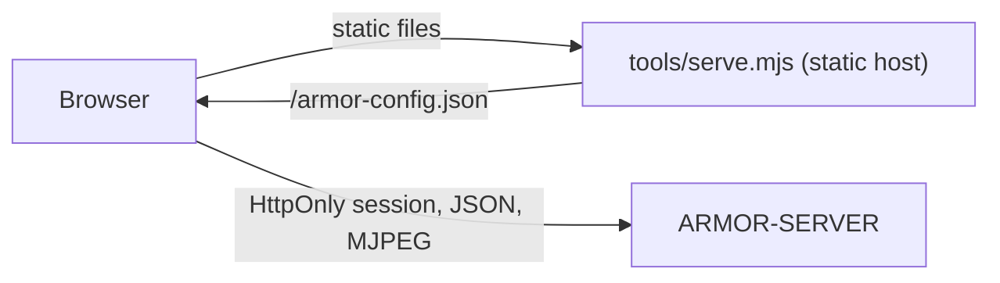

<p align="center">
  
</p>

# 🎛️ ARMOR-STUDIO

<p align="center">
  <a href="README.md">🇺🇸 English</a> |
  <a href="README_spa.md">🇪🇸 Español</a> |
  <a href="README_fra.md">🇫🇷 Français</a> |
  <a href="README_ita.md">🇮🇹 Italiano</a> |
  🇩🇪 <b>Deutsch</b> |
  <a href="README_zho.md">🇨🇳 简体中文</a> |
  <a href="README_jpn.md">🇯🇵 日本語</a> |
  <a href="README_por.md">🇵🇹 Português</a>
</p>

### Betriebs- und Entwurfskonsole: Kameras, Radar, Alarme, Energie, das lokale Netz, Beweise, der Standortplan und die Wartung der Anlage

<p align="center">
  
  
  
  
  
  
  
</p>

---

**Ehrlichkeitsprüfung - was heute läuft:** Studio spricht mit [ARMOR-SERVER](https://github.com/JuanenRac/ARMOR-SERVER) und wird von 1185 Unit-Tests abgedeckt (Einstellungen lesen, Kameras zusammenführen, die Arithmetik der Solardiagramme, Geometrie und Prüfungen der Entwurfswerkzeuge, der Alarmansager, das Wörterbuch des Assistenten, jedes Menü in den acht Sprachen, der statische Host) sowie durch Browsertests. Es läuft im täglichen Einsatz am CM5-Testaufbau mit dem echten Server, echten IP-Kameras und einem Radarknoten auf seiner Platine; die Bilder der Hilfe entstehen mit Beispieldaten. **Nicht** bewiesen sind Livevideo und PTZ mit allen möglichen Kameras, die Menüs für Solar, Elektro, Alarmzentralen und Touchpanel mit echten Geräten (es gibt nur den Radarknoten) sowie eine formale Prüfung auf Barrierefreiheit oder Bedienbarkeit. Solange der Server nicht erreichbar ist, zeigt Studio Demodaten und sagt das in der oberen Leiste.

---

## 📋 Auf einen Blick

| | |
|---|---|
| Version | `0.8.1.4` |
| Reifegrad | Etabliert |
| Rolle | Bedien- und Entwurfskonsole der Familie |
| Technik | React 19, TypeScript, Vite, Three.js, Leaflet |
| Tests | 1185 (`npm test`, Vitest) und Browser-Tests (Playwright) |
| Vertrag | Spricht nur mit ARMOR-SERVER (HTTP `/api/v1/*` mit HttpOnly-Sitzung, WebSocket `/api/v1/events`) |
| Lauscht auf | `127.0.0.1:5178` (`tools/serve.mjs`) |
| Läuft auf | Ein Browser; die Dateien liefert `tools/serve.mjs` oder das nginx des Containers |
| Auf echter Hardware | Täglich am CM5-Testaufbau im Einsatz (echter Server, echte IP-Kameras, ein echter Radarknoten); die Menüs für Solar, Elektro, Alarmzentralen und Touchpanel warten auf echte Knoten |
| Lizenz | GPL-3.0-or-later |

**Springe zu:** [Überblick](#-überblick) · [Architektur](#-architektur) · [Sicherheit](#-sicherheit-und-schutz) · [Schnittstellen](#-schnittstellen) · [Konfiguration](#-konfiguration) · [Schnellstart](#-schnellstart) · [Tests](#-tests) · [Probleme](#-fehlerbehebung) · [Struktur](#-struktur-des-repositorys) · [Verwandte](#-verwandte-projekte)

## 🚦 Projektstatus

Jede Zeile ist ein Teil dieses Repositorys, und die Ampel sagt, wie weit er heute ist. Sie beruht auf dem, was das Repository zeigen kann (Tests, Builds, Läufe), nicht auf dem, was geplant ist.

🟢 Fertig und überprüft · 🟡 Funktioniert, mit bekannten Grenzen · 🟠 Teilweise fertig oder noch nicht überprüft · 🔴 Nicht gemacht oder funktioniert nicht

| Bereich | Stand | Was das hier bedeutet |
|---|---|---|
| Software | 🟢 | Die Konsole läuft täglich gegen den echten Server des CM5-Prüfstands. |
| Tests | 🟢 | 1185 Unit-Tests bestehen (`npm test`) und die Browser-Tests laufen: Einstellungen, Zusammenführen der Kameras, Solardiagramme, Geometrie und Prüfungen der Designer, Alarm-Ansager, Wörterbuch des Assistenten und jedes Menü in den acht Sprachen. |
| Oberfläche | 🟡 | Live-Video und PTZ sind nicht mit jeder möglichen Kamera belegt, es gab keine formale Prüfung der Barrierefreiheit oder Bedienbarkeit, und die Bilder der Hilfe entstehen mit Beispieldaten. |
| Hardware | 🟡 | Er wird täglich mit dem echten Server, echten IP-Kameras und einem echten Radar-Knoten genutzt; die Menüs für Solar, Elektrik, Alarmzentrale und Touch-Panel warten auf echte Knoten. |
| Sicherheit | 🟡 | Sitzungen, Rollen und die Ablehnung von Kamera-Zugangsdaten in Adressen sind durch Tests abgedeckt; es gab keine unabhängige Prüfung. |
| Integration | 🟡 | Solange der Server nicht erreichbar ist, zeigt Studio Demodaten und sagt das in der oberen Leiste. |
| Dokumentation | 🟢 | Acht Sprachen, die eingebaute Hilfe und die geführten Rundgänge, die Sicherheitshinweise und das Änderungsprotokoll sind aktuell. |

## 🎯 Überblick

**ARMOR-STUDIO** ist die Konsole des Bedieners. Sie hält nie ein Kamerapasswort, eine RTSP-Adresse oder ein Token: sie meldet sich mit Benutzername und Passwort am Server an, erhält eine **HttpOnly**-Sitzung von 7 Tagen, und alles Privilegierte läuft über diese Sitzung.

* **Überblick und System:** der Zustand des Perimeters, eine Kachel für jeden Teil (Alarmzentralen, Radar, Kameras, Geräte, Energie, Netzwerk, Server), eine Live-Karte des Plans mit jedem Gerät und Alarm und was Aufmerksamkeit braucht, alles auf einem Bildschirm ohne Scrollen; eine Systemseite und ein Audit-Protokoll für Administratoren.
* **Kameramonitor:** 1, 2, 4, 6, 8, 9, 12 oder 16 Kacheln, die in ihren Rahmen passen (16:9, die ganze Matrix sichtbar, kein Beschnitt), eine vergrößerte Ansicht mit begrenztem PTZ-Pad, Schnappschuss und MP4-Aufnahme; eine **Aufnahmebibliothek** zum Filtern, Ansehen, Abspielen, Schützen und Löschen von Beweisen und zum Herunterladen eines **Verwahrungsnachweises**.
* **Alarme:** was jetzt eine Person braucht, mit Quittieren und abgeschlossenem Protokoll; eine **Prüfung vor dem Scharfschalten** und eine PIN zum Unscharfschalten; Alarme auf der Live-Karte; ein Ton für jede Stufe, eine gesprochene Stimme mit eigenen Stilen (neutral, Actionheld, dunkler Lord, theatralisch), die auch sagt, wenn sich etwas verbindet, Hinweisfenster, eine Stumm-Taste neben der Hilfe und ein optionaler Sprung ins passende Menü.
* **Geräte und Automationen:** Rauch, Gas, Wasser, Tür, Fenster, Bewegung, Klima, Steckdose, Licht, Sirene, Schloss, Rollladen, Tor, Garagentor und Warmwasserbereiter über WLAN, Zigbee, Bluetooth oder Kabel (Vorlagen für Zigbee2MQTT, Tasmota und Shelly); Regeln aus jeder Alarmquelle, auch mit Schwellwerten, die Geräte schalten, wenn etwas geschieht; eine große Taste Scharf / Unscharf.
* **Alarmzentralen und Alarm-Designer:** der Zustand jedes ARMOR-NODE-ALARM-Knotens, seine Zonen und Ereignisse, die den Zonen zugeordneten Zigbee-Sensoren und ein Designer, in dem Sie die Alarmanlage des Hauses zeichnen (Zentralen, Kontakte, Bewegung, Rauch-, Gas- und Wassermelder, Sirenen, Tastaturen, Verdrahtung und Funkverbindungen) und jedes gezeichnete Element einer echten Zone zuordnen.
* **Solar- und Elektroenergie:** das Menü *Wechselrichter* zeichnet das Haus als animierten Energiefluss mit Anzeigen, Werten und Verlaufsdiagrammen; *Batterien* zeigt jeden Stapel mit seinen Kapazitäten, jedes Modul und jede Zelle; *Elektro* zeigt den Netzeingang, jeden Kanal und die Alarme der Zähler; in beiden melden Sie Ihre Geräte an (Voltronic, MPP Solar, Pylontech, ANT-BMS…), und eine Taste *Beispielwerte zeigen* lässt Sie das Menü zuerst ausprobieren.
* **Elektro-Designer:** zeichnen Sie den Elektroplan des Hauses (Netz, Zähler, Schutzorgane, Umschalter, Verteilung, PV, Wechselrichter, Batterien und Lasten, AC und DC), verbinden Sie ihn mit den Solargeräten, die der Server liest, um Live-Werte zu sehen, und lassen Sie die Prüfungen ihn durchsehen (zwei Quellen auf einer Leitung, Sicherungen und Kabel gegen den Strom…).
* **Radar:** eine Live-Karte nach Ihrem Standortplan mit den Zielen, die jedes Radar meldet, ihrem letzten Weg und den **zu ignorierenden Bildzonen**; Live-Zustand der Knoten, stumme als *veraltet*; das eigene Panel jedes Knotens einen Klick entfernt.
* **Standort-Designer:** zeichnen Sie das Gelände, Gebäude mit mehreren Etagen und fünf Dacharten, Türen, Fenster, Lampen, Schornsteine, Solarmodule, Masten, Straßen und Wege, dann Kameras und Radare, wo Sie möchten; ein 2D-Plan im CAD-Stil und eine drehbare 3D-Ansicht Etage für Etage; Rückgängig und Wiederholen; Versionen des Plans.
* **Lokales Netz:** das Menü *Netzwerk* zeigt, was der ARMOR-NETWORK-Knoten meldet (Geräte, Ausfälle, den Internetzustand und die **öffentliche Adresse** mit Anbieter und Ort), lässt Sie Geräte benennen, verbergen und beobachten, einen Scan, einen Ping oder eine Prüfung mit einem von Ihnen gegebenen Login beauftragen, und der *Netzwerk-Designer* zeichnet es.
* **Automatische Aufnahme:** unter *Konfiguration > Automatische Aufnahme* von selbst gemachte Fotos und Videos, wenn eine Kamera bei scharfem System etwas sieht (wie viele Fotos, wie oft, wie lang ein Clip), und die zu ignorierenden Bildzonen, auf den Kamerabildausschnitt gezeichnet.
* **Knoten-Firmware und Updates:** *Knoten-Firmware* aktualisiert die Feldknoten nacheinander, mit einem Balken für die ganze Arbeit und für jeden Knoten, und behält ihren Zustand, wenn Sie ein Alarm in ein anderes Menü führt; *Updates* installiert neue Versionen von Studio und Server von GitHub (mit den Neuigkeiten der neuen Version), die des Betriebssystems und eine optionale Wartungskonsole.
* **Konfiguration in Gruppen:** Allgemein und Einstellungen; Benutzer, Benachrichtigungen und Automatische Aufnahme; Knoten-Firmware und Updates; Server, Dienste, MQTT-Broker, Einstellungsdateien, Installation und Konsole; und jedes Menü der Seitenleiste ist ebenfalls in einklappbaren Gruppen (Überwachung, Sicherheit, Energie, Haus und Netz, Entwurf, Administration).
* **Acht Sprachen** (Englisch, Spanisch, Deutsch, Französisch, Italienisch, Japanisch, Chinesisch und Portugiesisch) und sechzehn Themen, das Standardthema heißt *Armor*; Sprache, Thema und Wetterort folgen dem Konto, nicht dem Browser. Rollen: Administrator, Operator und **Viewer**, der nur ansieht.
* **Eine Hilfe, die das ganze System kennt:** ein Buch mit vier Detailstufen und einem Bild mit Beispieldaten für jedes Hauptmenü, eine geführte Schritt-für-Schritt-Tour für jedes Menü, die Bedienelement für Bedienelement vorgeht (was jeder Knopf tut, was zu erwarten ist und die üblichen Fehler) mit eigenem Maskottchen und eigener Stimme, eine Hilfe, die die Feldknoten im Detail erklärt (Einrichtungs-WLAN, Zugangspunkt und Station, Bluetooth-PIN, Firmware-Slots mit Rückfall, signierte Updates, das Panel von außen), Hinweise zu allem und ein **Assistent** (ein Maskottchen, das Sie überallhin ziehen, wo Sie wollen fixieren und schriftlich fragen können) mit einem Wörterbuch in acht Sprachen und einer Sprechblase, die sich auf der Seite mit Platz öffnet. Die Menüs, in denen Sie arbeiten, bleiben offen, während Sie ein anderes besuchen.
* **Zugriff von außen mit Auswahl statt Dateien:** In Sicherheit richtet ein Administrator das WireGuard-VPN ein, fügt ein Handy per QR-Code hinzu, hält einen Namen aktuell, der dem Haus folgt (DuckDNS, Cloudflare oder eine beliebige Adresse), und trägt die Knoten ein, deren eigenes Panel von außen über den Server geöffnet werden kann, wobei der Zertifikat-Fingerabdruck vor dem Vertrauen verglichen wird; jeder Schritt erklärt sich in acht Sprachen und verlangt von außen erneut das Passwort.
* **Von außen ins Haus, Schritt für Schritt:** in Konfiguration > Sicherheit zeigt eine Anleitung mit sechs Schritten, ob der Rechner es kann, das VPN existiert, das Haus einen Namen hat, der Port am Router offen und das Handy hinzugefügt ist, und wie man es mit mobilen Daten testet; die Registerkarte Sicherheit ist in drei Abschnitte mit Titel gegliedert.
* **Karte zur Broker-Verschlüsselung:** Konfiguration > Broker zeigt, ob die Verbindung des Servers zum Broker verschlüsselt ist, und den Fingerabdruck der eigenen Zertifizierungsstelle der Anlage, der er vertraut; bei unverschlüsselter Verbindung wird nichts Alarmierendes angezeigt, denn das ist der Standard.
* **Zustand der Knoten und Scharfschaltmodi:** System hat eine Karte mit dem Zustandsbericht jedes Knotens (Laufzeit, Neustartgrund, Speicher, Verbindung und Signal, Brokerverbindungen, letzter Fehler, Verlauf und Neustarts), und Alarmzentralen hat eine Modusauswahl (Abwesend, Zuhause, Nacht und eigene) mit einem Editor für die Modi, alles in acht Sprachen mit Hilfe, Tourschritten und Antworten des Assistenten.
* **Anmeldung für Passwortmanager und ein Verlauf mit Reitern:** Die Anmeldung ist ein echtes Formular, das der Passwortmanager des Browsers oder Systems speichern und ausfüllen kann, mit einem optionalen "Angemeldet bleiben", das nur den Benutzernamen (nie das Passwort) merkt, und einem Hinweis dazu; der Verlauf hat die Reiter Alle, Alarme, Verbindungen, Geräte, System und Einstellungen, mit der Liste jedes Geräts und jeder App, die sich mit dem Server verbindet (zuletzt gesehen, offene Sitzungen, Anmeldungen und Ablehnungen), und den Ereignissen der Knoten, des Brokers, der Dienste, Updates und des Scharfschaltens. Adressen sehen nur Administratoren.
* **Batteriewartung (Konfiguration, Administratoren):** ein Assistent in vier Schritten - Batterie und Operation, Werte, Bestätigung mit eingetippter Seriennummer der Batterie, Ergebnis - um zu ändern, was eine Pylontech-Batterie speichert; Grenzwerte in Volt und Grad jeweils als ganze Gruppe, eine Firmware-Datei wird vor dem Senden gelesen, die Batterie davor und danach mit Unterschied und Protokoll, und ein Ausgang lässt sich wie vorher zurücksetzen.
* **Steuerung der Knoten über die Gesundheitskarte:** Jeder Knoten hat ein Menü (Neustart, Pause oder Fortsetzen, Standby - Arbeit aus, bleibt verbunden - oder Einschalten, Identifizieren, Diagnose, Wartung ein oder aus), und die Karte bietet die Gruppenaktionen Alle neu starten (gleichzeitig oder nacheinander mit der Alarmzentrale zuletzt), Alle pausieren, Alle in Standby und Alle fortsetzen. Der Name des Knotens (oder das Wort RESTART, PAUSE oder STANDBY für alle) wird erneut getippt, und es wird ein frischer Identitätsnachweis verlangt; Marken folgen jedem Knoten (gesendet, bestätigt, offline, zurück, angewendet) und zeigen Pausiert, Standby seit wann und durch wen sowie Wartung; und die Warnungen sagen, wann eine pausierte oder im Standby befindliche Alarmzentrale oder ein Radar das Haus ungeschützt lässt. Es gibt kein Zurücksetzen auf Werkseinstellungen, kein Löschen und keinen Tiefschlaf.
* **Live-Status:** Studio hört den Live-Kanal des Servers (ein WebSocket) ab und zeigt einen Alarm, ein Scharfschalten oder einen zurückkehrenden Knoten sofort an; solange der Kanal offen ist, wird der Status nur alle zwanzig Sekunden als Sicherheitsnetz abgefragt, die untere Leiste zeigt *Live*. Die Designer für Alarm, Elektrik und Netzwerk reagieren zusätzlich auf F (einpassen), Plus und Minus (Zoom) und Strg+D (duplizieren).
* **Das Anmeldelimit eines Knotens:** Jeder Knoten der Listen (Radar, Wechselrichter, Batterien, Elektro und Wandbildschirme) hat eine Schaltfläche, die einen Dialog zum Lesen und Ändern von `system.login_limit_per_minute` öffnet (falsche Passwörter pro Minute, bevor der Knoten die Anmeldung sperrt: standardmäßig 30, 0 für kein globales Limit, höchstens 120). Die Anmeldung am Panel des Knotens wird einmal benutzt und nie gespeichert; Dialog und Hilfe gibt es in den acht Sprachen.
* **Ein Zähler, der nicht mehr antwortet, und ein Firmware-Image für eine andere Platine:** Ein Elektrokanal mit altem Messwert wird ausgegraut und mit „keine Daten“ markiert, und die Karte zählt sie (Konfiguration > Sicherheit, `electrical.set_aside_old_readings`, standardmäßig an); ein Firmware-Update, dessen Dateiname eine andere Platine als die des Knotens nennt, oder ein Knoten einer anderen Art wird mit einer klaren Begründung statt eines Codes abgelehnt.
* **Entwurfshilfen, standardmäßig aus:** Wer unter Konfiguration > Einstellungen die *Entwurfshilfen* einschaltet, erhält im Alarmplaner drei Vorlagen (Wohnung, Laden und Halle mit Außenschutz, jeweils eine Datendatei, die gegen ein Schema geprüft wird) und im Lageplan eine *Abdeckungs*-Prüfung: die Gebäudeteile, die kein Radar erfasst, die Türen und Fenster, die nichts überwacht, die Stellen, die zwei Radare zugleich beobachten, jeweils mit einer Position für ein Radar, die blinden Flecken im Plan und den Bericht als JSON oder CSV. Sie ist eine flache Hilfe, die nur zählt, was sicher erfasst ist (Wände versperren die Sicht und jedes Radar wird um einen selbst gesetzten Abstand verkleinert), kein Beweis, dass ein Gebäude geschützt ist; siehe [docs/DESIGN_AIDS.md](docs/DESIGN_AIDS.md).
* **Scharfschaltmodi des Systems (Abwesend, Zuhause, Nacht):** Schaltet ein Administrator unter Konfiguration > Sicherheit *Scharfschaltmodi Zuhause und Nacht* ein, öffnet die Schaltfläche zum Scharfschalten einen Dialog, um in einem Modus scharf zu schalten, zwischen ihnen zu wechseln oder unscharf zu schalten; ein Modus ohne Schutzobjekte verlangt eine Bestätigung, und ein Wechsel zu einem Modus mit weniger Schutz verlangt die PIN wie das Unscharfschalten. Der Alarm-Designer erhält einen Reiter *Modi*, um für Zuhause und Nacht ganze Zonen (die Orte der Geräte), Sensoren, Radarknoten und Kameras zu markieren (sie beginnen leer) sowie Ausgangs- und Eingangsverzögerung und einen Zeitplan. Drei weitere Optionen (die PIN für den Wechsel zu einem Modus mit weniger Schutz, der Zeitplan und ob er den Schutz verringern darf) stehen unter Konfiguration > Sicherheit. Standardmäßig aus: bei ausgeschalteter Option schaltet die Konsole genau wie bisher scharf und unscharf.

## 🧩 Rolle in A.R.M.O.R.

Studio ist das Fenster des Bedieners auf das ganze System. Es spricht nie mit einem Knoten: alles läuft über [ARMOR-SERVER](https://github.com/JuanenRac/ARMOR-SERVER), das als Einziges entscheidet (die einzige Ausnahme ist ein Link zum eigenen Panel jedes Knotens). Hier werden auch Standort, Alarmanlage, Elektroinstallation und Netzwerk entworfen, die Firmware der Knoten und die Updates der Anlage selbst gesteuert, und hier leben die Hilfe und der Assistent. Denselben Server nutzt [ARMOR-ANDROID-CONTROL](https://github.com/JuanenRac/ARMOR-ANDROID-CONTROL) auf dem Telefon.

| Er spricht mit | Wie | Wozu |
|---|---|---|
| ARMOR-SERVER | HTTP, WebSocket und MJPEG mit der HttpOnly-Sitzung | alles: Zustand, Befehle, Entwürfe, Kameras |
| Das eigene Panel jedes Knotens | ein Link über den Proxy des Servers | die einzige Ausnahme von "spricht nie mit einem Knoten" |
| Wetterdienste | Open-Meteo, RainViewer, EUMETSAT, ArcGIS | nur das Wetter-Menü, nur mit gespeichertem Ort |
| ARMOR-DEVOPS | installiert den Stack auf dem CM5-Prüfstand | Bereitstellung |

## 🏛️ Architektur

<p align="center">
  
</p>

<details>
<summary>Textversion des Diagramms (Mermaid)</summary>



</details>

## 🖼️ Screenshots

Aufgenommen mit 1920×1080 auf einem Prüfstand, mit Beispieldaten und ohne eine echte Anlage dahinter.

<table>
<tr><td width="50%" valign="top"><br><sub>Übersicht: Zustand des Perimeters, Alarme, Radarknoten, Energie und die Live-Karte des Geländes auf einem Bildschirm.</sub></td><td width="50%" valign="top"><br><sub>Radar: die Ziele, die jedes Radar sieht, auf dem Plan des Geländes, mit dem Bereich, den jeder Sensor abdeckt.</sub></td></tr>
<tr><td width="50%" valign="top"><br><sub>Wechselrichter: der Energiefluss zwischen Solarmodulen, Netz, Haus und Batterien, nur lesend.</sub></td><td width="50%" valign="top"><br><sub>Standort-Designer: Gelände, Gebäude, Kameras und Radare auf dem Plan, den der Rest von Studio verwendet.</sub></td></tr>
<tr><td width="50%" valign="top"><br><sub>Elektro-Designer: der AC- und DC-Plan des Hauses mit seinen Prüfungen, aus einem fertigen Beispiel.</sub></td><td width="50%" valign="top"><br><sub>Alarmzentralen: ob jede überwacht, ihre Zonen und was zuletzt geschah.</sub></td></tr>
</table>

## 🔒 Sicherheit und Schutz

* **Keine Geheimnisse im Browser.** Kamerapasswörter werden einmal eingegeben, an den Server gesendet und danach nur als maskierter Zustand „gespeichert“ gezeigt. Standortexporte lassen Benutzernamen und Zugangsdaten-Markierungen weg.
* **Gespeicherte Einstellungen sind nicht vertrauenswürdige Eingabe.** Sie werden Wert für Wert gelesen: ein ungültiger Ursprung, ein ungültiges Thema, eine ungültige Sprache oder Form wird verworfen, Positionen werden begrenzt und Listen gekappt.

| Bedrohung | Abwehr |
|---|---|
| Geheimnisse im Browser | Nie werden Passwort, Token, Sitzung oder Kameraanmeldedaten gespeichert; eine Standbild-Adresse mit Login (`user:pass@` oder `?pwd=`) wird abgelehnt; beim Abmelden werden Konsole und Firmware-Aufträge geleert |
| Sitzungsdiebstahl | HttpOnly-Cookie mit SameSite=Strict vom Server gesetzt (`armor_studio_sid`, bei HTTPS `__Host-armor_studio_sid`); Studio prüft sie jede Minute |
| Manipulierter Browser-Speicher | Alles aus `localStorage` wird Wert für Wert geprüft: ungültiger Ursprung, ungültiges Thema, ungültige Sprache oder Form wird verworfen, Positionen werden begrenzt, Listen gekappt; das Speicherschema ist versioniert |
| Eine bösartige Serveradresse | Nur ein einfacher `http(s)`-Ursprung: ohne Zugangsdaten, Pfad, Query oder Fragment |
| Injection, Clickjacking und Lecks | `Content-Security-Policy: default-src 'self'; script-src 'self'; object-src 'none'; base-uri 'none'; frame-ancestors 'none'`, `connect-src` nur für die konfigurierten Server und die Wetterdienste, `nosniff`, `no-referrer`, `Cross-Origin-Opener-Policy: same-origin` und eine `Permissions-Policy`, die Kamera, Mikrofon und Standort abschaltet |
| Verlorene Sicherheits-Header hinter nginx | `security_headers.conf` ist in jedem `location` eingebunden (nginx erbt `add_header` nur, wenn der `location` keine eigenen hat) |
| Gefährliche Befehle an die Knoten | Nur Administratoren; der Knotenname (oder RESTART, PAUSE, STANDBY für alle) wird erneut getippt und das Passwort erneut verlangt; es gibt keinen Lösch-, Werksreset- oder Ausschaltbefehl |
| Rollen | Administrator, Bediener, Betrachter (schaut nur) und Wandpanel (sein Konto kann Studio nicht nutzen); die `capabilities` der Sitzung bestimmen, was angezeigt wird, und der Server prüft erneut |

**Nur das Wetter-Menü erreicht andere Dienste.** Schriften sind lokal und sonst fragt nichts einen Dritten an. Das Wetter-Menü, und nur bei einem Konto mit gespeichertem Ort, lädt Open-Meteo (Vorhersage, Geokodierung, Luftqualität), RainViewer (Radar), EUMETSAT (Wolken) und ArcGIS (Kartenkacheln). Der statische Host sendet `Content-Security-Policy: default-src 'self'`, beschränkt auf den konfigurierten Server und diese Dienste, `frame-ancestors 'none'`, `nosniff` und `no-referrer`.

**Schalter.** *Konfiguration > Sicherheit* hat ein Bedienelement für jeden der 17 Schutzmechanismen, die ARMOR-SERVER einem Administrator zum Einstellen überlässt (Entschärf-PIN, Stummschalten per Sprache, Signatur des Alarmentwurfs, Zonen-Feed, Kameratunnel, Netzwerk-Logins, Warnung bei Anmeldung aus einem neuen Land, Beiseitelegen alter Elektro-Messwerte, Live-Ereignisse des Wandpanels, Gerätesperre, Verschlüsselung des Knotenspeichers und die Audiogrenzen), jeweils mit konservativem Standard; der Server hält das Absenken im Audit fest. Einzelheiten in [docs/SECURITY_MODEL.md](docs/SECURITY_MODEL.md). Eine unabhängige Sicherheitsprüfung gab es nicht.

## 🔌 Schnittstellen

| Route | Authentifizierung | Was sie tut |
|---|---|---|
| `/api/v1/*` | Sitzungs-Cookie | der Client des Servers, nach Bereichen in `src/api/` geteilt; `src/api/routes.test.ts` und `src/api/contract/` prüfen ihn gegen den Vertrag |
| `WS /api/v1/events` | Sitzung | Live-Status: ein Alarm, ein Scharfschalten oder ein zurückkehrender Knoten erscheint sofort; bei offenem Kanal wird der Status nur alle 20 Sekunden als Sicherheitsnetz abgefragt (ohne ihn alle 3 Sekunden); die untere Leiste zeigt *Live* |
| MJPEG, Standbilder, Aufnahmen | Stream-Ticket | Live-Video nur über eine Adresse, die der Server an einen Bediener ausgibt; die Kamerapasswörter erreichen den Browser nie |
| `GET /armor-config.json` | keine | `{"serverOrigin": "<Ursprung>" / "same-origin"}`, von `tools/serve.mjs` oder nginx geliefert |

## ⚙️ Konfiguration

| Einstellung | Standard | Was sie tut |
|---|---|---|
| `ARMOR_STUDIO_HOST` | 127.0.0.1 | Adresse, auf der der statische Host lauscht |
| `ARMOR_STUDIO_PORT` | 5178 | Port; der `studio_port` einer aus Studio gespeicherten `connection.json` gewinnt |
| `ARMOR_STUDIO_DIST` | ./dist | der Ordner des auszuliefernden Builds |
| `ARMOR_SERVER_ORIGIN` | leer | ein oder mehrere Ursprünge (kommagetrennt), mit denen Studio startet; legt das `connect-src` der Richtlinie fest; leer akzeptiert den Server, an dem man sich anmeldet |
| `TLS_CERT_PATH`  `TLS_KEY_PATH` | aus | beide oder keines: natives HTTPS des statischen Hosts |
| `ARMOR_PUBLIC_ORIGIN`  `ARMOR_SERVER_UPSTREAM` | same-origin | im Container: was `/armor-config.json` sagt, und `host:port` des Servers, an den nginx `/api/` weiterleitet |

Ohne konfigurierten Ursprung nutzt der Client `http://127.0.0.1:8080`. Sprache, Thema (sechzehn) und Wetterort folgen dem Konto, nicht dem Browser. `tools/serve.mjs` liest die obigen Variablen; zur Installation des ganzen Stacks auf dem CM5-Prüfstand siehe [ARMOR-DEVOPS](https://github.com/JuanenRac/ARMOR-DEVOPS).

## 🚀 Schnellstart

**Voraussetzungen:** Node.js 22+ und ein laufender ARMOR-SERVER (sonst zeigt Studio Demodaten und sagt das in der oberen Leiste).

```powershell
npm install                                                                    # Abhängigkeiten
npm run dev                                                                    # http://127.0.0.1:5178 gegen einen Server auf 127.0.0.1:8080
npm run typecheck                                                              # tsc -b --noEmit
npm run locales                                                                # die Tabelle jeder Sprache nach einer Änderung schreiben
npm test                                                                       # 1185 Tests
npm run build                                                                  # dist/
$env:ARMOR_SERVER_ORIGIN = "http://192.168.0.180:18080"; node tools/serve.mjs  # den Build ausliefern
```

## 🧪 Tests

```powershell
npm run typecheck      # tsc -b --noEmit
npm test               # vitest run
npm run lint           # eslint src
npm run locales:check  # die acht Tabellen sind erzeugt
python -I tools/armor_ci_validate.py
```

| Bereich | Was er abdeckt |
|---|---|
| Einstellungen, Kameras und die Radarkarte | Auswertung gespeicherter Einstellungen, Kamera-Zusammenführung, Radarziele und Ignorierzonen |
| Energie | die Arithmetik der Solardiagramme und der Batterie- und Elektro-Menüs |
| Designer | Geometrie, Operationen und Prüfungen der Standort-, Elektro-, Alarm- und Netzwerk-Designer |
| Alarme und Assistent | der Ansager für Alarme und Verbindungen, das Wörterbuch des Assistenten und die Touren |
| Jedes Menü in acht Sprachen | jeder Bildschirm wird in jeder Sprache gezeichnet, ohne Satz mit rohem Schlüssel |
| API-Client und statischer Host | die Routen und Verträge von `src/api/` und `tools/serve.test.mjs` (Header, `/armor-config.json`, natives TLS) |
| Browser-Tests | `e2e/tests` mit Playwright gegen einen Stack mit echtem Server (`e2e/README.md`) |

Der Test des nativen TLS des statischen Hosts braucht installiertes `openssl`. `npm run locales:check` schlägt fehl, wenn die Tabelle einer Sprache nicht aus ihren Sätzen erzeugt ist. GitHub Actions führt bei jedem Push und Pull Request die A.R.M.O.R.-Basis aus: die Prüfung von Manifest, Version, Änderungsprotokoll und README-Parität, dann den eigenen Build und die eigenen Tests des Projekts.

## 🏗️ Build und Veröffentlichung

`npm run build` schreibt die statische Seite nach `dist/`; das `Dockerfile` baut sie mit Node 22 und liefert sie mit nginx aus (`nginx/`). Die Version steht in `package.json`, in `armor.project.json` und im README-Badge (aus dem Manifest gelesen); jede Version hat ihren Eintrag in [CHANGELOG.md](CHANGELOG.md). Releases werden auf GitHub veröffentlicht.

## 🩺 Fehlerbehebung

| Du siehst | Weil | Tu |
|---|---|---|
| Demodaten und ein Hinweis in der oberen Leiste | der Server ist nicht erreichbar | ARMOR-SERVER starten und den Ursprung der Anmeldung prüfen |
| Der Browser blockiert jede Anfrage an den Server | der Ursprung steht nicht im `connect-src` der Richtlinie | in `ARMOR_SERVER_ORIGIN` ergänzen (kommagetrennt) oder Studio und Server vom selben Ursprung ausliefern |
| Ein Befehl wird mit `elevation_required` (403) abgelehnt | eine kritische Aktion braucht einen aktuellen Identitätsnachweis | Studio fragt das Passwort erneut ab; eingeben und wiederholen |
| Der Passwortmanager bietet das Speichern nicht an | die Anmeldung ist ein echtes Formular; manche Manager warten auf die erste erfolgreiche Anmeldung | einmal anmelden; "Angemeldet bleiben" speichert nur den Benutzernamen, nie das Passwort |

## 📂 Struktur des Repositorys

<p align="center">
  
</p>

<details>
<summary>Textversion des Baums</summary>

```text
ARMOR-STUDIO/
├── src/
│   ├── App.tsx                       die Hülle: Menüs, Gruppen, Live-Status
│   ├── api/                          der Client des Servers, eine Datei je Bereich
│   ├── views/                        Übersicht, Kameras, Radar, Alarme, Energie, Netz, System
│   ├── components/                   Kamerakacheln, Kopfleiste, Seitenleiste, Hilfe, Karte
│   ├── designer/                     der Standort-Designer, 2D-Plan und 3D-Ansicht
│   ├── electrical/ alarm/ network/   die Elektro-, Alarm- und Netzwerk-Designer
│   ├── alerts/ assistant/ tour/      Klänge und Stimme, das Maskottchen, geführte Touren
│   ├── weather/ help/ preflight/     Wetter-Menü, Hilfebuch, Prüfung vor dem Scharfschalten
│   └── locales/                      die Tabelle jeder Sprache (erzeugt)
├── public/                           die Bilder der Hilfe, ein Satz je Sprache
├── nginx/                            Webserver des Images und seine Header
├── e2e/                              Browser-Tests (Playwright)
├── tools/                            serve.mjs (der statische Host), build_locales.mjs, die gemeinsamen CI-Prüfungen und der Starter
├── docs/                             das Sicherheitsmodell
├── images/                           Banner, Symbol und die Bilder des READMEs
├── .github/                          CI-Workflow, Dashboard-Hinweis, Vorlagen für Issues und Pull Requests
├── Dockerfile                        Container-Image: Node-Build, nginx-Host
├── armor.project.json                Manifest: Version, Rolle, Reife
├── CHANGELOG.md                      was sich in jeder Version geändert hat
├── package.json package-lock.json    Abhängigkeiten und Skripte
├── index.html                        die Seite, aus der Vite die App baut
├── vite.config.ts eslint.config.js   Einstellungen für Bundler und Lint
├── tsconfig.json tsconfig.app.json   TypeScript-Einstellungen
├── run.sh run.bat                    Start, gemeinsamer Ablauf
├── build.sh build.bat                Bauen und Testen, gemeinsamer Ablauf
├── build-test.sh build-test.bat      Bauen, Testen und Verpacken
├── test.sh test.bat                  nur die Tests, nie die Version
└── SECURITY.md SUPPORT.md CONTRIBUTING.md CODE_OF_CONDUCT.md LICENSE
```

</details>

## 🗺️ Roadmap und bekannte Grenzen

**Bekannte Grenzen heute**

* Live-Video und PTZ sind nicht mit allen möglichen Kameras erprobt.
* Die Menüs für Solar, Elektro, Alarmpanel und Touchpanel warten auf echte Knoten: Es gibt nur den Radar-Knoten.
* Es gab keine formale Prüfung von Barrierefreiheit oder Bedienbarkeit, und die Bilder der Hilfe nutzen Beispieldaten.
* Keine unabhängige Sicherheitsprüfung.

**Als Nächstes**

* Die Menüs der anderen Knoten mit ihren Platinen ausprobieren.
* Barrierefreiheit und Bedienbarkeit prüfen.

## 🌍 Sprachen

README und Texte gibt es auf Englisch, Spanisch, Französisch, Italienisch, Deutsch, Chinesisch, Japanisch und europäischem Portugiesisch.

## 🔗 Verwandte Projekte

**A.R.M.O.R.** (Autonomous Radar & Multimodal Observation Range) ist ein Perimeter-Sicherheitssystem aus unabhängigen Repositorys. Jedes hat eine eigene Version, eigene Tests und ein eigenes README; hier ist die Familie:

* **[ARMOR-COMMON](https://github.com/JuanenRac/ARMOR-COMMON)** - Nachrichtenverträge, Validierer, Konformitätsvektoren und generierte Typen
* **[ARMOR-NODE-RADAR](https://github.com/JuanenRac/ARMOR-NODE-RADAR)** - Feldknoten-Firmware für ESP32-S3 mit drei Radaren und eigenem Web-Panel
* **[ARMOR-NODE-SOLAR](https://github.com/JuanenRac/ARMOR-NODE-SOLAR)** - Protokolle für Solar-Wechselrichter und -Batterien und die Nachrichten eines Gateway-Knotens
* **[ARMOR-NODE-ELECTRICAL](https://github.com/JuanenRac/ARMOR-NODE-ELECTRICAL)** - Elektroknoten: Zähler, die Nachricht der Netzmesswerte und die Regeln fürs Schalten
* **[ARMOR-NODE-ALARM](https://github.com/JuanenRac/ARMOR-NODE-ALARM)** - Alarmknoten und Alarmzentrale: Zonen, Scharfschalten, Verzögerungen, Sirene und PIN, mit dem Server oder ohne ihn
* **[ARMOR-NODE-HMI](https://github.com/JuanenRac/ARMOR-NODE-HMI)** - Touch-Panel: der Systemzustand auf einem Wandbildschirm, Scharf- und Quittieren sowie das Zuhause des Sprachassistenten
* **[ARMOR-NETWORK](https://github.com/JuanenRac/ARMOR-NETWORK)** - Das lokale Netzwerk: seine Geräte, das Internet und was sich ändert
* **[ARMOR-SERVER](https://github.com/JuanenRac/ARMOR-SERVER)** - Zentraler Koordinator: Telemetrie, Alarme, Geräte, Solarmesswerte und Kameras
* **ARMOR-STUDIO** (dieses Repository) - Web-Konsole: Kameras, Radar, Alarme, Solarenergie und 2D/3D-Standortdesigner
* **[ARMOR-ANDROID-CONTROL](https://github.com/JuanenRac/ARMOR-ANDROID-CONTROL)** - Android-Bedienclient mit Live-Radar in 2D/3D
* **[ARMOR-IOS-CONTROL](https://github.com/JuanenRac/ARMOR-IOS-CONTROL)** - iPhone-Bedienclient
* **[ARMOR-SERVER-AI](https://github.com/JuanenRac/ARMOR-SERVER-AI)** - Visuelle Inferenzrichtlinie, die ihre Entscheidungen erklärt und nie handelt
* **[ARMOR-VISION](https://github.com/JuanenRac/ARMOR-VISION)** - Kamerazonen, Masken und Erkennungsregeln für den Jetson Orin NX
* **[ARMOR-VOICE-AI](https://github.com/JuanenRac/ARMOR-VOICE-AI)** - Offline-Sprachabsichten mit einer nicht fälschbaren Bestätigung
* **[ARMOR-HARDWARE](https://github.com/JuanenRac/ARMOR-HARDWARE)** - Gehäuse, Elektronik und die Abnahmematrix am Prüfstand
* **[ARMOR-DEVOPS](https://github.com/JuanenRac/ARMOR-DEVOPS)** - Bereitstellung, CM5-Prüfstand, Backup und TLS
* **[ARMOR-SIMULATOR](https://github.com/JuanenRac/ARMOR-SIMULATOR)** - Offline-Telemetriesimulator mit wiederholbaren Fehlern
* **[ARMOR-UPDATER](https://github.com/JuanenRac/ARMOR-UPDATER)** - Erkennt, installiert und aktualisiert die eigenen Repositorys des Ökosystems
* **[ARMOR-DOCS](https://github.com/JuanenRac/ARMOR-DOCS)** - Architektur, Sicherheitsgrundlage und die Fähigkeitsmatrix

## 📚 Dokumentation

* [Entwurfshilfen](docs/DESIGN_AIDS.md): die Alarmvorlagen und die Abdeckungsprüfung des Lageplans
* [Sicherheitsmodell](docs/SECURITY_MODEL.md): was der Browser speichert, die Header und die Befehle an die Knoten
* [Browser-Tests](e2e/README.md): wie man sie gegen einen Stack ausführt
* [Fähigkeitsmatrix: was belegt ist und was nicht](https://github.com/JuanenRac/ARMOR-DOCS/blob/main/docs/CAPABILITY_MATRIX.md)
* [Projektkatalog: Versionen und wie die Repositorys voneinander abhängen](https://github.com/JuanenRac/ARMOR-DOCS/blob/main/docs/PROJECT_CATALOG.md)
* [Änderungsverlauf dieses Repositorys](CHANGELOG.md)

## 🤝 Mitwirken und Community

* Führe vor einem Pull Request `python -I tools/armor_ci_validate.py` und die Tests aus: Beide müssen bestehen. Siehe [CONTRIBUTING.md](CONTRIBUTING.md) und den [Verhaltenskodex](CODE_OF_CONDUCT.md).
* Das README gibt es in acht Sprachen, und es wird aus den Quellen in ARMOR-DOCS erzeugt: Eine Textänderung erfolgt dort.
* Eine Änderung an einer Nachricht zwischen Komponenten beginnt in ARMOR-COMMON.
* Beschreibe nichts als auf einer Platine funktionierend, was nur gebaut wurde.
* Melde eine Schwachstelle privat: [SECURITY.md](SECURITY.md). Fragen, Ideen und Meldungen: electrohobby3d@gmail.com ([SUPPORT.md](SUPPORT.md)).

## 👤 AUTOR

**JuanenRac (Electro Hobby 3D)** · electrohobby3d@gmail.com

## 📜 LIZENZ

GPL-3.0-or-later - siehe [LICENSE](LICENSE).
