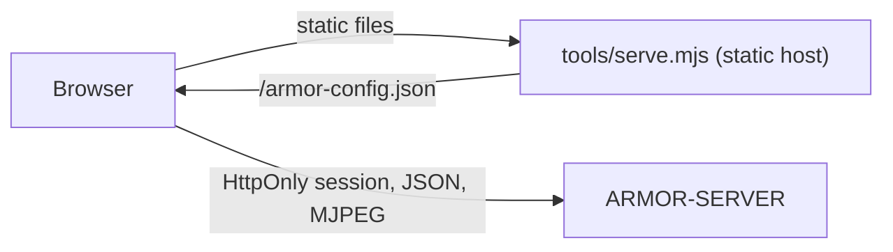

<p align="center">
  
</p>

# 🎛️ ARMOR-STUDIO

<p align="center">
  <a href="README.md">🇺🇸 English</a> |
  <a href="README_spa.md">🇪🇸 Español</a> |
  <a href="README_fra.md">🇫🇷 Français</a> |
  <a href="README_ita.md">🇮🇹 Italiano</a> |
  🇩🇪 <b>Deutsch</b> |
  <a href="README_zho.md">🇨🇳 简体中文</a> |
  <a href="README_jpn.md">🇯🇵 日本語</a> |
  <a href="README_por.md">🇵🇹 Português</a>
</p>

### Betriebs- und Entwurfskonsole: Kameras, Radar, Alarme, Energie, das lokale Netz, Beweise, der Standortplan und die Wartung der Anlage

<p align="center">
  
  
  
  
  
  
  
</p>

---

**Ehrlichkeitsprüfung - was heute läuft:** Studio spricht mit [ARMOR-SERVER](https://github.com/JuanenRac/ARMOR-SERVER) und wird von 740 Unit-Tests abgedeckt (Einstellungen lesen, Kameras zusammenführen, die Arithmetik der Solardiagramme, Geometrie und Prüfungen der Entwurfswerkzeuge, der Alarmansager, das Wörterbuch des Assistenten, jedes Menü in den acht Sprachen, der statische Host) sowie durch Browsertests. Es läuft im täglichen Einsatz am CM5-Testaufbau mit dem echten Server, echten IP-Kameras und einem Radarknoten auf seiner Platine; die Bilder der Hilfe entstehen mit Beispieldaten. **Nicht** bewiesen sind Livevideo und PTZ mit allen möglichen Kameras, die Menüs für Solar, Elektro, Alarmzentralen und Touchpanel mit echten Geräten (es gibt nur den Radarknoten) sowie eine formale Prüfung auf Barrierefreiheit oder Bedienbarkeit. Solange der Server nicht erreichbar ist, zeigt Studio Demodaten und sagt das in der oberen Leiste.

---

## 📋 Auf einen Blick

| | |
|---|---|
| Version | `0.8.0.3` |
| Reifegrad | Etabliert |
| Tests | 740 (`npm test`) |
| Technik | React 19 / TypeScript / Vite |
| Auf echter Hardware | Täglich am CM5-Testaufbau im Einsatz (echter Server, echte IP-Kameras, ein echter Radarknoten); die Menüs für Solar, Elektro, Alarmzentralen und Touchpanel warten auf echte Knoten |

## 🎯 Überblick

**ARMOR-STUDIO** ist die Konsole des Bedieners. Sie hält nie ein Kamerapasswort, eine RTSP-Adresse oder ein Token: sie meldet sich mit Benutzername und Passwort am Server an, erhält eine **HttpOnly**-Sitzung von 8 Stunden, und alles Privilegierte läuft über diese Sitzung.

* **Überblick und System:** der Zustand des Perimeters, eine Kachel für jeden Teil (Alarmzentralen, Radar, Kameras, Geräte, Energie, Netzwerk, Server), eine Live-Karte des Plans mit jedem Gerät und Alarm und was Aufmerksamkeit braucht, alles auf einem Bildschirm ohne Scrollen; eine Systemseite und ein Audit-Protokoll für Administratoren.
* **Kameramonitor:** 1, 2, 4, 6, 8, 9, 12 oder 16 Kacheln, die in ihren Rahmen passen (16:9, die ganze Matrix sichtbar, kein Beschnitt), eine vergrößerte Ansicht mit begrenztem PTZ-Pad, Schnappschuss und MP4-Aufnahme; eine **Aufnahmebibliothek** zum Filtern, Ansehen, Abspielen, Schützen und Löschen von Beweisen und zum Herunterladen eines **Verwahrungsnachweises**.
* **Alarme:** was jetzt eine Person braucht, mit Quittieren und abgeschlossenem Protokoll; eine **Prüfung vor dem Scharfschalten** und eine PIN zum Unscharfschalten; Alarme auf der Live-Karte; ein Ton für jede Stufe, eine gesprochene Stimme mit eigenen Stilen (neutral, Actionheld, dunkler Lord, theatralisch), die auch sagt, wenn sich etwas verbindet, Hinweisfenster, eine Stumm-Taste neben der Hilfe und ein optionaler Sprung ins passende Menü.
* **Geräte und Automationen:** Rauch, Gas, Wasser, Tür, Fenster, Bewegung, Klima, Steckdose, Licht, Sirene, Schloss, Rollladen, Tor, Garagentor und Warmwasserbereiter über WLAN, Zigbee, Bluetooth oder Kabel (Vorlagen für Zigbee2MQTT, Tasmota und Shelly); Regeln aus jeder Alarmquelle, auch mit Schwellwerten, die Geräte schalten, wenn etwas geschieht; eine große Taste Scharf / Unscharf.
* **Alarmzentralen und Alarm-Designer:** der Zustand jedes ARMOR-ALARM-Knotens, seine Zonen und Ereignisse, die den Zonen zugeordneten Zigbee-Sensoren und ein Designer, in dem Sie die Alarmanlage des Hauses zeichnen (Zentralen, Kontakte, Bewegung, Rauch-, Gas- und Wassermelder, Sirenen, Tastaturen, Verdrahtung und Funkverbindungen) und jedes gezeichnete Element einer echten Zone zuordnen.
* **Solar- und Elektroenergie:** das Menü *Wechselrichter* zeichnet das Haus als animierten Energiefluss mit Anzeigen, Werten und Verlaufsdiagrammen; *Batterien* zeigt jeden Stapel mit seinen Kapazitäten, jedes Modul und jede Zelle; *Elektro* zeigt den Netzeingang, jeden Kanal und die Alarme der Zähler; in beiden melden Sie Ihre Geräte an (Voltronic, MPP Solar, Pylontech, ANT-BMS…), und eine Taste *Beispielwerte zeigen* lässt Sie das Menü zuerst ausprobieren.
* **Elektro-Designer:** zeichnen Sie den Elektroplan des Hauses (Netz, Zähler, Schutzorgane, Umschalter, Verteilung, PV, Wechselrichter, Batterien und Lasten, AC und DC), verbinden Sie ihn mit den Solargeräten, die der Server liest, um Live-Werte zu sehen, und lassen Sie die Prüfungen ihn durchsehen (zwei Quellen auf einer Leitung, Sicherungen und Kabel gegen den Strom…).
* **Radar:** eine Live-Karte nach Ihrem Standortplan mit den Zielen, die jedes Radar meldet, ihrem letzten Weg und den **zu ignorierenden Bildzonen**; Live-Zustand der Knoten, stumme als *veraltet*; das eigene Panel jedes Knotens einen Klick entfernt.
* **Standort-Designer:** zeichnen Sie das Gelände, Gebäude mit mehreren Etagen und fünf Dacharten, Türen, Fenster, Lampen, Schornsteine, Solarmodule, Masten, Straßen und Wege, dann Kameras und Radare, wo Sie möchten; ein 2D-Plan im CAD-Stil und eine drehbare 3D-Ansicht Etage für Etage; Rückgängig und Wiederholen; Versionen des Plans.
* **Lokales Netz:** das Menü *Netzwerk* zeigt, was der ARMOR-NETWORK-Knoten meldet (Geräte, Ausfälle, den Internetzustand und die **öffentliche Adresse** mit Anbieter und Ort), lässt Sie Geräte benennen, verbergen und beobachten, einen Scan, einen Ping oder eine Prüfung mit einem von Ihnen gegebenen Login beauftragen, und der *Netzwerk-Designer* zeichnet es.
* **Automatische Aufnahme:** unter *Konfiguration > Automatische Aufnahme* von selbst gemachte Fotos und Videos, wenn eine Kamera bei scharfem System etwas sieht (wie viele Fotos, wie oft, wie lang ein Clip), und die zu ignorierenden Bildzonen, auf den Kamerabildausschnitt gezeichnet.
* **Knoten-Firmware und Updates:** *Knoten-Firmware* aktualisiert die Feldknoten nacheinander, mit einem Balken für die ganze Arbeit und für jeden Knoten, und behält ihren Zustand, wenn Sie ein Alarm in ein anderes Menü führt; *Updates* installiert neue Versionen von Studio und Server von GitHub (mit den Neuigkeiten der neuen Version), die des Betriebssystems und eine optionale Wartungskonsole.
* **Konfiguration in Gruppen:** Allgemein und Einstellungen; Benutzer, Benachrichtigungen und Automatische Aufnahme; Knoten-Firmware und Updates; Server, Dienste, MQTT-Broker, Einstellungsdateien, Installation und Konsole; und jedes Menü der Seitenleiste ist ebenfalls in einklappbaren Gruppen (Überwachung, Sicherheit, Energie, Haus und Netz, Entwurf, Administration).
* **Acht Sprachen** (Englisch, Spanisch, Deutsch, Französisch, Italienisch, Japanisch, Chinesisch und Portugiesisch) und elf Themen, das Standardthema heißt *Armor*; Sprache, Thema und Wetterort folgen dem Konto, nicht dem Browser. Rollen: Administrator, Operator und **Viewer**, der nur ansieht.
* **Eine Hilfe, die das ganze System kennt:** ein Buch mit vier Detailstufen und einem Bild mit Beispieldaten für jedes Hauptmenü, eine geführte Schritt-für-Schritt-Tour für jedes Menü, die Bedienelement für Bedienelement vorgeht (was jeder Knopf tut, was zu erwarten ist und die üblichen Fehler) mit eigenem Maskottchen und eigener Stimme, eine Hilfe, die die Feldknoten im Detail erklärt (Einrichtungs-WLAN, Zugangspunkt und Station, Bluetooth-PIN, Firmware-Slots mit Rückfall, signierte Updates, das Panel von außen), Hinweise zu allem und ein **Assistent** (ein Maskottchen, das Sie überallhin ziehen, wo Sie wollen fixieren und schriftlich fragen können) mit einem Wörterbuch in acht Sprachen und einer Sprechblase, die sich auf der Seite mit Platz öffnet. Die Menüs, in denen Sie arbeiten, bleiben offen, während Sie ein anderes besuchen.
* **Zugriff von außen mit Auswahl statt Dateien:** In Sicherheit richtet ein Administrator das WireGuard-VPN ein, fügt ein Handy per QR-Code hinzu, hält einen Namen aktuell, der dem Haus folgt (DuckDNS, Cloudflare oder eine beliebige Adresse), und trägt die Knoten ein, deren eigenes Panel von außen über den Server geöffnet werden kann, wobei der Zertifikat-Fingerabdruck vor dem Vertrauen verglichen wird; jeder Schritt erklärt sich in acht Sprachen und verlangt von außen erneut das Passwort.**Von außen ins Haus, Schritt für Schritt:** in Konfiguration > Sicherheit zeigt eine Anleitung mit sechs Schritten, ob der Rechner es kann, das VPN existiert, das Haus einen Namen hat, der Port am Router offen und das Handy hinzugefügt ist, und wie man es mit mobilen Daten testet; die Registerkarte Sicherheit ist in drei Abschnitte mit Titel gegliedert.
* **Karte zur Broker-Verschlüsselung:** Konfiguration > Broker zeigt, ob die Verbindung des Servers zum Broker verschlüsselt ist, und den Fingerabdruck der eigenen Zertifizierungsstelle der Anlage, der er vertraut; bei unverschlüsselter Verbindung wird nichts Alarmierendes angezeigt, denn das ist der Standard.
* **Zustand der Knoten und Scharfschaltmodi:** System hat eine Karte mit dem Zustandsbericht jedes Knotens (Laufzeit, Neustartgrund, Speicher, Verbindung und Signal, Brokerverbindungen, letzter Fehler, Verlauf und Neustarts), und Alarmzentralen hat eine Modusauswahl (Abwesend, Zuhause, Nacht und eigene) mit einem Editor für die Modi, alles in acht Sprachen mit Hilfe, Tourschritten und Antworten des Assistenten.
* **Anmeldung für Passwortmanager und ein Verlauf mit Reitern:** Die Anmeldung ist ein echtes Formular, das der Passwortmanager des Browsers oder Systems speichern und ausfüllen kann, mit einem optionalen "Angemeldet bleiben", das nur den Benutzernamen (nie das Passwort) merkt, und einem Hinweis dazu; der Verlauf hat die Reiter Alle, Alarme, Verbindungen, Geräte, System und Einstellungen, mit der Liste jedes Geräts und jeder App, die sich mit dem Server verbindet (zuletzt gesehen, offene Sitzungen, Anmeldungen und Ablehnungen), und den Ereignissen der Knoten, des Brokers, der Dienste, Updates und des Scharfschaltens. Adressen sehen nur Administratoren.

## 🖼️ Screenshots

Aufgenommen mit 1920×1080 auf einem Prüfstand, mit Beispieldaten und ohne eine echte Anlage dahinter.

<table>
<tr><td width="50%" valign="top"><br><sub>Übersicht: Zustand des Perimeters, Alarme, Radarknoten, Energie und die Live-Karte des Geländes auf einem Bildschirm.</sub></td><td width="50%" valign="top"><br><sub>Radar: die Ziele, die jedes Radar sieht, auf dem Plan des Geländes, mit dem Bereich, den jeder Sensor abdeckt.</sub></td></tr>
<tr><td width="50%" valign="top"><br><sub>Wechselrichter: der Energiefluss zwischen Solarmodulen, Netz, Haus und Batterien, nur lesend.</sub></td><td width="50%" valign="top"><br><sub>Standort-Designer: Gelände, Gebäude, Kameras und Radare auf dem Plan, den der Rest von Studio verwendet.</sub></td></tr>
<tr><td width="50%" valign="top"><br><sub>Elektro-Designer: der AC- und DC-Plan des Hauses mit seinen Prüfungen, aus einem fertigen Beispiel.</sub></td><td width="50%" valign="top"><br><sub>Alarmzentralen: ob jede überwacht, ihre Zonen und was zuletzt geschah.</sub></td></tr>
</table>

## 🧩 Rolle in A.R.M.O.R.

Studio ist das Fenster des Bedieners auf das ganze System. Es spricht nie mit einem Knoten: alles läuft über [ARMOR-SERVER](https://github.com/JuanenRac/ARMOR-SERVER), das als Einziges entscheidet (die einzige Ausnahme ist ein Link zum eigenen Panel jedes Knotens). Hier werden auch Standort, Alarmanlage, Elektroinstallation und Netzwerk entworfen, die Firmware der Knoten und die Updates der Anlage selbst gesteuert, und hier leben die Hilfe und der Assistent. Denselben Server nutzt [ARMOR-ANDROID-CONTROL](https://github.com/JuanenRac/ARMOR-ANDROID-CONTROL) auf dem Telefon.

## 🔄 Architektur



## 🔒 Sicherheitsmodell

* **Keine Geheimnisse im Browser.** Kamerapasswörter werden einmal eingegeben, an den Server gesendet und danach nur als maskierter Zustand „gespeichert“ gezeigt. Standortexporte lassen Benutzernamen und Zugangsdaten-Markierungen weg.
* **Gespeicherte Einstellungen sind nicht vertrauenswürdige Eingabe.** Sie werden Wert für Wert gelesen: ein ungültiger Ursprung, ein ungültiges Thema, eine ungültige Sprache oder Form wird verworfen, Positionen werden begrenzt und Listen gekappt.
* **Keine Anfragen an Dritte.** Schriften sind lokal; der statische Host sendet `Content-Security-Policy: default-src 'self'` beschränkt auf den konfigurierten Server, `frame-ancestors 'none'`, `nosniff` und `no-referrer`.
* Live-Video wird nur über eine Stream-Adresse gezeigt, die der Server einem Operator ausstellt.

## 📂 Struktur des Repositorys

```text
ARMOR-STUDIO/
├── src/
│   ├── App.tsx, domain.ts, settings.ts, prefs.ts, cameras.ts, hooks.ts, api.ts (+ api/ by area), config.ts, i18n.ts, viewSlots.tsx
│   ├── components/   camera, chrome (top bar, sidebar, Help), SiteMap
│   ├── views/        overview, monitoring, RadarView, AlarmsView, AlarmPanelsView, DevicesView, AutomationsView, InvertersView, BatteriesView, ElectricalView, NetworkView, WeatherView, SystemView, ServicesView
│   ├── designer/     the Site Designer: geometry, ops (+ ops/), model, Plan2D, Viewport3D, Toolbox, Inspector
│   ├── electrical/   the Electrical Designer: model, ops, analysis (the checks), presets, symbols, sync
│   ├── alarm/        the Alarm Designer and the alarm panels' Zigbee links
│   ├── network/      the Network Designer and the network model
│   ├── alerts/       sounds, voice and its styles, pop-ups, the announcer of alarms and of connections
│   ├── assistant/    the mascot, its dictionary in eight languages and where its bubble opens
│   ├── tour/         a guided tour for every menu
│   ├── weather/      the Weather menu: radar map, clouds, forecast
│   └── ...           ConfigurationPanel (tabs: General, Preferences, Users, Notifications, Automatic capture, Node firmware, Updates, Server, Services, Broker, Files, Installation, Console), MediaLibrary, HistoryView, StudioLogin, one *Text.ts per area (eight languages)
├── public/help/      the pictures of the Help, one set per language
├── e2e/              browser tests (Playwright)
├── tools/            serve.mjs (+ tests)
├── docs/             security model
└── images/           brand assets
```

## 🛠️ Entwicklungsumgebung

**Voraussetzungen:** Node.js 22+, a running ARMOR-SERVER (otherwise Studio shows demonstration data)

```powershell
npm install
npm run dev         # http://127.0.0.1:5178 against a server on 127.0.0.1:8080
npm run typecheck
npm test            # 740 tests: designers, settings, cameras, radar map, solar arithmetic, alerts and the assistant, every menu in eight languages, static host
npm run build       # dist/
$env:ARMOR_SERVER_ORIGIN="http://192.168.0.180:18080"; node tools/serve.mjs   # serve the build
```

`tools/serve.mjs` liest `ARMOR_STUDIO_HOST` (Standard `127.0.0.1`), `ARMOR_STUDIO_PORT` (`5178`), `ARMOR_STUDIO_DIST` und `ARMOR_SERVER_ORIGIN`. Zur Installation des ganzen Stacks auf dem CM5-Prüfstand siehe [ARMOR-DEVOPS](https://github.com/JuanenRac/ARMOR-DEVOPS).

## 🔗 Verwandte Projekte

**A.R.M.O.R.** (Autonomous Radar & Multimodal Observation Range) ist ein Perimeter-Sicherheitssystem aus unabhängigen Repositorys. Jedes hat eine eigene Version, eigene Tests und ein eigenes README; hier ist die Familie:

* **[ARMOR-COMMON](https://github.com/JuanenRac/ARMOR-COMMON)** - Nachrichtenverträge, Validierer, Konformitätsvektoren und generierte Typen
* **[ARMOR-RADAR](https://github.com/JuanenRac/ARMOR-RADAR)** - Feldknoten-Firmware für ESP32-S3 mit drei Radaren und eigenem Web-Panel
* **[ARMOR-SOLAR](https://github.com/JuanenRac/ARMOR-SOLAR)** - Protokolle für Solar-Wechselrichter und -Batterien und die Nachrichten eines Gateway-Knotens
* **[ARMOR-ELECTRICAL](https://github.com/JuanenRac/ARMOR-ELECTRICAL)** - Elektroknoten: Zähler, die Nachricht der Netzmesswerte und die Regeln fürs Schalten
* **[ARMOR-ALARM](https://github.com/JuanenRac/ARMOR-ALARM)** - Alarmknoten und Alarmzentrale: Zonen, Scharfschalten, Verzögerungen, Sirene und PIN, mit dem Server oder ohne ihn
* **[ARMOR-HMI](https://github.com/JuanenRac/ARMOR-HMI)** - Touch-Panel: der Systemzustand auf einem Wandbildschirm, Scharf- und Quittieren sowie das Zuhause des Sprachassistenten
* **[ARMOR-NETWORK](https://github.com/JuanenRac/ARMOR-NETWORK)** - Das lokale Netzwerk: seine Geräte, das Internet und was sich ändert
* **[ARMOR-SERVER](https://github.com/JuanenRac/ARMOR-SERVER)** - Zentraler Koordinator: Telemetrie, Alarme, Geräte, Solarmesswerte und Kameras
* **ARMOR-STUDIO** (dieses Repository) - Web-Konsole: Kameras, Radar, Alarme, Solarenergie und 2D/3D-Standortdesigner
* **[ARMOR-ANDROID-CONTROL](https://github.com/JuanenRac/ARMOR-ANDROID-CONTROL)** - Android-Bedienclient mit Live-Radar in 2D/3D
* **[ARMOR-SERVER-AI](https://github.com/JuanenRac/ARMOR-SERVER-AI)** - Visuelle Inferenzrichtlinie, die ihre Entscheidungen erklärt und nie handelt
* **[ARMOR-VISION](https://github.com/JuanenRac/ARMOR-VISION)** - Kamerazonen, Masken und Erkennungsregeln für den Jetson Orin NX
* **[ARMOR-VOICE-AI](https://github.com/JuanenRac/ARMOR-VOICE-AI)** - Offline-Sprachabsichten mit einer nicht fälschbaren Bestätigung
* **[ARMOR-HARDWARE](https://github.com/JuanenRac/ARMOR-HARDWARE)** - Gehäuse, Elektronik und die Abnahmematrix am Prüfstand
* **[ARMOR-DEVOPS](https://github.com/JuanenRac/ARMOR-DEVOPS)** - Bereitstellung, CM5-Prüfstand, Backup und TLS
* **[ARMOR-SIMULATOR](https://github.com/JuanenRac/ARMOR-SIMULATOR)** - Offline-Telemetriesimulator mit wiederholbaren Fehlern
* **[ARMOR-UPDATER](https://github.com/JuanenRac/ARMOR-UPDATER)** - Erkennt, installiert und aktualisiert die eigenen Repositories des Ökosystems
* **[ARMOR-DOCS](https://github.com/JuanenRac/ARMOR-DOCS)** - Architektur, Sicherheitsgrundlage und die Fähigkeitsmatrix

## 📚 Dokumentation und Community

Hier gibt es mehr zu lesen:

* [Fähigkeitsmatrix: was belegt ist und was nicht](https://github.com/JuanenRac/ARMOR-DOCS/blob/main/docs/CAPABILITY_MATRIX.md)
* [Projektkatalog: Versionen und wie die Repositorys voneinander abhängen](https://github.com/JuanenRac/ARMOR-DOCS/blob/main/docs/PROJECT_CATALOG.md)
* [Änderungsverlauf dieses Repositorys](CHANGELOG.md)
* [Lizenz (GPL-3.0-or-later)](LICENSE)
* Fragen, Ideen und Meldungen: electrohobby3d@gmail.com

## 👤 AUTOR

**JuanenRac (Electro Hobby 3D)** · electrohobby3d@gmail.com

## 📜 LIZENZ

GPL-3.0-or-later - siehe [LICENSE](LICENSE).
