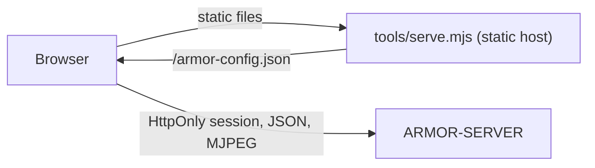

<p align="center">
  
</p>

# 🎛️ ARMOR-STUDIO

<p align="center">
  <a href="README.md">🇺🇸 English</a> |
  <a href="README_spa.md">🇪🇸 Español</a> |
  🇫🇷 <b>Français</b> |
  <a href="README_ita.md">🇮🇹 Italiano</a> |
  <a href="README_deu.md">🇩🇪 Deutsch</a> |
  <a href="README_zho.md">🇨🇳 简体中文</a> |
  <a href="README_jpn.md">🇯🇵 日本語</a> |
  <a href="README_por.md">🇵🇹 Português</a>
</p>

### Console d'exploitation et de conception : caméras, radar, alarmes, énergie, réseau local, preuves, plan du site et entretien de l'installation

<p align="center">
  
  
  
  
  
  
  
</p>

---

**Vérification d'honnêteté - ce qui fonctionne aujourd'hui:** Studio dialogue avec [ARMOR-SERVER](https://github.com/JuanenRac/ARMOR-SERVER) et est couvert par 750 tests unitaires (lecture des réglages, fusion des caméras, arithmétique des graphiques solaires, géométrie et vérifications des concepteurs, annonceur d'alarmes, dictionnaire de l'assistant, chaque menu rendu dans les huit langues, hôte statique) et par des tests dans un navigateur. Il fonctionne en usage quotidien contre le banc de test CM5 avec le vrai serveur, de vraies caméras IP et un nœud radar sur sa carte ; les images de l'Aide sont faites avec des données d'exemple. Ce qui n'a **pas** été prouvé : la vidéo en direct et le PTZ avec toutes les caméras possibles, les menus solaire, électrique, centrales d'alarme et panneau tactile avec du vrai matériel (seul le nœud radar existe) et une revue formelle d'accessibilité ou d'utilisabilité. Tant que le serveur est injoignable, Studio affiche des données de démonstration et le dit dans la barre supérieure.

---

## 📋 En un coup d'œil

| | |
|---|---|
| Version | `0.8.0.6` |
| Maturité | Établi |
| Tests | 765 (`npm test`) |
| Technologie | React 19 / TypeScript / Vite |
| Sur matériel réel | Utilisé chaque jour sur le banc de test CM5 (vrai serveur, vraies caméras IP, un vrai nœud radar) ; les menus solaire, électrique, centrales d'alarme et panneau tactile attendent de vrais nœuds |

## 🎯 Présentation

**ARMOR-STUDIO** est la console de l'opérateur. Elle ne détient jamais un mot de passe de caméra, une adresse RTSP ni un jeton : elle se connecte au serveur avec un nom et un mot de passe, reçoit une session **HttpOnly** de 8 heures, et tout ce qui est privilégié passe par cette session.

* **Aperçu et système :** l'état du périmètre, une tuile par partie (centrales d'alarme, radar, caméras, appareils, énergie, réseau, serveur), une carte vivante du plan avec chaque appareil et alarme, et ce qui demande attention, le tout sur un seul écran sans défilement ; une page système et un journal d'audit pour l'administrateur.
* **Moniteur de caméras :** 1, 2, 4, 6, 8, 9, 12 ou 16 tuiles qui épousent leur cadre (16:9, toute la matrice visible, sans rognage), une vue agrandie avec une télécommande PTZ bornée, capture et enregistrement MP4 ; une **bibliothèque d'enregistrements** pour filtrer, prévisualiser, lire, protéger et supprimer des preuves et télécharger une **preuve de conservation**.
* **Alarmes :** ce qui demande une personne tout de suite, avec acquittement et dossier clos ; une **vérification avant armement** et un PIN pour désarmer ; des alarmes dessinées sur la carte vivante ; un son pour chaque gravité, une voix parlée avec ses propres styles (neutre, héros d'action, seigneur des ténèbres, théâtral) qui dit aussi quand quelque chose se connecte, des fenêtres d'alerte, un bouton muet à côté de l'Aide et un saut optionnel vers le bon menu.
* **Appareils et automatisations :** fumée, gaz, inondation, porte, fenêtre, mouvement, climat, prise, lumière, sirène, serrure, volet, portail, porte de garage et chauffe-eau en Wi-Fi, Zigbee, Bluetooth ou filaire (préréglages Zigbee2MQTT, Tasmota et Shelly) ; des règles depuis toute source d'alarme, avec seuils, qui actionnent des appareils quand quelque chose arrive ; un grand bouton armer / désarmer.
* **Centrales d'alarme et Concepteur d'alarme :** l'état de chaque nœud ARMOR-ALARM, ses zones et événements, les capteurs Zigbee liés aux zones, et un concepteur où vous dessinez l'alarme de la maison (centrales, contacts, mouvement, détecteurs de fumée, gaz et inondation, sirènes, claviers, câblage et liaisons radio) et liez chaque élément dessiné à une vraie zone.
* **Énergie solaire et électrique :** le menu *Onduleurs* dessine la maison comme un flux d'énergie animé avec cadrans, mesures et courbes d'historique ; *Batteries* montre chaque bloc avec ses capacités, chaque module et chaque cellule ; *Électrique* montre l'entrée réseau, chaque canal et les alarmes des compteurs ; dans les deux vous déclarez votre matériel (Voltronic, MPP Solar, Pylontech, ANT-BMS…) et un bouton *Afficher des mesures d'exemple* permet d'essayer le menu d'abord.
* **Concepteur électrique :** dessinez le schéma électrique de la maison (réseau, compteur, protections, inverseurs, distribution, PV, onduleurs, batteries et charges, AC et DC), liez-le aux appareils solaires que lit le serveur pour voir les valeurs en direct, et laissez les vérifications le relire (deux sources sur une ligne, disjoncteurs et câbles face au courant…).
* **Radar :** une carte vivante tracée d'après votre plan du site avec les cibles que rapporte chaque radar, leur trajet récent et les **zones de l'image à ignorer** ; état vivant des nœuds, les silencieux affichés *périmés* ; le panneau propre de chaque nœud à un clic.
* **Concepteur du site :** dessinez le terrain, des bâtiments de plusieurs étages avec cinq types de toit, portes, fenêtres, lampadaires, cheminées, panneaux solaires, mâts, routes et chemins, puis caméras et radars où vous voulez ; un plan 2D de type CAO et une vue 3D orbitale étage par étage ; annuler et rétablir ; versions du plan.
* **Réseau local :** le menu *Réseau* montre ce que rapporte le nœud ARMOR-NETWORK (appareils, coupures, état d'internet et **adresse publique** avec le fournisseur et le lieu), permet de nommer, masquer et surveiller des appareils, d'ordonner un balayage, un ping ou une inspection avec un identifiant que vous donnez, et le *Concepteur réseau* le dessine.
* **Capture automatique :** dans *Configuration > Capture automatique*, photos et vidéo prises seules quand une caméra voit quelque chose système armé (combien de photos, à quel rythme, durée d'un clip), et les zones de l'image à ignorer dessinées sur le cadre de la caméra.
* **Firmware des nœuds et mises à jour :** *Firmware des nœuds* met à jour les nœuds de terrain un par un, avec une barre pour tout le travail et pour chaque nœud, et garde son état si une alarme vous emmène dans un autre menu ; *Mises à jour* installe les nouvelles versions de Studio et du serveur depuis GitHub (en montrant les nouveautés de la version), celles du système d'exploitation et une console de maintenance optionnelle.
* **Configuration en groupes :** Général et Préférences ; Utilisateurs, Notifications et Capture automatique ; Firmware des nœuds et Mises à jour ; Serveur, Services, Broker MQTT, Fichiers de réglages, Installation et Console ; et chaque menu de la barre latérale est aussi en groupes repliables (Surveillance, Sécurité, Énergie, Maison et réseau, Conception, Administration).
* **Huit langues** (anglais, espagnol, allemand, français, italien, japonais, chinois et portugais) et onze thèmes, celui par défaut s'appelant *Armor* ; la langue, le thème et le lieu météo suivent le compte, pas le navigateur. Rôles : administrateur, opérateur et **viewer**, qui ne fait que regarder.
* **Une Aide qui connaît tout le système :** un livre à quatre niveaux de détail avec une image de données d'exemple de chaque menu principal, une visite guidée pas à pas pour chaque menu qui va contrôle par contrôle (ce que fait chaque bouton, à quoi s'attendre et les erreurs courantes) avec sa propre mascotte et sa voix, une Aide qui explique en détail les nœuds de terrain (Wi-Fi de configuration, point d'accès et station, PIN Bluetooth, emplacements de firmware avec retour arrière, mises à jour signées, le panneau depuis l'extérieur), des bulles d'aide partout, et un **assistant** (une mascotte que vous pouvez glisser n'importe où, épingler où vous voulez et interroger par écrit) avec un dictionnaire en huit langues et une bulle qui s'ouvre du côté qui a de la place. Les menus où vous travaillez restent ouverts pendant que vous en visitez un autre.
* **Accès extérieur avec des choix, pas des fichiers :** dans Sécurité, un administrateur configure le VPN WireGuard, ajoute un téléphone en scannant un code QR, garde un nom qui suit la maison (DuckDNS, Cloudflare ou toute adresse à appeler) et enregistre les nœuds dont le panneau propre peut s'ouvrir depuis l'extérieur via le serveur, en comparant l'empreinte du certificat avant de lui faire confiance ; chaque étape s'explique en huit langues et redemande le mot de passe depuis l'extérieur.**Joindre la maison depuis l'extérieur, pas à pas :** dans Configuration > Sécurité un guide de six étapes montre si la machine en est capable, si le VPN existe, si la maison a un nom, si le port est ouvert sur le routeur et si le téléphone est ajouté, et comment l'essayer en données mobiles ; l'onglet Sécurité est organisé en trois sections titrées.
* **Carte du chiffrement du broker :** Configuration > Broker montre si la liaison du serveur avec le broker est chiffrée et l'empreinte de l'autorité propre à l'installation à laquelle il fait confiance ; rien d'alarmant n'est affiché quand la liaison est non chiffrée, car c'est le cas par défaut.
* **Santé des nœuds et modes d'armement :** Système a une carte avec le rapport de santé de chaque nœud (durée de marche, motif du redémarrage, mémoire, liaison et signal, connexions au broker, dernière erreur, historique et redémarrages) et Centrales d'alarme a un sélecteur de mode (Absent, Présent, Nuit et les vôtres) avec un éditeur de modes, le tout en huit langues avec aide, étapes de visite et réponses de l'assistant.
* **Ordres pour les nœuds (administrateurs) :** la carte de santé donne à chaque nœud un menu d'Actions (redémarrer, mettre en pause ou reprendre, veille ou mettre en marche, identifier, diagnostic, mode maintenance) et l'en-tête donne les mêmes ordres à tous les nœuds (tout redémarrer, maintenant ou échelonné, tout mettre en pause, tout en veille, tout reprendre). Redémarrer, mettre en pause et veille demandent de saisir le nom du nœud (ou RESTART, PAUSE, STANDBY pour tous) et avertissent quand la centrale d'alarme ou un radar reste sans surveillance ; la veille, c'est le travail arrêté, toujours connecté, jamais une mise hors tension. Chaque ordre est suivi nœud par nœud (envoyé, accusé de réception, hors ligne, de retour) avec le motif de chaque refus.
* **Connexion pour gestionnaires de mots de passe et un Historique à onglets :** la connexion est un vrai formulaire que le gestionnaire de mots de passe du navigateur ou du système peut enregistrer et remplir, avec un « Se souvenir de moi » facultatif qui ne retient que le nom d'utilisateur (jamais le mot de passe) et une note qui le dit ; l'Historique a les onglets Tout, Alarmes, Connexions, Appareils, Système et Réglages, avec la liste de chaque appareil et application qui se connecte au serveur (dernière fois vu, sessions ouvertes, connexions et refus) et les événements des nœuds, du broker, des services, des mises à jour et de l'armement. Les adresses ne sont visibles que des administrateurs.
* **Maintenance des batteries (Configuration, administrateurs) :** un assistant en quatre étapes - batterie et opération, valeurs, confirmation en saisissant le numéro de série de la batterie, résultat - pour modifier ce que garde une batterie Pylontech ; limites en volts et en degrés un groupe entier à la fois, un fichier de firmware lu avant d'être envoyé, la batterie lue avant et après avec la différence et la transcription, et une sortie qu'on peut remettre comme avant.

## 🖼️ Captures d'écran

Capturées en 1920×1080 sur un banc d'essai, avec des données d'exemple et sans installation réelle derrière.

<table>
<tr><td width="50%" valign="top"><br><sub>Résumé : l'état du périmètre, les alarmes, les nœuds radar, l'énergie et la carte en direct du site sur un seul écran.</sub></td><td width="50%" valign="top"><br><sub>Radar : les cibles que voit chaque radar, placées sur le plan du site, avec la zone couverte par chaque capteur.</sub></td></tr>
<tr><td width="50%" valign="top"><br><sub>Onduleurs : le flux d'énergie entre les panneaux solaires, le réseau, la maison et les batteries, en lecture seule.</sub></td><td width="50%" valign="top"><br><sub>Concepteur du site : terrain, bâtiments, caméras et radars dessinés sur le plan qu'utilise le reste de Studio.</sub></td></tr>
<tr><td width="50%" valign="top"><br><sub>Concepteur électrique : le schéma CA et CC de la maison, avec ses vérifications, à partir d'un exemple prêt à l'emploi.</sub></td><td width="50%" valign="top"><br><sub>Centrales d'alarme : si chacune surveille, ses zones et ce qui s'est passé en dernier.</sub></td></tr>
</table>

## 🧩 Rôle dans A.R.M.O.R.

Studio est la fenêtre de l'opérateur sur tout le système. Il ne parle jamais à un nœud : tout passe par [ARMOR-SERVER](https://github.com/JuanenRac/ARMOR-SERVER), seul à décider (la seule exception est un lien vers le panneau propre de chaque nœud). C'est aussi là que se conçoivent le site, l'alarme, l'installation électrique et le réseau, d'où se pilotent le firmware des nœuds et les mises à jour de l'installation elle-même, et où vivent l'Aide et l'assistant. Le même serveur est utilisé par [ARMOR-ANDROID-CONTROL](https://github.com/JuanenRac/ARMOR-ANDROID-CONTROL) sur le téléphone.

## 🔄 Architecture



## 🔒 Modèle de sécurité

* **Aucun secret dans le navigateur.** Les mots de passe des caméras sont saisis une fois, envoyés au serveur et ensuite affichés seulement comme un état « enregistré » masqué. Les exports du site suppriment les noms d'utilisateur et les indicateurs d'identifiants.
* **Les réglages stockés sont une entrée non fiable.** Ils sont lus valeur par valeur : une origine, un thème, une langue ou une forme invalides sont écartés, les positions sont bornées et les listes plafonnées.
* **Aucune requête vers un tiers.** Les polices sont locales ; l'hôte statique envoie `Content-Security-Policy: default-src 'self'` limitée au serveur configuré, `frame-ancestors 'none'`, `nosniff` et `no-referrer`.
* La vidéo en direct n'est montrée que par une adresse de flux que le serveur délivre à un opérateur.

## 📂 Structure du dépôt

```text
ARMOR-STUDIO/
├── src/
│   ├── App.tsx, domain.ts, settings.ts, prefs.ts, cameras.ts, hooks.ts, api.ts (+ api/ by area), config.ts, i18n.ts, viewSlots.tsx
│   ├── components/   camera, chrome (top bar, sidebar, Help), SiteMap
│   ├── views/        overview, monitoring, RadarView, AlarmsView, AlarmPanelsView, DevicesView, AutomationsView, InvertersView, BatteriesView, ElectricalView, NetworkView, WeatherView, SystemView, ServicesView
│   ├── designer/     the Site Designer: geometry, ops (+ ops/), model, Plan2D, Viewport3D, Toolbox, Inspector
│   ├── electrical/   the Electrical Designer: model, ops, analysis (the checks), presets, symbols, sync
│   ├── alarm/        the Alarm Designer and the alarm panels' Zigbee links
│   ├── network/      the Network Designer and the network model
│   ├── alerts/       sounds, voice and its styles, pop-ups, the announcer of alarms and of connections
│   ├── assistant/    the mascot, its dictionary in eight languages and where its bubble opens
│   ├── tour/         a guided tour for every menu
│   ├── weather/      the Weather menu: radar map, clouds, forecast
│   └── ...           ConfigurationPanel (tabs: General, Preferences, Users, Notifications, Automatic capture, Node firmware, Updates, Server, Services, Broker, Files, Installation, Console), MediaLibrary, HistoryView, StudioLogin, one *Text.ts per area (eight languages)
├── public/help/      the pictures of the Help, one set per language
├── e2e/              browser tests (Playwright)
├── tools/            serve.mjs (+ tests)
├── docs/             security model
└── images/           brand assets
```

## 🛠️ Environnement de développement

**Prérequis:** Node.js 22+, a running ARMOR-SERVER (otherwise Studio shows demonstration data)

```powershell
npm install
npm run dev         # http://127.0.0.1:5178 against a server on 127.0.0.1:8080
npm run typecheck
npm test            # 750 tests: designers, settings, cameras, radar map, solar arithmetic, alerts and the assistant, every menu in eight languages, static host
npm run build       # dist/
$env:ARMOR_SERVER_ORIGIN="http://192.168.0.180:18080"; node tools/serve.mjs   # serve the build
```

`tools/serve.mjs` lit `ARMOR_STUDIO_HOST` (par défaut `127.0.0.1`), `ARMOR_STUDIO_PORT` (`5178`), `ARMOR_STUDIO_DIST` et `ARMOR_SERVER_ORIGIN`. Pour installer toute la pile sur le banc d'essai CM5, voir [ARMOR-DEVOPS](https://github.com/JuanenRac/ARMOR-DEVOPS).

## 🔗 Projets liés

**A.R.M.O.R.** (Autonomous Radar & Multimodal Observation Range) est un système de sécurité périmétrique composé de dépôts indépendants. Chacun a sa propre version, ses propres tests et son propre README ; voici la famille :

* **[ARMOR-COMMON](https://github.com/JuanenRac/ARMOR-COMMON)** - Contrats de messages, validateurs, vecteurs de conformité et types générés
* **[ARMOR-RADAR](https://github.com/JuanenRac/ARMOR-RADAR)** - Firmware du nœud de terrain pour ESP32-S3 avec trois radars et son propre panneau web
* **[ARMOR-SOLAR](https://github.com/JuanenRac/ARMOR-SOLAR)** - Protocoles des onduleurs et batteries solaires et messages d'un nœud passerelle
* **[ARMOR-ELECTRICAL](https://github.com/JuanenRac/ARMOR-ELECTRICAL)** - Nœud électrique : compteurs, le message des mesures du réseau et les règles de commutation
* **[ARMOR-ALARM](https://github.com/JuanenRac/ARMOR-ALARM)** - Nœud et centrale d'alarme : zones, armement, temporisations, sirène et PIN, avec ou sans le serveur
* **[ARMOR-HMI](https://github.com/JuanenRac/ARMOR-HMI)** - Panneau tactile : l'état du système sur un écran mural, armer et acquitter, et la maison de l'assistant vocal
* **[ARMOR-NETWORK](https://github.com/JuanenRac/ARMOR-NETWORK)** - Le réseau local : ses appareils, internet et ce qui change
* **[ARMOR-SERVER](https://github.com/JuanenRac/ARMOR-SERVER)** - Coordinateur central : télémétrie, alarmes, appareils, relevés solaires et caméras
* **ARMOR-STUDIO** (ce dépôt) - Console web : caméras, radar, alarmes, énergie solaire et concepteur de site 2D/3D
* **[ARMOR-ANDROID-CONTROL](https://github.com/JuanenRac/ARMOR-ANDROID-CONTROL)** - Client Android de l'opérateur avec radar 2D/3D en direct
* **[ARMOR-SERVER-AI](https://github.com/JuanenRac/ARMOR-SERVER-AI)** - Politique d'inférence visuelle qui explique ses décisions et n'agit jamais
* **[ARMOR-VISION](https://github.com/JuanenRac/ARMOR-VISION)** - Zones de caméra, masques et règles de détection pour la Jetson Orin NX
* **[ARMOR-VOICE-AI](https://github.com/JuanenRac/ARMOR-VOICE-AI)** - Intentions vocales hors ligne avec une confirmation impossible à falsifier
* **[ARMOR-HARDWARE](https://github.com/JuanenRac/ARMOR-HARDWARE)** - Boîtiers, électronique et matrice d'acceptation sur banc
* **[ARMOR-DEVOPS](https://github.com/JuanenRac/ARMOR-DEVOPS)** - Déploiement, banc d'essai CM5, sauvegarde et TLS
* **[ARMOR-SIMULATOR](https://github.com/JuanenRac/ARMOR-SIMULATOR)** - Simulateur de télémétrie hors ligne avec des pannes reproductibles
* **[ARMOR-UPDATER](https://github.com/JuanenRac/ARMOR-UPDATER)** - Détecte, installe et met à jour les propres dépôts de l'écosystème
* **[ARMOR-DOCS](https://github.com/JuanenRac/ARMOR-DOCS)** - Architecture, base de sécurité et matrice des capacités

## 📚 Documentation et communauté

Pour en savoir plus :

* [Matrice des capacités : ce qui est prouvé et ce qui ne l'est pas](https://github.com/JuanenRac/ARMOR-DOCS/blob/main/docs/CAPABILITY_MATRIX.md)
* [Catalogue des projets : versions et dépendances entre les dépôts](https://github.com/JuanenRac/ARMOR-DOCS/blob/main/docs/PROJECT_CATALOG.md)
* [Historique des modifications de ce dépôt](CHANGELOG.md)
* [Licence (GPL-3.0-or-later)](LICENSE)
* Questions, idées et rapports : electrohobby3d@gmail.com

## 👤 AUTEUR

**JuanenRac (Electro Hobby 3D)** · electrohobby3d@gmail.com

## 📜 LICENCE

GPL-3.0-or-later - voir [LICENSE](LICENSE).
