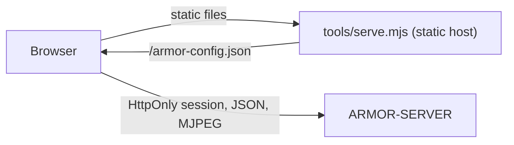

<p align="center">
  
</p>

# 🎛️ ARMOR-STUDIO

<p align="center">
  <a href="README.md">🇺🇸 English</a> |
  <a href="README_spa.md">🇪🇸 Español</a> |
  🇫🇷 <b>Français</b> |
  <a href="README_ita.md">🇮🇹 Italiano</a> |
  <a href="README_deu.md">🇩🇪 Deutsch</a> |
  <a href="README_zho.md">🇨🇳 简体中文</a> |
  <a href="README_jpn.md">🇯🇵 日本語</a> |
  <a href="README_por.md">🇵🇹 Português</a>
</p>

### Console d'exploitation et de conception : caméras, radar, alarmes, énergie, réseau local, preuves, plan du site et entretien de l'installation

<p align="center">
  
  
  
  
  
  
  
</p>

---

**Vérification d'honnêteté - ce qui fonctionne aujourd'hui :** Studio dialogue avec [ARMOR-SERVER](https://github.com/JuanenRac/ARMOR-SERVER) et est couvert par 1004 tests unitaires (lecture des réglages, fusion des caméras, arithmétique des graphiques solaires, géométrie et vérifications des concepteurs, annonceur d'alarmes, dictionnaire de l'assistant, chaque menu rendu dans les huit langues, hôte statique) et par des tests dans un navigateur. Il fonctionne en usage quotidien contre le banc de test CM5 avec le vrai serveur, de vraies caméras IP et un nœud radar sur sa carte ; les images de l'Aide sont faites avec des données d'exemple. Ce qui n'a **pas** été prouvé : la vidéo en direct et le PTZ avec toutes les caméras possibles, les menus solaire, électrique, centrales d'alarme et panneau tactile avec du vrai matériel (seul le nœud radar existe) et une revue formelle d'accessibilité ou d'utilisabilité. Tant que le serveur est injoignable, Studio affiche des données de démonstration et le dit dans la barre supérieure.

---

## 📋 En un coup d'œil

| | |
|---|---|
| Version | `0.8.1.0` |
| Maturité | Établi |
| Rôle | Console d'exploitation et de conception de la famille |
| Technologie | React 19, TypeScript, Vite, Three.js, Leaflet |
| Tests | 1004 (`npm test`, Vitest) et tests navigateur (Playwright) |
| Contrat | Ne parle qu'à ARMOR-SERVER (HTTP `/api/v1/*` avec session HttpOnly, WebSocket `/api/v1/events`) |
| Écoute sur | `127.0.0.1:5178` (`tools/serve.mjs`) |
| Fonctionne sur | Un navigateur ; les fichiers sont servis par `tools/serve.mjs` ou par le nginx du conteneur |
| Sur matériel réel | Utilisé chaque jour sur le banc de test CM5 (vrai serveur, vraies caméras IP, un vrai nœud radar) ; les menus solaire, électrique, centrales d'alarme et panneau tactile attendent de vrais nœuds |
| Licence | GPL-3.0-or-later |

**Aller à :** [Présentation](#-présentation) · [Architecture](#-architecture) · [Sécurité](#-sécurité-et-protection) · [Interfaces](#-interfaces) · [Configuration](#-configuration) · [Démarrage rapide](#-démarrage-rapide) · [Tests](#-tests) · [Dépannage](#-dépannage) · [Structure](#-structure-du-dépôt) · [Liés](#-projets-liés)

## 🚦 État du projet

Chaque ligne est une partie de ce dépôt et le feu dit où elle en est aujourd'hui. Elle est écrite d'après ce que le dépôt peut montrer (tests, compilations, exécutions), pas d'après ce qui est prévu.

🟢 Fait et vérifié · 🟡 Fonctionne, avec des limites connues · 🟠 À moitié fait ou pas encore vérifié · 🔴 Pas fait ou ne fonctionne pas

| Domaine | État | Ce que cela veut dire ici |
|---|---|---|
| Logiciel | 🟢 | La console tourne au quotidien contre le vrai serveur du banc d'essai CM5. |
| Tests | 🟢 | 1004 tests unitaires réussissent (`npm test`) et les tests de navigateur s'exécutent : réglages, fusion des caméras, graphiques solaires, géométrie et contrôles des concepteurs, annonceur d'alarmes, dictionnaire de l'assistant et chaque menu dans les huit langues. |
| Interface | 🟡 | La vidéo en direct et le PTZ ne sont pas prouvés avec toutes les caméras possibles, il n'y a pas eu de revue formelle d'accessibilité ou d'utilisabilité, et les images de l'aide sont faites avec des données d'exemple. |
| Matériel | 🟡 | Il est utilisé chaque jour avec le vrai serveur, de vraies caméras IP et un vrai nœud radar ; les menus solaire, électrique, de centrale d'alarme et de panneau tactile attendent de vrais nœuds. |
| Sécurité | 🟡 | Les sessions, les rôles et le refus des identifiants de caméra dans les adresses sont couverts par des tests ; il n'y a pas eu de revue indépendante. |
| Intégration | 🟡 | Tant que le serveur est injoignable, Studio affiche des données de démonstration et le dit dans la barre du haut. |
| Documentation | 🟢 | Huit langues, l'aide intégrée et les visites guidées, les notes de sécurité et le journal des modifications sont à jour. |

## 🎯 Présentation

**ARMOR-STUDIO** est la console de l'opérateur. Elle ne détient jamais un mot de passe de caméra, une adresse RTSP ni un jeton : elle se connecte au serveur avec un nom et un mot de passe, reçoit une session **HttpOnly** de 7 jours, et tout ce qui est privilégié passe par cette session.

* **Aperçu et système :** l'état du périmètre, une tuile par partie (centrales d'alarme, radar, caméras, appareils, énergie, réseau, serveur), une carte vivante du plan avec chaque appareil et alarme, et ce qui demande attention, le tout sur un seul écran sans défilement ; une page système et un journal d'audit pour l'administrateur.
* **Moniteur de caméras :** 1, 2, 4, 6, 8, 9, 12 ou 16 tuiles qui épousent leur cadre (16:9, toute la matrice visible, sans rognage), une vue agrandie avec une télécommande PTZ bornée, capture et enregistrement MP4 ; une **bibliothèque d'enregistrements** pour filtrer, prévisualiser, lire, protéger et supprimer des preuves et télécharger une **preuve de conservation**.
* **Alarmes :** ce qui demande une personne tout de suite, avec acquittement et dossier clos ; une **vérification avant armement** et un PIN pour désarmer ; des alarmes dessinées sur la carte vivante ; un son pour chaque gravité, une voix parlée avec ses propres styles (neutre, héros d'action, seigneur des ténèbres, théâtral) qui dit aussi quand quelque chose se connecte, des fenêtres d'alerte, un bouton muet à côté de l'Aide et un saut optionnel vers le bon menu.
* **Appareils et automatisations :** fumée, gaz, inondation, porte, fenêtre, mouvement, climat, prise, lumière, sirène, serrure, volet, portail, porte de garage et chauffe-eau en Wi-Fi, Zigbee, Bluetooth ou filaire (préréglages Zigbee2MQTT, Tasmota et Shelly) ; des règles depuis toute source d'alarme, avec seuils, qui actionnent des appareils quand quelque chose arrive ; un grand bouton armer / désarmer.
* **Centrales d'alarme et Concepteur d'alarme :** l'état de chaque nœud ARMOR-NODE-ALARM, ses zones et événements, les capteurs Zigbee liés aux zones, et un concepteur où vous dessinez l'alarme de la maison (centrales, contacts, mouvement, détecteurs de fumée, gaz et inondation, sirènes, claviers, câblage et liaisons radio) et liez chaque élément dessiné à une vraie zone.
* **Énergie solaire et électrique :** le menu *Onduleurs* dessine la maison comme un flux d'énergie animé avec cadrans, mesures et courbes d'historique ; *Batteries* montre chaque bloc avec ses capacités, chaque module et chaque cellule ; *Électrique* montre l'entrée réseau, chaque canal et les alarmes des compteurs ; dans les deux vous déclarez votre matériel (Voltronic, MPP Solar, Pylontech, ANT-BMS…) et un bouton *Afficher des mesures d'exemple* permet d'essayer le menu d'abord.
* **Concepteur électrique :** dessinez le schéma électrique de la maison (réseau, compteur, protections, inverseurs, distribution, PV, onduleurs, batteries et charges, AC et DC), liez-le aux appareils solaires que lit le serveur pour voir les valeurs en direct, et laissez les vérifications le relire (deux sources sur une ligne, disjoncteurs et câbles face au courant…).
* **Radar :** une carte vivante tracée d'après votre plan du site avec les cibles que rapporte chaque radar, leur trajet récent et les **zones de l'image à ignorer** ; état vivant des nœuds, les silencieux affichés *périmés* ; le panneau propre de chaque nœud à un clic.
* **Concepteur du site :** dessinez le terrain, des bâtiments de plusieurs étages avec cinq types de toit, portes, fenêtres, lampadaires, cheminées, panneaux solaires, mâts, routes et chemins, puis caméras et radars où vous voulez ; un plan 2D de type CAO et une vue 3D orbitale étage par étage ; annuler et rétablir ; versions du plan.
* **Réseau local :** le menu *Réseau* montre ce que rapporte le nœud ARMOR-NETWORK (appareils, coupures, état d'internet et **adresse publique** avec le fournisseur et le lieu), permet de nommer, masquer et surveiller des appareils, d'ordonner un balayage, un ping ou une inspection avec un identifiant que vous donnez, et le *Concepteur réseau* le dessine.
* **Capture automatique :** dans *Configuration > Capture automatique*, photos et vidéo prises seules quand une caméra voit quelque chose système armé (combien de photos, à quel rythme, durée d'un clip), et les zones de l'image à ignorer dessinées sur le cadre de la caméra.
* **Firmware des nœuds et mises à jour :** *Firmware des nœuds* met à jour les nœuds de terrain un par un, avec une barre pour tout le travail et pour chaque nœud, et garde son état si une alarme vous emmène dans un autre menu ; *Mises à jour* installe les nouvelles versions de Studio et du serveur depuis GitHub (en montrant les nouveautés de la version), celles du système d'exploitation et une console de maintenance optionnelle.
* **Configuration en groupes :** Général et Préférences ; Utilisateurs, Notifications et Capture automatique ; Firmware des nœuds et Mises à jour ; Serveur, Services, Broker MQTT, Fichiers de réglages, Installation et Console ; et chaque menu de la barre latérale est aussi en groupes repliables (Surveillance, Sécurité, Énergie, Maison et réseau, Conception, Administration).
* **Huit langues** (anglais, espagnol, allemand, français, italien, japonais, chinois et portugais) et seize thèmes, celui par défaut s'appelant *Armor* ; la langue, le thème et le lieu météo suivent le compte, pas le navigateur. Rôles : administrateur, opérateur et **viewer**, qui ne fait que regarder.
* **Une Aide qui connaît tout le système :** un livre à quatre niveaux de détail avec une image de données d'exemple de chaque menu principal, une visite guidée pas à pas pour chaque menu qui va contrôle par contrôle (ce que fait chaque bouton, à quoi s'attendre et les erreurs courantes) avec sa propre mascotte et sa voix, une Aide qui explique en détail les nœuds de terrain (Wi-Fi de configuration, point d'accès et station, PIN Bluetooth, emplacements de firmware avec retour arrière, mises à jour signées, le panneau depuis l'extérieur), des bulles d'aide partout, et un **assistant** (une mascotte que vous pouvez glisser n'importe où, épingler où vous voulez et interroger par écrit) avec un dictionnaire en huit langues et une bulle qui s'ouvre du côté qui a de la place. Les menus où vous travaillez restent ouverts pendant que vous en visitez un autre.
* **Accès extérieur avec des choix, pas des fichiers :** dans Sécurité, un administrateur configure le VPN WireGuard, ajoute un téléphone en scannant un code QR, garde un nom qui suit la maison (DuckDNS, Cloudflare ou toute adresse à appeler) et enregistre les nœuds dont le panneau propre peut s'ouvrir depuis l'extérieur via le serveur, en comparant l'empreinte du certificat avant de lui faire confiance ; chaque étape s'explique en huit langues et redemande le mot de passe depuis l'extérieur.
* **Joindre la maison depuis l'extérieur, pas à pas :** dans Configuration > Sécurité un guide de six étapes montre si la machine en est capable, si le VPN existe, si la maison a un nom, si le port est ouvert sur le routeur et si le téléphone est ajouté, et comment l'essayer en données mobiles ; l'onglet Sécurité est organisé en trois sections titrées.
* **Carte du chiffrement du broker :** Configuration > Broker montre si la liaison du serveur avec le broker est chiffrée et l'empreinte de l'autorité propre à l'installation à laquelle il fait confiance ; rien d'alarmant n'est affiché quand la liaison est non chiffrée, car c'est le cas par défaut.
* **Santé des nœuds et modes d'armement :** Système a une carte avec le rapport de santé de chaque nœud (durée de marche, motif du redémarrage, mémoire, liaison et signal, connexions au broker, dernière erreur, historique et redémarrages) et Centrales d'alarme a un sélecteur de mode (Absent, Présent, Nuit et les vôtres) avec un éditeur de modes, le tout en huit langues avec aide, étapes de visite et réponses de l'assistant.
* **Connexion pour gestionnaires de mots de passe et un Historique à onglets :** la connexion est un vrai formulaire que le gestionnaire de mots de passe du navigateur ou du système peut enregistrer et remplir, avec un « Se souvenir de moi » facultatif qui ne retient que le nom d'utilisateur (jamais le mot de passe) et une note qui le dit ; l'Historique a les onglets Tout, Alarmes, Connexions, Appareils, Système et Réglages, avec la liste de chaque appareil et application qui se connecte au serveur (dernière fois vu, sessions ouvertes, connexions et refus) et les événements des nœuds, du broker, des services, des mises à jour et de l'armement. Les adresses ne sont visibles que des administrateurs.
* **Maintenance des batteries (Configuration, administrateurs) :** un assistant en quatre étapes - batterie et opération, valeurs, confirmation en saisissant le numéro de série de la batterie, résultat - pour modifier ce que garde une batterie Pylontech ; limites en volts et en degrés un groupe entier à la fois, un fichier de firmware lu avant d'être envoyé, la batterie lue avant et après avec la différence et la transcription, et une sortie qu'on peut remettre comme avant.
* **Commande des nœuds depuis la carte de santé :** chaque nœud a un menu (Redémarrer, Mettre en pause ou Reprendre, Mettre en veille - travail arrêté, reste connecté - ou Rallumer, Identifier, Diagnostic, Maintenance activée ou désactivée) et la carte offre les actions de groupe Tout redémarrer (en même temps, ou l'un après l'autre avec la centrale d'alarme en dernier), Tout mettre en pause, Tout mettre en veille et Tout reprendre. Le nom du nœud (ou le mot RESTART, PAUSE ou STANDBY pour tous) est saisi de nouveau et une nouvelle preuve d'identité est demandée ; des pastilles suivent chaque nœud (envoyé, reçu, hors ligne, de retour, appliqué) et montrent En pause, En veille depuis quand et par qui, et Maintenance ; et les avertissements disent quand une centrale d'alarme ou un radar en pause ou en veille laisse la maison sans protection. Il n'existe ni réinitialisation d'usine, ni effacement, ni sommeil profond.
* **État en direct :** Studio écoute le canal en direct du serveur (un WebSocket) et affiche aussitôt une alarme, un armement ou un nœud qui revient, et ne demande l'état que toutes les vingt secondes comme filet de sécurité tant que le canal est ouvert ; la barre du bas indique *En direct*. Les concepteurs d'alarme, d'électricité et de réseau répondent aussi à F (ajuster), plus et moins (zoom) et Ctrl+D (dupliquer).

## 🧩 Rôle dans A.R.M.O.R.

Studio est la fenêtre de l'opérateur sur tout le système. Il ne parle jamais à un nœud : tout passe par [ARMOR-SERVER](https://github.com/JuanenRac/ARMOR-SERVER), seul à décider (la seule exception est un lien vers le panneau propre de chaque nœud). C'est aussi là que se conçoivent le site, l'alarme, l'installation électrique et le réseau, d'où se pilotent le firmware des nœuds et les mises à jour de l'installation elle-même, et où vivent l'Aide et l'assistant. Le même serveur est utilisé par [ARMOR-ANDROID-CONTROL](https://github.com/JuanenRac/ARMOR-ANDROID-CONTROL) sur le téléphone.

| Il parle à | Comment | Pour quoi faire |
|---|---|---|
| ARMOR-SERVER | HTTP, WebSocket et MJPEG avec la session HttpOnly | tout : état, ordres, conceptions, caméras |
| Le panneau propre de chaque nœud | un lien, via le proxy du serveur | la seule exception à « ne parle jamais à un nœud » |
| Services météo | Open-Meteo, RainViewer, EUMETSAT, ArcGIS | seulement le menu Météo, seulement avec un lieu enregistré |
| ARMOR-DEVOPS | installe la pile sur le banc d'essai CM5 | déploiement |

## 🏛️ Architecture

<p align="center">
  
</p>

<details>
<summary>Version texte du diagramme (Mermaid)</summary>



</details>

## 🖼️ Captures d'écran

Capturées en 1920×1080 sur un banc d'essai, avec des données d'exemple et sans installation réelle derrière.

<table>
<tr><td width="50%" valign="top"><br><sub>Résumé : l'état du périmètre, les alarmes, les nœuds radar, l'énergie et la carte en direct du site sur un seul écran.</sub></td><td width="50%" valign="top"><br><sub>Radar : les cibles que voit chaque radar, placées sur le plan du site, avec la zone couverte par chaque capteur.</sub></td></tr>
<tr><td width="50%" valign="top"><br><sub>Onduleurs : le flux d'énergie entre les panneaux solaires, le réseau, la maison et les batteries, en lecture seule.</sub></td><td width="50%" valign="top"><br><sub>Concepteur du site : terrain, bâtiments, caméras et radars dessinés sur le plan qu'utilise le reste de Studio.</sub></td></tr>
<tr><td width="50%" valign="top"><br><sub>Concepteur électrique : le schéma CA et CC de la maison, avec ses vérifications, à partir d'un exemple prêt à l'emploi.</sub></td><td width="50%" valign="top"><br><sub>Centrales d'alarme : si chacune surveille, ses zones et ce qui s'est passé en dernier.</sub></td></tr>
</table>

## 🔒 Sécurité et protection

* **Aucun secret dans le navigateur.** Les mots de passe des caméras sont saisis une fois, envoyés au serveur et ensuite affichés seulement comme un état « enregistré » masqué. Les exports du site suppriment les noms d'utilisateur et les indicateurs d'identifiants.
* **Les réglages stockés sont une entrée non fiable.** Ils sont lus valeur par valeur : une origine, un thème, une langue ou une forme invalides sont écartés, les positions sont bornées et les listes plafonnées.

| Menace | Défense |
|---|---|
| Secrets dans le navigateur | Jamais de mot de passe, jeton, session ou identifiant de caméra stocké ; une adresse d'instantané avec identifiants (`user:pass@` ou `?pwd=`) est refusée ; se déconnecter vide la console et l'état des travaux de firmware |
| Vol de session | Cookie HttpOnly et SameSite=Strict posé par le serveur (`armor_studio_sid`, ou `__Host-armor_studio_sid` en HTTPS) ; Studio la vérifie chaque minute |
| Stockage du navigateur altéré | Tout ce qui est lu dans `localStorage` est analysé valeur par valeur : une origine, un thème, une langue ou une forme invalide est écarté, les positions sont bornées et les listes plafonnées ; le schéma de stockage est versionné |
| Une adresse de serveur malveillante | Seulement une origine `http(s)` simple : sans identifiants, chemin, requête ni fragment |
| Injection, détournement de clic et fuites | `Content-Security-Policy: default-src 'self'; script-src 'self'; object-src 'none'; base-uri 'none'; frame-ancestors 'none'`, `connect-src` seulement pour les serveurs configurés et les services météo, `nosniff`, `no-referrer`, `Cross-Origin-Opener-Policy: same-origin` et une `Permissions-Policy` qui coupe caméra, micro et localisation |
| En-têtes de sécurité perdus derrière nginx | `security_headers.conf` est inclus dans chaque `location` (nginx n'hérite d'`add_header` que si le `location` n'a pas les siens) |
| Ordres dangereux vers les nœuds | Administrateurs seulement ; le nom du nœud (ou RESTART, PAUSE, STANDBY pour tous) est retapé et le mot de passe redemandé ; il n'y a pas d'ordre d'effacement, de réinitialisation d'usine ni d'extinction |
| Rôles | Administrateur, opérateur, lecteur (regarde seulement) et panneau mural (son compte ne peut pas utiliser Studio) ; les `capabilities` de la session décident de l'affichage et le serveur revérifie |

**Seul le menu Météo atteint d'autres services.** Les polices sont locales et rien d'autre ne demande quoi que ce soit à un tiers. Le menu Météo, et seulement pour un compte ayant un lieu enregistré, charge Open-Meteo (prévisions, géocodage, qualité de l'air), RainViewer (radar), EUMETSAT (nuages) et ArcGIS (tuiles de carte). L'hôte statique envoie `Content-Security-Policy: default-src 'self'` limitée au serveur configuré et à ces services, `frame-ancestors 'none'`, `nosniff` et `no-referrer`.

**Interrupteurs.** *Configuration > Sécurité* a une commande pour chacune des 13 protections qu'ARMOR-SERVER laisse régler à un administrateur (PIN de désarmement, coupure par la voix, signature de la conception d'alarme, flux de zones, tunnel des caméras, identifiants réseau, événements en direct du panneau mural, verrouillage d'appareil, chiffrement du stockage des nœuds et limites audio), chacune avec un défaut prudent ; le serveur consigne dans son audit qu'on en abaisse une. Détails dans [docs/SECURITY_MODEL.md](docs/SECURITY_MODEL.md). Il n'y a pas eu de revue de sécurité indépendante.

## 🔌 Interfaces

| Route | Authentification | Ce qu'elle fait |
|---|---|---|
| `/api/v1/*` | cookie de session | le client du serveur, découpé par domaine dans `src/api/` ; `src/api/routes.test.ts` et `src/api/contract/` le vérifient contre le contrat |
| `WS /api/v1/events` | session | état en direct : une alarme, un armement ou un nœud qui revient s'affiche aussitôt ; canal ouvert, l'état n'est demandé que toutes les 20 secondes par sécurité (3 secondes sans lui) ; la barre du bas indique *En direct* |
| MJPEG, instantanés, enregistrements | ticket de flux | la vidéo en direct ne passe que par une adresse que le serveur délivre à un opérateur ; les mots de passe des caméras n'atteignent jamais le navigateur |
| `GET /armor-config.json` | aucune | `{"serverOrigin": "<origine>" / "same-origin"}`, fourni par `tools/serve.mjs` ou nginx |

## ⚙️ Configuration

| Réglage | Par défaut | Ce qu'il fait |
|---|---|---|
| `ARMOR_STUDIO_HOST` | 127.0.0.1 | adresse d'écoute de l'hôte statique |
| `ARMOR_STUDIO_PORT` | 5178 | port ; le `studio_port` d'un `connection.json` enregistré depuis Studio l'emporte |
| `ARMOR_STUDIO_DIST` | ./dist | le dossier du build à servir |
| `ARMOR_SERVER_ORIGIN` | vide | une ou plusieurs origines (séparées par des virgules) avec lesquelles Studio démarre ; elles définissent le `connect-src` de la politique ; vide accepte le serveur auquel vous vous connectez |
| `TLS_CERT_PATH`  `TLS_KEY_PATH` | désactivé | les deux ou aucun : HTTPS natif de l'hôte statique |
| `ARMOR_PUBLIC_ORIGIN`  `ARMOR_SERVER_UPSTREAM` | same-origin | dans le conteneur : ce que dit `/armor-config.json` et le `hôte:port` du serveur vers lequel nginx relaie `/api/` |

Sans origine configurée, le client utilise `http://127.0.0.1:8080`. La langue, le thème (seize) et le lieu météo suivent le compte, pas le navigateur. `tools/serve.mjs` lit les variables ci-dessus ; pour installer toute la pile sur le banc d'essai CM5, voir [ARMOR-DEVOPS](https://github.com/JuanenRac/ARMOR-DEVOPS).

## 🚀 Démarrage rapide

**Prérequis :** Node.js 22+ et un ARMOR-SERVER en marche (sinon Studio affiche des données de démonstration et le dit dans la barre du haut).

```powershell
npm install                                                                    # dépendances
npm run dev                                                                    # http://127.0.0.1:5178 face à un serveur sur 127.0.0.1:8080
npm run typecheck                                                              # tsc -b --noEmit
npm run locales                                                                # écrit la table de chaque langue après un changement de phrase
npm test                                                                       # 1004 tests
npm run build                                                                  # dist/
$env:ARMOR_SERVER_ORIGIN = "http://192.168.0.180:18080"; node tools/serve.mjs  # sert le build
```

## 🧪 Tests

```powershell
npm run typecheck      # tsc -b --noEmit
npm test               # vitest run
npm run lint           # eslint src
npm run locales:check  # les huit tables sont générées
python -I tools/armor_ci_validate.py
```

| Domaine | Ce qu'il couvre |
|---|---|
| Réglages, caméras et la carte radar | analyse des réglages enregistrés, fusion des caméras, cibles radar et zones à ignorer |
| Énergie | l'arithmétique des graphiques solaires et des menus batteries et électrique |
| Concepteurs | géométrie, opérations et contrôles des concepteurs de site, électrique, alarme et réseau |
| Alertes et assistant | l'annonceur d'alarmes et de connexions, le dictionnaire de l'assistant et les visites |
| Chaque menu en huit langues | chaque écran est rendu dans chaque langue, sans phrase restée à l'état de clé brute |
| Client d'API et hôte statique | les routes et contrats de `src/api/` et `tools/serve.test.mjs` (en-têtes, `/armor-config.json`, TLS natif) |
| Tests navigateur | `e2e/tests` avec Playwright contre une pile avec un vrai serveur (`e2e/README.md`) |

Le test du TLS natif de l'hôte statique demande `openssl` installé. `npm run locales:check` échoue si la table d'une langue n'est pas générée depuis ses phrases. GitHub Actions exécute la base A.R.M.O.R. à chaque push et pull request : la validation du manifeste, de la version, du journal des modifications et de la parité des README, puis le build et les tests propres au projet.

## 🏗️ Compilation et publication

`npm run build` écrit le site statique dans `dist/` ; le `Dockerfile` le construit avec Node 22 et le sert avec nginx (`nginx/`). La version se trouve dans `package.json`, dans `armor.project.json` et dans le badge du README (lu depuis le manifeste) ; chaque version a son entrée dans [CHANGELOG.md](CHANGELOG.md). Les versions sont publiées sur GitHub.

## 🩺 Dépannage

| Vous voyez | Parce que | Faites |
|---|---|---|
| Données de démonstration et un avis dans la barre du haut | le serveur est injoignable | démarrez ARMOR-SERVER et vérifiez l'origine de connexion |
| Le navigateur bloque toute requête vers le serveur | l'origine n'est pas dans le `connect-src` de la politique | ajoutez-la à `ARMOR_SERVER_ORIGIN` (séparées par des virgules) ou servez Studio et le serveur depuis la même origine |
| Un ordre est refusé avec `elevation_required` (403) | une action critique exige une preuve d'identité récente | Studio redemande le mot de passe ; saisissez-le et recommencez |
| Le gestionnaire de mots de passe ne propose pas d'enregistrer | la connexion est un vrai formulaire ; certains gestionnaires attendent la première connexion réussie | connectez-vous une fois ; « Se souvenir de moi » ne garde que le nom, jamais le mot de passe |

## 📂 Structure du dépôt

<p align="center">
  
</p>

<details>
<summary>Version texte de l'arborescence</summary>

```text
ARMOR-STUDIO/
├── src/
│   ├── App.tsx                       l'ossature : menus, groupes, état en direct
│   ├── api/                          le client du serveur, un fichier par domaine
│   ├── views/                        aperçu, caméras, radar, alarmes, énergie, réseau, système
│   ├── components/                   tuiles caméra, barre, panneau latéral, Aide, carte
│   ├── designer/                     le concepteur de site, plan 2D et vue 3D
│   ├── electrical/ alarm/ network/   les concepteurs électrique, alarme et réseau
│   ├── alerts/ assistant/ tour/      sons et voix, la mascotte, visites guidées
│   ├── weather/ help/ preflight/     menu Météo, livre d'Aide, contrôle avant armement
│   └── locales/                      la table de chaque langue (générée)
├── public/                           les images de l'Aide, un jeu par langue
├── nginx/                            serveur web de l'image et ses en-têtes
├── e2e/                              tests navigateur (Playwright)
├── tools/                            serve.mjs (l'hôte statique), build_locales.mjs, les vérifications CI et le lanceur
├── docs/                             le modèle de sécurité
├── images/                           bannière, icône et images du README
├── .github/                          workflow CI, avis au tableau de bord, modèles d'issues et de pull requests
├── Dockerfile                        image de conteneur : build Node, hôte nginx
├── armor.project.json                manifeste : version, rôle, maturité
├── CHANGELOG.md                      ce qui a changé à chaque version
├── package.json package-lock.json    dépendances et scripts
├── index.html                        la page dont Vite construit l'application
├── vite.config.ts eslint.config.js   réglages du bundler et lint
├── tsconfig.json tsconfig.app.json   réglages TypeScript
├── run.sh run.bat                    démarrer, flux partagé
├── build.sh build.bat                construire et tester, flux partagé
├── build-test.sh build-test.bat      construire, tester, empaqueter
├── test.sh test.bat                  seulement les tests, jamais la version
└── SECURITY.md SUPPORT.md CONTRIBUTING.md CODE_OF_CONDUCT.md LICENSE
```

</details>

## 🗺️ Feuille de route et limites connues

**Limites connues aujourd'hui**

* La vidéo en direct et le PTZ ne sont pas éprouvés avec toutes les caméras possibles.
* Les menus solaire, électrique, tableau d'alarme et écran tactile attendent de vrais nœuds : seul le nœud radar existe.
* Il n'y a pas eu de revue formelle d'accessibilité ni d'ergonomie, et les images de l'Aide utilisent des données d'exemple.
* Pas de revue de sécurité indépendante.

**Prochainement**

* Essayer les menus des autres nœuds avec leurs cartes.
* Revoir l'accessibilité et l'ergonomie.

## 🌍 Langues

Le README et les textes existent en anglais, espagnol, français, italien, allemand, chinois, japonais et portugais européen.

## 🔗 Projets liés

**A.R.M.O.R.** (Autonomous Radar & Multimodal Observation Range) est un système de sécurité périmétrique composé de dépôts indépendants. Chacun a sa propre version, ses propres tests et son propre README ; voici la famille :

* **[ARMOR-COMMON](https://github.com/JuanenRac/ARMOR-COMMON)** - Contrats de messages, validateurs, vecteurs de conformité et types générés
* **[ARMOR-NODE-RADAR](https://github.com/JuanenRac/ARMOR-NODE-RADAR)** - Firmware du nœud de terrain pour ESP32-S3 avec trois radars et son propre panneau web
* **[ARMOR-NODE-SOLAR](https://github.com/JuanenRac/ARMOR-NODE-SOLAR)** - Protocoles des onduleurs et batteries solaires et messages d'un nœud passerelle
* **[ARMOR-NODE-ELECTRICAL](https://github.com/JuanenRac/ARMOR-NODE-ELECTRICAL)** - Nœud électrique : compteurs, le message des mesures du réseau et les règles de commutation
* **[ARMOR-NODE-ALARM](https://github.com/JuanenRac/ARMOR-NODE-ALARM)** - Nœud et centrale d'alarme : zones, armement, temporisations, sirène et PIN, avec ou sans le serveur
* **[ARMOR-NODE-HMI](https://github.com/JuanenRac/ARMOR-NODE-HMI)** - Panneau tactile : l'état du système sur un écran mural, armer et acquitter, et la maison de l'assistant vocal
* **[ARMOR-NETWORK](https://github.com/JuanenRac/ARMOR-NETWORK)** - Le réseau local : ses appareils, internet et ce qui change
* **[ARMOR-SERVER](https://github.com/JuanenRac/ARMOR-SERVER)** - Coordinateur central : télémétrie, alarmes, appareils, relevés solaires et caméras
* **ARMOR-STUDIO** (ce dépôt) - Console web : caméras, radar, alarmes, énergie solaire et concepteur de site 2D/3D
* **[ARMOR-ANDROID-CONTROL](https://github.com/JuanenRac/ARMOR-ANDROID-CONTROL)** - Client Android de l'opérateur avec radar 2D/3D en direct
* **[ARMOR-IOS-CONTROL](https://github.com/JuanenRac/ARMOR-IOS-CONTROL)** - Client opérateur iPhone
* **[ARMOR-SERVER-AI](https://github.com/JuanenRac/ARMOR-SERVER-AI)** - Politique d'inférence visuelle qui explique ses décisions et n'agit jamais
* **[ARMOR-VISION](https://github.com/JuanenRac/ARMOR-VISION)** - Zones de caméra, masques et règles de détection pour la Jetson Orin NX
* **[ARMOR-VOICE-AI](https://github.com/JuanenRac/ARMOR-VOICE-AI)** - Intentions vocales hors ligne avec une confirmation impossible à falsifier
* **[ARMOR-HARDWARE](https://github.com/JuanenRac/ARMOR-HARDWARE)** - Boîtiers, électronique et matrice d'acceptation sur banc
* **[ARMOR-DEVOPS](https://github.com/JuanenRac/ARMOR-DEVOPS)** - Déploiement, banc d'essai CM5, sauvegarde et TLS
* **[ARMOR-SIMULATOR](https://github.com/JuanenRac/ARMOR-SIMULATOR)** - Simulateur de télémétrie hors ligne avec des pannes reproductibles
* **[ARMOR-UPDATER](https://github.com/JuanenRac/ARMOR-UPDATER)** - Détecte, installe et met à jour les propres dépôts de l'écosystème
* **[ARMOR-DOCS](https://github.com/JuanenRac/ARMOR-DOCS)** - Architecture, base de sécurité et matrice des capacités

## 📚 Documentation

* [Modèle de sécurité](docs/SECURITY_MODEL.md) : ce que garde le navigateur, les en-têtes et les ordres aux nœuds
* [Tests navigateur](e2e/README.md) : comment les lancer contre une pile
* [Matrice des capacités : ce qui est prouvé et ce qui ne l'est pas](https://github.com/JuanenRac/ARMOR-DOCS/blob/main/docs/CAPABILITY_MATRIX.md)
* [Catalogue des projets : versions et dépendances entre les dépôts](https://github.com/JuanenRac/ARMOR-DOCS/blob/main/docs/PROJECT_CATALOG.md)
* [Historique des modifications de ce dépôt](CHANGELOG.md)

## 🤝 Contribuer et communauté

* Avant une pull request, exécutez `python -I tools/armor_ci_validate.py` et les tests : les deux doivent réussir. Voir [CONTRIBUTING.md](CONTRIBUTING.md) et le [code de conduite](CODE_OF_CONDUCT.md).
* Le README existe en huit langues et est généré à partir des sources d'ARMOR-DOCS : une modification du texte se fait là-bas.
* Une modification d'un message entre composants commence dans ARMOR-COMMON.
* Ne décrivez pas comme fonctionnant sur une carte ce qui a seulement été compilé.
* Signalez une vulnérabilité en privé : [SECURITY.md](SECURITY.md). Questions, idées et rapports : electrohobby3d@gmail.com ([SUPPORT.md](SUPPORT.md)).

## 👤 AUTEUR

**JuanenRac (Electro Hobby 3D)** · electrohobby3d@gmail.com

## 📜 LICENCE

GPL-3.0-or-later - voir [LICENSE](LICENSE).
