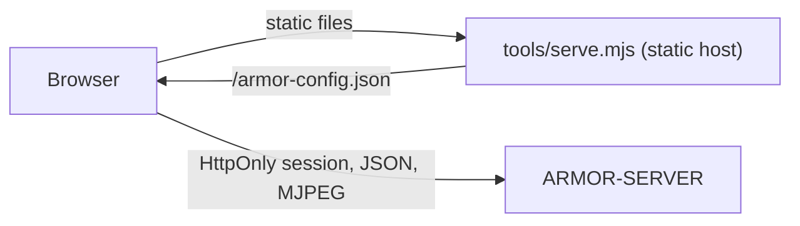

<p align="center">
  
</p>

# 🎛️ ARMOR-STUDIO

<p align="center">
  <a href="README.md">🇺🇸 English</a> |
  <a href="README_spa.md">🇪🇸 Español</a> |
  <a href="README_fra.md">🇫🇷 Français</a> |
  🇮🇹 <b>Italiano</b> |
  <a href="README_deu.md">🇩🇪 Deutsch</a> |
  <a href="README_zho.md">🇨🇳 简体中文</a> |
  <a href="README_jpn.md">🇯🇵 日本語</a> |
  <a href="README_por.md">🇵🇹 Português</a>
</p>

### Console di gestione e progettazione: telecamere, radar, allarmi, energia, rete locale, prove, planimetria del sito e manutenzione dell'impianto

<p align="center">
  
  
  
  
  
  
  
</p>

---

**Controllo di onestà - cosa funziona oggi:** Studio dialoga con [ARMOR-SERVER](https://github.com/JuanenRac/ARMOR-SERVER) ed è coperto da 1185 test unitari (lettura delle impostazioni, fusione delle telecamere, aritmetica dei grafici solari, geometria e controlli dei progettisti, annunciatore degli allarmi, dizionario dell'assistente, ogni menu reso nelle otto lingue, host statico) e da test nel browser. Funziona in uso quotidiano contro il banco di prova CM5 con il vero server, vere telecamere IP e un nodo radar sulla sua scheda; le immagini della Guida sono fatte con dati di esempio. Ciò che **non** è stato provato è il video dal vivo e il PTZ con tutte le telecamere possibili, i menu solare, elettrico, centrali d'allarme e pannello touch con apparecchi reali (esiste solo il nodo radar) e una revisione formale di accessibilità o usabilità. Finché il server non è raggiungibile, Studio mostra dati dimostrativi e lo dice nella barra superiore.

---

## 📋 In breve

| | |
|---|---|
| Versione | `0.8.1.4` |
| Maturità | Consolidato |
| Ruolo | Console di operatività e progettazione della famiglia |
| Tecnologia | React 19, TypeScript, Vite, Three.js, Leaflet |
| Test | 1185 (`npm test`, Vitest) e test nel browser (Playwright) |
| Contratto | Parla solo con ARMOR-SERVER (HTTP `/api/v1/*` con sessione HttpOnly, WebSocket `/api/v1/events`) |
| In ascolto su | `127.0.0.1:5178` (`tools/serve.mjs`) |
| Gira su | Un browser; i file li serve `tools/serve.mjs` o il nginx del container |
| Su hardware reale | Usato ogni giorno sul banco di prova CM5 (vero server, vere telecamere IP, un vero nodo radar); i menu solare, elettrico, centrali d'allarme e pannello touch attendono nodi reali |
| Licenza | GPL-3.0-or-later |

**Vai a:** [Panoramica](#-panoramica) · [Architettura](#-architettura) · [Sicurezza](#-sicurezza-e-protezione) · [Interfacce](#-interfacce) · [Configurazione](#-configurazione) · [Avvio rapido](#-avvio-rapido) · [Test](#-test) · [Problemi](#-risoluzione-dei-problemi) · [Struttura](#-struttura-del-repository) · [Correlati](#-progetti-correlati)

## 🚦 Stato del progetto

Ogni riga è una parte di questo repository e il semaforo dice a che punto è oggi. È scritta in base a ciò che il repository può mostrare (test, compilazioni, esecuzioni), non a ciò che è previsto.

🟢 Fatto e verificato · 🟡 Funziona, con limiti noti · 🟠 Fatto a metà o non ancora verificato · 🔴 Non fatto o non funzionante

| Area | Stato | Cosa significa qui |
|---|---|---|
| Software | 🟢 | La console funziona ogni giorno contro il server reale del banco di prova CM5. |
| Test | 🟢 | Superano 1185 test unitari (`npm test`) e girano i test nel browser: impostazioni, fusione delle telecamere, grafici solari, geometria e controlli dei progettisti, annunciatore di allarmi, dizionario dell'assistente e ogni menu nelle otto lingue. |
| Interfaccia | 🟡 | Il video dal vivo e il PTZ non sono provati con ogni telecamera possibile, non c'è stata una revisione formale di accessibilità o usabilità e le immagini della Guida sono fatte con dati di esempio. |
| Hardware | 🟡 | È usato ogni giorno con il server reale, telecamere IP reali e un nodo radar reale; i menu solare, elettrico, della centralina d'allarme e del pannello touch attendono nodi reali. |
| Sicurezza | 🟡 | Sessioni, ruoli e rifiuto delle credenziali delle telecamere negli indirizzi sono coperti da test; non c'è stata una revisione indipendente. |
| Integrazione | 🟡 | Finché il server non è raggiungibile, Studio mostra dati dimostrativi e lo dice nella barra superiore. |
| Documentazione | 🟢 | Otto lingue, la Guida integrata e i percorsi guidati, le note di sicurezza e il registro delle modifiche sono aggiornati. |

## 🎯 Panoramica

**ARMOR-STUDIO** è la console dell'operatore. Non detiene mai una password di telecamera, un indirizzo RTSP o un token: accede al server con nome utente e password, riceve una sessione **HttpOnly** di 7 giorni e tutto ciò che è privilegiato passa da quella sessione.

* **Panoramica e sistema:** lo stato del perimetro, una scheda per ogni parte (centrali d'allarme, radar, telecamere, dispositivi, energia, rete, server), una mappa viva del progetto con ogni dispositivo e allarme, e ciò che richiede attenzione, tutto in una schermata senza scorrimento; una pagina di sistema e un registro di audit per l'amministratore.
* **Monitor delle telecamere:** 1, 2, 4, 6, 8, 9, 12 o 16 riquadri che si adattano alla cornice (16:9, tutta la matrice visibile, senza ritagli), una vista ingrandita con pulsantiera PTZ limitata, istantanea e registrazione MP4; una **libreria delle registrazioni** per filtrare, anteprima, riprodurre, proteggere e cancellare prove e scaricare una **prova di custodia**.
* **Allarmi:** ciò che richiede una persona ora, con riconoscimento e archivio chiuso; un **controllo prima di inserire** e un PIN per disinserire; allarmi disegnati sulla mappa viva; un suono per ogni gravità, una voce parlata con propri stili (neutro, eroe d'azione, signore oscuro, teatrale) che dice anche quando qualcosa si connette, finestre di avviso, un pulsante muto accanto alla Guida e un salto facoltativo al menu giusto.
* **Dispositivi e automazioni:** fumo, gas, allagamento, porta, finestra, movimento, clima, presa, luce, sirena, serratura, tapparella, cancello, porta del garage e scaldabagno via Wi-Fi, Zigbee, Bluetooth o cavo (preset per Zigbee2MQTT, Tasmota e Shelly); regole da qualsiasi fonte di allarme, con soglie, che azionano dispositivi quando succede qualcosa; un grande pulsante inserisci / disinserisci.
* **Centrali d'allarme e Progettista dell'allarme:** lo stato di ogni nodo ARMOR-NODE-ALARM, le sue zone ed eventi, i sensori Zigbee legati alle zone, e un progettista in cui disegni l'allarme della casa (centrali, contatti, movimento, rilevatori di fumo, gas e allagamento, sirene, tastiere, cablaggio e collegamenti radio) e leghi ogni elemento disegnato a una zona reale.
* **Energia solare ed elettrica:** il menu *Inverter* disegna la casa come un flusso di energia animato con indicatori, letture e grafici di storico; *Batterie* mostra ogni pacco con le sue capacità, ogni modulo e ogni cella; *Elettrico* mostra l'ingresso di rete, ogni canale e gli allarmi dei contatori; in entrambi dichiari le tue apparecchiature (Voltronic, MPP Solar, Pylontech, ANT-BMS…) e un pulsante *Mostra letture di esempio* ti lascia provare prima il menu.
* **Progettista elettrico:** disegna lo schema elettrico della casa (rete, contatore, protezioni, commutatori, distribuzione, FV, inverter, batterie e carichi, CA e CC), legalo ai dispositivi solari che il server legge per vedere i valori in diretta, e lascia che i controlli lo rivedano (due sorgenti su una linea, interruttori e cavi rispetto alla corrente…).
* **Radar:** una mappa viva disegnata dal tuo progetto del sito con i bersagli che ogni radar riferisce, il loro percorso recente e le **zone dell'immagine da ignorare**; stato vivo dei nodi, con quelli silenziosi mostrati come *obsoleti*; il pannello proprio di ogni nodo a un clic.
* **Progettista del sito:** disegna il terreno, edifici di più piani con cinque tipi di tetto, porte, finestre, lampioni, camini, pannelli solari, pali, strade e sentieri, poi telecamere e radar dove vuoi; una pianta 2D in stile CAD e una vista 3D orbitabile piano per piano; annulla e ripeti; versioni del progetto.
* **Rete locale:** il menu *Rete* mostra ciò che riferisce il nodo ARMOR-NETWORK (dispositivi, interruzioni, stato di internet e **indirizzo pubblico** con il fornitore e il luogo), permette di dare nomi, nascondere e sorvegliare dispositivi, ordinare una scansione, un ping o un'ispezione con un accesso che dai, e il *Progettista di rete* la disegna.
* **Cattura automatica:** in *Configurazione > Cattura automatica*, foto e video fatti da soli quando una telecamera vede qualcosa a sistema inserito (quante foto, ogni quanto, quanto dura un clip), e le zone dell'immagine da ignorare disegnate sul fotogramma della telecamera.
* **Firmware dei nodi e aggiornamenti:** *Firmware dei nodi* aggiorna i nodi di campo uno alla volta, con una barra per tutto il lavoro e per ogni nodo, e conserva il suo stato se un allarme ti porta in un altro menu; *Aggiornamenti* installa le nuove versioni di Studio e del server da GitHub (mostrando le novità della nuova versione), quelle del sistema operativo e una console di manutenzione facoltativa.
* **Configurazione in gruppi:** Generale e Preferenze; Utenti, Notifiche e Cattura automatica; Firmware dei nodi e Aggiornamenti; Server, Servizi, Broker MQTT, File di impostazioni, Installazione e Console; e ogni menu della barra laterale è anche in gruppi comprimibili (Monitor, Sicurezza, Energia, Casa e rete, Progetto, Amministrazione).
* **Otto lingue** (inglese, spagnolo, tedesco, francese, italiano, giapponese, cinese e portoghese) e sedici temi, quello predefinito chiamato *Armor*; lingua, tema e luogo del meteo seguono l'account, non il browser. Ruoli: amministratore, operatore e **viewer**, che guarda soltanto.
* **Una Guida che conosce tutto il sistema:** un libro con quattro livelli di dettaglio e un'immagine con dati di esempio di ogni menu principale, un percorso guidato passo passo per ogni menu che va controllo per controllo (cosa fa ogni pulsante, cosa aspettarsi e gli errori comuni) con la propria mascotte e voce, una Guida che spiega a fondo i nodi di campo (Wi-Fi di configurazione, punto di accesso e stazione, PIN Bluetooth, slot di firmware con ripristino, aggiornamenti firmati, il pannello da fuori), suggerimenti su tutto, e un **assistente** (una mascotte che puoi trascinare ovunque, fissare dove vuoi e a cui chiedere per iscritto) con un dizionario in otto lingue e un fumetto che si apre dal lato che ha spazio. I menu in cui lavori restano aperti mentre ne visiti un altro.
* **Accesso da fuori con scelte, non file:** in Sicurezza un amministratore configura la VPN WireGuard, aggiunge un telefono scansionando un codice QR, mantiene un nome che segue la casa (DuckDNS, Cloudflare o qualsiasi indirizzo da chiamare) e registra i nodi il cui pannello può essere aperto da fuori tramite il server, confrontando l'impronta del certificato prima di fidarsi; ogni passo si spiega in otto lingue e richiede di nuovo la password da fuori.
* **Raggiungere la casa da fuori, passo passo:** in Configurazione > Sicurezza una guida di sei passi mostra se la macchina può farlo, se la VPN esiste, se la casa ha un nome, se la porta è aperta sul router e se il telefono è aggiunto, e come provarlo con i dati mobili; la scheda Sicurezza è organizzata in tre sezioni con titolo.
* **Scheda della cifratura del broker:** Configurazione > Broker mostra se il collegamento del server con il broker è cifrato e l'impronta dell'autorità propria dell'installazione di cui si fida; non viene mostrato nulla di allarmante quando il collegamento non è cifrato, perché è la condizione predefinita.
* **Salute dei nodi e modalità di inserimento:** Sistema ha una scheda con il rapporto di salute di ogni nodo (tempo acceso, motivo del riavvio, memoria, collegamento e segnale, connessioni al broker, ultimo errore, cronologia e riavvii) e Centrali d'allarme ha un selettore di modalità (Fuori casa, In casa, Notte e le tue) con un editor delle modalità, tutto in otto lingue con aiuto, passi della guida e risposte dell'assistente.
* **Accesso per gestori di password e una Cronologia a schede:** l'accesso è un vero modulo che il gestore di password del browser o del sistema può salvare e compilare, con un "Ricordami" facoltativo che conserva solo il nome utente (mai la password) e una nota che lo dice; la Cronologia ha le schede Tutto, Allarmi, Connessioni, Dispositivi, Sistema e Impostazioni, con l'elenco di ogni dispositivo e app che si collega al server (ultima volta visto, sessioni aperte, accessi e rifiuti) e gli eventi di nodi, broker, servizi, aggiornamenti e inserimento. Gli indirizzi li vedono solo gli amministratori.
* **Manutenzione delle batterie (Configurazione, amministratori):** una procedura guidata in quattro passi - batteria e operazione, valori, conferma digitando il numero di serie della batteria, risultato - per modificare ciò che conserva una batteria Pylontech; limiti in volt e gradi un gruppo intero alla volta, un file firmware letto prima di essere inviato, la batteria letta prima e dopo con la differenza e la trascrizione, e un'uscita che si può rimettere com'era.
* **Controllo dei nodi dalla scheda di salute:** ogni nodo ha un menu (Riavvia, Pausa o Riprendi, Standby - lavoro spento, resta connesso - o Accendi, Identifica, Diagnostica, Manutenzione attivata o disattivata) e la scheda ha le azioni di gruppo Riavvia tutti (insieme, o uno dopo l'altro con la centrale d'allarme per ultima), Metti tutti in pausa, Metti tutti in standby e Riprendi tutti. Il nome del nodo (o la parola RESTART, PAUSE o STANDBY per tutti) viene digitato di nuovo e si chiede una nuova prova di identità; delle etichette seguono ogni nodo (inviato, ricevuto, offline, tornato, applicato) e mostrano In pausa, In standby da quando e da chi, e Manutenzione; e gli avvisi dicono quando una centrale d'allarme o un radar in pausa o in standby lascia la casa senza protezione. Non esistono ripristino di fabbrica, cancellazione né sonno profondo.
* **Stato in diretta:** Studio ascolta il canale in diretta del server (un WebSocket) e mostra subito un allarme, un inserimento o un nodo che torna, e chiede lo stato solo ogni venti secondi come rete di sicurezza finché il canale è aperto; la barra in basso dice *In diretta*. I designer di allarme, elettrico e rete rispondono anche a F (adatta), più e meno (zoom) e Ctrl+D (duplica).
* **Il limite di accesso di un nodo:** ogni nodo degli elenchi (radar, inverter, batterie, elettrico e schermi a muro) ha un pulsante che apre una finestra per leggere e cambiare `system.login_limit_per_minute` (password errate al minuto prima che il nodo blocchi l'accesso: 30 per default, 0 per nessun limite globale, 120 al massimo). L'accesso al pannello del nodo è usato una volta e mai conservato; la finestra e la sua guida sono in otto lingue.
* **Un contatore che non risponde più e un'immagine firmware per un'altra scheda:** un canale elettrico con una lettura vecchia è in grigio e marcato «nessun dato», e la scheda li conta (Configurazione > Sicurezza, `electrical.set_aside_old_readings`, attivo per default); un aggiornamento firmware il cui nome di file indica una scheda diversa da quella del nodo, o un nodo di un altro tipo, viene rifiutato con un motivo chiaro invece di un codice.
* **Aiuti di progetto, disattivati per impostazione predefinita:** attivando *Aiuti di progetto* in Configurazione > Preferenze, il Progettista di allarme offre tre punti di partenza (un appartamento, un negozio e un capannone con perimetro, ciascuno un file di dati validato con uno schema) e la planimetria una verifica di *Copertura*: le parti degli edifici che nessun radar vede, le porte e finestre che nulla sorveglia, i punti sorvegliati da due radar insieme, ciascuno con una posizione per un radar, i punti ciechi disegnati sulla planimetria e il rapporto in JSON o CSV. È una guida piana che conta solo ciò che si vede con certezza (i muri bloccano la vista e ogni radar è ridotto di un margine che fissi tu), non la prova che un edificio sia protetto; vedi [docs/DESIGN_AIDS.md](docs/DESIGN_AIDS.md).
* **Modalità di inserimento del sistema (Fuori casa, In casa, Notte):** quando un amministratore attiva *Modalità di inserimento In casa e Notte* in Configurazione > Sicurezza, il pulsante di inserimento apre un dialogo per inserire in una modalità, passare dall'una all'altra o disinserire; una modalità che non protegge nulla chiede conferma e un passaggio a una modalità che protegge meno chiede il PIN, come disinserire. Il Progettista allarme ottiene una scheda *Modalità* per contrassegnare, per In casa e Notte, zone intere (i luoghi dei dispositivi), sensori, nodi radar e telecamere (partono vuote), i ritardi di uscita e di ingresso e una programmazione. Altre tre opzioni (il PIN per passare a una modalità che protegge meno, la programmazione e se può abbassare la difesa) sono in Configurazione > Sicurezza. Disattivato per impostazione predefinita: con l'opzione spenta la console inserisce e disinserisce esattamente come prima.

## 🧩 Ruolo in A.R.M.O.R.

Studio è la finestra dell'operatore su tutto il sistema. Non parla mai con un nodo: tutto passa per [ARMOR-SERVER](https://github.com/JuanenRac/ARMOR-SERVER), l'unico che decide (l'unica eccezione è un collegamento al pannello proprio di ogni nodo). È anche il luogo dove si progettano il sito, l'allarme, l'impianto elettrico e la rete, da cui si governano il firmware dei nodi e gli aggiornamenti dell'impianto stesso, e dove vivono la Guida e l'assistente. Lo stesso server è usato da [ARMOR-ANDROID-CONTROL](https://github.com/JuanenRac/ARMOR-ANDROID-CONTROL) sul telefono.

| Parla con | Come | A che scopo |
|---|---|---|
| ARMOR-SERVER | HTTP, WebSocket e MJPEG con la sessione HttpOnly | tutto: stato, ordini, progetti, telecamere |
| Il pannello proprio di ogni nodo | un collegamento, tramite il proxy del server | l'unica eccezione a "non parla mai con un nodo" |
| Servizi meteo | Open-Meteo, RainViewer, EUMETSAT, ArcGIS | solo il menu Meteo, solo con luogo salvato |
| ARMOR-DEVOPS | installa lo stack sul banco di prova CM5 | distribuzione |

## 🏛️ Architettura

<p align="center">
  
</p>

<details>
<summary>Versione testuale del diagramma (Mermaid)</summary>



</details>

## 🖼️ Schermate

Catturate a 1920×1080 su un banco di prova, con dati di esempio e senza alcuna installazione reale dietro.

<table>
<tr><td width="50%" valign="top"><br><sub>Riepilogo: lo stato del perimetro, gli allarmi, i nodi radar, l'energia e la mappa dal vivo del sito in una sola schermata.</sub></td><td width="50%" valign="top"><br><sub>Radar: i bersagli che vede ogni radar, posizionati sulla planimetria del sito, con l'area coperta da ogni sensore.</sub></td></tr>
<tr><td width="50%" valign="top"><br><sub>Inverter: il flusso di energia tra i pannelli solari, la rete, la casa e le batterie, in sola lettura.</sub></td><td width="50%" valign="top"><br><sub>Progettista del sito: terreno, edifici, telecamere e radar disegnati sulla planimetria usata dal resto di Studio.</sub></td></tr>
<tr><td width="50%" valign="top"><br><sub>Progettista elettrico: lo schema CA e CC della casa, con i suoi controlli, partendo da un esempio pronto.</sub></td><td width="50%" valign="top"><br><sub>Centrali d'allarme: se ognuna sorveglia, le sue zone e l'ultimo evento accaduto.</sub></td></tr>
</table>

## 🔒 Sicurezza e protezione

* **Nessun segreto nel browser.** Le password delle telecamere si digitano una volta, si inviano al server e poi si vedono solo come stato «salvata» mascherato. Le esportazioni del sito omettono nomi utente e indicatori di credenziali.
* **Le impostazioni salvate sono input non attendibile.** Sono lette valore per valore: un'origine, un tema, una lingua o una forma non validi vengono scartati, le posizioni limitate e le liste contenute.

| Minaccia | Difesa |
|---|---|
| Segreti nel browser | Mai salvati password, token, sessione o credenziali di telecamera; un indirizzo di istantanea con login (`user:pass@` o `?pwd=`) è rifiutato; uscire svuota la console e lo stato dei lavori firmware |
| Furto di sessione | Cookie HttpOnly e SameSite=Strict impostato dal server (`armor_studio_sid`, o `__Host-armor_studio_sid` con HTTPS); Studio la verifica ogni minuto |
| Archivio del browser manomesso | Tutto ciò che si legge da `localStorage` è analizzato valore per valore: un'origine, un tema, una lingua o una forma non valida viene scartata, le posizioni sono limitate e le liste hanno un tetto; lo schema di archiviazione è versionato |
| Un indirizzo di server malevolo | Solo un'origine `http(s)` semplice: senza credenziali, percorso, query o frammento |
| Injection, clickjacking e fughe | `Content-Security-Policy: default-src 'self'; script-src 'self'; object-src 'none'; base-uri 'none'; frame-ancestors 'none'`, `connect-src` solo per i server configurati e i servizi meteo, `nosniff`, `no-referrer`, `Cross-Origin-Opener-Policy: same-origin` e una `Permissions-Policy` che spegne fotocamera, microfono e posizione |
| Intestazioni di sicurezza perse dietro nginx | `security_headers.conf` è incluso in ogni `location` (nginx eredita `add_header` solo se il `location` non ne ha di propri) |
| Ordini pericolosi ai nodi | Solo amministratori; il nome del nodo (o RESTART, PAUSE, STANDBY per tutti) si digita di nuovo e si richiede ancora la password; non esiste un ordine di cancellazione, ripristino di fabbrica o spegnimento |
| Ruoli | Amministratore, operatore, visualizzatore (guarda soltanto) e pannello a muro (il suo account non può usare Studio); le `capabilities` della sessione decidono cosa si mostra e il server ricontrolla |

**Solo il menu Meteo raggiunge altri servizi.** I caratteri sono locali e nient'altro chiede qualcosa a terzi. Il menu Meteo, e solo per un account con un luogo salvato, carica Open-Meteo (previsioni, geocodifica, qualità dell'aria), RainViewer (radar), EUMETSAT (nuvole) e ArcGIS (tessere della mappa). L'host statico invia `Content-Security-Policy: default-src 'self'` limitata al server configurato e a quei servizi, `frame-ancestors 'none'`, `nosniff` e `no-referrer`.

**Interruttori.** *Configurazione > Sicurezza* ha un controllo per ciascuna delle 17 protezioni che ARMOR-SERVER lascia regolare a un amministratore (PIN di disarmo, silenziamento a voce, firma del progetto di allarme, flusso delle zone, tunnel delle telecamere, accessi di rete, avviso di accesso da un nuovo paese, messa da parte delle letture elettriche vecchie, eventi dal vivo del pannello a muro, blocco del dispositivo, cifratura dell'archivio dei nodi e limiti audio), ciascuna con un default prudente; il server registra nell'audit che se ne abbassa una. Dettagli in [docs/SECURITY_MODEL.md](docs/SECURITY_MODEL.md). Non c'è stata una revisione di sicurezza indipendente.

## 🔌 Interfacce

| Rotta | Autenticazione | Cosa fa |
|---|---|---|
| `/api/v1/*` | cookie di sessione | il client del server, diviso per aree in `src/api/`; `src/api/routes.test.ts` e `src/api/contract/` lo verificano rispetto al contratto |
| `WS /api/v1/events` | sessione | stato dal vivo: un allarme, un armamento o un nodo che torna si vedono subito; con il canale aperto lo stato si chiede solo ogni 20 secondi come rete di sicurezza (3 secondi senza); la barra in basso dice *Dal vivo* |
| MJPEG, istantanee, registrazioni | ticket di flusso | il video dal vivo passa solo da un indirizzo che il server emette a un operatore; le password delle telecamere non arrivano mai al browser |
| `GET /armor-config.json` | nessuna | `{"serverOrigin": "<origine>" / "same-origin"}`, fornito da `tools/serve.mjs` o nginx |

## ⚙️ Configurazione

| Impostazione | Predefinito | Cosa fa |
|---|---|---|
| `ARMOR_STUDIO_HOST` | 127.0.0.1 | indirizzo su cui ascolta l'host statico |
| `ARMOR_STUDIO_PORT` | 5178 | porta; vince lo `studio_port` di un `connection.json` salvato da Studio |
| `ARMOR_STUDIO_DIST` | ./dist | la cartella della build da servire |
| `ARMOR_SERVER_ORIGIN` | vuoto | una o più origini (separate da virgole) con cui parte Studio; definisce il `connect-src` della policy; vuoto accetta il server a cui accedi |
| `TLS_CERT_PATH`  `TLS_KEY_PATH` | spento | entrambi o nessuno: HTTPS nativo dell'host statico |
| `ARMOR_PUBLIC_ORIGIN`  `ARMOR_SERVER_UPSTREAM` | same-origin | nel container: cosa dice `/armor-config.json` e l'`host:porta` del server a cui nginx inoltra `/api/` |

Senza un'origine configurata il client usa `http://127.0.0.1:8080`. La lingua, il tema (sedici) e il luogo del meteo seguono l'account, non il browser. `tools/serve.mjs` legge le variabili sopra; per installare tutto lo stack sul banco di prova CM5 vedi [ARMOR-DEVOPS](https://github.com/JuanenRac/ARMOR-DEVOPS).

## 🚀 Avvio rapido

**Requisiti:** Node.js 22+ e un ARMOR-SERVER in funzione (altrimenti Studio mostra dati dimostrativi e lo dice nella barra superiore).

```powershell
npm install                                                                    # dipendenze
npm run dev                                                                    # http://127.0.0.1:5178 con un server su 127.0.0.1:8080
npm run typecheck                                                              # tsc -b --noEmit
npm run locales                                                                # scrive la tabella di ogni lingua dopo aver cambiato una frase
npm test                                                                       # 1185 test
npm run build                                                                  # dist/
$env:ARMOR_SERVER_ORIGIN = "http://192.168.0.180:18080"; node tools/serve.mjs  # serve la build
```

## 🧪 Test

```powershell
npm run typecheck      # tsc -b --noEmit
npm test               # vitest run
npm run lint           # eslint src
npm run locales:check  # le otto tabelle sono generate
python -I tools/armor_ci_validate.py
```

| Area | Cosa copre |
|---|---|
| Impostazioni, telecamere e la mappa radar | analisi delle impostazioni salvate, fusione delle telecamere, bersagli radar e zone da ignorare |
| Energia | l'aritmetica dei grafici solari e dei menu batterie ed elettrico |
| Progettisti | geometria, operazioni e controlli dei progettisti di sito, elettrico, allarme e rete |
| Avvisi e assistente | l'annunciatore di allarmi e connessioni, il dizionario dell'assistente e i tour |
| Ogni menu in otto lingue | ogni schermata è disegnata in ogni lingua, senza frasi rimaste come chiave grezza |
| Client API e host statico | le rotte e i contratti di `src/api/` e `tools/serve.test.mjs` (intestazioni, `/armor-config.json`, TLS nativo) |
| Test nel browser | `e2e/tests` con Playwright contro uno stack con server reale (`e2e/README.md`) |

Il test del TLS nativo dell'host statico richiede `openssl` installato. `npm run locales:check` fallisce se la tabella di una lingua non è generata dalle sue frasi. GitHub Actions esegue la base A.R.M.O.R. a ogni push e pull request: la validazione di manifesto, versione, registro delle modifiche e parità dei README, poi la compilazione e i test del progetto.

## 🏗️ Compilazione e rilascio

`npm run build` scrive il sito statico in `dist/`; il `Dockerfile` lo costruisce con Node 22 e lo serve con nginx (`nginx/`). La versione risiede in `package.json`, in `armor.project.json` e nel badge del README (letto dal manifesto); ogni versione ha la sua voce in [CHANGELOG.md](CHANGELOG.md). Le versioni sono pubblicate su GitHub.

## 🩺 Risoluzione dei problemi

| Vedi | Perché | Fai |
|---|---|---|
| Dati dimostrativi e un avviso nella barra superiore | il server non è raggiungibile | avvia ARMOR-SERVER e controlla l'origine con cui hai effettuato l'accesso |
| Il browser blocca ogni richiesta al server | l'origine non è nel `connect-src` della policy | aggiungila a `ARMOR_SERVER_ORIGIN` (separata da virgole) o servi Studio e il server dalla stessa origine |
| Un ordine è rifiutato con `elevation_required` (403) | un'azione critica richiede una prova d'identità recente | Studio chiede di nuovo la password; inseriscila e ripeti |
| Il gestore di password non propone di salvare | l'accesso è un vero modulo; alcuni gestori aspettano il primo accesso riuscito | accedi una volta; "Ricordami" conserva solo il nome utente, mai la password |

## 📂 Struttura del repository

<p align="center">
  
</p>

<details>
<summary>Versione testuale dell'albero</summary>

```text
ARMOR-STUDIO/
├── src/
│   ├── App.tsx                       l'ossatura: menu, gruppi, stato dal vivo
│   ├── api/                          il client del server, un file per area
│   ├── views/                        panoramica, telecamere, radar, allarmi, energia, rete, sistema
│   ├── components/                   riquadri camera, barra, laterale, Guida, mappa
│   ├── designer/                     il progettista del sito, piano 2D e vista 3D
│   ├── electrical/ alarm/ network/   i progettisti elettrico, allarme e rete
│   ├── alerts/ assistant/ tour/      suoni e voce, la mascotte, tour guidati
│   ├── weather/ help/ preflight/     menu Meteo, libro della Guida, controllo prima dell'armamento
│   └── locales/                      la tabella di ogni lingua (generata)
├── public/                           le immagini della Guida, un set per lingua
├── nginx/                            server web dell'immagine e le sue intestazioni
├── e2e/                              test nel browser (Playwright)
├── tools/                            serve.mjs (l'host statico), build_locales.mjs, i controlli CI e l'avviatore
├── docs/                             il modello di sicurezza
├── images/                           banner, icona e immagini del README
├── .github/                          workflow CI, avviso alla dashboard, modelli per issue e pull request
├── Dockerfile                        immagine container: build Node, host nginx
├── armor.project.json                manifesto: versione, ruolo, maturità
├── CHANGELOG.md                      cosa è cambiato in ogni versione
├── package.json package-lock.json    dipendenze e script
├── index.html                        la pagina da cui Vite costruisce l'app
├── vite.config.ts eslint.config.js   impostazioni di bundler e lint
├── tsconfig.json tsconfig.app.json   impostazioni TypeScript
├── run.sh run.bat                    avvio, flusso condiviso
├── build.sh build.bat                compila e prova, flusso condiviso
├── build-test.sh build-test.bat      compila, prova e impacchetta
├── test.sh test.bat                  solo i test, mai la versione
└── SECURITY.md SUPPORT.md CONTRIBUTING.md CODE_OF_CONDUCT.md LICENSE
```

</details>

## 🗺️ Roadmap e limiti noti

**Limiti noti oggi**

* Il video dal vivo e il PTZ non sono provati con tutte le telecamere possibili.
* I menu solare, elettrico, pannello allarme e pannello touch attendono nodi reali: esiste solo il nodo radar.
* Non c'è stata una revisione formale di accessibilità o usabilità, e le immagini della Guida usano dati di esempio.
* Nessuna revisione di sicurezza indipendente.

**Prossimi passi**

* Provare i menu degli altri nodi con le loro schede.
* Rivedere accessibilità e usabilità.

## 🌍 Lingue

Il README e i testi esistono in inglese, spagnolo, francese, italiano, tedesco, cinese, giapponese e portoghese europeo.

## 🔗 Progetti correlati

**A.R.M.O.R.** (Autonomous Radar & Multimodal Observation Range) è un sistema di sicurezza perimetrale fatto di repository indipendenti. Ognuno ha la propria versione, i propri test e il proprio README; ecco la famiglia:

* **[ARMOR-COMMON](https://github.com/JuanenRac/ARMOR-COMMON)** - Contratti dei messaggi, validatori, vettori di conformità e tipi generati
* **[ARMOR-NODE-RADAR](https://github.com/JuanenRac/ARMOR-NODE-RADAR)** - Firmware del nodo di campo per ESP32-S3 con tre radar e un proprio pannello web
* **[ARMOR-NODE-SOLAR](https://github.com/JuanenRac/ARMOR-NODE-SOLAR)** - Protocolli di inverter e batterie solari e messaggi di un nodo gateway
* **[ARMOR-NODE-ELECTRICAL](https://github.com/JuanenRac/ARMOR-NODE-ELECTRICAL)** - Nodo elettrico: contatori, il messaggio delle letture della rete e le regole di manovra
* **[ARMOR-NODE-ALARM](https://github.com/JuanenRac/ARMOR-NODE-ALARM)** - Nodo e centrale d'allarme: zone, inserimento, ritardi, sirena e PIN, con il server o senza
* **[ARMOR-NODE-HMI](https://github.com/JuanenRac/ARMOR-NODE-HMI)** - Pannello touch: lo stato del sistema su uno schermo a parete, attivare e riconoscere gli allarmi, e la casa dell'assistente vocale
* **[ARMOR-NETWORK](https://github.com/JuanenRac/ARMOR-NETWORK)** - La rete locale: i suoi dispositivi, internet e ciò che cambia
* **[ARMOR-SERVER](https://github.com/JuanenRac/ARMOR-SERVER)** - Coordinatore centrale: telemetria, allarmi, dispositivi, letture solari e telecamere
* **ARMOR-STUDIO** (questo repository) - Console web: telecamere, radar, allarmi, energia solare e progettista del sito 2D/3D
* **[ARMOR-ANDROID-CONTROL](https://github.com/JuanenRac/ARMOR-ANDROID-CONTROL)** - Client Android dell'operatore con radar 2D/3D in tempo reale
* **[ARMOR-IOS-CONTROL](https://github.com/JuanenRac/ARMOR-IOS-CONTROL)** - Client operatore per iPhone
* **[ARMOR-SERVER-AI](https://github.com/JuanenRac/ARMOR-SERVER-AI)** - Politica di inferenza visiva che spiega le sue decisioni e non agisce mai
* **[ARMOR-VISION](https://github.com/JuanenRac/ARMOR-VISION)** - Zone delle telecamere, maschere e regole di rilevamento per la Jetson Orin NX
* **[ARMOR-VOICE-AI](https://github.com/JuanenRac/ARMOR-VOICE-AI)** - Intenti vocali offline con una conferma impossibile da falsificare
* **[ARMOR-HARDWARE](https://github.com/JuanenRac/ARMOR-HARDWARE)** - Contenitori, elettronica e matrice di accettazione da banco
* **[ARMOR-DEVOPS](https://github.com/JuanenRac/ARMOR-DEVOPS)** - Distribuzione, banco di prova CM5, backup e TLS
* **[ARMOR-SIMULATOR](https://github.com/JuanenRac/ARMOR-SIMULATOR)** - Simulatore di telemetria offline con guasti ripetibili
* **[ARMOR-UPDATER](https://github.com/JuanenRac/ARMOR-UPDATER)** - Rileva, installa e aggiorna i repository stessi dell'ecosistema
* **[ARMOR-DOCS](https://github.com/JuanenRac/ARMOR-DOCS)** - Architettura, base di sicurezza e matrice delle capacità

## 📚 Documentazione

* [Aiuti di progetto](docs/DESIGN_AIDS.md): i modelli di allarme e la verifica di copertura della planimetria
* [Modello di sicurezza](docs/SECURITY_MODEL.md): cosa conserva il browser, le intestazioni e gli ordini ai nodi
* [Test nel browser](e2e/README.md): come eseguirli contro uno stack
* [Matrice delle capacità: cosa è provato e cosa no](https://github.com/JuanenRac/ARMOR-DOCS/blob/main/docs/CAPABILITY_MATRIX.md)
* [Catalogo dei progetti: versioni e dipendenze tra i repository](https://github.com/JuanenRac/ARMOR-DOCS/blob/main/docs/PROJECT_CATALOG.md)
* [Cronologia delle modifiche di questo repository](CHANGELOG.md)

## 🤝 Contribuire e comunità

* Prima di una pull request esegui `python -I tools/armor_ci_validate.py` e i test: devono passare entrambi. Vedi [CONTRIBUTING.md](CONTRIBUTING.md) e il [codice di condotta](CODE_OF_CONDUCT.md).
* Il README esiste in otto lingue ed è generato dalle sorgenti in ARMOR-DOCS: una modifica al testo si fa lì.
* Una modifica a un messaggio tra componenti parte da ARMOR-COMMON.
* Non descrivere come funzionante su una scheda ciò che è stato solo compilato.
* Segnala una vulnerabilità in privato: [SECURITY.md](SECURITY.md). Domande, idee e segnalazioni: electrohobby3d@gmail.com ([SUPPORT.md](SUPPORT.md)).

## 👤 AUTORE

**JuanenRac (Electro Hobby 3D)** · electrohobby3d@gmail.com

## 📜 LICENZA

GPL-3.0-or-later - vedi [LICENSE](LICENSE).
