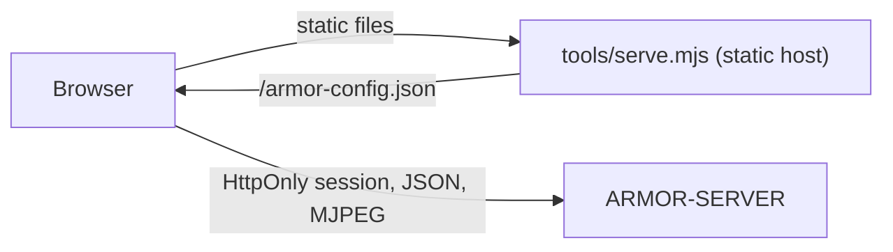

<p align="center">
  
</p>

# 🎛️ ARMOR-STUDIO

<p align="center">
  <a href="README.md">🇺🇸 English</a> |
  <a href="README_spa.md">🇪🇸 Español</a> |
  <a href="README_fra.md">🇫🇷 Français</a> |
  🇮🇹 <b>Italiano</b> |
  <a href="README_deu.md">🇩🇪 Deutsch</a> |
  <a href="README_zho.md">🇨🇳 简体中文</a> |
  <a href="README_jpn.md">🇯🇵 日本語</a> |
  <a href="README_por.md">🇵🇹 Português</a>
</p>

### Console di gestione e progettazione: telecamere, radar, allarmi, energia, rete locale, prove, planimetria del sito e manutenzione dell'impianto

<p align="center">
  
  
  
  
  
  
  
</p>

---

**Controllo di onestà - cosa funziona oggi:** Studio dialoga con [ARMOR-SERVER](https://github.com/JuanenRac/ARMOR-SERVER) ed è coperto da 495 test unitari (lettura delle impostazioni, fusione delle telecamere, aritmetica dei grafici solari, geometria e controlli dei progettisti, annunciatore degli allarmi, dizionario dell'assistente, ogni menu reso nelle otto lingue, host statico) e da test nel browser. Funziona in uso quotidiano contro il banco di prova CM5 con il vero server, vere telecamere IP e un nodo radar sulla sua scheda; le immagini della Guida sono fatte con dati di esempio. Ciò che **non** è stato provato è il video dal vivo e il PTZ con tutte le telecamere possibili, i menu solare, elettrico, centrali d'allarme e pannello touch con apparecchi reali (esiste solo il nodo radar) e una revisione formale di accessibilità o usabilità. Finché il server non è raggiungibile, Studio mostra dati dimostrativi e lo dice nella barra superiore.

---

## 📋 In breve

| | |
|---|---|
| Versione | `0.8.0.3` |
| Maturità | Consolidato |
| Test | 495 (`npm test`) |
| Tecnologia | React 19 / TypeScript / Vite |
| Su hardware reale | Usato ogni giorno sul banco di prova CM5 (vero server, vere telecamere IP, un vero nodo radar); i menu solare, elettrico, centrali d'allarme e pannello touch attendono nodi reali |

## 🎯 Panoramica

**ARMOR-STUDIO** è la console dell'operatore. Non detiene mai una password di telecamera, un indirizzo RTSP o un token: accede al server con nome utente e password, riceve una sessione **HttpOnly** di 8 ore e tutto ciò che è privilegiato passa da quella sessione.

* **Panoramica e sistema:** lo stato del perimetro, una scheda per ogni parte (centrali d'allarme, radar, telecamere, dispositivi, energia, rete, server), una mappa viva del progetto con ogni dispositivo e allarme, e ciò che richiede attenzione, tutto in una schermata senza scorrimento; una pagina di sistema e un registro di audit per l'amministratore.
* **Monitor delle telecamere:** 1, 2, 4, 6, 8, 9, 12 o 16 riquadri che si adattano alla cornice (16:9, tutta la matrice visibile, senza ritagli), una vista ingrandita con pulsantiera PTZ limitata, istantanea e registrazione MP4; una **libreria delle registrazioni** per filtrare, anteprima, riprodurre, proteggere e cancellare prove e scaricare una **prova di custodia**.
* **Allarmi:** ciò che richiede una persona ora, con riconoscimento e archivio chiuso; un **controllo prima di inserire** e un PIN per disinserire; allarmi disegnati sulla mappa viva; un suono per ogni gravità, una voce parlata con propri stili (neutro, eroe d'azione, signore oscuro, teatrale) che dice anche quando qualcosa si connette, finestre di avviso, un pulsante muto accanto alla Guida e un salto facoltativo al menu giusto.
* **Dispositivi e automazioni:** fumo, gas, allagamento, porta, finestra, movimento, clima, presa, luce, sirena, serratura, tapparella, cancello, porta del garage e scaldabagno via Wi-Fi, Zigbee, Bluetooth o cavo (preset per Zigbee2MQTT, Tasmota e Shelly); regole da qualsiasi fonte di allarme, con soglie, che azionano dispositivi quando succede qualcosa; un grande pulsante inserisci / disinserisci.
* **Centrali d'allarme e Progettista dell'allarme:** lo stato di ogni nodo ARMOR-ALARM, le sue zone ed eventi, i sensori Zigbee legati alle zone, e un progettista in cui disegni l'allarme della casa (centrali, contatti, movimento, rilevatori di fumo, gas e allagamento, sirene, tastiere, cablaggio e collegamenti radio) e leghi ogni elemento disegnato a una zona reale.
* **Energia solare ed elettrica:** il menu *Inverter* disegna la casa come un flusso di energia animato con indicatori, letture e grafici di storico; *Batterie* mostra ogni pacco con le sue capacità, ogni modulo e ogni cella; *Elettrico* mostra l'ingresso di rete, ogni canale e gli allarmi dei contatori; in entrambi dichiari le tue apparecchiature (Voltronic, MPP Solar, Pylontech, ANT-BMS…) e un pulsante *Mostra letture di esempio* ti lascia provare prima il menu.
* **Progettista elettrico:** disegna lo schema elettrico della casa (rete, contatore, protezioni, commutatori, distribuzione, FV, inverter, batterie e carichi, CA e CC), legalo ai dispositivi solari che il server legge per vedere i valori in diretta, e lascia che i controlli lo rivedano (due sorgenti su una linea, interruttori e cavi rispetto alla corrente…).
* **Radar:** una mappa viva disegnata dal tuo progetto del sito con i bersagli che ogni radar riferisce, il loro percorso recente e le **zone dell'immagine da ignorare**; stato vivo dei nodi, con quelli silenziosi mostrati come *obsoleti*; il pannello proprio di ogni nodo a un clic.
* **Progettista del sito:** disegna il terreno, edifici di più piani con cinque tipi di tetto, porte, finestre, lampioni, camini, pannelli solari, pali, strade e sentieri, poi telecamere e radar dove vuoi; una pianta 2D in stile CAD e una vista 3D orbitabile piano per piano; annulla e ripeti; versioni del progetto.
* **Rete locale:** il menu *Rete* mostra ciò che riferisce il nodo ARMOR-NETWORK (dispositivi, interruzioni, stato di internet e **indirizzo pubblico** con il fornitore e il luogo), permette di dare nomi, nascondere e sorvegliare dispositivi, ordinare una scansione, un ping o un'ispezione con un accesso che dai, e il *Progettista di rete* la disegna.
* **Cattura automatica:** in *Configurazione > Cattura automatica*, foto e video fatti da soli quando una telecamera vede qualcosa a sistema inserito (quante foto, ogni quanto, quanto dura un clip), e le zone dell'immagine da ignorare disegnate sul fotogramma della telecamera.
* **Firmware dei nodi e aggiornamenti:** *Firmware dei nodi* aggiorna i nodi di campo uno alla volta, con una barra per tutto il lavoro e per ogni nodo, e conserva il suo stato se un allarme ti porta in un altro menu; *Aggiornamenti* installa le nuove versioni di Studio e del server da GitHub (mostrando le novità della nuova versione), quelle del sistema operativo e una console di manutenzione facoltativa.
* **Configurazione in gruppi:** Generale e Preferenze; Utenti, Notifiche e Cattura automatica; Firmware dei nodi e Aggiornamenti; Server, Servizi, Broker MQTT, File di impostazioni, Installazione e Console; e ogni menu della barra laterale è anche in gruppi comprimibili (Monitor, Sicurezza, Energia, Casa e rete, Progetto, Amministrazione).
* **Otto lingue** (inglese, spagnolo, tedesco, francese, italiano, giapponese, cinese e portoghese) e undici temi, quello predefinito chiamato *Armor*; lingua, tema e luogo del meteo seguono l'account, non il browser. Ruoli: amministratore, operatore e **viewer**, che guarda soltanto.
* **Una Guida che conosce tutto il sistema:** un libro con quattro livelli di dettaglio e un'immagine con dati di esempio di ogni menu principale, un percorso guidato passo passo per ogni menu che va controllo per controllo (cosa fa ogni pulsante, cosa aspettarsi e gli errori comuni) con la propria mascotte e voce, una Guida che spiega a fondo i nodi di campo (Wi-Fi di configurazione, punto di accesso e stazione, PIN Bluetooth, slot di firmware con ripristino, aggiornamenti firmati, il pannello da fuori), suggerimenti su tutto, e un **assistente** (una mascotte che puoi trascinare ovunque, fissare dove vuoi e a cui chiedere per iscritto) con un dizionario in otto lingue e un fumetto che si apre dal lato che ha spazio. I menu in cui lavori restano aperti mentre ne visiti un altro.
* **Accesso da fuori con scelte, non file:** in Sicurezza un amministratore configura la VPN WireGuard, aggiunge un telefono scansionando un codice QR, mantiene un nome che segue la casa (DuckDNS, Cloudflare o qualsiasi indirizzo da chiamare) e registra i nodi il cui pannello può essere aperto da fuori tramite il server, confrontando l'impronta del certificato prima di fidarsi; ogni passo si spiega in otto lingue e richiede di nuovo la password da fuori.**Raggiungere la casa da fuori, passo passo:** in Configurazione > Sicurezza una guida di sei passi mostra se la macchina può farlo, se la VPN esiste, se la casa ha un nome, se la porta è aperta sul router e se il telefono è aggiunto, e come provarlo con i dati mobili; la scheda Sicurezza è organizzata in tre sezioni con titolo.
* **Scheda della cifratura del broker:** Configurazione > Broker mostra se il collegamento del server con il broker è cifrato e l'impronta dell'autorità propria dell'installazione di cui si fida; non viene mostrato nulla di allarmante quando il collegamento non è cifrato, perché è la condizione predefinita.
* **Salute dei nodi e modalità di inserimento:** Sistema ha una scheda con il rapporto di salute di ogni nodo (tempo acceso, motivo del riavvio, memoria, collegamento e segnale, connessioni al broker, ultimo errore, cronologia e riavvii) e Centrali d'allarme ha un selettore di modalità (Fuori casa, In casa, Notte e le tue) con un editor delle modalità, tutto in otto lingue con aiuto, passi della guida e risposte dell'assistente.

## 🖼️ Schermate

Catturate a 1920×1080 su un banco di prova, con dati di esempio e senza alcuna installazione reale dietro.

<table>
<tr><td width="50%" valign="top"><br><sub>Riepilogo: lo stato del perimetro, gli allarmi, i nodi radar, l'energia e la mappa dal vivo del sito in una sola schermata.</sub></td><td width="50%" valign="top"><br><sub>Radar: i bersagli che vede ogni radar, posizionati sulla planimetria del sito, con l'area coperta da ogni sensore.</sub></td></tr>
<tr><td width="50%" valign="top"><br><sub>Inverter: il flusso di energia tra i pannelli solari, la rete, la casa e le batterie, in sola lettura.</sub></td><td width="50%" valign="top"><br><sub>Progettista del sito: terreno, edifici, telecamere e radar disegnati sulla planimetria usata dal resto di Studio.</sub></td></tr>
<tr><td width="50%" valign="top"><br><sub>Progettista elettrico: lo schema CA e CC della casa, con i suoi controlli, partendo da un esempio pronto.</sub></td><td width="50%" valign="top"><br><sub>Centrali d'allarme: se ognuna sorveglia, le sue zone e l'ultimo evento accaduto.</sub></td></tr>
</table>

## 🧩 Ruolo in A.R.M.O.R.

Studio è la finestra dell'operatore su tutto il sistema. Non parla mai con un nodo: tutto passa per [ARMOR-SERVER](https://github.com/JuanenRac/ARMOR-SERVER), l'unico che decide (l'unica eccezione è un collegamento al pannello proprio di ogni nodo). È anche il luogo dove si progettano il sito, l'allarme, l'impianto elettrico e la rete, da cui si governano il firmware dei nodi e gli aggiornamenti dell'impianto stesso, e dove vivono la Guida e l'assistente. Lo stesso server è usato da [ARMOR-ANDROID-CONTROL](https://github.com/JuanenRac/ARMOR-ANDROID-CONTROL) sul telefono.

## 🔄 Architettura



## 🔒 Modello di sicurezza

* **Nessun segreto nel browser.** Le password delle telecamere si digitano una volta, si inviano al server e poi si vedono solo come stato «salvata» mascherato. Le esportazioni del sito omettono nomi utente e indicatori di credenziali.
* **Le impostazioni salvate sono input non attendibile.** Sono lette valore per valore: un'origine, un tema, una lingua o una forma non validi vengono scartati, le posizioni limitate e le liste contenute.
* **Nessuna richiesta a terzi.** I caratteri sono locali; l'host statico invia `Content-Security-Policy: default-src 'self'` limitata al server configurato, `frame-ancestors 'none'`, `nosniff` e `no-referrer`.
* Il video dal vivo si mostra solo tramite un indirizzo di flusso che il server rilascia a un operatore.

## 📂 Struttura del repository

```text
ARMOR-STUDIO/
├── src/
│   ├── App.tsx, domain.ts, settings.ts, prefs.ts, cameras.ts, hooks.ts, api.ts, config.ts, i18n.ts, viewSlots.tsx
│   ├── components/   camera, chrome (top bar, sidebar, Help), SiteMap
│   ├── views/        overview, monitoring, RadarView, AlarmsView, AlarmPanelsView, DevicesView, AutomationsView, InvertersView, BatteriesView, ElectricalView, NetworkView, WeatherView, SystemView, ServicesView
│   ├── designer/     the Site Designer: geometry, ops, model, Plan2D, Viewport3D, Toolbox, Inspector
│   ├── electrical/   the Electrical Designer: model, ops, analysis (the checks), presets, symbols, sync
│   ├── alarm/        the Alarm Designer and the alarm panels' Zigbee links
│   ├── network/      the Network Designer and the network model
│   ├── alerts/       sounds, voice and its styles, pop-ups, the announcer of alarms and of connections
│   ├── assistant/    the mascot, its dictionary in eight languages and where its bubble opens
│   ├── tour/         a guided tour for every menu
│   ├── weather/      the Weather menu: radar map, clouds, forecast
│   └── ...           ConfigurationPanel (tabs: General, Preferences, Users, Notifications, Automatic capture, Node firmware, Updates, Server, Services, Broker, Files, Installation, Console), MediaLibrary, HistoryView, StudioLogin, one *Text.ts per area (eight languages)
├── public/help/      the pictures of the Help, one set per language
├── e2e/              browser tests (Playwright)
├── tools/            serve.mjs (+ tests)
├── docs/             security model
└── images/           brand assets
```

## 🛠️ Ambiente di sviluppo

**Requisiti:** Node.js 22+, a running ARMOR-SERVER (otherwise Studio shows demonstration data)

```powershell
npm install
npm run dev         # http://127.0.0.1:5178 against a server on 127.0.0.1:8080
npm run typecheck
npm test            # 495 tests: designers, settings, cameras, radar map, solar arithmetic, alerts and the assistant, every menu in eight languages, static host
npm run build       # dist/
$env:ARMOR_SERVER_ORIGIN="http://192.168.0.180:18080"; node tools/serve.mjs   # serve the build
```

`tools/serve.mjs` legge `ARMOR_STUDIO_HOST` (predefinito `127.0.0.1`), `ARMOR_STUDIO_PORT` (`5178`), `ARMOR_STUDIO_DIST` e `ARMOR_SERVER_ORIGIN`. Per installare tutto lo stack sul banco di prova CM5 vedi [ARMOR-DEVOPS](https://github.com/JuanenRac/ARMOR-DEVOPS).

## 🔗 Progetti correlati

**A.R.M.O.R.** (Autonomous Radar & Multimodal Observation Range) è un sistema di sicurezza perimetrale fatto di repository indipendenti. Ognuno ha la propria versione, i propri test e il proprio README; ecco la famiglia:

* **[ARMOR-COMMON](https://github.com/JuanenRac/ARMOR-COMMON)** - Contratti dei messaggi, validatori, vettori di conformità e tipi generati
* **[ARMOR-RADAR](https://github.com/JuanenRac/ARMOR-RADAR)** - Firmware del nodo di campo per ESP32-S3 con tre radar e un proprio pannello web
* **[ARMOR-SOLAR](https://github.com/JuanenRac/ARMOR-SOLAR)** - Protocolli di inverter e batterie solari e messaggi di un nodo gateway
* **[ARMOR-ELECTRICAL](https://github.com/JuanenRac/ARMOR-ELECTRICAL)** - Nodo elettrico: contatori, il messaggio delle letture della rete e le regole di manovra
* **[ARMOR-ALARM](https://github.com/JuanenRac/ARMOR-ALARM)** - Nodo e centrale d'allarme: zone, inserimento, ritardi, sirena e PIN, con il server o senza
* **[ARMOR-HMI](https://github.com/JuanenRac/ARMOR-HMI)** - Pannello touch: lo stato del sistema su uno schermo a parete, attivare e riconoscere gli allarmi, e la casa dell'assistente vocale
* **[ARMOR-NETWORK](https://github.com/JuanenRac/ARMOR-NETWORK)** - La rete locale: i suoi dispositivi, internet e ciò che cambia
* **[ARMOR-SERVER](https://github.com/JuanenRac/ARMOR-SERVER)** - Coordinatore centrale: telemetria, allarmi, dispositivi, letture solari e telecamere
* **ARMOR-STUDIO** (questo repository) - Console web: telecamere, radar, allarmi, energia solare e progettista del sito 2D/3D
* **[ARMOR-ANDROID-CONTROL](https://github.com/JuanenRac/ARMOR-ANDROID-CONTROL)** - Client Android dell'operatore con radar 2D/3D in tempo reale
* **[ARMOR-SERVER-AI](https://github.com/JuanenRac/ARMOR-SERVER-AI)** - Politica di inferenza visiva che spiega le sue decisioni e non agisce mai
* **[ARMOR-VISION](https://github.com/JuanenRac/ARMOR-VISION)** - Zone delle telecamere, maschere e regole di rilevamento per la Jetson Orin NX
* **[ARMOR-VOICE-AI](https://github.com/JuanenRac/ARMOR-VOICE-AI)** - Intenti vocali offline con una conferma impossibile da falsificare
* **[ARMOR-HARDWARE](https://github.com/JuanenRac/ARMOR-HARDWARE)** - Contenitori, elettronica e matrice di accettazione da banco
* **[ARMOR-DEVOPS](https://github.com/JuanenRac/ARMOR-DEVOPS)** - Distribuzione, banco di prova CM5, backup e TLS
* **[ARMOR-SIMULATOR](https://github.com/JuanenRac/ARMOR-SIMULATOR)** - Simulatore di telemetria offline con guasti ripetibili
* **[ARMOR-UPDATER](https://github.com/JuanenRac/ARMOR-UPDATER)** - Rileva, installa e aggiorna i repository stessi dell'ecosistema
* **[ARMOR-DOCS](https://github.com/JuanenRac/ARMOR-DOCS)** - Architettura, base di sicurezza e matrice delle capacità

## 📚 Documentazione e comunità

Dove leggere di più:

* [Matrice delle capacità: cosa è provato e cosa no](https://github.com/JuanenRac/ARMOR-DOCS/blob/main/docs/CAPABILITY_MATRIX.md)
* [Catalogo dei progetti: versioni e dipendenze tra i repository](https://github.com/JuanenRac/ARMOR-DOCS/blob/main/docs/PROJECT_CATALOG.md)
* [Cronologia delle modifiche di questo repository](CHANGELOG.md)
* [Licenza (GPL-3.0-or-later)](LICENSE)
* Domande, idee e segnalazioni: electrohobby3d@gmail.com

## 👤 AUTORE

**JuanenRac (Electro Hobby 3D)** · electrohobby3d@gmail.com

## 📜 LICENZA

GPL-3.0-or-later - vedi [LICENSE](LICENSE).
