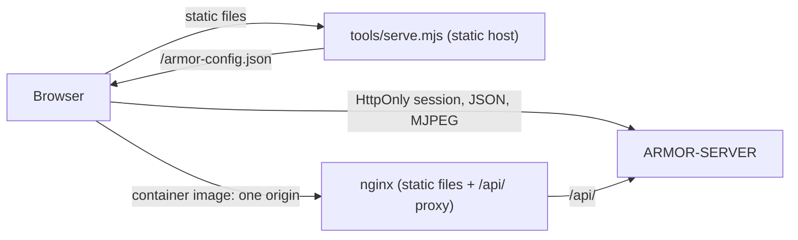

<p align="center">
  
</p>

# 🎛️ ARMOR-STUDIO

<p align="center">
  <a href="README.md">🇺🇸 English</a> |
  <a href="README_spa.md">🇪🇸 Español</a> |
  <a href="README_fra.md">🇫🇷 Français</a> |
  <a href="README_ita.md">🇮🇹 Italiano</a> |
  <a href="README_deu.md">🇩🇪 Deutsch</a> |
  <a href="README_zho.md">🇨🇳 简体中文</a> |
  🇯🇵 <b>日本語</b> |
  <a href="README_por.md">🇵🇹 Português</a>
</p>

### 運用・設計コンソール：カメラ、レーダー、警報、エネルギー、ローカルネットワーク、証拠、サイト図、設備の保守

<p align="center">
  
  
  
  
  
  
  
</p>

---

**正直さのチェック - 今日動いているもの:** Studio は [ARMOR-SERVER](https://github.com/JuanenRac/ARMOR-SERVER) と通信し、481 件のユニットテスト（設定の解析、カメラの統合、ソーラーグラフの計算、設計ツールの幾何と検査、警報アナウンサー、アシスタントの辞書、8 言語での全メニューの描画、静的ホスト）とブラウザテストでカバーされています。CM5 テストベンチで、実際のサーバー、実際の IP カメラ、基板上のレーダーノードと組み合わせて日常的に動作しており、ヘルプの画像は例示データで作られています。**まだ**証明されていないもの：あらゆるカメラでのライブ映像と PTZ、実機でのソーラー・電気・警報盤・タッチパネルのメニュー（存在するのはレーダーノードのみ）、正式なアクセシビリティ・ユーザビリティ評価。サーバーに接続できない間、Studio はデモデータを表示し、上部バーでそれを示します。

---

## 📋 ひと目で

| | |
|---|---|
| バージョン | `0.7.9` |
| 成熟度 | 確立 |
| テスト | 481 (`npm test`) |
| 技術 | React 19 / TypeScript / Vite |
| 実機での確認 | CM5 テストベンチ（実サーバー、実際の IP カメラ、実際のレーダーノード）で毎日使用。ソーラー・電気・警報盤・タッチパネルのメニューは実ノードを待っています |

## 🎯 概要

**ARMOR-STUDIO** はオペレーターのコンソールです。カメラのパスワード、RTSP アドレス、トークンを決して持ちません。ユーザー名とパスワードでサーバーにサインインし、**HttpOnly** セッション（既定は 7 日。サーバーが `ARMOR_STUDIO_SESSION_TTL_MS` で決めます）を受け取り、権限の要る操作はすべてそのセッションを通ります。

* **概要とシステム：**境界の状態、各部分のタイル（警報盤、レーダー、カメラ、デバイス、エネルギー、ネットワーク、サーバー）、すべてのデバイスと警報を載せた設計のライブマップ、注意が必要なもの。すべてスクロールなしの 1 画面で、管理者にはシステムページと監査記録があります。
* **カメラモニター：**枠に収まる 1、2、4、6、8、9、12、16 タイル（16:9、マトリクス全体が見え、切り取りなし）、範囲を限った PTZ パッド付きの拡大表示、スナップショットと MP4 録画。**録画ライブラリ**で証拠のフィルター、プレビュー、再生、保護、削除、**保管証明**のダウンロードができます。
* **警報：**今すぐ人が必要なものを、確認と終了記録とともに表示。**警戒前のチェック**と解除用 PIN、ライブマップ上の警報、重大度ごとの音、独自のスタイル（標準、アクションヒーロー、闇の支配者、劇的）を持つ音声読み上げ（何かが接続されたことも伝えます）、ポップアップ、ヘルプの隣のミュートボタン、適切なメニューへの任意のジャンプ。
* **デバイスとオートメーション：**煙、ガス、浸水、ドア、窓、動き、気候、プラグ、照明、サイレン、鍵、シャッター、門扉、ガレージドア、給湯器を Wi-Fi、Zigbee、Bluetooth、有線で（Zigbee2MQTT、Tasmota、Shelly のプリセット付き）。あらゆる警報源（しきい値も可）から、何かが起きたときにデバイスを切り替えるルール、大きな警戒 / 解除ボタン。
* **警報盤と警報デザイナー：**各 ARMOR-ALARM ノードの状態、ゾーンとイベント、ゾーンに結び付けた Zigbee センサー、そして家の警報（警報盤、接点、動き、煙・ガス・浸水検知器、サイレン、キーパッド、配線、無線リンク）を描き、描いた各要素を実際のゾーンに結び付けるデザイナー。
* **ソーラーと電気のエネルギー：***インバーター*メニューは家をゲージ、数値、履歴グラフ付きのアニメーションするエネルギーフローとして描き、*バッテリー*は各スタックの容量、各モジュール、すべてのセルを表示し、*電気*は系統入力、各チャンネル、メーターの警報を表示します。どちらも機器（Voltronic、MPP Solar、Pylontech、ANT-BMS など）を登録でき、*例示の測定値を表示*ボタンで先にメニューを試せます。
* **電気デザイナー：**家の電気図（系統、メーター、保護、切替器、配電、PV、インバーター、バッテリー、負荷、AC と DC）を描き、サーバーが読むソーラー機器に結び付けてライブ値を見て、検査に見直させます（1 本の線に 2 つの電源、電流に対するブレーカーとケーブルなど）。
* **レーダー：**サイト設計から描いたライブマップに、各レーダーが報告する対象、その最近の経路、**無視する映像ゾーン**を表示。ノードのライブ状態（無応答は*古い*と表示）、各ノード自身のパネルへ 1 クリック。
* **サイトデザイナー：**地形、複数階の建物（5 種類の屋根）、ドア、窓、街灯、煙突、ソーラーパネル、マスト、道路や小道を描き、カメラとレーダーを好きな場所に配置。CAD 風の 2D 図面と、階ごとに回転できる 3D 表示、元に戻す・やり直し、設計のバージョン。
* **ローカルネットワーク：***ネットワーク*メニューは ARMOR-NETWORK ノードの報告（デバイス、停止、インターネットの状態、プロバイダーと場所付きの**公開アドレス**）を表示し、デバイスの命名、非表示、監視、スキャン・ping・あなたが渡したログインでの検査の指示ができ、*ネットワークデザイナー*がそれを描きます。
* **自動撮影：***設定 > 自動撮影*で、システムが警戒中にカメラが何かを捉えると写真と動画を自動で撮影（枚数、間隔、クリップの長さ）し、無視する映像ゾーンをカメラのフレーム上に描きます。
* **ノードファームウェアとアップデート：***ノードファームウェア*はフィールドノードを 1 台ずつ更新し、全体と各ノードにバーを表示し、警報で別メニューに移っても状態を保ちます。*アップデート*は GitHub から Studio とサーバーの新バージョン（新バージョンの更新内容も表示）、OS の更新、任意の保守コンソールをインストールします。
* **グループ化された設定：**一般（サーバーのアドレスとポートを含む）と設定項目、ユーザー・通知・自動撮影、ノードファームウェアとアップデート、サービス・MQTT ブローカー・設定ファイル・インストール・コンソール。サイドバーの各メニューも折りたたみ可能なグループ（監視、セキュリティ、エネルギー、家とネットワーク、設計、管理）に分かれています。
* **8 言語**（英語、スペイン語、ドイツ語、フランス語、イタリア語、日本語、中国語、ポルトガル語）と 16 のテーマ（既定は *Armor*）。言語、テーマ、天気の場所はブラウザではなくアカウントに従います。ロール：管理者、オペレーター、閲覧だけの **viewer**、壁面パネル用の **panel** アカウント（Studio にはサインインできません）。
* **システム全体を知っているヘルプ：**4 段階の詳しさを持つ本と各主要メニューの例示データ付き画像、メニューごとのガイドツアー、あらゆるもののヒント、そして**アシスタント**（どこへでもドラッグでき、好きな場所に固定でき、文字で質問できるマスコット）。8 言語の辞書と、空きのある側に開く吹き出し付き。作業中のメニューは、別のメニューを見ている間も開いたままです。

## 🖼️ スクリーンショット

テストベンチで 1920×1080 で撮影。サンプルデータを使用しており、実際の設備は接続されていません。

<table>
<tr><td width="50%" valign="top"><br><sub>概要：境界の状態、警報、レーダーノード、エネルギー、現場のライブマップを 1 画面に表示します。</sub></td><td width="50%" valign="top"><br><sub>レーダー：各レーダーが捉えた目標を現場の図面上に表示し、各センサーのカバー範囲も示します。</sub></td></tr>
<tr><td width="50%" valign="top"><br><sub>インバーター：ソーラーパネル、系統、住宅、バッテリー間のエネルギーの流れ（読み取り専用）。</sub></td><td width="50%" valign="top"><br><sub>サイトデザイナー：Studio の他の画面が使う図面に、地形・建物・カメラ・レーダーを描きます。</sub></td></tr>
<tr><td width="50%" valign="top"><br><sub>電気デザイナー：住宅の AC・DC 回路図とそのチェックを、用意されたサンプルから表示します。</sub></td><td width="50%" valign="top"><br><sub>警報パネル：各パネルが警戒中か、そのゾーン、直近の出来事を表示します。</sub></td></tr>
</table>

## 🧩 A.R.M.O.R. での役割

Studio はシステム全体を見渡すオペレーターの窓口です。ノードとは直接話さず、すべて [ARMOR-SERVER](https://github.com/JuanenRac/ARMOR-SERVER) を通します（唯一の例外は各ノード自身のパネルへのリンク）。サイト、警報、電気設備、ネットワークの設計、ノードのファームウェアや設備自身のアップデートの操作、ヘルプとアシスタントもここにあります。同じサーバーを、スマートフォンの [ARMOR-ANDROID-CONTROL](https://github.com/JuanenRac/ARMOR-ANDROID-CONTROL) も使います。

## 🔄 アーキテクチャ



## 🔒 セキュリティモデル

* **ブラウザーにシークレットはありません。** カメラのパスワードは一度入力してサーバーに送り、その後はマスクされた「保存済み」の状態でしか表示されません。サイトのエクスポートはユーザー名と認証情報のフラグを除きます。
* **保存された設定は信頼できない入力です。** 値ごとに読み取られ、無効なオリジン、テーマ、言語、形は捨てられ、位置は範囲内に収められ、リストは上限が設けられます。
* **ブラウザーが保持するもの。** サーバーごとに、図面（サイト、電気、ネットワーク、アラーム）のコピー、カメラの名前とアドレス、設定。パスワード、トークン、セッションは保持しません。サインアウトすると、メニューがメモリに持つもの（コンソールの出力、ファームウェアの作業）は空になります。ログイン情報を含むスナップショットのアドレスは拒否されます。
* **サードパーティは天気のためだけです。** フォントはローカルのものです。天気メニューは、アカウントに場所が保存されるまで何も要求せず、Open-Meteo（予報）、RainViewer（雨雲レーダー）、EUMETSAT と ArcGIS（衛星画像と地図）と通信します。静的ホストとコンテナの nginx は、設定されたサーバーとこれらの気象サービスに限定した `Content-Security-Policy: default-src 'self'`、`frame-ancestors 'none'`、`nosniff`、`no-referrer` を、ページだけでなくすべてのファイルに付けて送ります。
* ライブ映像は、サーバーがオペレーターに発行するストリームアドレスを通じてのみ表示されます。

## 📂 リポジトリの構成

```text
ARMOR-STUDIO/
├── src/
│   ├── App.tsx, domain.ts, settings.ts, prefs.ts, cameras.ts, hooks.ts, api.ts, config.ts, i18n.ts, viewSlots.tsx
│   ├── components/   camera, chrome (top bar, sidebar, Help), SiteMap
│   ├── views/        overview, monitoring, RadarView, AlarmsView, AlarmPanelsView, DevicesView, AutomationsView, InvertersView, BatteriesView, ElectricalView, NetworkView, WeatherView, SystemView, ServicesView
│   ├── designer/     the Site Designer: geometry, ops, model, Plan2D, Viewport3D, Toolbox, Inspector
│   ├── electrical/   the Electrical Designer: model, ops, analysis (the checks), presets, symbols, sync
│   ├── alarm/        the Alarm Designer and the alarm panels' Zigbee links
│   ├── network/      the Network Designer and the network model
│   ├── alerts/       sounds, voice and its styles, pop-ups, the announcer of alarms and of connections
│   ├── assistant/    the mascot, its dictionary in eight languages and where its bubble opens
│   ├── tour/         a guided tour for every menu
│   ├── weather/      the Weather menu: radar map, clouds, forecast
│   └── ...           ConfigurationPanel (tabs: General, Preferences, Users, Notifications, Automatic capture, Node firmware, Updates, Services, Broker, Files, Installation, Console), MediaLibrary, HistoryView, StudioLogin, one *Text.ts per area (eight languages)
├── public/help/      the pictures of the Help, one set per language
├── e2e/              browser tests (Playwright)
├── tools/            serve.mjs (+ tests)
├── docs/             security model
└── images/           brand assets
```

## 🛠️ 開発環境

**必要なもの:** Node.js 22+, a running ARMOR-SERVER (otherwise Studio shows demonstration data)

```powershell
npm install
npm run dev         # http://127.0.0.1:5178 against a server on 127.0.0.1:8080
npm run typecheck
npm test            # 481 tests: designers, settings, cameras, radar map, solar arithmetic, alerts and the assistant, every menu in eight languages, static host
npm run build       # dist/
$env:ARMOR_SERVER_ORIGIN="http://192.168.0.180:18080"; node tools/serve.mjs   # serve the build
```

`tools/serve.mjs` は `ARMOR_STUDIO_HOST`（既定 `127.0.0.1`）、`ARMOR_STUDIO_PORT`（`5178`）、`ARMOR_STUDIO_DIST`、`ARMOR_CONNECTION_FILE`（管理者が Studio から保存する `connection.json`。その Studio のポートが優先されます）、`TLS_CERT_PATH` と `TLS_KEY_PATH`（https でも配信する場合）、`ARMOR_SERVER_ORIGIN`（カンマ区切りで複数のサーバーを並べられます）を読みます。サーバー側では `ARMOR_STUDIO_ORIGIN` を Studio が配信されるアドレスに合わせる必要があります（CORS）。

コンテナイメージ（`Dockerfile`）は nginx でビルドを配信し、`/api/` をサーバー（`ARMOR_SERVER_UPSTREAM`）へ中継します。ブラウザーは Studio 自身のオリジンとだけ通信し、`ARMOR_PUBLIC_ORIGIN` は展開先が別のものを指定しない限り `same-origin` で、CORS を開く必要はありません。CM5 テストベンチにスタック全体をインストールするには [ARMOR-DEVOPS](https://github.com/JuanenRac/ARMOR-DEVOPS) を参照。

## 🔗 関連プロジェクト

**A.R.M.O.R.**（Autonomous Radar & Multimodal Observation Range）は、独立したリポジトリで構成される周辺警備システムです。それぞれに独自のバージョン、テスト、README があります。ファミリーは次のとおりです：

* **[ARMOR-COMMON](https://github.com/JuanenRac/ARMOR-COMMON)** - メッセージ契約、検証器、適合性ベクトル、生成された型
* **[ARMOR-RADAR](https://github.com/JuanenRac/ARMOR-RADAR)** - ESP32-S3 用フィールドノードのファームウェア。レーダー 3 基と独自の Web パネル付き
* **[ARMOR-SOLAR](https://github.com/JuanenRac/ARMOR-SOLAR)** - 太陽光インバーターとバッテリーのプロトコル、およびゲートウェイノードのメッセージ
* **[ARMOR-ELECTRICAL](https://github.com/JuanenRac/ARMOR-ELECTRICAL)** - 電気ノード：電力量計、電力網の計測メッセージ、開閉のルール
* **[ARMOR-ALARM](https://github.com/JuanenRac/ARMOR-ALARM)** - 警報ノードと警報盤：警戒区域、警戒セット、遅延、サイレン、PIN。サーバーがあってもなくても
* **[ARMOR-HMI](https://github.com/JuanenRac/ARMOR-HMI)** - タッチパネル：壁面ディスプレイでのシステム状態表示、警戒・確認操作、音声アシスタントの拠点
* **[ARMOR-NETWORK](https://github.com/JuanenRac/ARMOR-NETWORK)** - ローカルネットワーク：機器、インターネット、そして変化
* **[ARMOR-SERVER](https://github.com/JuanenRac/ARMOR-SERVER)** - 中央コーディネーター：テレメトリ、アラーム、デバイス、太陽光の測定値、カメラ
* **ARMOR-STUDIO** (このリポジトリ) - Web コンソール：カメラ、レーダー、アラーム、太陽光発電、2D/3D サイト設計
* **[ARMOR-ANDROID-CONTROL](https://github.com/JuanenRac/ARMOR-ANDROID-CONTROL)** - リアルタイム 2D/3D レーダー付きの Android オペレータークライアント
* **[ARMOR-SERVER-AI](https://github.com/JuanenRac/ARMOR-SERVER-AI)** - 判断を説明し、決して動作しない視覚推論ポリシー
* **[ARMOR-VISION](https://github.com/JuanenRac/ARMOR-VISION)** - Jetson Orin NX 向けのカメラのゾーン、マスク、検知ルール
* **[ARMOR-VOICE-AI](https://github.com/JuanenRac/ARMOR-VOICE-AI)** - 偽造できない確認を備えたオフライン音声インテント
* **[ARMOR-HARDWARE](https://github.com/JuanenRac/ARMOR-HARDWARE)** - 筐体、電子部品、ベンチ受け入れマトリクス
* **[ARMOR-DEVOPS](https://github.com/JuanenRac/ARMOR-DEVOPS)** - デプロイ、CM5 テストベンチ、バックアップ、TLS
* **[ARMOR-SIMULATOR](https://github.com/JuanenRac/ARMOR-SIMULATOR)** - 再現可能な故障を備えたオフラインのテレメトリシミュレーター
* **[ARMOR-UPDATER](https://github.com/JuanenRac/ARMOR-UPDATER)** - エコシステム自身のリポジトリを検出し、インストールし、更新する
* **[ARMOR-DOCS](https://github.com/JuanenRac/ARMOR-DOCS)** - アーキテクチャ、セキュリティ基準、機能マトリクス

## 📚 ドキュメントとコミュニティ

詳しくは：

* [機能マトリクス：実証済みのものとそうでないもの](https://github.com/JuanenRac/ARMOR-DOCS/blob/main/docs/CAPABILITY_MATRIX.md)
* [プロジェクト一覧：バージョンとリポジトリ間の依存関係](https://github.com/JuanenRac/ARMOR-DOCS/blob/main/docs/PROJECT_CATALOG.md)
* [このリポジトリの変更履歴](CHANGELOG.md)
* [ライセンス（GPL-3.0-or-later）](LICENSE)
* 質問・提案・報告：electrohobby3d@gmail.com

## 👤 作者

**JuanenRac (Electro Hobby 3D)** · electrohobby3d@gmail.com

## 📜 ライセンス

GPL-3.0-or-later - [LICENSE](LICENSE) を参照。
