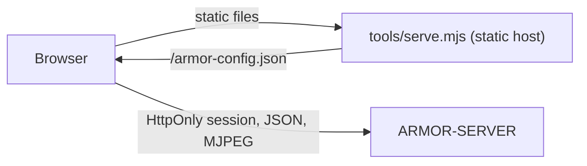

<p align="center">
  
</p>

# 🎛️ ARMOR-STUDIO

<p align="center">
  <a href="README.md">🇺🇸 English</a> |
  <a href="README_spa.md">🇪🇸 Español</a> |
  <a href="README_fra.md">🇫🇷 Français</a> |
  <a href="README_ita.md">🇮🇹 Italiano</a> |
  <a href="README_deu.md">🇩🇪 Deutsch</a> |
  <a href="README_zho.md">🇨🇳 简体中文</a> |
  🇯🇵 <b>日本語</b> |
  <a href="README_por.md">🇵🇹 Português</a>
</p>

### 運用・設計コンソール：カメラ、レーダー、警報、エネルギー、ローカルネットワーク、証拠、サイト図、設備の保守

<p align="center">
  
  
  
  
  
  
  
</p>

---

**正直さのチェック - 今日動いているもの:** Studio は [ARMOR-SERVER](https://github.com/JuanenRac/ARMOR-SERVER) と通信し、1185 件のユニットテスト（設定の解析、カメラの統合、ソーラーグラフの計算、設計ツールの幾何と検査、警報アナウンサー、アシスタントの辞書、8 言語での全メニューの描画、静的ホスト）とブラウザテストでカバーされています。CM5 テストベンチで、実際のサーバー、実際の IP カメラ、基板上のレーダーノードと組み合わせて日常的に動作しており、ヘルプの画像は例示データで作られています。**まだ**証明されていないもの：あらゆるカメラでのライブ映像と PTZ、実機でのソーラー・電気・警報盤・タッチパネルのメニュー（存在するのはレーダーノードのみ）、正式なアクセシビリティ・ユーザビリティ評価。サーバーに接続できない間、Studio はデモデータを表示し、上部バーでそれを示します。

---

## 📋 ひと目で

| | |
|---|---|
| バージョン | `0.8.1.3` |
| 成熟度 | 確立 |
| 役割 | ファミリーの運用・設計コンソール |
| 技術 | React 19, TypeScript, Vite, Three.js, Leaflet |
| テスト | 1185 件（`npm test`、Vitest）とブラウザーテスト（Playwright） |
| 契約 | ARMOR-SERVER とだけ通信（HttpOnly セッションの HTTP `/api/v1/*`、WebSocket `/api/v1/events`） |
| 待ち受け | `127.0.0.1:5178`（`tools/serve.mjs`） |
| 動作環境 | ブラウザー。ファイルは `tools/serve.mjs` またはコンテナの nginx が配信 |
| 実機での確認 | CM5 テストベンチ（実サーバー、実際の IP カメラ、実際のレーダーノード）で毎日使用。ソーラー・電気・警報盤・タッチパネルのメニューは実ノードを待っています |
| ライセンス | GPL-3.0-or-later |

**移動先：** [概要](#-概要) · [アーキテクチャ](#-アーキテクチャ) · [セキュリティ](#-セキュリティと安全) · [インターフェース](#-インターフェース) · [設定](#-設定) · [クイックスタート](#-クイックスタート) · [テスト](#-テスト) · [トラブルシューティング](#-トラブルシューティング) · [構成](#-リポジトリの構成) · [関連](#-関連プロジェクト)

## 🚦 プロジェクトの状況

各行はこのリポジトリの一部分で、信号は今日どこまで進んでいるかを示します。計画ではなく、リポジトリが示せるもの（テスト、ビルド、実行）に基づいて書かれています。

🟢 完了・検証済み · 🟡 動作する（既知の制限あり） · 🟠 一部のみ、または未検証 · 🔴 未実装または動作しない

| 領域 | 状態 | ここでの意味 |
|---|---|---|
| ソフトウェア | 🟢 | コンソールは CM5 テストベンチの実際のサーバーに対して毎日使われています。 |
| テスト | 🟢 | 1185 件のユニットテストが通り（`npm test`）、ブラウザーテストも実行されます：設定、カメラの統合、太陽光のグラフ、デザイナーの図形と検査、警報アナウンス、アシスタントの辞書、8 言語すべてのメニュー。 |
| インターフェース | 🟡 | ライブ映像と PTZ はすべてのカメラで確認したわけではなく、アクセシビリティやユーザビリティの正式なレビューもありません。ヘルプの画像はサンプルデータで作っています。 |
| ハードウェア | 🟡 | 実際のサーバー、実際の IP カメラ、実際のレーダーノードとともに毎日使っています。太陽光・電気・警報パネル・タッチパネルのメニューは、実機のノードを待っています。 |
| セキュリティ | 🟡 | セッション、ロール、アドレスにカメラのログイン情報を含めることの拒否はテストでカバーされています。独立したレビューはありません。 |
| 連携 | 🟡 | サーバーに接続できない間は、Studio はデモデータを表示し、上部のバーでそのことを知らせます。 |
| ドキュメント | 🟢 | 8 言語、アプリ内ヘルプとガイドツアー、セキュリティ注記、変更履歴は最新です。 |

## 🎯 概要

**ARMOR-STUDIO** はオペレーターのコンソールです。カメラのパスワード、RTSP アドレス、トークンを決して持ちません。ユーザー名とパスワードでサーバーにサインインし、7 日間の **HttpOnly** セッションを受け取り、権限の要る操作はすべてそのセッションを通ります。

* **概要とシステム：**境界の状態、各部分のタイル（警報盤、レーダー、カメラ、デバイス、エネルギー、ネットワーク、サーバー）、すべてのデバイスと警報を載せた設計のライブマップ、注意が必要なもの。すべてスクロールなしの 1 画面で、管理者にはシステムページと監査記録があります。
* **カメラモニター：**枠に収まる 1、2、4、6、8、9、12、16 タイル（16:9、マトリクス全体が見え、切り取りなし）、範囲を限った PTZ パッド付きの拡大表示、スナップショットと MP4 録画。**録画ライブラリ**で証拠のフィルター、プレビュー、再生、保護、削除、**保管証明**のダウンロードができます。
* **警報：**今すぐ人が必要なものを、確認と終了記録とともに表示。**警戒前のチェック**と解除用 PIN、ライブマップ上の警報、重大度ごとの音、独自のスタイル（標準、アクションヒーロー、闇の支配者、劇的）を持つ音声読み上げ（何かが接続されたことも伝えます）、ポップアップ、ヘルプの隣のミュートボタン、適切なメニューへの任意のジャンプ。
* **デバイスとオートメーション：**煙、ガス、浸水、ドア、窓、動き、気候、プラグ、照明、サイレン、鍵、シャッター、門扉、ガレージドア、給湯器を Wi-Fi、Zigbee、Bluetooth、有線で（Zigbee2MQTT、Tasmota、Shelly のプリセット付き）。あらゆる警報源（しきい値も可）から、何かが起きたときにデバイスを切り替えるルール、大きな警戒 / 解除ボタン。
* **警報盤と警報デザイナー：**各 ARMOR-NODE-ALARM ノードの状態、ゾーンとイベント、ゾーンに結び付けた Zigbee センサー、そして家の警報（警報盤、接点、動き、煙・ガス・浸水検知器、サイレン、キーパッド、配線、無線リンク）を描き、描いた各要素を実際のゾーンに結び付けるデザイナー。
* **ソーラーと電気のエネルギー：***インバーター*メニューは家をゲージ、数値、履歴グラフ付きのアニメーションするエネルギーフローとして描き、*バッテリー*は各スタックの容量、各モジュール、すべてのセルを表示し、*電気*は系統入力、各チャンネル、メーターの警報を表示します。どちらも機器（Voltronic、MPP Solar、Pylontech、ANT-BMS など）を登録でき、*例示の測定値を表示*ボタンで先にメニューを試せます。
* **電気デザイナー：**家の電気図（系統、メーター、保護、切替器、配電、PV、インバーター、バッテリー、負荷、AC と DC）を描き、サーバーが読むソーラー機器に結び付けてライブ値を見て、検査に見直させます（1 本の線に 2 つの電源、電流に対するブレーカーとケーブルなど）。
* **レーダー：**サイト設計から描いたライブマップに、各レーダーが報告する対象、その最近の経路、**無視する映像ゾーン**を表示。ノードのライブ状態（無応答は*古い*と表示）、各ノード自身のパネルへ 1 クリック。
* **サイトデザイナー：**地形、複数階の建物（5 種類の屋根）、ドア、窓、街灯、煙突、ソーラーパネル、マスト、道路や小道を描き、カメラとレーダーを好きな場所に配置。CAD 風の 2D 図面と、階ごとに回転できる 3D 表示、元に戻す・やり直し、設計のバージョン。
* **ローカルネットワーク：***ネットワーク*メニューは ARMOR-NETWORK ノードの報告（デバイス、停止、インターネットの状態、プロバイダーと場所付きの**公開アドレス**）を表示し、デバイスの命名、非表示、監視、スキャン・ping・あなたが渡したログインでの検査の指示ができ、*ネットワークデザイナー*がそれを描きます。
* **自動撮影：***設定 > 自動撮影*で、システムが警戒中にカメラが何かを捉えると写真と動画を自動で撮影（枚数、間隔、クリップの長さ）し、無視する映像ゾーンをカメラのフレーム上に描きます。
* **ノードファームウェアとアップデート：***ノードファームウェア*はフィールドノードを 1 台ずつ更新し、全体と各ノードにバーを表示し、警報で別メニューに移っても状態を保ちます。*アップデート*は GitHub から Studio とサーバーの新バージョン（新バージョンの更新内容も表示）、OS の更新、任意の保守コンソールをインストールします。
* **グループ化された設定：**一般と設定項目、ユーザー・通知・自動撮影、ノードファームウェアとアップデート、サーバー・サービス・MQTT ブローカー・設定ファイル・インストール・コンソール。サイドバーの各メニューも折りたたみ可能なグループ（監視、セキュリティ、エネルギー、家とネットワーク、設計、管理）に分かれています。
* **8 言語**（英語、スペイン語、ドイツ語、フランス語、イタリア語、日本語、中国語、ポルトガル語）と 16 のテーマ（既定は *Armor*）。言語、テーマ、天気の場所はブラウザではなくアカウントに従います。ロール：管理者、オペレーター、閲覧だけの **viewer**。
* **システム全体を知っているヘルプ：**4 段階の詳しさを持つ本と各主要メニューの例示データ付き画像、メニューごとのステップガイドツアー（ボタン1つ1つの働き、期待できる結果、よくある間違いまで説明し、専用のマスコットと音声付き）、現場ノードを詳しく説明するヘルプ（セットアップ用Wi-Fi、アクセスポイントとステーション、Bluetooth PIN、ロールバック付きファームウェアスロット、署名付き更新、外部からのパネル）、あらゆるもののヒント、そして**アシスタント**（どこへでもドラッグでき、好きな場所に固定でき、文字で質問できるマスコット）。8 言語の辞書と、空きのある側に開く吹き出し付き。作業中のメニューは、別のメニューを見ている間も開いたままです。
* **ファイルではなく選択肢で設定する外部アクセス：**セキュリティで管理者が WireGuard VPN を設定し、QR コードでスマホを追加し、家に付いてくる名前（DuckDNS、Cloudflare、または呼び出せる任意のアドレス）を維持し、サーバー経由で外から開けるノードを登録します（信頼する前に証明書のフィンガープリントを比較）。各ステップは 8 言語で説明され、外からの操作ではパスワードを再度求めます。
* **外から家に届く方法を一歩ずつ：** 設定 > セキュリティの6ステップのガイドが、マシンが対応しているか、VPNがあるか、家に名前があるか、ルーターでポートが開いているか、スマホが追加済みかを示し、モバイルデータでの試し方を説明します。セキュリティタブは見出し付きの3つのセクションに整理されています。
* **ブローカー暗号化カード:** 設定 > ブローカー に、サーバーとブローカーの接続が暗号化されているかと、信頼している設備独自の認証局のフィンガープリントが表示されます。接続が暗号化なしの場合は、それが初期状態なので警告は表示されません。
* **ノードの状態と警戒モード:** 「システム」には各ノードの状態報告（稼働時間、再起動の理由、メモリ、回線と信号、ブローカー接続、最後のエラー、履歴と再起動）のカードがあり、「警報盤」にはモード選択（外出、在宅、夜間、独自）とモードの編集があります。すべて 8 言語で、ヘルプ、ツアーの手順、アシスタントの回答付きです。
* **パスワードマネージャー対応のサインインとタブ付きの履歴:** サインインは本物のフォームで、ブラウザーや OS のパスワードマネージャーが保存・入力できます。任意の「ユーザー名を記憶」はユーザー名だけを保存し（パスワードは決して保存しません）、その旨の注記があります。履歴には「すべて」「アラーム」「接続」「デバイス」「システム」「設定」のタブがあり、サーバーに接続するすべてのデバイスとアプリの一覧（最終確認、開いているセッション、サインインと拒否）と、ノード・ブローカー・サービス・更新・警戒操作のイベントが見られます。アドレスは管理者にだけ表示されます。
* **バッテリーのメンテナンス（設定、管理者向け）：** 4段階のウィザード——バッテリーと操作、値、バッテリーのシリアル番号を入力して確認、結果——で、Pylontechバッテリーが保持する内容を変更します。制限値は電圧・温度で入力しグループ単位で送信、ファームウェアファイルは送信前に読み取り、前後のバッテリー状態を差分と記録とともに表示し、出力は元に戻せます。
* **ノードの健全性カードからの制御：** 各ノードにメニュー（再起動、一時停止または再開、スタンバイ（動作停止、接続は維持）または電源オン、識別、診断、メンテナンスのオン／オフ）があり、カードにはグループ操作として、すべて再起動（同時、または警報パネルを最後にして順番に）、すべて一時停止、すべてスタンバイ、すべて再開があります。ノード名（全ノードの場合は RESTART、PAUSE、STANDBY のいずれかの単語）を再入力し、新たな本人確認も求められます。チップが各ノード（送信済み、受領、オフライン、復帰、適用）を追い、一時停止中、いつから誰によるスタンバイか、メンテナンスを表示し、警報パネルやレーダーが一時停止またはスタンバイのとき家が無防備になることを警告が知らせます。工場出荷時リセット、消去、ディープスリープはありません。
* **ライブ状態：** Studio はサーバーのライブチャネル（WebSocket）を受け取り、アラーム・警戒・ノードの復帰を即座に表示します。チャネルが開いている間は保険として20秒ごとにだけ状態を問い合わせ、下部バーに「ライブ」と表示します。アラーム・電気・ネットワークの各デザイナーは、既存のキーに加えて F（全体表示）、プラス／マイナス（ズーム）、Ctrl+D（複製）にも反応します。
* **ノードのログイン上限:** 一覧のすべてのノード（レーダー、インバーター、バッテリー、電気、壁面画面）に、`system.login_limit_per_minute`（ノードがログインをロックするまでの 1 分あたりの誤パスワード数。既定 30、0 で全体の上限なし、最大 120）を読み取り・変更するダイアログを開くボタンがあります。ノードのパネルのログイン情報は 1 回だけ使われ保存されません。ダイアログとそのヘルプは 8 言語です。
* **応答しなくなったメーターと、別のボード用のファームウェアイメージ:** 読み取りが古い電気チャンネルはグレー表示で「データなし」と示され、カードがその数を数えます（設定 > セキュリティ、`electrical.set_aside_old_readings`、既定でオン）。ファイル名がノードのボードと異なるボードを示すファームウェア更新や、別の種類のノードへの更新は、コードではなく分かりやすい理由とともに拒否されます。
* **設計支援（既定ではオフ）:** 設定 > 環境設定で *設計支援* をオンにすると、警報設計に 3 つの出発点（住戸、店舗、周囲防護付きの倉庫。それぞれスキーマで検証されるデータファイル）が、敷地プランに *カバー範囲* チェックが加わります。どのレーダーにも見えない建物の部分、何も守っていないドアと窓、2 台のレーダーが同時に見ている場所を、それぞれレーダーの設置位置の提案つきで示し、死角をプランに描き、レポートを JSON または CSV で書き出せます。確実に見える範囲だけを数える平面的な目安であり（壁は視界を遮り、各レーダーは設定したマージンだけ小さく扱います）、建物が守られている証明ではありません。詳しくは [docs/DESIGN_AIDS.md](docs/DESIGN_AIDS.md) を参照してください。
* **システムの警戒モード（外出・在宅・夜間）:** 管理者が 設定 > セキュリティ で *在宅・夜間の警戒モード* をオンにすると、警戒ボタンがダイアログを開き、モードを選んで警戒したり、モードを切り替えたり、解除したりできます。何も守らないモードは確認を求め、守る範囲が狭いモードへの切り替えは解除と同じようにPINを求めます。アラームデザイナーには *モード* タブが加わり、在宅と夜間について、ゾーン全体（デバイスの設置場所）、センサー、レーダーノード、カメラ（最初は空）、退出・入口の遅延、スケジュールを指定できます。さらに3つのオプション（守る範囲が狭いモードへ切り替えるPIN、スケジュール、スケジュールが保護を下げてよいか）が 設定 > セキュリティ にあります。既定ではオフで、オフのときコンソールはこれまでどおり警戒と解除だけを行います。

## 🧩 A.R.M.O.R. での役割

Studio はシステム全体を見渡すオペレーターの窓口です。ノードとは直接話さず、すべて [ARMOR-SERVER](https://github.com/JuanenRac/ARMOR-SERVER) を通します（唯一の例外は各ノード自身のパネルへのリンク）。サイト、警報、電気設備、ネットワークの設計、ノードのファームウェアや設備自身のアップデートの操作、ヘルプとアシスタントもここにあります。同じサーバーを、スマートフォンの [ARMOR-ANDROID-CONTROL](https://github.com/JuanenRac/ARMOR-ANDROID-CONTROL) も使います。

| 連携先 | 方法 | 目的 |
|---|---|---|
| ARMOR-SERVER | HttpOnly セッションでの HTTP、WebSocket、MJPEG | すべて：状態、オーダー、設計、カメラ |
| 各ノード自身のパネル | サーバーのプロキシ経由のリンク | 「ノードとは直接通信しない」の唯一の例外 |
| 天気サービス | Open-Meteo, RainViewer, EUMETSAT, ArcGIS | 天気メニューのみ、場所を保存した場合のみ |
| ARMOR-DEVOPS | CM5 テストベンチへスタックをインストール | デプロイ |

## 🏛️ アーキテクチャ

<p align="center">
  
</p>

<details>
<summary>図のテキスト版（Mermaid）</summary>



</details>

## 🖼️ スクリーンショット

テストベンチで 1920×1080 で撮影。サンプルデータを使用しており、実際の設備は接続されていません。

<table>
<tr><td width="50%" valign="top"><br><sub>概要：境界の状態、警報、レーダーノード、エネルギー、現場のライブマップを 1 画面に表示します。</sub></td><td width="50%" valign="top"><br><sub>レーダー：各レーダーが捉えた目標を現場の図面上に表示し、各センサーのカバー範囲も示します。</sub></td></tr>
<tr><td width="50%" valign="top"><br><sub>インバーター：ソーラーパネル、系統、住宅、バッテリー間のエネルギーの流れ（読み取り専用）。</sub></td><td width="50%" valign="top"><br><sub>サイトデザイナー：Studio の他の画面が使う図面に、地形・建物・カメラ・レーダーを描きます。</sub></td></tr>
<tr><td width="50%" valign="top"><br><sub>電気デザイナー：住宅の AC・DC 回路図とそのチェックを、用意されたサンプルから表示します。</sub></td><td width="50%" valign="top"><br><sub>警報パネル：各パネルが警戒中か、そのゾーン、直近の出来事を表示します。</sub></td></tr>
</table>

## 🔒 セキュリティと安全

* **ブラウザーにシークレットはありません。** カメラのパスワードは一度入力してサーバーに送り、その後はマスクされた「保存済み」の状態でしか表示されません。サイトのエクスポートはユーザー名と認証情報のフラグを除きます。
* **保存された設定は信頼できない入力です。** 値ごとに読み取られ、無効なオリジン、テーマ、言語、形は捨てられ、位置は範囲内に収められ、リストは上限が設けられます。

| 脅威 | 防御 |
|---|---|
| ブラウザー内の秘密 | パスワード、トークン、セッション、カメラの認証情報は一切保存しません。ログイン付きのスナップショットアドレス（`user:pass@` や `?pwd=`）は拒否し、サインアウトでコンソールとファームウェアジョブの状態を空にします |
| セッションの盗難 | サーバーが設定する HttpOnly・SameSite=Strict の Cookie（`armor_studio_sid`、HTTPS では `__Host-armor_studio_sid`）。Studio は毎分確認します |
| 改ざんされたブラウザー保存データ | `localStorage` から読むものはすべて値ごとに解析し、不正なオリジン・テーマ・言語・形は破棄、位置は範囲内に収め、リストには上限があります。保存スキーマにはバージョンがあります |
| 悪意のあるサーバーアドレス | 素の `http(s)` オリジンのみ（認証情報、パス、クエリ、フラグメントなし） |
| インジェクション、クリックジャッキング、情報漏えい | `Content-Security-Policy: default-src 'self'; script-src 'self'; object-src 'none'; base-uri 'none'; frame-ancestors 'none'`、`connect-src` は設定済みサーバーと天気サービスのみ、`nosniff`、`no-referrer`、`Cross-Origin-Opener-Policy: same-origin`、カメラ・マイク・位置情報を無効にする `Permissions-Policy` |
| nginx 配下で失われるセキュリティヘッダー | `security_headers.conf` はすべての `location` に含めます（nginx は `location` 自身が持たない場合にしか `add_header` を継承しません） |
| ノードへの危険なオーダー | 管理者のみ。ノード名（全ノードなら RESTART、PAUSE、STANDBY）を再入力し、パスワードも再度求めます。消去、初期化、電源オフのオーダーはありません |
| ロール | 管理者、オペレーター、閲覧者（見るだけ）、壁面パネル（そのアカウントは Studio を使えません）。セッションの `capabilities` が表示を決め、サーバーが再検証します |

**他のサービスに接続するのは天気メニューだけです。** フォントはローカルで、ほかにサードパーティへ要求するものはありません。天気メニューは、場所を保存したアカウントでのみ、Open-Meteo（予報、ジオコーディング、大気質）、RainViewer（レーダー）、EUMETSAT（雲）、ArcGIS（地図タイル）を読み込みます。静的ホストは、設定されたサーバーとこれらのサービスに限定した `Content-Security-Policy: default-src 'self'`、`frame-ancestors 'none'`、`nosniff`、`no-referrer` を送ります。

**スイッチ。** *設定 > セキュリティ* には、ARMOR-SERVER が管理者に調整を許す 17 の保護（解除 PIN、音声での消音、アラーム設計の署名、ゾーンフィード、カメラのトンネル、ネットワークのログイン、新しい国からのログイン通知、古い電気の読み取り値の除外、壁面パネルのライブイベント、デバイスロック、ノード保存領域の暗号化、音声の上限）それぞれのコントロールがあり、既定値は保守的です。下げた場合はサーバーの監査に残ります。詳細は [docs/SECURITY_MODEL.md](docs/SECURITY_MODEL.md)。第三者によるセキュリティレビューはありません。

## 🔌 インターフェース

| ルート | 認証 | 内容 |
|---|---|---|
| `/api/v1/*` | セッション Cookie | サーバークライアント（`src/api/` に分野別）。`src/api/routes.test.ts` と `src/api/contract/` が契約と照合 |
| `WS /api/v1/events` | セッション | ライブ状態：アラーム、警戒、ノード復帰が即座に表示されます。チャネルが開いている間は安全網として 20 秒ごとにだけ状態を問い合わせ（なければ 3 秒ごと）、下部バーに *ライブ* と表示 |
| MJPEG、スナップショット、録画 | ストリームチケット | ライブ映像はサーバーがオペレーターに発行したアドレス経由のみ。カメラのパスワードはブラウザーに届きません |
| `GET /armor-config.json` | なし | `{"serverOrigin": "<オリジン>" / "same-origin"}`、`tools/serve.mjs` または nginx が返す |

## ⚙️ 設定

| 設定 | 既定値 | 内容 |
|---|---|---|
| `ARMOR_STUDIO_HOST` | 127.0.0.1 | 静的ホストの待ち受けアドレス |
| `ARMOR_STUDIO_PORT` | 5178 | ポート。Studio から保存した `connection.json` の `studio_port` が優先 |
| `ARMOR_STUDIO_DIST` | ./dist | 配信するビルドのフォルダー |
| `ARMOR_SERVER_ORIGIN` | 空 | Studio が起動時に使うオリジン（カンマ区切りで複数可）。ポリシーの `connect-src` を決めます。空ならサインインしたサーバーを受け入れます |
| `TLS_CERT_PATH`  `TLS_KEY_PATH` | オフ | 両方指定か両方なし：静的ホストのネイティブ HTTPS |
| `ARMOR_PUBLIC_ORIGIN`  `ARMOR_SERVER_UPSTREAM` | same-origin | コンテナ内：`/armor-config.json` の内容と、nginx が `/api/` を中継するサーバーの `host:port` |

オリジンを設定しない場合、クライアントは `http://127.0.0.1:8080` を使います。言語、テーマ（16 種類）、天気の場所はブラウザーではなくアカウントに従います。`tools/serve.mjs` は上の変数を読みます。CM5 テストベンチへスタック全体をインストールするには [ARMOR-DEVOPS](https://github.com/JuanenRac/ARMOR-DEVOPS) を参照してください。

## 🚀 クイックスタート

**要件：** Node.js 22+ と稼働中の ARMOR-SERVER（なければ Studio はデモデータを表示し、上部バーでそう伝えます）。

```powershell
npm install                                                                    # 依存関係
npm run dev                                                                    # 127.0.0.1:8080 のサーバーに対して http://127.0.0.1:5178
npm run typecheck                                                              # tsc -b --noEmit
npm run locales                                                                # 文言を変えたら各言語の表を書き出す
npm test                                                                       # 1185 件
npm run build                                                                  # dist/
$env:ARMOR_SERVER_ORIGIN = "http://192.168.0.180:18080"; node tools/serve.mjs  # ビルドを配信
```

## 🧪 テスト

```powershell
npm run typecheck      # tsc -b --noEmit
npm test               # vitest run
npm run lint           # eslint src
npm run locales:check  # 8 つの表が生成済み
python -I tools/armor_ci_validate.py
```

| 分野 | 対象 |
|---|---|
| 設定、カメラ、レーダーマップ | 保存設定の解析、カメラの統合、レーダー目標、無視ゾーン |
| エネルギー | 太陽光グラフの計算、バッテリーと電気のメニュー |
| デザイナー | サイト・電気・アラーム・ネットワークデザイナーの図形、操作、検査 |
| 通知とアシスタント | 警報と接続のアナウンサー、アシスタントの辞書、ツアー |
| 8 言語すべてのメニュー | 各画面を全言語で描画し、生のキーのまま残る文言がないことを確認 |
| API クライアントと静的ホスト | `src/api/` のルートと契約、`tools/serve.test.mjs`（ヘッダー、`/armor-config.json`、ネイティブ TLS） |
| ブラウザーテスト | 実サーバーのスタックに対する Playwright の `e2e/tests`（`e2e/README.md`） |

静的ホストのネイティブ TLS テストには `openssl` が必要です。`npm run locales:check` は、ある言語の表がその文言から生成されていないと失敗します。GitHub Actions は push と pull request のたびに A.R.M.O.R. の基本検査（マニフェスト、バージョン、変更履歴、README の一致）と、プロジェクト自身のビルドとテストを実行します。

## 🏗️ ビルドとリリース

`npm run build` は静的サイトを `dist/` に書き出します。`Dockerfile` は Node 22 でビルドし、nginx（`nginx/`）で配信します。バージョンは `package.json`、`armor.project.json`、README のバッジ（マニフェストから読み取り）にあり、各バージョンには [CHANGELOG.md](CHANGELOG.md) にエントリーがあります。リリースは GitHub で公開されます。

## 🩺 トラブルシューティング

| 表示 | 原因 | 対処 |
|---|---|---|
| デモデータと上部バーの通知 | サーバーに届かない | ARMOR-SERVER を起動し、サインインに使ったオリジンを確認 |
| ブラウザーがサーバーへのリクエストをすべて遮断する | オリジンがポリシーの `connect-src` にない | `ARMOR_SERVER_ORIGIN` に追加（カンマ区切り）するか、Studio とサーバーを同じオリジンで配信 |
| オーダーが `elevation_required`（403）で拒否される | 重要操作には直近の再認証が必要 | Studio がパスワードを再度求めるので入力してやり直す |
| パスワードマネージャーが保存を提案しない | サインインは本物のフォームで、最初の成功まで待つマネージャーもある | 一度サインインする。「記憶する」はユーザー名のみで、パスワードは保存しない |

## 📂 リポジトリの構成

<p align="center">
  
</p>

<details>
<summary>ツリーのテキスト版</summary>

```text
ARMOR-STUDIO/
├── src/
│   ├── App.tsx                       骨格：メニュー、グループ、ライブ状態
│   ├── api/                          サーバークライアント（分野ごとに 1 ファイル）
│   ├── views/                        概要、カメラ、レーダー、アラーム、エネルギー、ネットワーク、システム
│   ├── components/                   カメラタイル、上部バー、サイドバー、ヘルプ、地図
│   ├── designer/                     サイトデザイナー（2D 図面と 3D）
│   ├── electrical/ alarm/ network/   電気・アラーム・ネットワークデザイナー
│   ├── alerts/ assistant/ tour/      音と声、マスコット、ガイドツアー
│   ├── weather/ help/ preflight/     天気メニュー、ヘルプ、警戒前チェック
│   └── locales/                      各言語の表（生成）
├── public/                           ヘルプの画像（言語ごと）
├── nginx/                            イメージの Web サーバーとヘッダー
├── e2e/                              ブラウザーテスト（Playwright）
├── tools/                            serve.mjs（静的ホスト）、build_locales.mjs、共通の CI 検査とランチャー
├── docs/                             セキュリティモデル
├── images/                           バナー、アイコン、README の画像
├── .github/                          CI ワークフロー、ダッシュボード通知、Issue と Pull Request のテンプレート
├── Dockerfile                        コンテナイメージ（Node ビルド、nginx）
├── armor.project.json                マニフェスト：版・役割・成熟度
├── CHANGELOG.md                      各バージョンの変更点
├── package.json package-lock.json    依存関係とスクリプト
├── index.html                        Vite がアプリを組み立てる元のページ
├── vite.config.ts eslint.config.js   バンドラーと lint の設定
├── tsconfig.json tsconfig.app.json   TypeScript 設定
├── run.sh run.bat                    起動（共通フロー）
├── build.sh build.bat                ビルドとテスト（共通フロー）
├── build-test.sh build-test.bat      ビルド、テスト、パッケージ化
├── test.sh test.bat                  テストのみ（版は変えません）
└── SECURITY.md SUPPORT.md CONTRIBUTING.md CODE_OF_CONDUCT.md LICENSE
```

</details>

## 🗺️ ロードマップと既知の制限

**現時点の既知の制限**

* ライブ映像と PTZ は、考えられるすべてのカメラで確認されたわけではありません。
* ソーラー、電気、アラームパネル、タッチパネルのメニューは実際のノードを待っています。実機があるのはレーダーノードだけです。
* アクセシビリティとユーザビリティの正式なレビューはなく、ヘルプの画像はサンプルデータで作られています。
* 第三者によるセキュリティレビューはありません。

**今後**

* 他のノードのメニューを各基板で試す。
* アクセシビリティとユーザビリティを見直す。

## 🌍 言語

README とテキストは、英語、スペイン語、フランス語、イタリア語、ドイツ語、中国語、日本語、ヨーロッパポルトガル語で提供されています。

## 🔗 関連プロジェクト

**A.R.M.O.R.**（Autonomous Radar & Multimodal Observation Range）は、独立したリポジトリで構成される境界セキュリティシステムです。各リポジトリは独自のバージョン、テスト、README を持ちます。ファミリーは次のとおりです：

* **[ARMOR-COMMON](https://github.com/JuanenRac/ARMOR-COMMON)** - メッセージのコントラクト、バリデーター、適合ベクトル、生成された型
* **[ARMOR-NODE-RADAR](https://github.com/JuanenRac/ARMOR-NODE-RADAR)** - 3 つのレーダーと独自の Web パネルを備えた ESP32-S3 向けフィールドノードのファームウェア
* **[ARMOR-NODE-SOLAR](https://github.com/JuanenRac/ARMOR-NODE-SOLAR)** - ソーラーインバーターとバッテリーのプロトコル、ゲートウェイノードのメッセージ
* **[ARMOR-NODE-ELECTRICAL](https://github.com/JuanenRac/ARMOR-NODE-ELECTRICAL)** - 電気ノード：メーター、系統の読み取り値のメッセージ、切り替えのルール
* **[ARMOR-NODE-ALARM](https://github.com/JuanenRac/ARMOR-NODE-ALARM)** - 警報ノードとパネル：ゾーン、警戒、遅延、サイレン、PIN。サーバーありでもなしでも動作
* **[ARMOR-NODE-HMI](https://github.com/JuanenRac/ARMOR-NODE-HMI)** - タッチパネル：壁面画面でのシステムの状態、警戒と確認応答、そして音声アシスタントの置き場
* **[ARMOR-NETWORK](https://github.com/JuanenRac/ARMOR-NETWORK)** - ローカルネットワーク：そのデバイス、インターネット、そして変化
* **[ARMOR-SERVER](https://github.com/JuanenRac/ARMOR-SERVER)** - 中央コーディネーター：テレメトリ、警報、デバイス、ソーラーの読み取り値、カメラ
* **ARMOR-STUDIO**（このリポジトリ） - Web コンソール：カメラ、レーダー、警報、太陽光エネルギー、2D/3D のサイトデザイナー
* **[ARMOR-ANDROID-CONTROL](https://github.com/JuanenRac/ARMOR-ANDROID-CONTROL)** - ライブの 2D/3D レーダーを備えた Android オペレータークライアント
* **[ARMOR-IOS-CONTROL](https://github.com/JuanenRac/ARMOR-IOS-CONTROL)** - iPhone オペレータークライアント
* **[ARMOR-SERVER-AI](https://github.com/JuanenRac/ARMOR-SERVER-AI)** - 判断を説明し、決して作動させない視覚推論ポリシー
* **[ARMOR-VISION](https://github.com/JuanenRac/ARMOR-VISION)** - Jetson Orin NX 向けのカメラゾーン、マスク、検出ルール
* **[ARMOR-VOICE-AI](https://github.com/JuanenRac/ARMOR-VOICE-AI)** - 偽造できない確認つきのオフライン音声インテント
* **[ARMOR-HARDWARE](https://github.com/JuanenRac/ARMOR-HARDWARE)** - 筐体、電子回路、ベンチ受け入れマトリクス
* **[ARMOR-DEVOPS](https://github.com/JuanenRac/ARMOR-DEVOPS)** - デプロイ、CM5 テストベンチ、バックアップ、TLS
* **[ARMOR-SIMULATOR](https://github.com/JuanenRac/ARMOR-SIMULATOR)** - 再現可能な障害を持つオフラインのテレメトリシミュレーター
* **[ARMOR-UPDATER](https://github.com/JuanenRac/ARMOR-UPDATER)** - エコシステム自身のリポジトリを検出、インストール、更新
* **[ARMOR-DOCS](https://github.com/JuanenRac/ARMOR-DOCS)** - アーキテクチャ、セキュリティのベースライン、機能マトリクス

## 📚 ドキュメント

* [設計支援](docs/DESIGN_AIDS.md)：警報テンプレートと敷地プランのカバー範囲チェック
* [セキュリティモデル](docs/SECURITY_MODEL.md)：ブラウザーが保持するもの、ヘッダー、ノードへのオーダー
* [ブラウザーテスト](e2e/README.md)：スタックに対する実行方法
* [機能マトリクス：何が証明され、何が証明されていないか](https://github.com/JuanenRac/ARMOR-DOCS/blob/main/docs/CAPABILITY_MATRIX.md)
* [プロジェクトカタログ：バージョンと、リポジトリ同士の依存関係](https://github.com/JuanenRac/ARMOR-DOCS/blob/main/docs/PROJECT_CATALOG.md)
* [このリポジトリの変更履歴](CHANGELOG.md)

## 🤝 コントリビュートとコミュニティ

* Pull Request の前に `python -I tools/armor_ci_validate.py` とテストを実行してください。どちらも通る必要があります。[CONTRIBUTING.md](CONTRIBUTING.md) と[行動規範](CODE_OF_CONDUCT.md)を参照してください。
* README は 8 言語で提供され、ARMOR-DOCS のソースから生成されます。文面の変更はそちらで行います。
* コンポーネント間のメッセージの変更は ARMOR-COMMON から始めます。
* ビルドしただけのものを、ボード上で動いているかのように書かないでください。
* 脆弱性は非公開で報告してください：[SECURITY.md](SECURITY.md)。質問、アイデア、報告：electrohobby3d@gmail.com（[SUPPORT.md](SUPPORT.md)）。

## 👤 作者

**JuanenRac (Electro Hobby 3D)** · electrohobby3d@gmail.com

## 📜 ライセンス

GPL-3.0-or-later - [LICENSE](LICENSE) を参照してください。
