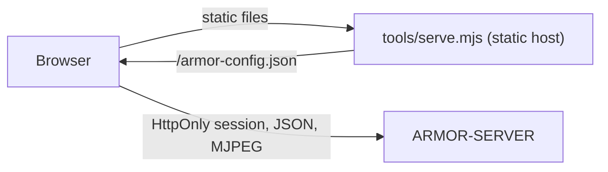

<p align="center">
  
</p>

# 🎛️ ARMOR-STUDIO

<p align="center">
  <a href="README.md">🇺🇸 English</a> |
  <a href="README_spa.md">🇪🇸 Español</a> |
  <a href="README_fra.md">🇫🇷 Français</a> |
  <a href="README_ita.md">🇮🇹 Italiano</a> |
  <a href="README_deu.md">🇩🇪 Deutsch</a> |
  <a href="README_zho.md">🇨🇳 简体中文</a> |
  <a href="README_jpn.md">🇯🇵 日本語</a> |
  🇵🇹 <b>Português</b>
</p>

### Consola de operação e desenho: câmaras, radar, alarmes, energia, a rede local, provas, a planta do local e a manutenção da instalação

<p align="center">
  
  
  
  
  
  
  
</p>

---

**Verificação de honestidade - o que funciona hoje:** O Studio fala com o [ARMOR-SERVER](https://github.com/JuanenRac/ARMOR-SERVER) e está coberto por 1186 testes unitários (leitura de definições, fusão de câmaras, a aritmética dos gráficos solares, a geometria e as verificações dos desenhadores, o anunciador de alarmes, o dicionário do assistente, cada menu desenhado nos oito idiomas, o servidor estático) e por testes no navegador. Funciona em uso diário contra a bancada de testes do CM5 com o servidor real, câmaras IP reais e um nó radar na sua placa; as imagens da Ajuda são feitas com dados de exemplo. O que **não** foi provado é o vídeo em direto e o PTZ com todas as câmaras possíveis, os menus solar, elétrico, de centrais de alarme e de painel tátil com equipamentos reais (só existe o nó radar) e uma revisão formal de acessibilidade ou usabilidade. Enquanto o servidor não é alcançado, o Studio mostra dados de demonstração e di-lo na barra superior.

---

## 📋 Num relance

| | |
|---|---|
| Versão | `0.8.1.4` |
| Maturidade | Estabelecido |
| Função | Consola de operação e desenho da família |
| Tecnologia | React 19, TypeScript, Vite, Three.js, Leaflet |
| Testes | 1186 (`npm test`, Vitest) e testes de navegador (Playwright) |
| Contrato | Só fala com o ARMOR-SERVER (HTTP `/api/v1/*` com sessão HttpOnly, WebSocket `/api/v1/events`) |
| Escuta em | `127.0.0.1:5178` (`tools/serve.mjs`) |
| Funciona em | Um navegador; os ficheiros são servidos por `tools/serve.mjs` ou pelo nginx do contentor |
| Em hardware real | Usado diariamente contra a bancada de testes do CM5 (servidor real, câmaras IP reais, um nó radar real); os menus solar, elétrico, de centrais de alarme e de painel tátil esperam nós reais |
| Licença | GPL-3.0-or-later |

**Ir para:** [Visão geral](#-visão-geral) · [Arquitetura](#-arquitetura) · [Segurança](#-segurança-e-proteção) · [Interfaces](#-interfaces) · [Configuração](#-configuração) · [Início rápido](#-início-rápido) · [Testes](#-testes) · [Problemas](#-resolução-de-problemas) · [Estrutura](#-estrutura-do-repositório) · [Relacionados](#-projetos-relacionados)

## 🚦 Estado do projeto

Cada linha é uma parte deste repositório e a luz diz até onde chega hoje. É escrita com o que o repositório consegue demonstrar (testes, compilações, execuções), não com o que está previsto.

🟢 Feito e verificado · 🟡 Funciona, com limites conhecidos · 🟠 Feito a meio ou ainda por verificar · 🔴 Por fazer ou a não funcionar

| Área | Estado | O que significa aqui |
|---|---|---|
| Software | 🟢 | A consola funciona todos os dias contra o servidor real da bancada de testes CM5. |
| Testes | 🟢 | Passam 1186 testes unitários (`npm test`) e correm os testes de navegador: definições, fusão das câmaras, gráficos solares, geometria e verificações dos desenhadores, anunciador de alarmes, dicionário do assistente e cada menu nos oito idiomas. |
| Interface | 🟡 | O vídeo em direto e o PTZ não estão provados com todas as câmaras possíveis, não houve uma revisão formal de acessibilidade ou usabilidade, e as imagens da Ajuda são feitas com dados de exemplo. |
| Hardware | 🟡 | É usada todos os dias com o servidor real, câmaras IP reais e um nó radar real; os menus solar, elétrico, de painel de alarme e de painel tátil esperam nós reais. |
| Segurança | 🟡 | As sessões, os papéis e a recusa de credenciais de câmara nos endereços estão cobertos por testes; não houve revisão independente. |
| Integração | 🟡 | Enquanto o servidor não puder ser alcançado, o Studio mostra dados de demonstração e di-lo na barra superior. |
| Documentação | 🟢 | Oito idiomas, a Ajuda integrada e os percursos guiados, as notas de segurança e o registo de alterações estão atualizados. |

## 🎯 Visão geral

O **ARMOR-STUDIO** é a consola do operador. Nunca guarda uma palavra-passe de câmara, um endereço RTSP nem um token: inicia sessão no servidor com um nome de utilizador e palavra-passe, recebe uma sessão **HttpOnly** de 7 dias, e tudo o que é privilegiado viaja por essa sessão.

* **Resumo e sistema:** o estado do perímetro, um cartão para cada parte (centrais de alarme, radar, câmaras, dispositivos, energia, rede, servidor), um mapa vivo do desenho com cada dispositivo e alarme, e o que precisa de atenção, tudo num só ecrã sem deslocamento; uma página de sistema e um registo de auditoria para o administrador.
* **Monitor de câmaras:** 1, 2, 4, 6, 8, 9, 12 ou 16 mosaicos que se ajustam à moldura (16:9, toda a matriz visível, sem cortes), uma vista ampliada com comando PTZ limitado, fotografia e gravação MP4; uma **biblioteca de gravações** para filtrar, pré-visualizar, reproduzir, proteger e apagar provas e descarregar uma **prova de custódia**.
* **Alarmes:** o que precisa de uma pessoa agora, com reconhecer e o registo fechado; uma **verificação antes de armar** e um PIN para desarmar; alarmes desenhados no mapa vivo; um som para cada gravidade, uma voz falada com estilos próprios (neutro, herói de ação, senhor das trevas, teatral) que também diz quando algo se liga, janelas de aviso, um botão de silêncio junto à Ajuda e um salto opcional para o menu certo.
* **Dispositivos e automatizações:** fumo, gás, inundação, porta, janela, movimento, clima, tomada, luz, sirene, fechadura, estore, portão, porta de garagem e esquentador por Wi-Fi, Zigbee, Bluetooth ou cabo (predefinições para Zigbee2MQTT, Tasmota e Shelly); regras a partir de qualquer fonte de alarme, com limiares, que acionam dispositivos quando algo acontece; um botão grande de armar / desarmar.
* **Centrais de alarme e o Desenhador de alarme:** o estado de cada nó ARMOR-NODE-ALARM, as suas zonas e eventos, os sensores Zigbee ligados às zonas, e um desenhador onde desenha o alarme da casa (centrais, contactos, movimento, detetores de fumo, gás e inundação, sirenes, teclados, cablagem e ligações por rádio) e liga cada elemento desenhado a uma zona real.
* **Energia solar e elétrica:** o menu *Inversores* desenha a casa como um fluxo de energia animado com mostradores, leituras e gráficos de histórico; *Baterias* mostra cada pilha com as suas capacidades, cada módulo e cada célula; *Elétrico* mostra a entrada de rede, cada canal e os alarmes dos contadores; em ambos declara o seu equipamento (Voltronic, MPP Solar, Pylontech, ANT-BMS…) e um botão *Mostrar leituras de exemplo* deixa-o experimentar o menu antes.
* **Desenhador elétrico:** desenhe o esquema elétrico da casa (rede, contador, proteções, comutadores, distribuição, FV, inversores, baterias e cargas, CA e CC), ligue-o aos dispositivos solares que o servidor lê para ver valores em direto, e deixe que as verificações o revejam (duas fontes numa linha, disjuntores e cabos face à corrente…).
* **Radar:** um mapa vivo desenhado a partir do seu desenho do local com os alvos que cada radar comunica, o seu percurso recente e as **zonas da imagem a ignorar**; estado vivo dos nós, com os silenciosos como *desatualizados*; o painel próprio de cada nó a um clique.
* **Desenhador do local:** desenhe o terreno, edifícios de vários pisos com cinco tipos de telhado, portas, janelas, candeeiros, chaminés, painéis solares, mastros, estradas e caminhos, e depois câmaras e radares onde quiser; uma planta 2D ao estilo CAD e uma vista 3D orbitável piso a piso; desfazer e refazer; versões do desenho.
* **Rede local:** o menu *Rede* mostra o que o nó ARMOR-NETWORK comunica (dispositivos, falhas, o estado da internet e o **endereço público** com o fornecedor e o local), deixa dar nomes, ocultar e vigiar dispositivos, ordenar um varrimento, um ping ou uma inspeção com um acesso que der, e o *Desenhador de rede* desenha-a.
* **Captura automática:** em *Configuração > Captura automática*, fotografias e vídeo feitos sozinhos quando uma câmara vê algo com o sistema armado (quantas fotografias, com que frequência, quanto dura um clipe), e as zonas da imagem a ignorar desenhadas sobre o quadro da câmara.
* **Firmware dos nós e atualizações:** *Firmware dos nós* atualiza os nós de campo um a um, com uma barra para todo o trabalho e para cada nó, e mantém o seu estado se um alarme o levar a outro menu; *Atualizações* instala as novas versões do Studio e do servidor a partir do GitHub (mostrando as novidades da nova versão), as do sistema operativo e uma consola de manutenção opcional.
* **Configuração em grupos:** Geral e Preferências; Utilizadores, Notificações e Captura automática; Firmware dos nós e Atualizações; Servidor, Serviços, Broker MQTT, Ficheiros de configuração, Instalação e Consola; e cada menu da barra lateral também está em grupos recolhíveis (Monitor, Segurança, Energia, Casa e rede, Desenho, Administração).
* **Oito idiomas** (inglês, espanhol, alemão, francês, italiano, japonês, chinês e português) e dezasseis temas, o predefinido chamado *Armor*; o idioma, o tema e o local do tempo seguem a conta, não o navegador. Papéis: administrador, operador e **viewer**, que só observa.
* **Uma Ajuda que conhece todo o sistema:** um livro com quatro níveis de detalhe e uma imagem com dados de exemplo de cada menu principal, uma visita guiada passo a passo para cada menu que vai controlo a controlo (o que faz cada botão, o que esperar e os erros habituais) com a sua própria mascote e voz, uma Ajuda que explica os nós de campo a fundo (Wi-Fi de configuração, ponto de acesso e estação, PIN de Bluetooth, ranhuras de firmware com retrocesso, atualizações assinadas, o painel de fora), dicas em tudo, e um **assistente** (uma mascote que pode arrastar para qualquer lugar, fixar onde quiser e a quem perguntar por escrito) com um dicionário em oito idiomas e um balão que se abre do lado que tem espaço. Os menus onde trabalha ficam abertos enquanto visita outro.
* **Acesso de fora com escolhas, não ficheiros:** em Segurança um administrador configura a VPN WireGuard, adiciona um telemóvel lendo um código QR, mantém um nome que acompanha a casa (DuckDNS, Cloudflare ou qualquer endereço a chamar) e regista os nós cujo próprio painel pode ser aberto de fora através do servidor, comparando a impressão digital do certificado antes de confiar nele; cada passo explica-se nas oito línguas e volta a pedir a palavra-passe quando é feito de fora.
* **Chegar a casa a partir de fora, passo a passo:** em Configuração > Segurança um guia de seis passos mostra se a máquina consegue, se a VPN existe, se a casa tem nome, se a porta está aberta no router e se o telemóvel está adicionado, e como o testar com dados móveis; o separador Segurança está organizado em três secções com título.
* **Cartão da cifragem do broker:** Configuração > Broker mostra se a ligação do servidor ao broker está cifrada e a impressão digital da autoridade própria da instalação em que confia; não se mostra nada alarmante quando a ligação é sem cifra, porque é o habitual.
* **Saúde dos nós e modos de armar:** Sistema tem um cartão com o relatório de saúde de cada nó (tempo ligado, motivo do reinício, memória, ligação e sinal, ligações ao broker, último erro, histórico e reinícios) e Centrais de alarme tem um seletor de modo (Ausente, Em casa, Noite e os seus) com um editor de modos, tudo em oito idiomas com ajuda, passos do guia e respostas do assistente.
* **Início de sessão para gestores de palavras-passe e um Histórico com separadores:** o início de sessão é um formulário a sério que o gestor de palavras-passe do navegador ou do sistema pode guardar e preencher, com um "Lembrar-me" opcional que guarda só o nome de utilizador (nunca a palavra-passe) e uma nota que o diz; o Histórico tem os separadores Tudo, Alarmes, Ligações, Dispositivos, Sistema e Definições, com a lista de cada dispositivo e aplicação que se liga ao servidor (última vez, sessões abertas, inícios de sessão e recusas) e os eventos dos nós, do broker, dos serviços, das atualizações e do armar. Os endereços só os veem os administradores.
* **Manutenção de baterias (Configuração, administradores):** um assistente de quatro passos - bateria e operação, valores, confirmação escrevendo o número de série da bateria, resultado - para alterar o que uma bateria Pylontech guarda; limites em volts e graus um grupo inteiro de cada vez, um ficheiro de firmware lido antes de ser enviado, a bateria lida antes e depois com a diferença e a transcrição, e uma saída que se pode repor como estava.
* **Controlo dos nós a partir do cartão de saúde:** cada nó tem um menu (Reiniciar, Pausar ou Retomar, Pôr em espera - trabalho desligado, continua ligado - ou Ligar, Identificar, Diagnóstico, Manutenção ligada ou desligada) e o cartão tem as ações de grupo Reiniciar todos (de uma vez, ou um a seguir ao outro com a central de alarme por último), Pausar todos, Pôr todos em espera e Retomar todos. O nome do nó (ou a palavra RESTART, PAUSE ou STANDBY para todos) é escrito de novo e pede-se uma nova prova de identidade; etiquetas seguem cada nó (enviada, recebida, sem ligação, de volta, aplicada) e mostram Em pausa, Em espera desde quando e por quem, e Manutenção; e os avisos dizem quando uma central de alarme ou um radar em pausa ou em espera deixa a casa sem proteção. Não existe reposição de fábrica, apagamento nem sono profundo.
* **Estado em direto:** o Studio escuta o canal em direto do servidor (um WebSocket) e mostra de imediato um alarme, um armar ou um nó que volta, e só pergunta o estado de vinte em vinte segundos como rede de segurança enquanto o canal está aberto; a barra de baixo diz *Em direto*. Os desenhadores de alarme, elétrico e de rede respondem também a F (ajustar), mais e menos (zoom) e Ctrl+D (duplicar).
* **O limite de início de sessão de um nó:** cada nó das listas (radar, inversores, baterias, elétrico e ecrãs de parede) tem um botão que abre um diálogo para ler e alterar `system.login_limit_per_minute` (palavras-passe erradas por minuto antes de o nó bloquear o início de sessão: 30 por predefinição, 0 para nenhum limite global, 120 no máximo). O acesso ao painel do nó é usado uma vez e nunca guardado; o diálogo e a sua ajuda estão nos oito idiomas.
* **Um contador que deixou de responder e uma imagem de firmware para outra placa:** um canal elétrico com uma leitura antiga aparece a cinzento e marcado «sem dados», e o cartão conta-os (Configuração > Segurança, `electrical.set_aside_old_readings`, ativo por predefinição); uma atualização de firmware cujo nome de ficheiro indica outra placa que não a do nó, ou um nó de outro tipo, é recusada com uma razão clara em vez de um código.
* **Ajudas de projeto, desativadas por predefinição:** ao ativar *Ajudas de projeto* em Configuração > Preferências, o Desenhador de alarme oferece três pontos de partida (um apartamento, uma loja e um pavilhão com perímetro, cada um um ficheiro de dados validado com um esquema) e a planta do local uma verificação de *Cobertura*: as partes dos edifícios que nenhum radar vê, as portas e janelas que nada vigia, os sítios vigiados por dois radares ao mesmo tempo, cada um com uma posição para um radar, os pontos cegos desenhados na planta e o relatório em JSON ou CSV. É um guia plano que só conta o que se vê com certeza (as paredes tapam a vista e cada radar é reduzido com uma margem que define), não uma prova de que um edifício está protegido; ver [docs/DESIGN_AIDS.md](docs/DESIGN_AIDS.md).
* **Modos de armar do sistema (Ausente, Em casa, Noite):** quando um administrador ativa *Modos de armar Em casa e Noite* em Configuração > Segurança, o botão de armar abre um diálogo para armar num modo, mudar de um para outro ou desarmar; um modo que não defende nada pede confirmação e uma mudança para um modo que defende menos pede o PIN, como desarmar. O Desenhador de alarme ganha um separador *Modos* para marcar, em Em casa e Noite, zonas inteiras (os locais dos dispositivos), sensores, nós de radar e câmaras (começam sem nada), os atrasos de saída e de entrada e um horário. Mais três opções (o PIN para passar a um modo que defende menos, o horário e se este pode baixar a defesa) estão em Configuração > Segurança. Desativado por predefinição: com a opção desligada a consola arma e desarma exatamente como antes.

## 🧩 Papel no A.R.M.O.R.

O Studio é a janela do operador para todo o sistema. Nunca fala com um nó: tudo passa pelo [ARMOR-SERVER](https://github.com/JuanenRac/ARMOR-SERVER), que é o único que decide (a única exceção é uma ligação ao painel próprio de cada nó). É também onde se desenham o local, o alarme, a instalação elétrica e a rede, de onde se governam o firmware dos nós e as atualizações da própria instalação, e onde vivem a Ajuda e o assistente. O mesmo servidor é usado pelo [ARMOR-ANDROID-CONTROL](https://github.com/JuanenRac/ARMOR-ANDROID-CONTROL) no telemóvel.

| Fala com | Como | Para quê |
|---|---|---|
| ARMOR-SERVER | HTTP, WebSocket e MJPEG com a sessão HttpOnly | tudo: estado, ordens, desenhos, câmaras |
| O painel próprio de cada nó | uma ligação, através do proxy do servidor | a única exceção a "nunca fala com um nó" |
| Serviços do tempo | Open-Meteo, RainViewer, EUMETSAT, ArcGIS | só o menu do Tempo, só com local guardado |
| ARMOR-DEVOPS | instala a pilha na bancada do CM5 | implantação |

## 🏛️ Arquitetura

<p align="center">
  
</p>

<details>
<summary>Versão em texto do diagrama (Mermaid)</summary>



</details>

## 🖼️ Capturas de ecrã

Capturadas a 1920×1080 numa bancada de testes, com dados de exemplo e sem qualquer instalação real por trás.

<table>
<tr><td width="50%" valign="top"><br><sub>Resumo: o estado do perímetro, os alarmes, os nós de radar, a energia e o mapa em direto do local num só ecrã.</sub></td><td width="50%" valign="top"><br><sub>Radar: os alvos que cada radar vê, colocados na planta do local, com a zona que cada sensor cobre.</sub></td></tr>
<tr><td width="50%" valign="top"><br><sub>Inversores: o fluxo de energia entre os painéis solares, a rede, a casa e as baterias, só de leitura.</sub></td><td width="50%" valign="top"><br><sub>Desenhador do local: terreno, edifícios, câmaras e radares desenhados na planta que o resto do Studio usa.</sub></td></tr>
<tr><td width="50%" valign="top"><br><sub>Desenhador elétrico: o esquema AC e DC da casa, com as suas verificações, a partir de um exemplo pronto.</sub></td><td width="50%" valign="top"><br><sub>Painéis de alarme: se cada painel está a vigiar, as suas zonas e o que aconteceu por último.</sub></td></tr>
</table>

## 🔒 Segurança e proteção

* **Sem segredos no navegador.** As palavras-passe das câmaras escrevem-se uma vez, enviam-se ao servidor e depois só se mostram como um estado «guardada» mascarado. As exportações do local retiram nomes de utilizador e indicadores de credenciais.
* **As definições guardadas são entrada não fiável.** Leem-se valor a valor: uma origem, tema, idioma ou forma inválidos descartam-se, as posições limitam-se e as listas têm tamanho máximo.

| Ameaça | Defesa |
|---|---|
| Segredos no navegador | Nunca se guarda palavra-passe, token, sessão nem credencial de câmara; um endereço de instantâneo com login (`user:pass@` ou `?pwd=`) é recusado; terminar a sessão esvazia a consola e o estado das tarefas de firmware |
| Roubo de sessão | Cookie HttpOnly e SameSite=Strict definido pelo servidor (`armor_studio_sid`, ou `__Host-armor_studio_sid` com HTTPS); o Studio verifica-o a cada minuto |
| Armazenamento do navegador adulterado | Tudo o que se lê de `localStorage` é analisado valor a valor: uma origem, tema, idioma ou forma inválidos é descartado, as posições são limitadas e as listas têm teto; o esquema de armazenamento tem versão |
| Um endereço de servidor malicioso | Só uma origem `http(s)` simples: sem credenciais, caminho, consulta nem fragmento |
| Injeção, clickjacking e fugas | `Content-Security-Policy: default-src 'self'; script-src 'self'; object-src 'none'; base-uri 'none'; frame-ancestors 'none'`, `connect-src` só para os servidores configurados e os serviços do tempo, `nosniff`, `no-referrer`, `Cross-Origin-Opener-Policy: same-origin` e uma `Permissions-Policy` que desliga câmara, microfone e localização |
| Cabeçalhos de segurança perdidos atrás do nginx | `security_headers.conf` está incluído em cada `location` (o nginx só herda `add_header` quando o `location` não tem os seus) |
| Ordens perigosas aos nós | Só administradores; o nome do nó (ou RESTART, PAUSE, STANDBY para todos) é escrito de novo e a palavra-passe pedida outra vez; não há ordem de apagar, repor de fábrica nem desligar |
| Funções | Administrador, operador, visualizador (só vê) e painel de parede (a sua conta não pode usar o Studio); as `capabilities` da sessão decidem o que se mostra e o servidor volta a verificar |

**Só o menu do Tempo chega a outros serviços.** Os tipos de letra são locais e nada mais pede algo a terceiros. O menu do Tempo, e só numa conta com um local guardado, carrega Open-Meteo (previsão, geocodificação, qualidade do ar), RainViewer (radar), EUMETSAT (nuvens) e ArcGIS (mosaicos do mapa). O servidor estático envia `Content-Security-Policy: default-src 'self'` limitado ao servidor configurado e a esses serviços, `frame-ancestors 'none'`, `nosniff` e `no-referrer`.

**Interruptores.** *Configuração > Segurança* tem um controlo para cada uma das 17 proteções que o ARMOR-SERVER deixa um administrador ajustar (PIN de desarme, silenciar por voz, assinatura do desenho de alarme, feed de zonas, túnel das câmaras, credenciais de rede, aviso de início de sessão de um novo país, pôr de parte leituras elétricas antigas, eventos em direto do painel de parede, bloqueio de dispositivo, cifra do armazenamento dos nós e os limites de áudio), cada uma com um valor predefinido conservador; o servidor deixa na auditoria que se baixe uma. Detalhes em [docs/SECURITY_MODEL.md](docs/SECURITY_MODEL.md). Não houve revisão de segurança independente.

## 🔌 Interfaces

| Rota | Autenticação | O que faz |
|---|---|---|
| `/api/v1/*` | cookie de sessão | o cliente do servidor, dividido por áreas em `src/api/`; `src/api/routes.test.ts` e `src/api/contract/` verificam-no contra o contrato |
| `WS /api/v1/events` | sessão | estado em direto: um alarme, um armamento ou um nó que volta vê-se logo; com o canal aberto o estado só é pedido a cada 20 segundos como rede de segurança (3 segundos sem ele); a barra inferior diz *Em direto* |
| MJPEG, instantâneos, gravações | bilhete de transmissão | o vídeo em direto só se vê por um endereço que o servidor emite a um operador; as palavras-passe das câmaras nunca chegam ao navegador |
| `GET /armor-config.json` | nenhuma | `{"serverOrigin": "<origem>" / "same-origin"}`, fornecido por `tools/serve.mjs` ou nginx |

## ⚙️ Configuração

| Definição | Predefinição | O que faz |
|---|---|---|
| `ARMOR_STUDIO_HOST` | 127.0.0.1 | endereço em que o anfitrião estático escuta |
| `ARMOR_STUDIO_PORT` | 5178 | porta; ganha o `studio_port` de um `connection.json` guardado a partir do Studio |
| `ARMOR_STUDIO_DIST` | ./dist | a pasta da compilação a servir |
| `ARMOR_SERVER_ORIGIN` | vazio | uma ou mais origens (separadas por vírgulas) com que o Studio arranca; define o `connect-src` da política; vazio aceita o servidor em que inicia sessão |
| `TLS_CERT_PATH`  `TLS_KEY_PATH` | desligado | ambos ou nenhum: HTTPS nativo do anfitrião estático |
| `ARMOR_PUBLIC_ORIGIN`  `ARMOR_SERVER_UPSTREAM` | same-origin | no contentor: o que diz `/armor-config.json` e o `host:porta` do servidor para onde o nginx reencaminha `/api/` |

Sem origem configurada o cliente usa `http://127.0.0.1:8080`. O idioma, o tema (dezasseis) e o local do tempo seguem a conta, não o navegador. `tools/serve.mjs` lê as variáveis acima; para instalar toda a pilha na bancada do CM5 veja [ARMOR-DEVOPS](https://github.com/JuanenRac/ARMOR-DEVOPS).

## 🚀 Início rápido

**Requisitos:** Node.js 22+ e um ARMOR-SERVER em funcionamento (senão o Studio mostra dados de demonstração e di-lo na barra superior).

```powershell
npm install                                                                    # dependências
npm run dev                                                                    # http://127.0.0.1:5178 contra um servidor em 127.0.0.1:8080
npm run typecheck                                                              # tsc -b --noEmit
npm run locales                                                                # escreve a tabela de cada idioma depois de mudar uma frase
npm test                                                                       # 1186 testes
npm run build                                                                  # dist/
$env:ARMOR_SERVER_ORIGIN = "http://192.168.0.180:18080"; node tools/serve.mjs  # serve a compilação
```

## 🧪 Testes

```powershell
npm run typecheck      # tsc -b --noEmit
npm test               # vitest run
npm run lint           # eslint src
npm run locales:check  # as oito tabelas estão geradas
python -I tools/armor_ci_validate.py
```

| Área | O que cobre |
|---|---|
| Definições, câmaras e o mapa do radar | análise das definições guardadas, fusão das câmaras, alvos do radar e zonas a ignorar |
| Energia | a aritmética dos gráficos solares e dos menus de baterias e elétrico |
| Desenhadores | geometria, operações e verificações dos desenhadores do local, elétrico, de alarme e de rede |
| Alertas e assistente | o anunciador de alarmes e ligações, o dicionário do assistente e as visitas |
| Cada menu em oito idiomas | cada ecrã é desenhado em cada idioma, sem nenhuma frase com a chave em bruto |
| Cliente da API e anfitrião estático | as rotas e contratos de `src/api/`, e `tools/serve.test.mjs` (cabeçalhos, `/armor-config.json`, TLS nativo) |
| Testes de navegador | `e2e/tests` com Playwright contra uma pilha com servidor real (`e2e/README.md`) |

O teste do TLS nativo do anfitrião estático precisa de `openssl` instalado. `npm run locales:check` falha se a tabela de um idioma não for gerada a partir das suas frases. O GitHub Actions executa a base do A.R.M.O.R. em cada push e pull request: a validação do manifesto, da versão, do registo de alterações e da paridade dos README, e depois a compilação e os testes do próprio projeto.

## 🏗️ Compilação e publicação

`npm run build` escreve o site estático em `dist/`; o `Dockerfile` constrói-o com Node 22 e serve-o com nginx (`nginx/`). A versão está em `package.json`, em `armor.project.json` e no emblema do README (lido do manifesto); cada versão tem a sua entrada em [CHANGELOG.md](CHANGELOG.md). As versões são publicadas no GitHub.

## 🩺 Resolução de problemas

| Vê | Porque | Faça |
|---|---|---|
| Dados de demonstração e um aviso na barra superior | não se consegue chegar ao servidor | inicie o ARMOR-SERVER e verifique a origem com que iniciou sessão |
| O navegador bloqueia todos os pedidos ao servidor | a origem não está no `connect-src` da política | acrescente-a a `ARMOR_SERVER_ORIGIN` (separada por vírgulas) ou sirva o Studio e o servidor da mesma origem |
| Uma ordem é recusada com `elevation_required` (403) | uma ação crítica pede uma prova de identidade recente | o Studio pede a palavra-passe outra vez; introduza-a e repita |
| O gestor de palavras-passe não oferece guardar | o início de sessão é um formulário verdadeiro; alguns gestores esperam o primeiro início bem-sucedido | inicie sessão uma vez; "Lembrar-me" guarda só o nome de utilizador, nunca a palavra-passe |

## 📂 Estrutura do repositório

<p align="center">
  
</p>

<details>
<summary>Versão em texto da árvore</summary>

```text
ARMOR-STUDIO/
├── src/
│   ├── App.tsx                       o esqueleto: menus, grupos, estado em direto
│   ├── api/                          o cliente do servidor, um ficheiro por área
│   ├── views/                        resumo, câmaras, radar, alarmes, energia, rede, sistema
│   ├── components/                   mosaicos de câmara, barra, lateral, Ajuda, mapa
│   ├── designer/                     o desenhador do local, planta 2D e vista 3D
│   ├── electrical/ alarm/ network/   os desenhadores elétrico, de alarme e de rede
│   ├── alerts/ assistant/ tour/      sons e voz, a mascote, visitas guiadas
│   ├── weather/ help/ preflight/     menu do Tempo, livro de Ajuda, verificação antes de armar
│   └── locales/                      a tabela de cada idioma (gerada)
├── public/                           as imagens da Ajuda, um conjunto por idioma
├── nginx/                            servidor web da imagem e os seus cabeçalhos
├── e2e/                              testes de navegador (Playwright)
├── tools/                            serve.mjs (o anfitrião estático), build_locales.mjs, as verificações de CI e o lançador
├── docs/                             o modelo de segurança
├── images/                           faixa, ícone e as imagens do README
├── .github/                          fluxo de CI, aviso ao painel, modelos de issues e pull requests
├── Dockerfile                        imagem de contentor: build Node, anfitrião nginx
├── armor.project.json                manifesto: versão, função, maturidade
├── CHANGELOG.md                      o que mudou em cada versão
├── package.json package-lock.json    dependências e scripts
├── index.html                        a página a partir da qual o Vite constrói a app
├── vite.config.ts eslint.config.js   definições do empacotador e lint
├── tsconfig.json tsconfig.app.json   definições do TypeScript
├── run.sh run.bat                    arrancar, fluxo partilhado
├── build.sh build.bat                compilar e testar, fluxo partilhado
├── build-test.sh build-test.bat      compilar, testar e empacotar
├── test.sh test.bat                  só os testes, nunca a versão
└── SECURITY.md SUPPORT.md CONTRIBUTING.md CODE_OF_CONDUCT.md LICENSE
```

</details>

## 🗺️ Roteiro e limites conhecidos

**Limites conhecidos hoje**

* O vídeo em direto e o PTZ não estão provados com todas as câmaras possíveis.
* Os menus solar, elétrico, de painel de alarme e de painel tátil esperam nós reais: só existe o nó de radar.
* Não houve revisão formal de acessibilidade nem de usabilidade, e as imagens da Ajuda usam dados de exemplo.
* Sem revisão de segurança independente.

**A seguir**

* Experimentar os menus dos outros nós com as suas placas.
* Rever acessibilidade e usabilidade.

## 🌍 Idiomas

O README e os textos existem em inglês, espanhol, francês, italiano, alemão, chinês, japonês e português europeu.

## 🔗 Projetos relacionados

O **A.R.M.O.R.** (Autonomous Radar & Multimodal Observation Range) é um sistema de segurança perimetral feito de repositórios independentes. Cada um tem a sua própria versão, os seus próprios testes e o seu próprio README; esta é a família:

* **[ARMOR-COMMON](https://github.com/JuanenRac/ARMOR-COMMON)** - Contratos de mensagens, validadores, vetores de conformidade e tipos gerados
* **[ARMOR-NODE-RADAR](https://github.com/JuanenRac/ARMOR-NODE-RADAR)** - Firmware de nó de campo para ESP32-S3 com três radares e o seu próprio painel web
* **[ARMOR-NODE-SOLAR](https://github.com/JuanenRac/ARMOR-NODE-SOLAR)** - Protocolos de inversores e baterias solares e as mensagens de um nó porta de ligação
* **[ARMOR-NODE-ELECTRICAL](https://github.com/JuanenRac/ARMOR-NODE-ELECTRICAL)** - Nó elétrico: contadores, a mensagem das leituras da rede e as regras de comutação
* **[ARMOR-NODE-ALARM](https://github.com/JuanenRac/ARMOR-NODE-ALARM)** - Nó e painel de alarme: zonas, armar, atrasos, sirene e PIN, com o servidor ou sem ele
* **[ARMOR-NODE-HMI](https://github.com/JuanenRac/ARMOR-NODE-HMI)** - Painel tátil: o estado do sistema num ecrã de parede, armar e reconhecer, e a casa do assistente de voz
* **[ARMOR-NETWORK](https://github.com/JuanenRac/ARMOR-NETWORK)** - A rede local: os seus dispositivos, a internet e o que muda
* **[ARMOR-SERVER](https://github.com/JuanenRac/ARMOR-SERVER)** - Coordenador central: telemetria, alarmes, dispositivos, leituras solares e câmaras
* **ARMOR-STUDIO** (este repositório) - Consola web: câmaras, radar, alarmes, energia solar e o desenhador 2D/3D do local
* **[ARMOR-ANDROID-CONTROL](https://github.com/JuanenRac/ARMOR-ANDROID-CONTROL)** - Cliente de operador Android com radar 2D/3D em direto
* **[ARMOR-IOS-CONTROL](https://github.com/JuanenRac/ARMOR-IOS-CONTROL)** - Cliente de operador para iPhone
* **[ARMOR-SERVER-AI](https://github.com/JuanenRac/ARMOR-SERVER-AI)** - Política de inferência visual que explica as suas decisões e nunca atua
* **[ARMOR-VISION](https://github.com/JuanenRac/ARMOR-VISION)** - Zonas de câmara, máscaras e regras de deteção para o Jetson Orin NX
* **[ARMOR-VOICE-AI](https://github.com/JuanenRac/ARMOR-VOICE-AI)** - Intenções de voz offline com uma confirmação que não pode ser falsificada
* **[ARMOR-HARDWARE](https://github.com/JuanenRac/ARMOR-HARDWARE)** - Caixas, eletrónica e a matriz de aceitação em bancada
* **[ARMOR-DEVOPS](https://github.com/JuanenRac/ARMOR-DEVOPS)** - Implantação, a bancada de testes do CM5, cópias de segurança e TLS
* **[ARMOR-SIMULATOR](https://github.com/JuanenRac/ARMOR-SIMULATOR)** - Simulador de telemetria offline com falhas repetíveis
* **[ARMOR-UPDATER](https://github.com/JuanenRac/ARMOR-UPDATER)** - Deteta, instala e atualiza os repositórios do próprio ecossistema
* **[ARMOR-DOCS](https://github.com/JuanenRac/ARMOR-DOCS)** - Arquitetura, base de segurança e a matriz de capacidades

## 📚 Documentação

* [Ajudas de projeto](docs/DESIGN_AIDS.md): os modelos de alarme e a verificação de cobertura da planta do local
* [Modelo de segurança](docs/SECURITY_MODEL.md): o que o navegador guarda, os cabeçalhos e as ordens aos nós
* [Testes de navegador](e2e/README.md): como os executar contra uma pilha
* [Matriz de capacidades: o que está demonstrado e o que não está](https://github.com/JuanenRac/ARMOR-DOCS/blob/main/docs/CAPABILITY_MATRIX.md)
* [Catálogo de projetos: versões e como os repositórios dependem uns dos outros](https://github.com/JuanenRac/ARMOR-DOCS/blob/main/docs/PROJECT_CATALOG.md)
* [Registo de alterações deste repositório](CHANGELOG.md)

## 🤝 Contribuir e comunidade

* Antes de um pull request execute `python -I tools/armor_ci_validate.py` e os testes: ambos têm de passar. Consulte [CONTRIBUTING.md](CONTRIBUTING.md) e o [código de conduta](CODE_OF_CONDUCT.md).
* O README existe em oito idiomas e é gerado a partir das fontes do ARMOR-DOCS: uma alteração ao texto faz-se lá.
* Uma alteração a uma mensagem entre componentes começa no ARMOR-COMMON.
* Não descreva como a funcionar numa placa aquilo que só foi compilado.
* Comunique uma vulnerabilidade em privado: [SECURITY.md](SECURITY.md). Perguntas, ideias e relatórios: electrohobby3d@gmail.com ([SUPPORT.md](SUPPORT.md)).

## 👤 AUTOR

**JuanenRac (Electro Hobby 3D)** · electrohobby3d@gmail.com

## 📜 LICENÇA

GPL-3.0-or-later - consulte [LICENSE](LICENSE).
