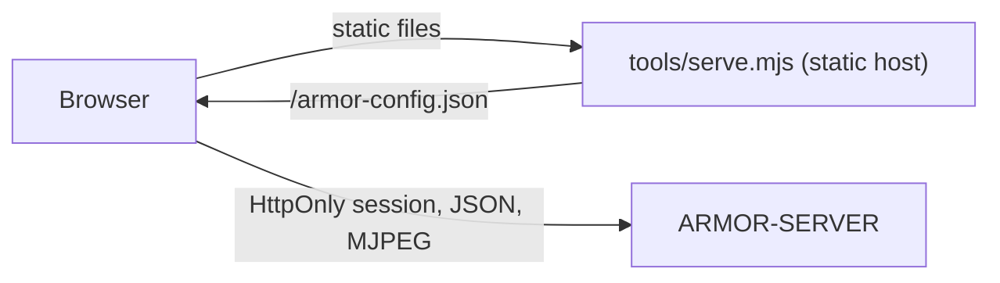

<p align="center">
  
</p>

# 🎛️ ARMOR-STUDIO

<p align="center">
  <a href="README.md">🇺🇸 English</a> |
  <a href="README_spa.md">🇪🇸 Español</a> |
  <a href="README_fra.md">🇫🇷 Français</a> |
  <a href="README_ita.md">🇮🇹 Italiano</a> |
  <a href="README_deu.md">🇩🇪 Deutsch</a> |
  <a href="README_zho.md">🇨🇳 简体中文</a> |
  <a href="README_jpn.md">🇯🇵 日本語</a> |
  🇵🇹 <b>Português</b>
</p>

### Consola de operações e desenho: câmaras, radar, alarmes, energia solar, provas e a planta do local

<p align="center">
  
  
  
  
  
  
</p>

---

**Verificação de honestidade - o que funciona hoje:** O Studio fala com o [ARMOR-SERVER](https://github.com/JuanenRac/ARMOR-SERVER) e está coberto por 203 testes unitários (leitura das definições, fusão de câmaras, a aritmética dos gráficos solares, cada menu desenhado nos idiomas disponíveis, o servidor estático). O que **não** foi provado é o vídeo em direto e o PTZ com todas as câmaras reais, os menus solares com um inversor ou bateria reais, e uma revisão formal de acessibilidade ou usabilidade. Enquanto o servidor não puder ser alcançado, o Studio mostra dados de demonstração e di-lo na barra superior.

---

## 🎯 Visão geral

O **ARMOR-STUDIO** é a consola do operador. Nunca guarda uma palavra-passe de câmara, um endereço RTSP nem um token: inicia sessão no servidor com um nome de utilizador e palavra-passe, recebe uma sessão **HttpOnly** de 8 horas, e tudo o que é privilegiado viaja por essa sessão.

* **Monitor de câmaras:** 1, 2, 4, 6, 8, 9, 12 ou 16 mosaicos que se ajustam à sua moldura (16:9, toda a matriz visível, sem cortes), uma vista maximizada com um comando PTZ limitado, fotografia e gravação MP4; uma **biblioteca de gravações** para filtrar, pré-visualizar, reproduzir, proteger e apagar provas.
* **Alarmes, dispositivos e automatizações:** o que precisa de uma pessoa agora, com reconhecimento e o registo fechado; dispositivos de fumo, gás, inundação, porta, janela, movimento, clima, ficha, luz, sirene e fechadura por Wi-Fi, Zigbee, Bluetooth ou cabo (predefinições para Zigbee2MQTT, Tasmota e Shelly); regras que comutam dispositivos quando algo acontece; um grande botão de armar / desarmar.
* **Energia solar:** o menu *Inversores* desenha a casa como um fluxo de energia animado (painéis, rede, inversor, bateria e consumo, com tracejados que correm mais depressa quanto maior a potência), indicadores, leituras, avisos em palavras e gráficos de histórico; o menu *Baterias* mostra cada conjunto com um nível de líquido, as suas **capacidades** (restante e total, Ah e kWh, ciclos, modelo), cada módulo e **cada célula** como uma barra com a sua tensão e a dispersão em milivolts, e gráficos de carga, tensão, corrente, gama das células e temperatura.
* **Resumo e sistema:** o estado do perímetro, um mosaico por parte, um mapa em direto do desenho com cada dispositivo, e uma página de sistema com o registo de auditoria para um administrador.
* **Radar:** um mapa em direto desenhado a partir do desenho do seu local (terreno, edifícios, câmaras, radares e a sua cobertura) com os alvos que cada radar reporta, o seu percurso recente e as zonas a ignorar; estado em direto dos nós, com os nós silenciosos mostrados como *desatualizados*; o painel próprio de cada nó está a um clique.
* **Desenhador do local:** desenhe o terreno (retângulo ou qualquer forma, com comprimentos escritos), coloque edifícios de vários pisos com cinco tipos de telhado, portas e janelas em qualquer piso e altura, candeeiros, chaminés, painéis solares, antenas, pilares, mastros, estradas e caminhos, e depois câmaras e radares onde quiser; uma planta 2D ao estilo CAD e uma vista 3D que pode orbitar, cortar piso a piso e editar; anular e refazer.
* **Configuração:** endereço do servidor, câmaras (ONVIF/RTSP), deteção, utilizadores (a sua conta e, para um administrador, a lista de utilizadores, funções e palavras-passe), tema e idioma; uma exportação portátil do local **sem credenciais**.
* **Oito idiomas** (inglês, espanhol, alemão, francês, italiano, japonês, chinês e português) e onze temas, o predefinido chamado *Armor*.
* **Declare o seu equipamento:** nos menus Inversores e Baterias adiciona cada inversor ou conjunto de baterias com o seu nome, modelo (Voltronic, MPP Solar, Pylontech US2000 / US3000 / US5000, ANT-BMS), ligação (RS232, RS485, USB, CAN, Wi-Fi) e nó de ligação; fica à espera da sua primeira leitura real, e *Mostrar leituras de exemplo* deixa experimentar o menu entretanto.
* **Desenhador elétrico:** desenhe o esquema elétrico da casa (rede, contador, proteções, comutadores de transferência, distribuição, FV, inversores, baterias e cargas, AC e DC) com portas e fios, agrupe-o em quadros, associe inversores e baterias aos dispositivos solares que o servidor lê para ver os seus valores em direto, e deixe que as verificações o revejam (duas fontes numa linha, disjuntores e cabos face à corrente, proteções em falta, tensões DC). O desenho fica guardado no servidor; é um desenho: por enquanto nada comuta nem mede nada.
* **Desenhador de alarme:** desenhe o alarme da casa - centrais, expansores, contactos de portas e janelas, detetores de movimento, fumo, gás e inundação, botões de pânico, sirenes, teclados e a alimentação - com laços com fio, ligações por rádio, a saída de sirene, o barramento de dados e a energia unidos porta a porta. Associe uma central desenhada a uma real e um sensor a uma das suas zonas no menu *Centrais de alarme* e cada elemento mostra em direto o que a sua central diz; «desenhar o que as centrais têm» preenche o desenho a partir das centrais, e as verificações avisam de um sensor que ninguém escuta, uma central sem sirene, teclado ou bateria de reserva, ou um sensor de fumo que ficaria em silêncio com o sistema desarmado. O desenho fica guardado no servidor com as suas versões anteriores.
* **Um menu em grupos e uma ajuda à medida:** Monitorização, Segurança, Energia, Casa e rede, Desenho e Administração, cada grupo recolhível; cada pergunta faz-se numa janela da página (o navegador nunca a pode silenciar); um novo alarme crítico soa e aparece como notificação; as provas podem proteger-se da limpeza automática; e a Ajuda explica cada menu nos idiomas disponíveis. Os alarmes têm sons por gravidade e por origem, sons carregados por si, voz falada e janelas de aviso que o levam ao menu certo; a Ajuda é um livro com quatro níveis de detalhe, cada menu tem uma visita guiada e um assistente anima-o de menu em menu.

## 🔄 Arquitetura



## 🔒 Modelo de segurança

* **Sem segredos no navegador.** As palavras-passe das câmaras escrevem-se uma vez, enviam-se ao servidor e depois só se mostram como um estado «guardada» mascarado. As exportações do local retiram nomes de utilizador e indicadores de credenciais.
* **As definições guardadas são entrada não fiável.** Leem-se valor a valor: uma origem, tema, idioma ou forma inválidos descartam-se, as posições limitam-se e as listas têm tamanho máximo.
* **Sem pedidos a terceiros.** Os tipos de letra são pilhas locais; o servidor estático envia `Content-Security-Policy: default-src 'self'` limitado ao servidor configurado, `frame-ancestors 'none'`, `nosniff` e `no-referrer`.
* O vídeo em direto só se mostra através de um endereço de emissão que o servidor emite para um operador.

## 📂 Estrutura do repositório

```text
ARMOR-STUDIO/
├── src/
│   ├── App.tsx, domain.ts, settings.ts, cameras.ts, hooks.ts, api.ts, config.ts, i18n.ts
│   ├── components/   camera, chrome, SiteMap
│   ├── views/        overview, monitoring, RadarView, RadarSensors, AlarmsView, DevicesView, AutomationsView, InvertersView, BatteriesView, SystemView
│   ├── designer/     geometry, ops, model, Plan2D, Viewport3D, Toolbox, Inspector
│   ├── electrical/   the Electrical Designer: model, ops, analysis (the checks), presets, symbols, sync
│   ├── solarModel.ts, solarGraphics.tsx, solarText.ts   the arithmetic, the drawings and the words of the solar menus
│   └── ...           ConfigurationPanel, UsersPanel, MediaLibrary, HistoryView, SiteDesignerInteractive, StudioLogin, one *Text.ts per area (7 languages)
├── tools/            serve.mjs (+ tests)
├── docs/             security model
└── images/           brand assets
```

## 🛠️ Ambiente de desenvolvimento

```powershell
npm install
npm run dev         # http://127.0.0.1:5178 against a server on 127.0.0.1:8080
npm run typecheck
npm test            # 203 tests: designer geometry, settings, cameras, radar map, solar arithmetic, the electrical designer, every menu in seven languages, static host
npm run build       # dist/
$env:ARMOR_SERVER_ORIGIN="http://192.168.0.180:18080"; node tools/serve.mjs   # serve the build
```

O `tools/serve.mjs` lê `ARMOR_STUDIO_HOST` (predefinido `127.0.0.1`), `ARMOR_STUDIO_PORT` (`5178`), `ARMOR_STUDIO_DIST` e `ARMOR_SERVER_ORIGIN`. Para instalar todo o conjunto na bancada de testes CM5 veja o [ARMOR-DEVOPS](https://github.com/JuanenRac/ARMOR-DEVOPS).

## 🔗 Projetos relacionados

O **A.R.M.O.R.** (Autonomous Radar & Multimodal Observation Range) é um sistema de segurança perimetral feito de repositórios independentes. Cada um tem a sua própria versão, os seus próprios testes e o seu próprio README; esta é a família:

* **[ARMOR-COMMON](https://github.com/JuanenRac/ARMOR-COMMON)** - Contratos de mensagens, validadores, vetores de conformidade e tipos gerados
* **[ARMOR-RADAR](https://github.com/JuanenRac/ARMOR-RADAR)** - Firmware de nó de campo para ESP32-S3 com três radares e o seu próprio painel web
* **[ARMOR-SOLAR](https://github.com/JuanenRac/ARMOR-SOLAR)** - Protocolos de inversores e baterias solares e as mensagens de um nó de ligação
* **[ARMOR-ELECTRICAL](https://github.com/JuanenRac/ARMOR-ELECTRICAL)** - Nó elétrico: contadores, a mensagem das leituras da rede e as regras de comutação
* **[ARMOR-HMI](https://github.com/JuanenRac/ARMOR-HMI)** - Painel tátil: o estado do sistema num ecrã de parede, armar e reconhecer, e a casa do assistente de voz
* **[ARMOR-NETWORK](https://github.com/JuanenRac/ARMOR-NETWORK)** - A rede local: os seus dispositivos, a internet e o que muda
* **[ARMOR-SERVER](https://github.com/JuanenRac/ARMOR-SERVER)** - Coordenador central: telemetria, alarmes, dispositivos, leituras solares e câmaras
* **ARMOR-STUDIO** (este repositório) - Consola web: câmaras, radar, alarmes, energia solar e o desenhador de local 2D/3D
* **[ARMOR-ANDROID-CONTROL](https://github.com/JuanenRac/ARMOR-ANDROID-CONTROL)** - Cliente Android de operador com um radar 2D/3D em direto
* **[ARMOR-SERVER-AI](https://github.com/JuanenRac/ARMOR-SERVER-AI)** - Política de inferência visual que explica as suas decisões e nunca atua
* **[ARMOR-VOICE-AI](https://github.com/JuanenRac/ARMOR-VOICE-AI)** - Intenções de voz offline com uma confirmação que não se pode falsificar
* **[ARMOR-HARDWARE](https://github.com/JuanenRac/ARMOR-HARDWARE)** - Caixas, eletrónica e a matriz de aceitação de bancada
* **[ARMOR-DEVOPS](https://github.com/JuanenRac/ARMOR-DEVOPS)** - Implementação, a bancada de testes CM5, cópias de segurança e TLS
* **[ARMOR-SIMULATOR](https://github.com/JuanenRac/ARMOR-SIMULATOR)** - Simulador de telemetria offline com falhas repetíveis
* **[ARMOR-UPDATER](https://github.com/JuanenRac/ARMOR-UPDATER)** - Deteta, instala e atualiza os próprios repositórios do ecossistema
* **[ARMOR-DOCS](https://github.com/JuanenRac/ARMOR-DOCS)** - Arquitetura, linha de base de segurança e a matriz de capacidades

## 📚 Documentação e comunidade

Onde ler mais:

* [Matriz de capacidades: o que está provado e o que não](https://github.com/JuanenRac/ARMOR-DOCS/blob/main/docs/CAPABILITY_MATRIX.md)
* [Catálogo de projetos: versões e como os repositórios dependem uns dos outros](https://github.com/JuanenRac/ARMOR-DOCS/blob/main/docs/PROJECT_CATALOG.md)
* [Registo de alterações deste repositório](CHANGELOG.md)
* [Licença (GPL-3.0-or-later)](LICENSE)
* Perguntas, ideias e relatórios: electrohobby3d@gmail.com

## 👤 AUTOR

**JuanenRac (Electro Hobby 3D)** · electrohobby3d@gmail.com

## 📜 LICENÇA

GPL-3.0-or-later - veja [LICENSE](LICENSE).
