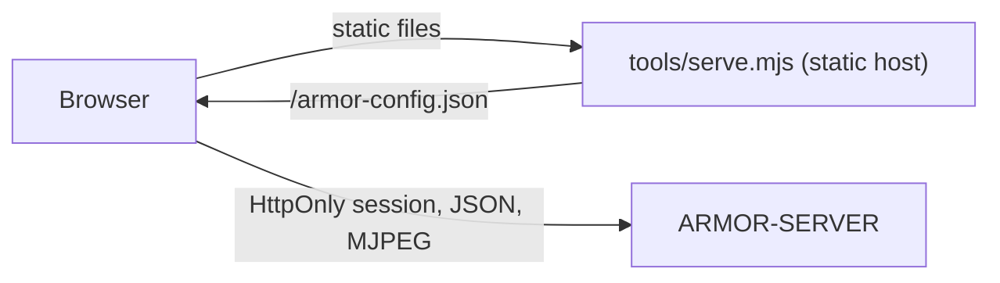

<p align="center">
  
</p>

# 🎛️ ARMOR-STUDIO

<p align="center">
  <a href="README.md">🇺🇸 English</a> |
  <a href="README_spa.md">🇪🇸 Español</a> |
  <a href="README_fra.md">🇫🇷 Français</a> |
  <a href="README_ita.md">🇮🇹 Italiano</a> |
  <a href="README_deu.md">🇩🇪 Deutsch</a> |
  <a href="README_zho.md">🇨🇳 简体中文</a> |
  <a href="README_jpn.md">🇯🇵 日本語</a> |
  🇵🇹 <b>Português</b>
</p>

### Consola de operação e desenho: câmaras, radar, alarmes, energia, a rede local, provas, a planta do local e a manutenção da instalação

<p align="center">
  
  
  
  
  
  
  
</p>

---

**Verificação de honestidade - o que funciona hoje:** O Studio fala com o [ARMOR-SERVER](https://github.com/JuanenRac/ARMOR-SERVER) e está coberto por 959 testes unitários (leitura de definições, fusão de câmaras, a aritmética dos gráficos solares, a geometria e as verificações dos desenhadores, o anunciador de alarmes, o dicionário do assistente, cada menu desenhado nos oito idiomas, o servidor estático) e por testes no navegador. Funciona em uso diário contra a bancada de testes do CM5 com o servidor real, câmaras IP reais e um nó radar na sua placa; as imagens da Ajuda são feitas com dados de exemplo. O que **não** foi provado é o vídeo em direto e o PTZ com todas as câmaras possíveis, os menus solar, elétrico, de centrais de alarme e de painel tátil com equipamentos reais (só existe o nó radar) e uma revisão formal de acessibilidade ou usabilidade. Enquanto o servidor não é alcançado, o Studio mostra dados de demonstração e di-lo na barra superior.

---

## 📋 Num relance

| | |
|---|---|
| Versão | `0.8.0.9` |
| Maturidade | Estabelecido |
| Testes | 959 (`npm test`) |
| Tecnologia | React 19 / TypeScript / Vite |
| Em hardware real | Usado diariamente contra a bancada de testes do CM5 (servidor real, câmaras IP reais, um nó radar real); os menus solar, elétrico, de centrais de alarme e de painel tátil esperam nós reais |

## 🎯 Visão geral

O **ARMOR-STUDIO** é a consola do operador. Nunca guarda uma palavra-passe de câmara, um endereço RTSP nem um token: inicia sessão no servidor com um nome de utilizador e palavra-passe, recebe uma sessão **HttpOnly** de 8 horas, e tudo o que é privilegiado viaja por essa sessão.

* **Resumo e sistema:** o estado do perímetro, um cartão para cada parte (centrais de alarme, radar, câmaras, dispositivos, energia, rede, servidor), um mapa vivo do desenho com cada dispositivo e alarme, e o que precisa de atenção, tudo num só ecrã sem deslocamento; uma página de sistema e um registo de auditoria para o administrador.
* **Monitor de câmaras:** 1, 2, 4, 6, 8, 9, 12 ou 16 mosaicos que se ajustam à moldura (16:9, toda a matriz visível, sem cortes), uma vista ampliada com comando PTZ limitado, fotografia e gravação MP4; uma **biblioteca de gravações** para filtrar, pré-visualizar, reproduzir, proteger e apagar provas e descarregar uma **prova de custódia**.
* **Alarmes:** o que precisa de uma pessoa agora, com reconhecer e o registo fechado; uma **verificação antes de armar** e um PIN para desarmar; alarmes desenhados no mapa vivo; um som para cada gravidade, uma voz falada com estilos próprios (neutro, herói de ação, senhor das trevas, teatral) que também diz quando algo se liga, janelas de aviso, um botão de silêncio junto à Ajuda e um salto opcional para o menu certo.
* **Dispositivos e automatizações:** fumo, gás, inundação, porta, janela, movimento, clima, tomada, luz, sirene, fechadura, estore, portão, porta de garagem e esquentador por Wi-Fi, Zigbee, Bluetooth ou cabo (predefinições para Zigbee2MQTT, Tasmota e Shelly); regras a partir de qualquer fonte de alarme, com limiares, que acionam dispositivos quando algo acontece; um botão grande de armar / desarmar.
* **Centrais de alarme e o Desenhador de alarme:** o estado de cada nó ARMOR-NODE-ALARM, as suas zonas e eventos, os sensores Zigbee ligados às zonas, e um desenhador onde desenha o alarme da casa (centrais, contactos, movimento, detetores de fumo, gás e inundação, sirenes, teclados, cablagem e ligações por rádio) e liga cada elemento desenhado a uma zona real.
* **Energia solar e elétrica:** o menu *Inversores* desenha a casa como um fluxo de energia animado com mostradores, leituras e gráficos de histórico; *Baterias* mostra cada pilha com as suas capacidades, cada módulo e cada célula; *Elétrico* mostra a entrada de rede, cada canal e os alarmes dos contadores; em ambos declara o seu equipamento (Voltronic, MPP Solar, Pylontech, ANT-BMS…) e um botão *Mostrar leituras de exemplo* deixa-o experimentar o menu antes.
* **Desenhador elétrico:** desenhe o esquema elétrico da casa (rede, contador, proteções, comutadores, distribuição, FV, inversores, baterias e cargas, CA e CC), ligue-o aos dispositivos solares que o servidor lê para ver valores em direto, e deixe que as verificações o revejam (duas fontes numa linha, disjuntores e cabos face à corrente…).
* **Radar:** um mapa vivo desenhado a partir do seu desenho do local com os alvos que cada radar comunica, o seu percurso recente e as **zonas da imagem a ignorar**; estado vivo dos nós, com os silenciosos como *desatualizados*; o painel próprio de cada nó a um clique.
* **Desenhador do local:** desenhe o terreno, edifícios de vários pisos com cinco tipos de telhado, portas, janelas, candeeiros, chaminés, painéis solares, mastros, estradas e caminhos, e depois câmaras e radares onde quiser; uma planta 2D ao estilo CAD e uma vista 3D orbitável piso a piso; desfazer e refazer; versões do desenho.
* **Rede local:** o menu *Rede* mostra o que o nó ARMOR-NETWORK comunica (dispositivos, falhas, o estado da internet e o **endereço público** com o fornecedor e o local), deixa dar nomes, ocultar e vigiar dispositivos, ordenar um varrimento, um ping ou uma inspeção com um acesso que der, e o *Desenhador de rede* desenha-a.
* **Captura automática:** em *Configuração > Captura automática*, fotografias e vídeo feitos sozinhos quando uma câmara vê algo com o sistema armado (quantas fotografias, com que frequência, quanto dura um clipe), e as zonas da imagem a ignorar desenhadas sobre o quadro da câmara.
* **Firmware dos nós e atualizações:** *Firmware dos nós* atualiza os nós de campo um a um, com uma barra para todo o trabalho e para cada nó, e mantém o seu estado se um alarme o levar a outro menu; *Atualizações* instala as novas versões do Studio e do servidor a partir do GitHub (mostrando as novidades da nova versão), as do sistema operativo e uma consola de manutenção opcional.
* **Configuração em grupos:** Geral e Preferências; Utilizadores, Notificações e Captura automática; Firmware dos nós e Atualizações; Servidor, Serviços, Broker MQTT, Ficheiros de configuração, Instalação e Consola; e cada menu da barra lateral também está em grupos recolhíveis (Monitor, Segurança, Energia, Casa e rede, Desenho, Administração).
* **Oito idiomas** (inglês, espanhol, alemão, francês, italiano, japonês, chinês e português) e onze temas, o predefinido chamado *Armor*; o idioma, o tema e o local do tempo seguem a conta, não o navegador. Papéis: administrador, operador e **viewer**, que só observa.
* **Uma Ajuda que conhece todo o sistema:** um livro com quatro níveis de detalhe e uma imagem com dados de exemplo de cada menu principal, uma visita guiada passo a passo para cada menu que vai controlo a controlo (o que faz cada botão, o que esperar e os erros habituais) com a sua própria mascote e voz, uma Ajuda que explica os nós de campo a fundo (Wi-Fi de configuração, ponto de acesso e estação, PIN de Bluetooth, ranhuras de firmware com retrocesso, atualizações assinadas, o painel de fora), dicas em tudo, e um **assistente** (uma mascote que pode arrastar para qualquer lugar, fixar onde quiser e a quem perguntar por escrito) com um dicionário em oito idiomas e um balão que se abre do lado que tem espaço. Os menus onde trabalha ficam abertos enquanto visita outro.
* **Acesso de fora com escolhas, não ficheiros:** em Segurança um administrador configura a VPN WireGuard, adiciona um telemóvel lendo um código QR, mantém um nome que acompanha a casa (DuckDNS, Cloudflare ou qualquer endereço a chamar) e regista os nós cujo próprio painel pode ser aberto de fora através do servidor, comparando a impressão digital do certificado antes de confiar nele; cada passo explica-se nas oito línguas e volta a pedir a palavra-passe quando é feito de fora.**Chegar a casa a partir de fora, passo a passo:** em Configuração > Segurança um guia de seis passos mostra se a máquina consegue, se a VPN existe, se a casa tem nome, se a porta está aberta no router e se o telemóvel está adicionado, e como o testar com dados móveis; o separador Segurança está organizado em três secções com título.
* **Cartão da cifragem do broker:** Configuração > Broker mostra se a ligação do servidor ao broker está cifrada e a impressão digital da autoridade própria da instalação em que confia; não se mostra nada alarmante quando a ligação é sem cifra, porque é o habitual.
* **Saúde dos nós e modos de armar:** Sistema tem um cartão com o relatório de saúde de cada nó (tempo ligado, motivo do reinício, memória, ligação e sinal, ligações ao broker, último erro, histórico e reinícios) e Centrais de alarme tem um seletor de modo (Ausente, Em casa, Noite e os seus) com um editor de modos, tudo em oito idiomas com ajuda, passos do guia e respostas do assistente.
* **Início de sessão para gestores de palavras-passe e um Histórico com separadores:** o início de sessão é um formulário a sério que o gestor de palavras-passe do navegador ou do sistema pode guardar e preencher, com um "Lembrar-me" opcional que guarda só o nome de utilizador (nunca a palavra-passe) e uma nota que o diz; o Histórico tem os separadores Tudo, Alarmes, Ligações, Dispositivos, Sistema e Definições, com a lista de cada dispositivo e aplicação que se liga ao servidor (última vez, sessões abertas, inícios de sessão e recusas) e os eventos dos nós, do broker, dos serviços, das atualizações e do armar. Os endereços só os veem os administradores.
* **Manutenção de baterias (Configuração, administradores):** um assistente de quatro passos - bateria e operação, valores, confirmação escrevendo o número de série da bateria, resultado - para alterar o que uma bateria Pylontech guarda; limites em volts e graus um grupo inteiro de cada vez, um ficheiro de firmware lido antes de ser enviado, a bateria lida antes e depois com a diferença e a transcrição, e uma saída que se pode repor como estava.
* **Controlo dos nós a partir do cartão de saúde:** cada nó tem um menu (Reiniciar, Pausar ou Retomar, Pôr em espera - trabalho desligado, continua ligado - ou Ligar, Identificar, Diagnóstico, Manutenção ligada ou desligada) e o cartão tem as ações de grupo Reiniciar todos (de uma vez, ou um a seguir ao outro com a central de alarme por último), Pausar todos, Pôr todos em espera e Retomar todos. O nome do nó (ou a palavra RESTART, PAUSE ou STANDBY para todos) é escrito de novo e pede-se uma nova prova de identidade; etiquetas seguem cada nó (enviada, recebida, sem ligação, de volta, aplicada) e mostram Em pausa, Em espera desde quando e por quem, e Manutenção; e os avisos dizem quando uma central de alarme ou um radar em pausa ou em espera deixa a casa sem proteção. Não existe reposição de fábrica, apagamento nem sono profundo.
* **Estado em direto:** o Studio escuta o canal em direto do servidor (um WebSocket) e mostra de imediato um alarme, um armar ou um nó que volta, e só pergunta o estado de vinte em vinte segundos como rede de segurança enquanto o canal está aberto; a barra de baixo diz *Em direto*. Os desenhadores de alarme, elétrico e de rede respondem também a F (ajustar), mais e menos (zoom) e Ctrl+D (duplicar).

## 🖼️ Capturas de ecrã

Capturadas a 1920×1080 numa bancada de testes, com dados de exemplo e sem qualquer instalação real por trás.

<table>
<tr><td width="50%" valign="top"><br><sub>Resumo: o estado do perímetro, os alarmes, os nós de radar, a energia e o mapa em direto do local num só ecrã.</sub></td><td width="50%" valign="top"><br><sub>Radar: os alvos que cada radar vê, colocados na planta do local, com a zona que cada sensor cobre.</sub></td></tr>
<tr><td width="50%" valign="top"><br><sub>Inversores: o fluxo de energia entre os painéis solares, a rede, a casa e as baterias, só de leitura.</sub></td><td width="50%" valign="top"><br><sub>Desenhador do local: terreno, edifícios, câmaras e radares desenhados na planta que o resto do Studio usa.</sub></td></tr>
<tr><td width="50%" valign="top"><br><sub>Desenhador elétrico: o esquema AC e DC da casa, com as suas verificações, a partir de um exemplo pronto.</sub></td><td width="50%" valign="top"><br><sub>Painéis de alarme: se cada painel está a vigiar, as suas zonas e o que aconteceu por último.</sub></td></tr>
</table>

## 🧩 Papel no A.R.M.O.R.

O Studio é a janela do operador para todo o sistema. Nunca fala com um nó: tudo passa pelo [ARMOR-SERVER](https://github.com/JuanenRac/ARMOR-SERVER), que é o único que decide (a única exceção é uma ligação ao painel próprio de cada nó). É também onde se desenham o local, o alarme, a instalação elétrica e a rede, de onde se governam o firmware dos nós e as atualizações da própria instalação, e onde vivem a Ajuda e o assistente. O mesmo servidor é usado pelo [ARMOR-ANDROID-CONTROL](https://github.com/JuanenRac/ARMOR-ANDROID-CONTROL) no telemóvel.

## 🔄 Arquitetura



## 🔒 Modelo de segurança

* **Sem segredos no navegador.** As palavras-passe das câmaras escrevem-se uma vez, enviam-se ao servidor e depois só se mostram como um estado «guardada» mascarado. As exportações do local retiram nomes de utilizador e indicadores de credenciais.
* **As definições guardadas são entrada não fiável.** Leem-se valor a valor: uma origem, tema, idioma ou forma inválidos descartam-se, as posições limitam-se e as listas têm tamanho máximo.
* **Sem pedidos a terceiros.** Os tipos de letra são pilhas locais; o servidor estático envia `Content-Security-Policy: default-src 'self'` limitado ao servidor configurado, `frame-ancestors 'none'`, `nosniff` e `no-referrer`.
* O vídeo em direto só se mostra através de um endereço de emissão que o servidor emite para um operador.

## 📂 Estrutura do repositório

```text
ARMOR-STUDIO/
├── src/
│   ├── App.tsx, domain.ts, settings.ts, prefs.ts, cameras.ts, hooks.ts, api.ts (+ api/ by area), config.ts, i18n.ts (loads one language at a time), storageSchema.ts (the version of what the browser keeps), viewSlots.tsx
│   ├── components/   camera, chrome (top bar, sidebar, Help), SiteMap
│   ├── views/        overview, monitoring, RadarView, AlarmsView, AlarmPanelsView, DevicesView, AutomationsView, InvertersView, BatteriesView, ElectricalView, NetworkView, WeatherView, SystemView, ServicesView
│   ├── designer/     the Site Designer: geometry, ops (+ ops/), model, Plan2D, Viewport3D, Toolbox, Inspector
│   ├── electrical/   the Electrical Designer: model, ops, analysis (the checks), presets, symbols, sync
│   ├── alarm/        the Alarm Designer and the alarm panels' Zigbee links
│   ├── network/      the Network Designer and the network model
│   ├── alerts/       sounds, voice and its styles, pop-ups, the announcer of alarms and of connections
│   ├── assistant/    the mascot, its dictionary in eight languages and where its bubble opens
│   ├── tour/         a guided tour for every menu
│   ├── weather/      the Weather menu: radar map, clouds, forecast
│   └── ...           ConfigurationPanel (tabs: General, Preferences, Users, Notifications, Automatic capture, Node firmware, Updates, Server, Services, Broker, Files, Installation, Console), MediaLibrary, HistoryView, StudioLogin, one *Text.ts per area (eight languages, one row per phrase); locales/ holds the table of each language, written from them
├── public/help/      the pictures of the Help, one set per language
├── e2e/              browser tests (Playwright)
├── tools/            serve.mjs (+ tests), build_locales.mjs (writes locales/)
├── docs/             security model
└── images/           brand assets
```

## 🛠️ Ambiente de desenvolvimento

**Requisitos:** Node.js 22+, um ARMOR-SERVER em execução (senão o Studio mostra dados de demonstração)

```powershell
npm install
npm run dev         # http://127.0.0.1:5178 against a server on 127.0.0.1:8080
npm run typecheck
npm run locales     # write the table of each language (src/locales) after changing a phrase
npm test            # 959 tests: designers, settings, cameras, radar map, solar arithmetic, alerts and the assistant, every menu in eight languages, static host
npm run build       # dist/
$env:ARMOR_SERVER_ORIGIN="http://192.168.0.180:18080"; node tools/serve.mjs   # serve the build
```

O `tools/serve.mjs` lê `ARMOR_STUDIO_HOST` (predefinido `127.0.0.1`), `ARMOR_STUDIO_PORT` (`5178`), `ARMOR_STUDIO_DIST` e `ARMOR_SERVER_ORIGIN`. Para instalar todo o conjunto na bancada de testes CM5 veja o [ARMOR-DEVOPS](https://github.com/JuanenRac/ARMOR-DEVOPS).

## 🔗 Projetos relacionados

O **A.R.M.O.R.** (Autonomous Radar & Multimodal Observation Range) é um sistema de segurança perimetral feito de repositórios independentes. Cada um tem a sua própria versão, os seus próprios testes e o seu próprio README; esta é a família:

* **[ARMOR-COMMON](https://github.com/JuanenRac/ARMOR-COMMON)** - Contratos de mensagens, validadores, vetores de conformidade e tipos gerados
* **[ARMOR-NODE-RADAR](https://github.com/JuanenRac/ARMOR-NODE-RADAR)** - Firmware de nó de campo para ESP32-S3 com três radares e o seu próprio painel web
* **[ARMOR-NODE-SOLAR](https://github.com/JuanenRac/ARMOR-NODE-SOLAR)** - Protocolos de inversores e baterias solares e as mensagens de um nó de ligação
* **[ARMOR-NODE-ELECTRICAL](https://github.com/JuanenRac/ARMOR-NODE-ELECTRICAL)** - Nó elétrico: contadores, a mensagem das leituras da rede e as regras de comutação
* **[ARMOR-NODE-ALARM](https://github.com/JuanenRac/ARMOR-NODE-ALARM)** - Nó e central de alarme: zonas, armar, atrasos, sirene e PIN, com o servidor ou sem ele
* **[ARMOR-NODE-HMI](https://github.com/JuanenRac/ARMOR-NODE-HMI)** - Painel tátil: o estado do sistema num ecrã de parede, armar e reconhecer, e a casa do assistente de voz
* **[ARMOR-NETWORK](https://github.com/JuanenRac/ARMOR-NETWORK)** - A rede local: os seus dispositivos, a internet e o que muda
* **[ARMOR-SERVER](https://github.com/JuanenRac/ARMOR-SERVER)** - Coordenador central: telemetria, alarmes, dispositivos, leituras solares e câmaras
* **ARMOR-STUDIO** (este repositório) - Consola web: câmaras, radar, alarmes, energia solar e o desenhador de local 2D/3D
* **[ARMOR-ANDROID-CONTROL](https://github.com/JuanenRac/ARMOR-ANDROID-CONTROL)** - Cliente Android de operador com um radar 2D/3D em direto
* **[ARMOR-IOS-CONTROL](https://github.com/JuanenRac/ARMOR-IOS-CONTROL)** - Cliente de operador para iPhone
* **[ARMOR-SERVER-AI](https://github.com/JuanenRac/ARMOR-SERVER-AI)** - Política de inferência visual que explica as suas decisões e nunca atua
* **[ARMOR-VISION](https://github.com/JuanenRac/ARMOR-VISION)** - Zonas de câmara, máscaras e regras de deteção para o Jetson Orin NX
* **[ARMOR-VOICE-AI](https://github.com/JuanenRac/ARMOR-VOICE-AI)** - Intenções de voz offline com uma confirmação que não se pode falsificar
* **[ARMOR-HARDWARE](https://github.com/JuanenRac/ARMOR-HARDWARE)** - Caixas, eletrónica e a matriz de aceitação de bancada
* **[ARMOR-DEVOPS](https://github.com/JuanenRac/ARMOR-DEVOPS)** - Implementação, a bancada de testes CM5, cópias de segurança e TLS
* **[ARMOR-SIMULATOR](https://github.com/JuanenRac/ARMOR-SIMULATOR)** - Simulador de telemetria offline com falhas repetíveis
* **[ARMOR-UPDATER](https://github.com/JuanenRac/ARMOR-UPDATER)** - Deteta, instala e atualiza os próprios repositórios do ecossistema
* **[ARMOR-DOCS](https://github.com/JuanenRac/ARMOR-DOCS)** - Arquitetura, linha de base de segurança e a matriz de capacidades

## 📚 Documentação e comunidade

Onde ler mais:

* [Matriz de capacidades: o que está provado e o que não](https://github.com/JuanenRac/ARMOR-DOCS/blob/main/docs/CAPABILITY_MATRIX.md)
* [Catálogo de projetos: versões e como os repositórios dependem uns dos outros](https://github.com/JuanenRac/ARMOR-DOCS/blob/main/docs/PROJECT_CATALOG.md)
* [Registo de alterações deste repositório](CHANGELOG.md)
* [Licença (GPL-3.0-or-later)](LICENSE)
* Perguntas, ideias e relatórios: electrohobby3d@gmail.com

## 👤 AUTOR

**JuanenRac (Electro Hobby 3D)** · electrohobby3d@gmail.com

## 📜 LICENÇA

GPL-3.0-or-later - veja [LICENSE](LICENSE).
