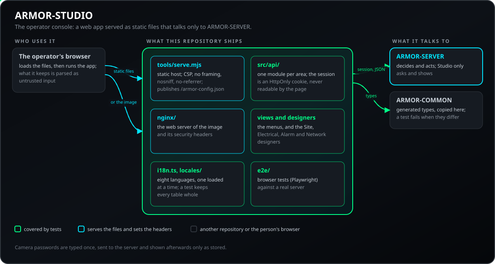
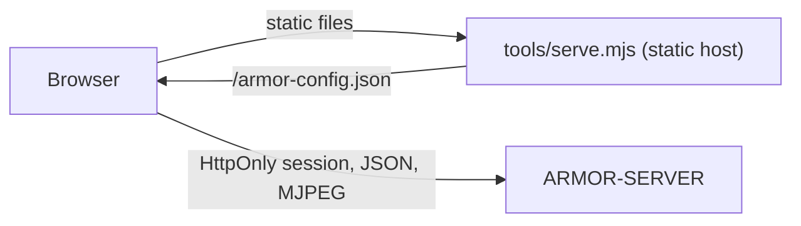
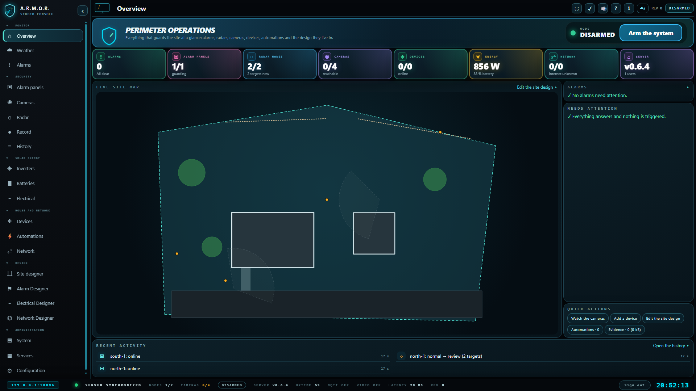
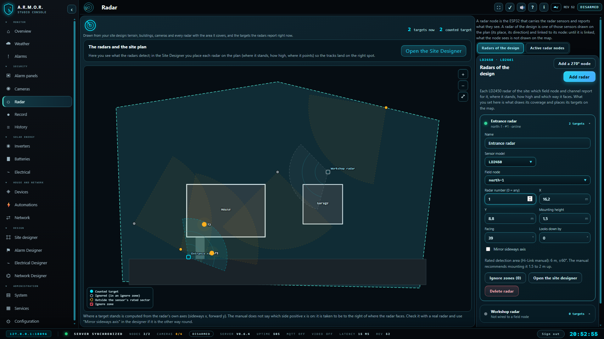
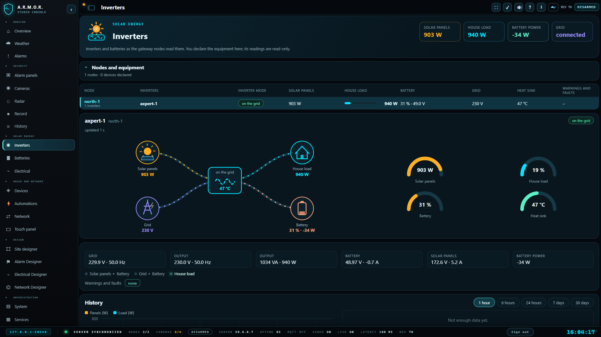
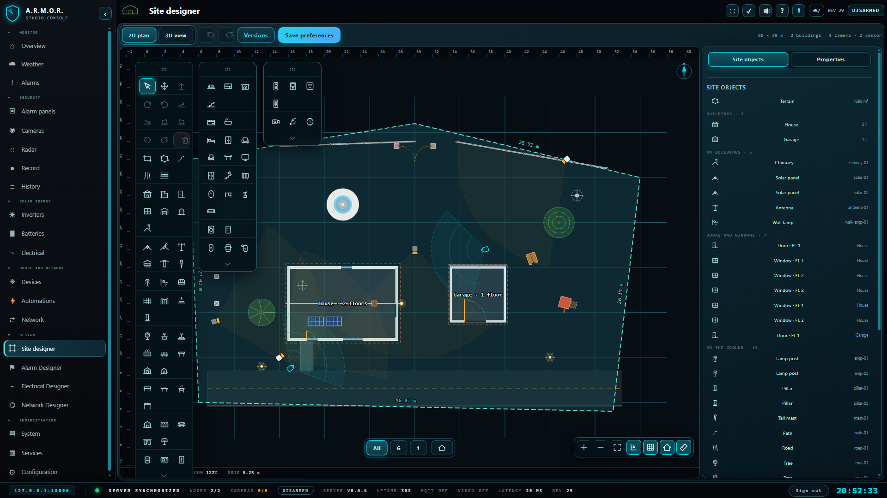
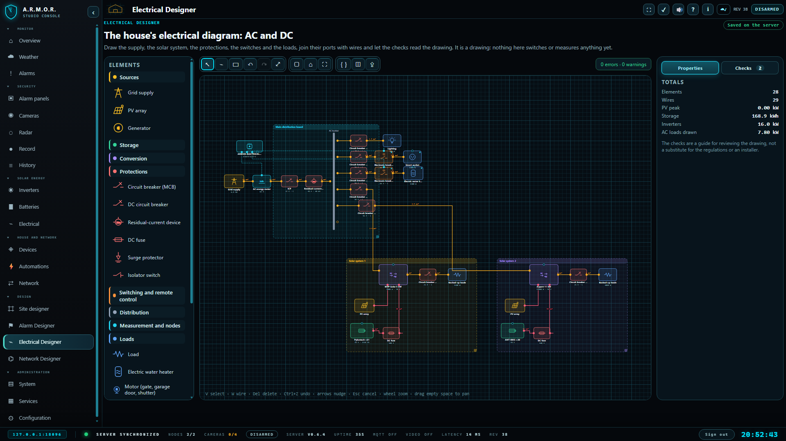
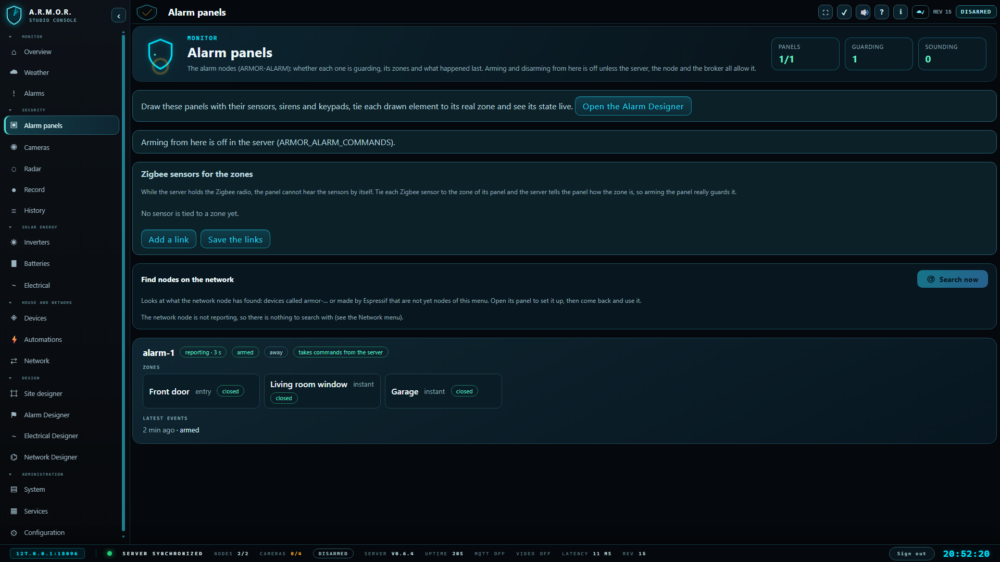
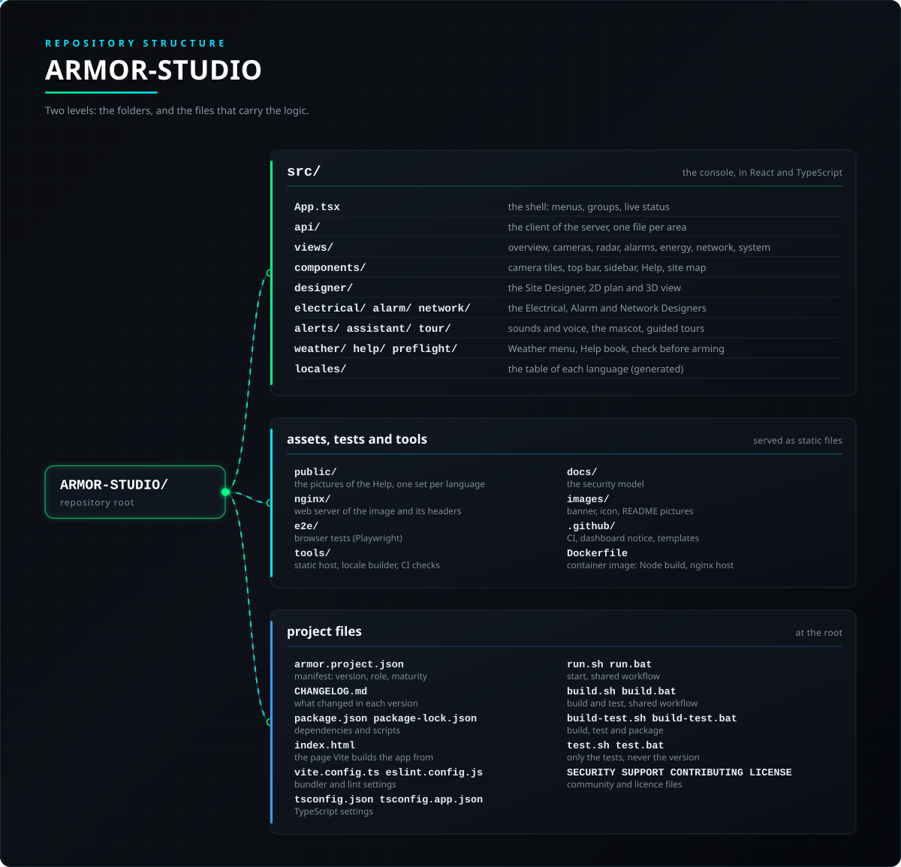

<p align="center">
  
</p>

# 🎛️ ARMOR-STUDIO

<p align="center">
  <a href="README.md">🇺🇸 English</a> |
  🇪🇸 <b>Español</b> |
  <a href="README_fra.md">🇫🇷 Français</a> |
  <a href="README_ita.md">🇮🇹 Italiano</a> |
  <a href="README_deu.md">🇩🇪 Deutsch</a> |
  <a href="README_zho.md">🇨🇳 简体中文</a> |
  <a href="README_jpn.md">🇯🇵 日本語</a> |
  <a href="README_por.md">🇵🇹 Português</a>
</p>

### Consola de operación y diseño: cámaras, radar, alarmas, energía, la red local, evidencias, el plano del sitio y el mantenimiento de la instalación

<p align="center">
  
  
  
  
  
  
  
</p>

---

**Comprobación de honestidad - qué funciona hoy:** Studio habla con [ARMOR-SERVER](https://github.com/JuanenRac/ARMOR-SERVER) y está cubierto por 1011 tests unitarios (lectura de ajustes, fusión de cámaras, la aritmética de las gráficas solares, la geometría y las comprobaciones de los diseñadores, el anunciador de alarmas, el diccionario del asistente, cada menú dibujado en los ocho idiomas, el servidor estático) y por pruebas en navegador. Funciona en uso diario contra el banco de pruebas de la CM5 con el servidor real, cámaras IP reales y un nodo radar en su placa; las imágenes de la Ayuda se hacen con datos de ejemplo. Lo que **no** se ha probado es el vídeo en directo y el PTZ con todas las cámaras posibles, los menús solar, eléctrico, de centrales de alarma y de panel táctil con equipos reales (solo existe el nodo radar) y una revisión formal de accesibilidad o usabilidad. Mientras no se alcanza el servidor, Studio muestra datos de demostración y lo dice en la barra superior.

---

## 📋 De un vistazo

| | |
|---|---|
| Versión | `0.8.1.1` |
| Madurez | Establecido |
| Función | Consola de operación y diseño de la familia |
| Tecnología | React 19, TypeScript, Vite, Three.js, Leaflet |
| Pruebas | 1011 (`npm test`, Vitest) y pruebas de navegador (Playwright) |
| Contrato | Habla solo con ARMOR-SERVER (HTTP `/api/v1/*` con sesión HttpOnly, WebSocket `/api/v1/events`) |
| Escucha en | `127.0.0.1:5178` (`tools/serve.mjs`) |
| Funciona en | Un navegador; los ficheros los sirve `tools/serve.mjs` o el nginx del contenedor |
| En hardware real | Usado a diario contra el banco de pruebas de la CM5 (servidor real, cámaras IP reales, un nodo radar real); los menús solar, eléctrico, de centrales de alarma y de panel táctil esperan nodos reales |
| Licencia | GPL-3.0-or-later |

**Ir a:** [Resumen](#-resumen) · [Arquitectura](#-arquitectura) · [Seguridad](#-seguridad-y-protección) · [Interfaces](#-interfaces) · [Configuración](#-configuración) · [Inicio rápido](#-inicio-rápido) · [Pruebas](#-pruebas) · [Problemas](#-resolución-de-problemas) · [Estructura](#-estructura-del-repositorio) · [Relacionados](#-proyectos-relacionados)

## 🚦 Estado del proyecto

Cada línea es una parte de este repositorio y la luz dice hasta dónde llega hoy. Está escrito con lo que el repositorio puede demostrar (pruebas, compilaciones, ejecuciones), no con lo que está planeado.

🟢 Hecho y verificado · 🟡 Funciona, con límites conocidos · 🟠 Parcial o sin verificar todavía · 🔴 No hecho o no funciona

| Área | Estado | Qué significa aquí |
|---|---|---|
| Software | 🟢 | La consola funciona a diario contra el servidor real del banco de pruebas CM5. |
| Pruebas | 🟢 | Pasan 1011 pruebas unitarias (`npm test`) y se ejecutan las pruebas de navegador: ajustes, fusión de cámaras, gráficas solares, geometría y comprobaciones de los diseñadores, el anunciador de alarmas, el diccionario del asistente y cada menú en los ocho idiomas. |
| Interfaz | 🟡 | El vídeo en vivo y el PTZ no están probados con todas las cámaras posibles, no ha habido una revisión formal de accesibilidad o usabilidad, y las imágenes de la Ayuda se hacen con datos de ejemplo. |
| Hardware | 🟡 | Se usa a diario con el servidor real, cámaras IP reales y un nodo radar real; los menús solar, eléctrico, de panel de alarma y de panel táctil esperan nodos reales. |
| Seguridad | 🟡 | Las sesiones, los roles y el rechazo de credenciales de cámara en las direcciones están cubiertos por pruebas; no ha habido una revisión independiente. |
| Integración | 🟡 | Mientras no se puede alcanzar el servidor, Studio muestra datos de demostración y lo dice en la barra superior. |
| Documentación | 🟢 | Ocho idiomas, la Ayuda integrada y los recorridos guiados, las notas de seguridad y el historial de cambios están al día. |

## 🎯 Resumen

**ARMOR-STUDIO** es la consola del operador. Nunca guarda una contraseña de cámara, una dirección RTSP ni un token: inicia sesión en el servidor con usuario y contraseña, recibe una sesión **HttpOnly** de 7 días y todo lo privilegiado viaja por esa sesión.

* **Resumen y sistema:** el estado del perímetro, una tarjeta por cada parte (centrales de alarma, radar, cámaras, dispositivos, energía, red, servidor), un mapa vivo del diseño con cada dispositivo y alarma, y lo que necesita atención, todo en una pantalla sin desplazamiento; una página de sistema y un registro de auditoría para el administrador.
* **Monitor de cámaras:** 1, 2, 4, 6, 8, 9, 12 o 16 teselas que se ajustan a su marco (16:9, toda la matriz visible, sin recortes), una vista ampliada con mando PTZ acotado, captura y grabación MP4; una **biblioteca de grabaciones** para filtrar, previsualizar, reproducir, proteger y borrar evidencias y descargar una **prueba de custodia**.
* **Alarmas:** lo que necesita a una persona ahora, con reconocer y el registro cerrado; una **comprobación antes de armar** y un PIN para desarmar; alarmas dibujadas en el mapa vivo; un sonido para cada gravedad, una voz hablada con sus propios estilos (neutro, héroe de acción, señor oscuro, teatral) que también dice cuándo algo se conecta, avisos emergentes, un botón de silencio junto a la Ayuda y un salto opcional al menú adecuado.
* **Dispositivos y automatizaciones:** humo, gas, inundación, puerta, ventana, movimiento, clima, enchufe, luz, sirena, cerradura, persiana, cancela, puerta de garaje y calentador de agua por Wi-Fi, Zigbee, Bluetooth o cable (preajustes para Zigbee2MQTT, Tasmota y Shelly); reglas desde cualquier fuente de alarma, con umbrales, que accionan dispositivos cuando algo ocurre; un botón grande de armar / desarmar.
* **Centrales de alarma y el Diseñador de alarma:** el estado de cada nodo ARMOR-NODE-ALARM, sus zonas y eventos, los sensores Zigbee atados a las zonas, y un diseñador donde dibujas la alarma de la casa (centrales, contactos, movimiento, detectores de humo, gas e inundación, sirenas, teclados, cableado y enlaces de radio) y atas cada elemento dibujado a una zona real.
* **Energía solar y eléctrica:** el menú *Inversores* dibuja la casa como un flujo de energía animado con relojes, lecturas y gráficas de historial; *Baterías* muestra cada pila con sus capacidades, cada módulo y cada celda; *Eléctrico* muestra la entrada de red, cada canal y las alarmas de los medidores; en ambos declaras tu equipo (Voltronic, MPP Solar, Pylontech, ANT-BMS…) y un botón *Mostrar lecturas de ejemplo* te deja probar el menú antes.
* **Diseñador eléctrico:** dibuja el esquema eléctrico de la casa (red, contador, protecciones, conmutadores, distribución, FV, inversores, baterías y cargas, CA y CC), átalo a los dispositivos solares que lee el servidor para ver valores en vivo, y deja que las comprobaciones lo revisen (dos fuentes en una línea, magnetotérmicos y cables frente a la corriente…).
* **Radar:** un mapa vivo dibujado desde tu diseño del sitio con los objetivos que informa cada radar, su recorrido reciente y las **zonas de la imagen que se ignoran**; estado vivo de los nodos, con los silenciosos como *obsoletos*; el panel propio de cada nodo a un clic.
* **Diseñador del sitio:** dibuja el terreno, edificios de varias plantas con cinco tipos de tejado, puertas, ventanas, farolas, chimeneas, paneles solares, mástiles, caminos y senderos, y después cámaras y radares donde quieras; un plano 2D estilo CAD y una vista 3D orbitable y por plantas; deshacer y rehacer; versiones del diseño.
* **Red local:** el menú *Red* muestra lo que informa el nodo ARMOR-NETWORK (dispositivos, cortes, el estado de internet y la **dirección pública** con el proveedor y el lugar), te deja poner nombre, ocultar y vigilar dispositivos, ordenar un barrido, un ping o una inspección con un acceso que das, y el *Diseñador de red* la dibuja.
* **Captura automática:** en *Configuración > Captura automática*, fotos y vídeo hechos solos cuando una cámara ve algo con el sistema armado (cuántas fotos, cada cuánto, cuánto dura un clip), y las zonas de la imagen que se ignoran dibujadas sobre el cuadro de la cámara.
* **Firmware de nodos y actualizaciones:** *Firmware de nodos* actualiza los nodos de campo de uno en uno, con una barra para todo el trabajo y para cada nodo, y conserva su estado si una alarma te lleva a otro menú; *Actualizaciones* instala las versiones nuevas de Studio y del servidor desde GitHub (mostrando las novedades de la versión nueva), las del sistema operativo y una consola de mantenimiento opcional.
* **Configuración en grupos:** General y Preferencias; Usuarios, Notificaciones y Captura automática; Firmware de nodos y Actualizaciones; Servidor, Servicios, Broker MQTT, Ficheros de configuración, Instalación y Consola; y cada menú de la barra lateral también va en grupos plegables (Monitor, Seguridad, Energía, Casa y red, Diseño, Administración).
* **Ocho idiomas** (inglés, español, alemán, francés, italiano, japonés, chino y portugués) y dieciséis temas, el predeterminado llamado *Armor*; el idioma, el tema y el lugar del tiempo siguen a la cuenta, no al navegador. Roles: administrador, operador y **viewer**, que solo mira.
* **Una Ayuda que conoce todo el sistema:** un libro con cuatro niveles de detalle y una imagen con datos de ejemplo de cada menú principal, un recorrido guiado paso a paso para cada menú que va control por control (qué hace cada botón, qué esperar y los errores habituales) con su propia mascota y voz, una Ayuda que explica los nodos de campo a fondo (Wi-Fi de configuración, punto de acceso y estación, PIN de Bluetooth, ranuras de firmware con vuelta atrás, actualizaciones firmadas, el panel desde fuera), ayudas emergentes en todo, y un **asistente** (una mascota que puedes arrastrar a cualquier sitio, anclar donde quieras y a la que preguntar por escrito) con un diccionario en ocho idiomas y un globo que se abre en el lado que tiene sitio. Los menús donde trabajas siguen abiertos mientras visitas otro.
* **Acceso desde fuera con opciones, no archivos:** en Seguridad un administrador configura la VPN WireGuard, añade un móvil escaneando un código QR, mantiene un nombre que sigue a la casa (DuckDNS, Cloudflare o cualquier dirección a la que llamar) y registra los nodos cuyo propio panel se puede abrir desde fuera a través del servidor, comparando la huella del certificado antes de confiar en él; cada paso se explica solo en los ocho idiomas y pide la contraseña de nuevo cuando se hace desde fuera.
* **Llegar a casa desde fuera, paso a paso:** en Configuración > Seguridad una guía de seis pasos muestra si la máquina puede, si la VPN existe, si la casa tiene nombre, si el puerto está abierto en el router y si el móvil está añadido, y cómo probarlo con datos móviles; la pestaña Seguridad está ordenada en tres secciones con título.
* **Tarjeta de cifrado del broker:** Configuración > Broker muestra si el enlace del servidor con el broker está cifrado y la huella de la autoridad propia de la instalación en la que confía; no se muestra nada alarmante cuando el enlace es sin cifrar, porque es lo habitual.
* **Salud de los nodos y modos de armado:** Sistema tiene una tarjeta con el informe de salud de cada nodo (tiempo encendido, motivo del reinicio, memoria, enlace y señal, conexiones al broker, último error, historial y reinicios) y Centrales de alarma tiene un selector de modo (Fuera, En casa, Noche y los tuyos) con un editor de modos, todo en ocho idiomas con ayuda, pasos de guía y respuestas del asistente.
* **Inicio de sesión para gestores de contraseñas y un Historial con pestañas:** el inicio de sesión es un formulario de verdad que el gestor de contraseñas del navegador o del sistema puede guardar y rellenar, con un "Recordarme" opcional que guarda solo el nombre de usuario (nunca la contraseña) y una nota que lo dice; el Historial tiene las pestañas Todo, Alarmas, Conexiones, Dispositivos, Sistema y Ajustes, con la lista de cada dispositivo y app que se conecta al servidor (última vez, sesiones abiertas, inicios de sesión y rechazos) y los eventos de los nodos, el broker, los servicios, las actualizaciones y el armado. Las direcciones solo las ven los administradores.
* **Mantenimiento de baterías (Configuración, administradores):** un asistente de cuatro pasos - batería y operación, valores, confirmación escribiendo el número de serie de la batería, resultado - para cambiar lo que guarda una batería Pylontech; límites en voltios y grados un grupo entero cada vez, un archivo de firmware leído antes de enviarlo, la batería leída antes y después con la diferencia y la transcripción, y una salida que se puede dejar como estaba.
* **Control de los nodos desde la tarjeta de salud:** cada nodo tiene un menú (Reiniciar, Pausar o Reanudar, Poner en espera - trabajo apagado, sigue conectado - o Encender, Identificar, Diagnóstico, Mantenimiento activado o desactivado) y la tarjeta tiene las acciones de grupo Reiniciar todos (a la vez, o uno tras otro con la central de alarma la última), Pausar todos, Poner todos en espera y Reanudar todos. Se vuelve a escribir el nombre del nodo (o la palabra RESTART, PAUSE o STANDBY para todos) y se pide una prueba de identidad nueva; unas etiquetas siguen a cada nodo (enviada, recibida, sin conexión, de vuelta, aplicada) y muestran En pausa, En espera desde cuándo y por quién, y Mantenimiento; y los avisos dicen cuándo una central de alarma o un radar en pausa o en espera dejan la casa sin proteger. No existe restablecimiento de fábrica, borrado ni sueño profundo.
* **Estado en vivo:** Studio escucha el canal en vivo del servidor (un WebSocket) y muestra al instante una alarma, un armado o un nodo que vuelve, y pregunta el estado solo cada veinte segundos como red de seguridad mientras el canal está abierto; la barra inferior dice *En vivo*. Los diseñadores de alarma, eléctrico y de red responden a F (encajar), más y menos (zoom) y Ctrl+D (duplicar) además de sus otras teclas.

## 🧩 Papel en A.R.M.O.R.

Studio es la ventana del operador a todo el sistema. Nunca habla con un nodo: todo pasa por [ARMOR-SERVER](https://github.com/JuanenRac/ARMOR-SERVER), que es lo único que decide (la única excepción es un enlace al panel propio de cada nodo). También es donde se diseñan el sitio, la alarma, la instalación eléctrica y la red, desde donde se gobiernan el firmware de los nodos y las actualizaciones de la propia instalación, y donde viven la Ayuda y el asistente. El mismo servidor lo usa [ARMOR-ANDROID-CONTROL](https://github.com/JuanenRac/ARMOR-ANDROID-CONTROL) en el móvil.

| Habla con | Cómo | Para qué |
|---|---|---|
| ARMOR-SERVER | HTTP, WebSocket y MJPEG con la sesión HttpOnly | todo: estado, órdenes, diseños, cámaras |
| El panel propio de cada nodo | un enlace, a través del proxy del servidor | la única excepción a "nunca habla con un nodo" |
| Servicios del tiempo | Open-Meteo, RainViewer, EUMETSAT, ArcGIS | solo el menú del Tiempo, solo con lugar guardado |
| ARMOR-DEVOPS | instala la pila en el banco de la CM5 | despliegue |

## 🏛️ Arquitectura

<p align="center">
  
</p>

<details>
<summary>Versión en texto del diagrama (Mermaid)</summary>



</details>

## 🖼️ Capturas de pantalla

Capturadas a 1920×1080 en un banco de pruebas, con datos de ejemplo y sin ninguna instalación real detrás.

<table>
<tr><td width="50%" valign="top"><br><sub>Resumen: el estado del perímetro, las alarmas, los nodos radar, la energía y el mapa en vivo del sitio en una sola pantalla.</sub></td><td width="50%" valign="top"><br><sub>Radar: los blancos que ve cada radar, colocados sobre el plano del sitio, con la zona que cubre cada sensor.</sub></td></tr>
<tr><td width="50%" valign="top"><br><sub>Inversores: el flujo de energía entre los paneles solares, la red, la casa y las baterías, solo lectura.</sub></td><td width="50%" valign="top"><br><sub>Diseñador del sitio: terreno, edificios, cámaras y radares dibujados en el plano que usa el resto de Studio.</sub></td></tr>
<tr><td width="50%" valign="top"><br><sub>Diseñador eléctrico: el esquema de corriente alterna y continua de la casa, con sus comprobaciones, desde un ejemplo listo.</sub></td><td width="50%" valign="top"><br><sub>Paneles de alarma: si cada panel está vigilando, sus zonas y lo último que ocurrió.</sub></td></tr>
</table>

## 🔒 Seguridad y protección

* **Ningún secreto en el navegador.** Las contraseñas de las cámaras se teclean una vez, se envían al servidor y después solo se ven como un estado "guardada" enmascarado. Las exportaciones del sitio omiten usuarios e indicadores de credenciales.
* **Los ajustes guardados son entrada no fiable.** Se leen valor a valor: un origen, tema, idioma o forma no válidos se descartan, las posiciones se acotan y las listas se limitan.

| Amenaza | Defensa |
|---|---|
| Secretos en el navegador | Nunca se guarda contraseña, token, sesión ni credencial de cámara; se rechaza una dirección de instantánea con login (`user:pass@` o `?pwd=`); cerrar sesión vacía la consola y el estado de los trabajos de firmware |
| Robo de sesión | Cookie HttpOnly y SameSite=Strict puesta por el servidor (`armor_studio_sid`, o `__Host-armor_studio_sid` con HTTPS); Studio la comprueba cada minuto |
| Almacenamiento del navegador manipulado | Todo lo leído de `localStorage` se analiza valor a valor: un origen, tema, idioma o forma inválidos se descarta, las posiciones se acotan y las listas tienen tope; el esquema de almacenamiento lleva versión |
| Una dirección de servidor maliciosa | Solo un origen `http(s)` simple: sin credenciales, ruta, consulta ni fragmento |
| Inyección, clickjacking y fugas | `Content-Security-Policy: default-src 'self'; script-src 'self'; object-src 'none'; base-uri 'none'; frame-ancestors 'none'`, `connect-src` solo para los servidores configurados y los servicios del tiempo, `nosniff`, `no-referrer`, `Cross-Origin-Opener-Policy: same-origin` y una `Permissions-Policy` que apaga cámara, micrófono y ubicación |
| Cabeceras de seguridad perdidas tras nginx | `security_headers.conf` se incluye en cada `location` (nginx solo hereda `add_header` si el `location` no tiene los suyos) |
| Órdenes peligrosas a los nodos | Solo administradores; se teclea de nuevo el nombre del nodo (o RESTART, PAUSE, STANDBY para todos) y se pide otra vez la contraseña; no hay orden de borrado, restablecimiento de fábrica ni apagado |
| Roles | Administrador, operador, visor (solo mira) y panel de pared (su cuenta no puede usar Studio); las `capabilities` de la sesión deciden qué se muestra y el servidor vuelve a comprobar |

**Solo el menú del Tiempo llega a otros servicios.** Las fuentes son locales y nada más pide algo a un tercero. El menú del Tiempo, y solo con una cuenta que tenga un lugar guardado, carga Open-Meteo (previsión, geocodificación, calidad del aire), RainViewer (radar), EUMETSAT (nubes) y ArcGIS (teselas del mapa). El servidor estático envía `Content-Security-Policy: default-src 'self'` limitada al servidor configurado y a esos servicios, `frame-ancestors 'none'`, `nosniff` y `no-referrer`.

**Interruptores.** *Configuración > Seguridad* tiene un control para cada una de las 13 protecciones que ARMOR-SERVER deja ajustar a un administrador (PIN de desarme, silenciar por voz, firma del diseño de alarma, aviso de zonas, túnel de cámaras, accesos de red, eventos en vivo del panel de pared, bloqueo de dispositivo, cifrado del almacenamiento de nodos y los límites de audio), cada una con un valor por defecto conservador; el servidor deja en su auditoría que se baje una. Detalles en [docs/SECURITY_MODEL.md](docs/SECURITY_MODEL.md). No ha habido revisión de seguridad independiente.

## 🔌 Interfaces

| Ruta | Autenticación | Qué hace |
|---|---|---|
| `/api/v1/*` | cookie de sesión | el cliente del servidor, dividido por áreas en `src/api/`; `src/api/routes.test.ts` y `src/api/contract/` lo comprueban contra el contrato |
| `WS /api/v1/events` | sesión | estado en vivo: una alarma, un armado o un nodo que vuelve se ven al instante; con el canal abierto el estado se pide solo cada 20 segundos como red de seguridad (3 segundos sin él); la barra inferior dice *En vivo* |
| MJPEG, instantáneas, grabaciones | ticket de transmisión | el vídeo en vivo solo se ve por una dirección que el servidor emite a un operador; las contraseñas de cámara nunca llegan al navegador |
| `GET /armor-config.json` | ninguna | `{"serverOrigin": "<origen>" / "same-origin"}`, lo escribe `tools/serve.mjs` o nginx |

## ⚙️ Configuración

| Ajuste | Por defecto | Qué hace |
|---|---|---|
| `ARMOR_STUDIO_HOST` | 127.0.0.1 | dirección en la que escucha el host estático |
| `ARMOR_STUDIO_PORT` | 5178 | puerto; gana el `studio_port` de un `connection.json` guardado desde Studio |
| `ARMOR_STUDIO_DIST` | ./dist | la carpeta de la build que se sirve |
| `ARMOR_SERVER_ORIGIN` | vacío | uno o varios orígenes (separados por comas) con los que arranca Studio; define el `connect-src` de la política; vacío acepta el servidor al que inicias sesión |
| `TLS_CERT_PATH`  `TLS_KEY_PATH` | apagado | ambos o ninguno: HTTPS nativo del host estático |
| `ARMOR_PUBLIC_ORIGIN`  `ARMOR_SERVER_UPSTREAM` | same-origin | en el contenedor: lo que dice `/armor-config.json` y el `host:puerto` del servidor al que nginx redirige `/api/` |

Sin un origen configurado el cliente usa `http://127.0.0.1:8080`. El idioma, el tema (dieciséis) y el lugar del tiempo siguen a la cuenta, no al navegador. `tools/serve.mjs` lee las variables de arriba; para instalar toda la pila en el banco de la CM5 mira [ARMOR-DEVOPS](https://github.com/JuanenRac/ARMOR-DEVOPS).

## 🚀 Inicio rápido

**Requisitos:** Node.js 22+ y un ARMOR-SERVER en marcha (si no, Studio muestra datos de demostración y lo dice en la barra superior).

```powershell
npm install                                                                    # dependencias
npm run dev                                                                    # http://127.0.0.1:5178 contra un servidor en 127.0.0.1:8080
npm run typecheck                                                              # tsc -b --noEmit
npm run locales                                                                # escribe la tabla de cada idioma tras cambiar una frase
npm test                                                                       # 1011 pruebas
npm run build                                                                  # dist/
$env:ARMOR_SERVER_ORIGIN = "http://192.168.0.180:18080"; node tools/serve.mjs  # sirve la build
```

## 🧪 Pruebas

```powershell
npm run typecheck      # tsc -b --noEmit
npm test               # vitest run
npm run lint           # eslint src
npm run locales:check  # las ocho tablas están generadas
python -I tools/armor_ci_validate.py
```

| Área | Qué cubre |
|---|---|
| Ajustes, cámaras y el mapa del radar | análisis de ajustes guardados, fusión de cámaras, objetivos del radar y zonas a ignorar |
| Energía | la aritmética de las gráficas solares y los menús de baterías y eléctrico |
| Diseñadores | geometría, operaciones y comprobaciones de los Diseñadores de emplazamiento, eléctrico, de alarma y de red |
| Avisos y asistente | el anunciador de alarmas y conexiones, el diccionario del asistente y las visitas |
| Cada menú en ocho idiomas | cada pantalla se pinta en cada idioma, sin ninguna frase con su clave cruda |
| Cliente de API y host estático | las rutas y contratos de `src/api/` y `tools/serve.test.mjs` (cabeceras, `/armor-config.json`, TLS nativo) |
| Pruebas de navegador | `e2e/tests` con Playwright contra una pila con servidor real (`e2e/README.md`) |

La prueba del TLS nativo del host estático necesita `openssl` instalado. `npm run locales:check` falla si la tabla de un idioma no está generada desde sus frases. GitHub Actions ejecuta la base de A.R.M.O.R. en cada push y pull request: la validación del manifiesto, la versión, el registro de cambios y la paridad de los README, y luego la compilación y las pruebas del propio proyecto.

## 🏗️ Compilación y publicación

`npm run build` escribe el sitio estático en `dist/`; el `Dockerfile` lo construye con Node 22 y lo sirve con nginx (`nginx/`). La versión vive en `package.json`, en `armor.project.json` y en la insignia del README (leída del manifiesto); cada versión tiene su entrada en [CHANGELOG.md](CHANGELOG.md). Las versiones se publican en GitHub.

## 🩺 Resolución de problemas

| Ves | Porque | Haz |
|---|---|---|
| Datos de demostración y un aviso en la barra superior | no se llega al servidor | arranca ARMOR-SERVER y revisa el origen con el que iniciaste sesión |
| El navegador bloquea cada petición al servidor | el origen no está en el `connect-src` de la política | añádelo a `ARMOR_SERVER_ORIGIN` (separado por comas) o sirve Studio y el servidor desde el mismo origen |
| Una orden se rechaza con `elevation_required` (403) | una acción crítica pide una prueba de identidad reciente | Studio pide la contraseña otra vez; escríbela y repite |
| El gestor de contraseñas no ofrece guardar | el inicio de sesión es un formulario real; algunos gestores esperan al primer inicio correcto | inicia sesión una vez; "Recordarme" solo guarda el usuario, nunca la contraseña |

## 📂 Estructura del repositorio

<p align="center">
  
</p>

<details>
<summary>Versión en texto del árbol</summary>

```text
ARMOR-STUDIO/
├── src/
│   ├── App.tsx                       el armazón: menús, grupos, estado en vivo
│   ├── api/                          el cliente del servidor, un fichero por área
│   ├── views/                        resumen, cámaras, radar, alarmas, energía, red, sistema
│   ├── components/                   teselas de cámara, barra superior, lateral, Ayuda, mapa
│   ├── designer/                     el Diseñador de emplazamiento, plano 2D y vista 3D
│   ├── electrical/ alarm/ network/   los Diseñadores eléctrico, de alarma y de red
│   ├── alerts/ assistant/ tour/      sonidos y voz, la mascota, visitas guiadas
│   ├── weather/ help/ preflight/     menú del Tiempo, libro de Ayuda, comprobación previa
│   └── locales/                      la tabla de cada idioma (generada)
├── public/                           las imágenes de la Ayuda, un juego por idioma
├── nginx/                            servidor web de la imagen y sus cabeceras
├── e2e/                              pruebas de navegador (Playwright)
├── tools/                            serve.mjs (el host estático), build_locales.mjs, las comprobaciones de CI y el lanzador
├── docs/                             el modelo de seguridad
├── images/                           banner, icono y las imágenes del README
├── .github/                          flujo de CI, aviso al panel, plantillas de incidencias y pull requests
├── Dockerfile                        imagen de contenedor: build Node, host nginx
├── armor.project.json                manifiesto: versión, función, madurez
├── CHANGELOG.md                      qué cambió en cada versión
├── package.json package-lock.json    dependencias y scripts
├── index.html                        la página desde la que Vite construye la app
├── vite.config.ts eslint.config.js   ajustes del empaquetador y lint
├── tsconfig.json tsconfig.app.json   ajustes de TypeScript
├── run.sh run.bat                    arrancar, flujo compartido
├── build.sh build.bat                construir y probar, flujo compartido
├── build-test.sh build-test.bat      construir, probar y empaquetar
├── test.sh test.bat                  solo las pruebas, nunca la versión
└── SECURITY.md SUPPORT.md CONTRIBUTING.md CODE_OF_CONDUCT.md LICENSE
```

</details>

## 🗺️ Hoja de ruta y límites conocidos

**Límites conocidos hoy**

* El vídeo en vivo y el PTZ no están probados con todas las cámaras posibles.
* Los menús de solar, eléctrico, panel de alarma y panel táctil esperan nodos reales: solo existe el nodo radar.
* No ha habido revisión formal de accesibilidad ni de usabilidad, y las imágenes de la Ayuda usan datos de ejemplo.
* Sin revisión de seguridad independiente.

**Lo siguiente**

* Probar los menús de los demás nodos con sus placas.
* Revisar accesibilidad y usabilidad.

## 🌍 Idiomas

El README y los textos existen en inglés, español, francés, italiano, alemán, chino, japonés y portugués de Portugal.

## 🔗 Proyectos relacionados

**A.R.M.O.R.** (Autonomous Radar & Multimodal Observation Range) es un sistema de seguridad perimetral hecho de repositorios independientes. Cada uno tiene su propia versión, sus propias pruebas y su propio README; esta es la familia:

* **[ARMOR-COMMON](https://github.com/JuanenRac/ARMOR-COMMON)** - Contratos de mensajes, validadores, vectores de conformidad y tipos generados
* **[ARMOR-NODE-RADAR](https://github.com/JuanenRac/ARMOR-NODE-RADAR)** - Firmware de nodo de campo para ESP32-S3 con tres radares y su propio panel web
* **[ARMOR-NODE-SOLAR](https://github.com/JuanenRac/ARMOR-NODE-SOLAR)** - Protocolos de inversores y baterías solares y los mensajes de un nodo pasarela
* **[ARMOR-NODE-ELECTRICAL](https://github.com/JuanenRac/ARMOR-NODE-ELECTRICAL)** - Nodo eléctrico: medidores, el mensaje de las lecturas de la red y las reglas de maniobra
* **[ARMOR-NODE-ALARM](https://github.com/JuanenRac/ARMOR-NODE-ALARM)** - Nodo y panel de alarma: zonas, armado, retardos, sirena y PIN, con el servidor o sin él
* **[ARMOR-NODE-HMI](https://github.com/JuanenRac/ARMOR-NODE-HMI)** - Panel táctil: el estado del sistema en una pantalla de pared, armar y reconocer, y el hogar del asistente de voz
* **[ARMOR-NETWORK](https://github.com/JuanenRac/ARMOR-NETWORK)** - La red local: sus dispositivos, internet y lo que cambia
* **[ARMOR-SERVER](https://github.com/JuanenRac/ARMOR-SERVER)** - Coordinador central: telemetría, alarmas, dispositivos, lecturas solares y cámaras
* **ARMOR-STUDIO** (este repositorio) - Consola web: cámaras, radar, alarmas, energía solar y el diseñador 2D/3D del emplazamiento
* **[ARMOR-ANDROID-CONTROL](https://github.com/JuanenRac/ARMOR-ANDROID-CONTROL)** - Cliente de operador Android con radar 2D/3D en vivo
* **[ARMOR-IOS-CONTROL](https://github.com/JuanenRac/ARMOR-IOS-CONTROL)** - Cliente de operador para iPhone
* **[ARMOR-SERVER-AI](https://github.com/JuanenRac/ARMOR-SERVER-AI)** - Política de inferencia visual que explica sus decisiones y nunca actúa
* **[ARMOR-VISION](https://github.com/JuanenRac/ARMOR-VISION)** - Zonas de cámara, máscaras y reglas de detección para la Jetson Orin NX
* **[ARMOR-VOICE-AI](https://github.com/JuanenRac/ARMOR-VOICE-AI)** - Intenciones de voz sin conexión con una confirmación que no se puede falsificar
* **[ARMOR-HARDWARE](https://github.com/JuanenRac/ARMOR-HARDWARE)** - Cajas, electrónica y la matriz de aceptación en banco
* **[ARMOR-DEVOPS](https://github.com/JuanenRac/ARMOR-DEVOPS)** - Despliegue, el banco de pruebas de la CM5, copias de seguridad y TLS
* **[ARMOR-SIMULATOR](https://github.com/JuanenRac/ARMOR-SIMULATOR)** - Simulador de telemetría sin conexión con fallos repetibles
* **[ARMOR-UPDATER](https://github.com/JuanenRac/ARMOR-UPDATER)** - Detecta, instala y actualiza los repositorios del propio ecosistema
* **[ARMOR-DOCS](https://github.com/JuanenRac/ARMOR-DOCS)** - Arquitectura, base de seguridad y la matriz de capacidades

## 📚 Documentación

* [Modelo de seguridad](docs/SECURITY_MODEL.md): qué guarda el navegador, las cabeceras y las órdenes a los nodos
* [Pruebas de navegador](e2e/README.md): cómo ejecutarlas contra una pila
* [Matriz de capacidades: qué está demostrado y qué no](https://github.com/JuanenRac/ARMOR-DOCS/blob/main/docs/CAPABILITY_MATRIX.md)
* [Catálogo de proyectos: versiones y cómo dependen unos repositorios de otros](https://github.com/JuanenRac/ARMOR-DOCS/blob/main/docs/PROJECT_CATALOG.md)
* [Registro de cambios de este repositorio](CHANGELOG.md)

## 🤝 Contribuir y comunidad

* Antes de un pull request ejecuta `python -I tools/armor_ci_validate.py` y las pruebas: ambos deben pasar. Mira [CONTRIBUTING.md](CONTRIBUTING.md) y el [código de conducta](CODE_OF_CONDUCT.md).
* El README existe en ocho idiomas y se genera desde las fuentes de ARMOR-DOCS: un cambio de texto se hace allí.
* Un cambio en un mensaje entre componentes empieza en ARMOR-COMMON.
* No describas como funcionando en una placa lo que solo se ha compilado.
* Informa de una vulnerabilidad en privado: [SECURITY.md](SECURITY.md). Preguntas, ideas e informes: electrohobby3d@gmail.com ([SUPPORT.md](SUPPORT.md)).

## 👤 AUTOR

**JuanenRac (Electro Hobby 3D)** · electrohobby3d@gmail.com

## 📜 LICENCIA

GPL-3.0-or-later - véase [LICENSE](LICENSE).
