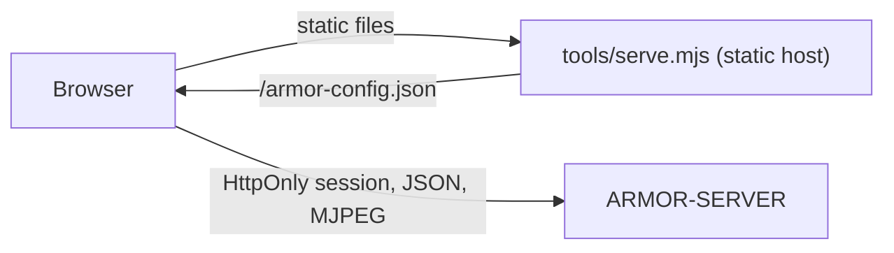

<p align="center">
  
</p>

# 🎛️ ARMOR-STUDIO

<p align="center">
  <a href="README.md">🇺🇸 English</a> |
  🇪🇸 <b>Español</b> |
  <a href="README_fra.md">🇫🇷 Français</a> |
  <a href="README_ita.md">🇮🇹 Italiano</a> |
  <a href="README_deu.md">🇩🇪 Deutsch</a> |
  <a href="README_zho.md">🇨🇳 简体中文</a> |
  <a href="README_jpn.md">🇯🇵 日本語</a> |
  <a href="README_por.md">🇵🇹 Português</a>
</p>

### Consola de operación y diseño: cámaras, radar, alarmas, energía, la red local, evidencias, el plano del sitio y el mantenimiento de la instalación

<p align="center">
  
  
  
  
  
  
  
</p>

---

**Comprobación de honestidad - qué funciona hoy:** Studio habla con [ARMOR-SERVER](https://github.com/JuanenRac/ARMOR-SERVER) y está cubierto por 945 tests unitarios (lectura de ajustes, fusión de cámaras, la aritmética de las gráficas solares, la geometría y las comprobaciones de los diseñadores, el anunciador de alarmas, el diccionario del asistente, cada menú dibujado en los ocho idiomas, el servidor estático) y por pruebas en navegador. Funciona en uso diario contra el banco de pruebas de la CM5 con el servidor real, cámaras IP reales y un nodo radar en su placa; las imágenes de la Ayuda se hacen con datos de ejemplo. Lo que **no** se ha probado es el vídeo en directo y el PTZ con todas las cámaras posibles, los menús solar, eléctrico, de centrales de alarma y de panel táctil con equipos reales (solo existe el nodo radar) y una revisión formal de accesibilidad o usabilidad. Mientras no se alcanza el servidor, Studio muestra datos de demostración y lo dice en la barra superior.

---

## 📋 De un vistazo

| | |
|---|---|
| Versión | `0.8.0.8` |
| Madurez | Establecido |
| Tests | 945 (`npm test`) |
| Tecnología | React 19 / TypeScript / Vite |
| En hardware real | Usado a diario contra el banco de pruebas de la CM5 (servidor real, cámaras IP reales, un nodo radar real); los menús solar, eléctrico, de centrales de alarma y de panel táctil esperan nodos reales |

## 🎯 Descripción general

**ARMOR-STUDIO** es la consola del operador. Nunca guarda una contraseña de cámara, una dirección RTSP ni un token: inicia sesión en el servidor con usuario y contraseña, recibe una sesión **HttpOnly** de 8 horas y todo lo privilegiado viaja por esa sesión.

* **Resumen y sistema:** el estado del perímetro, una tarjeta por cada parte (centrales de alarma, radar, cámaras, dispositivos, energía, red, servidor), un mapa vivo del diseño con cada dispositivo y alarma, y lo que necesita atención, todo en una pantalla sin desplazamiento; una página de sistema y un registro de auditoría para el administrador.
* **Monitor de cámaras:** 1, 2, 4, 6, 8, 9, 12 o 16 teselas que se ajustan a su marco (16:9, toda la matriz visible, sin recortes), una vista ampliada con mando PTZ acotado, captura y grabación MP4; una **biblioteca de grabaciones** para filtrar, previsualizar, reproducir, proteger y borrar evidencias y descargar una **prueba de custodia**.
* **Alarmas:** lo que necesita a una persona ahora, con reconocer y el registro cerrado; una **comprobación antes de armar** y un PIN para desarmar; alarmas dibujadas en el mapa vivo; un sonido para cada gravedad, una voz hablada con sus propios estilos (neutro, héroe de acción, señor oscuro, teatral) que también dice cuándo algo se conecta, avisos emergentes, un botón de silencio junto a la Ayuda y un salto opcional al menú adecuado.
* **Dispositivos y automatizaciones:** humo, gas, inundación, puerta, ventana, movimiento, clima, enchufe, luz, sirena, cerradura, persiana, cancela, puerta de garaje y calentador de agua por Wi-Fi, Zigbee, Bluetooth o cable (preajustes para Zigbee2MQTT, Tasmota y Shelly); reglas desde cualquier fuente de alarma, con umbrales, que accionan dispositivos cuando algo ocurre; un botón grande de armar / desarmar.
* **Centrales de alarma y el Diseñador de alarma:** el estado de cada nodo ARMOR-NODE-ALARM, sus zonas y eventos, los sensores Zigbee atados a las zonas, y un diseñador donde dibujas la alarma de la casa (centrales, contactos, movimiento, detectores de humo, gas e inundación, sirenas, teclados, cableado y enlaces de radio) y atas cada elemento dibujado a una zona real.
* **Energía solar y eléctrica:** el menú *Inversores* dibuja la casa como un flujo de energía animado con relojes, lecturas y gráficas de historial; *Baterías* muestra cada pila con sus capacidades, cada módulo y cada celda; *Eléctrico* muestra la entrada de red, cada canal y las alarmas de los medidores; en ambos declaras tu equipo (Voltronic, MPP Solar, Pylontech, ANT-BMS…) y un botón *Mostrar lecturas de ejemplo* te deja probar el menú antes.
* **Diseñador eléctrico:** dibuja el esquema eléctrico de la casa (red, contador, protecciones, conmutadores, distribución, FV, inversores, baterías y cargas, CA y CC), átalo a los dispositivos solares que lee el servidor para ver valores en vivo, y deja que las comprobaciones lo revisen (dos fuentes en una línea, magnetotérmicos y cables frente a la corriente…).
* **Radar:** un mapa vivo dibujado desde tu diseño del sitio con los objetivos que informa cada radar, su recorrido reciente y las **zonas de la imagen que se ignoran**; estado vivo de los nodos, con los silenciosos como *obsoletos*; el panel propio de cada nodo a un clic.
* **Diseñador del sitio:** dibuja el terreno, edificios de varias plantas con cinco tipos de tejado, puertas, ventanas, farolas, chimeneas, paneles solares, mástiles, caminos y senderos, y después cámaras y radares donde quieras; un plano 2D estilo CAD y una vista 3D orbitable y por plantas; deshacer y rehacer; versiones del diseño.
* **Red local:** el menú *Red* muestra lo que informa el nodo ARMOR-NETWORK (dispositivos, cortes, el estado de internet y la **dirección pública** con el proveedor y el lugar), te deja poner nombre, ocultar y vigilar dispositivos, ordenar un barrido, un ping o una inspección con un acceso que das, y el *Diseñador de red* la dibuja.
* **Captura automática:** en *Configuración > Captura automática*, fotos y vídeo hechos solos cuando una cámara ve algo con el sistema armado (cuántas fotos, cada cuánto, cuánto dura un clip), y las zonas de la imagen que se ignoran dibujadas sobre el cuadro de la cámara.
* **Firmware de nodos y actualizaciones:** *Firmware de nodos* actualiza los nodos de campo de uno en uno, con una barra para todo el trabajo y para cada nodo, y conserva su estado si una alarma te lleva a otro menú; *Actualizaciones* instala las versiones nuevas de Studio y del servidor desde GitHub (mostrando las novedades de la versión nueva), las del sistema operativo y una consola de mantenimiento opcional.
* **Configuración en grupos:** General y Preferencias; Usuarios, Notificaciones y Captura automática; Firmware de nodos y Actualizaciones; Servidor, Servicios, Broker MQTT, Ficheros de configuración, Instalación y Consola; y cada menú de la barra lateral también va en grupos plegables (Monitor, Seguridad, Energía, Casa y red, Diseño, Administración).
* **Ocho idiomas** (inglés, español, alemán, francés, italiano, japonés, chino y portugués) y once temas, el predeterminado llamado *Armor*; el idioma, el tema y el lugar del tiempo siguen a la cuenta, no al navegador. Roles: administrador, operador y **viewer**, que solo mira.
* **Una Ayuda que conoce todo el sistema:** un libro con cuatro niveles de detalle y una imagen con datos de ejemplo de cada menú principal, un recorrido guiado paso a paso para cada menú que va control por control (qué hace cada botón, qué esperar y los errores habituales) con su propia mascota y voz, una Ayuda que explica los nodos de campo a fondo (Wi-Fi de configuración, punto de acceso y estación, PIN de Bluetooth, ranuras de firmware con vuelta atrás, actualizaciones firmadas, el panel desde fuera), ayudas emergentes en todo, y un **asistente** (una mascota que puedes arrastrar a cualquier sitio, anclar donde quieras y a la que preguntar por escrito) con un diccionario en ocho idiomas y un globo que se abre en el lado que tiene sitio. Los menús donde trabajas siguen abiertos mientras visitas otro.
* **Acceso desde fuera con opciones, no archivos:** en Seguridad un administrador configura la VPN WireGuard, añade un móvil escaneando un código QR, mantiene un nombre que sigue a la casa (DuckDNS, Cloudflare o cualquier dirección a la que llamar) y registra los nodos cuyo propio panel se puede abrir desde fuera a través del servidor, comparando la huella del certificado antes de confiar en él; cada paso se explica solo en los ocho idiomas y pide la contraseña de nuevo cuando se hace desde fuera.**Llegar a casa desde fuera, paso a paso:** en Configuración > Seguridad una guía de seis pasos muestra si la máquina puede, si la VPN existe, si la casa tiene nombre, si el puerto está abierto en el router y si el móvil está añadido, y cómo probarlo con datos móviles; la pestaña Seguridad está ordenada en tres secciones con título.
* **Tarjeta de cifrado del broker:** Configuración > Broker muestra si el enlace del servidor con el broker está cifrado y la huella de la autoridad propia de la instalación en la que confía; no se muestra nada alarmante cuando el enlace es sin cifrar, porque es lo habitual.
* **Salud de los nodos y modos de armado:** Sistema tiene una tarjeta con el informe de salud de cada nodo (tiempo encendido, motivo del reinicio, memoria, enlace y señal, conexiones al broker, último error, historial y reinicios) y Centrales de alarma tiene un selector de modo (Fuera, En casa, Noche y los tuyos) con un editor de modos, todo en ocho idiomas con ayuda, pasos de guía y respuestas del asistente.
* **Inicio de sesión para gestores de contraseñas y un Historial con pestañas:** el inicio de sesión es un formulario de verdad que el gestor de contraseñas del navegador o del sistema puede guardar y rellenar, con un "Recordarme" opcional que guarda solo el nombre de usuario (nunca la contraseña) y una nota que lo dice; el Historial tiene las pestañas Todo, Alarmas, Conexiones, Dispositivos, Sistema y Ajustes, con la lista de cada dispositivo y app que se conecta al servidor (última vez, sesiones abiertas, inicios de sesión y rechazos) y los eventos de los nodos, el broker, los servicios, las actualizaciones y el armado. Las direcciones solo las ven los administradores.
* **Mantenimiento de baterías (Configuración, administradores):** un asistente de cuatro pasos - batería y operación, valores, confirmación escribiendo el número de serie de la batería, resultado - para cambiar lo que guarda una batería Pylontech; límites en voltios y grados un grupo entero cada vez, un archivo de firmware leído antes de enviarlo, la batería leída antes y después con la diferencia y la transcripción, y una salida que se puede dejar como estaba.
* **Control de los nodos desde la tarjeta de salud:** cada nodo tiene un menú (Reiniciar, Pausar o Reanudar, Poner en espera - trabajo apagado, sigue conectado - o Encender, Identificar, Diagnóstico, Mantenimiento activado o desactivado) y la tarjeta tiene las acciones de grupo Reiniciar todos (a la vez, o uno tras otro con la central de alarma la última), Pausar todos, Poner todos en espera y Reanudar todos. Se vuelve a escribir el nombre del nodo (o la palabra RESTART, PAUSE o STANDBY para todos) y se pide una prueba de identidad nueva; unas etiquetas siguen a cada nodo (enviada, recibida, sin conexión, de vuelta, aplicada) y muestran En pausa, En espera desde cuándo y por quién, y Mantenimiento; y los avisos dicen cuándo una central de alarma o un radar en pausa o en espera dejan la casa sin proteger. No existe restablecimiento de fábrica, borrado ni sueño profundo.
* **Estado en vivo:** Studio escucha el canal en vivo del servidor (un WebSocket) y muestra al instante una alarma, un armado o un nodo que vuelve, y pregunta el estado solo cada veinte segundos como red de seguridad mientras el canal está abierto; la barra inferior dice *En vivo*. Los diseñadores de alarma, eléctrico y de red responden a F (encajar), más y menos (zoom) y Ctrl+D (duplicar) además de sus otras teclas.

## 🖼️ Capturas de pantalla

Capturadas a 1920×1080 en un banco de pruebas, con datos de ejemplo y sin ninguna instalación real detrás.

<table>
<tr><td width="50%" valign="top"><br><sub>Resumen: el estado del perímetro, las alarmas, los nodos radar, la energía y el mapa en vivo del sitio en una sola pantalla.</sub></td><td width="50%" valign="top"><br><sub>Radar: los blancos que ve cada radar, colocados sobre el plano del sitio, con la zona que cubre cada sensor.</sub></td></tr>
<tr><td width="50%" valign="top"><br><sub>Inversores: el flujo de energía entre los paneles solares, la red, la casa y las baterías, solo lectura.</sub></td><td width="50%" valign="top"><br><sub>Diseñador del sitio: terreno, edificios, cámaras y radares dibujados en el plano que usa el resto de Studio.</sub></td></tr>
<tr><td width="50%" valign="top"><br><sub>Diseñador eléctrico: el esquema de corriente alterna y continua de la casa, con sus comprobaciones, desde un ejemplo listo.</sub></td><td width="50%" valign="top"><br><sub>Paneles de alarma: si cada panel está vigilando, sus zonas y lo último que ocurrió.</sub></td></tr>
</table>

## 🧩 Papel en A.R.M.O.R.

Studio es la ventana del operador a todo el sistema. Nunca habla con un nodo: todo pasa por [ARMOR-SERVER](https://github.com/JuanenRac/ARMOR-SERVER), que es lo único que decide (la única excepción es un enlace al panel propio de cada nodo). También es donde se diseñan el sitio, la alarma, la instalación eléctrica y la red, desde donde se gobiernan el firmware de los nodos y las actualizaciones de la propia instalación, y donde viven la Ayuda y el asistente. El mismo servidor lo usa [ARMOR-ANDROID-CONTROL](https://github.com/JuanenRac/ARMOR-ANDROID-CONTROL) en el móvil.

## 🔄 Arquitectura



## 🔒 Modelo de seguridad

* **Ningún secreto en el navegador.** Las contraseñas de las cámaras se teclean una vez, se envían al servidor y después solo se ven como un estado "guardada" enmascarado. Las exportaciones del sitio omiten usuarios e indicadores de credenciales.
* **Los ajustes guardados son entrada no fiable.** Se leen valor a valor: un origen, tema, idioma o forma no válidos se descartan, las posiciones se acotan y las listas se limitan.
* **Ninguna petición a terceros.** Las fuentes son locales; el servidor estático envía `Content-Security-Policy: default-src 'self'` limitada al servidor configurado, `frame-ancestors 'none'`, `nosniff` y `no-referrer`.
* El vídeo en vivo solo se muestra mediante una dirección de emisión que el servidor entrega a un operador.

## 📂 Estructura del repositorio

```text
ARMOR-STUDIO/
├── src/
│   ├── App.tsx, domain.ts, settings.ts, prefs.ts, cameras.ts, hooks.ts, api.ts (+ api/ by area), config.ts, i18n.ts, viewSlots.tsx
│   ├── components/   camera, chrome (top bar, sidebar, Help), SiteMap
│   ├── views/        overview, monitoring, RadarView, AlarmsView, AlarmPanelsView, DevicesView, AutomationsView, InvertersView, BatteriesView, ElectricalView, NetworkView, WeatherView, SystemView, ServicesView
│   ├── designer/     the Site Designer: geometry, ops (+ ops/), model, Plan2D, Viewport3D, Toolbox, Inspector
│   ├── electrical/   the Electrical Designer: model, ops, analysis (the checks), presets, symbols, sync
│   ├── alarm/        the Alarm Designer and the alarm panels' Zigbee links
│   ├── network/      the Network Designer and the network model
│   ├── alerts/       sounds, voice and its styles, pop-ups, the announcer of alarms and of connections
│   ├── assistant/    the mascot, its dictionary in eight languages and where its bubble opens
│   ├── tour/         a guided tour for every menu
│   ├── weather/      the Weather menu: radar map, clouds, forecast
│   └── ...           ConfigurationPanel (tabs: General, Preferences, Users, Notifications, Automatic capture, Node firmware, Updates, Server, Services, Broker, Files, Installation, Console), MediaLibrary, HistoryView, StudioLogin, one *Text.ts per area (eight languages)
├── public/help/      the pictures of the Help, one set per language
├── e2e/              browser tests (Playwright)
├── tools/            serve.mjs (+ tests)
├── docs/             security model
└── images/           brand assets
```

## 🛠️ Entorno de desarrollo

**Requisitos:** Node.js 22+, un ARMOR-SERVER en marcha (si no, Studio muestra datos de demostración)

```powershell
npm install
npm run dev         # http://127.0.0.1:5178 against a server on 127.0.0.1:8080
npm run typecheck
npm test            # 945 tests: designers, settings, cameras, radar map, solar arithmetic, alerts and the assistant, every menu in eight languages, static host
npm run build       # dist/
$env:ARMOR_SERVER_ORIGIN="http://192.168.0.180:18080"; node tools/serve.mjs   # serve the build
```

`tools/serve.mjs` lee `ARMOR_STUDIO_HOST` (por defecto `127.0.0.1`), `ARMOR_STUDIO_PORT` (`5178`), `ARMOR_STUDIO_DIST` y `ARMOR_SERVER_ORIGIN`. Para instalar toda la pila en el banco de pruebas de la CM5 véase [ARMOR-DEVOPS](https://github.com/JuanenRac/ARMOR-DEVOPS).

## 🔗 Proyectos relacionados

**A.R.M.O.R.** (Autonomous Radar & Multimodal Observation Range) es un sistema de seguridad perimetral hecho de repositorios independientes. Cada uno tiene su propia versión, sus propias pruebas y su propio README; esta es la familia:

* **[ARMOR-COMMON](https://github.com/JuanenRac/ARMOR-COMMON)** - Contratos de mensajes, validadores, vectores de conformidad y tipos generados
* **[ARMOR-NODE-RADAR](https://github.com/JuanenRac/ARMOR-NODE-RADAR)** - Firmware del nodo de campo para ESP32-S3 con tres radares y su propio panel web
* **[ARMOR-NODE-SOLAR](https://github.com/JuanenRac/ARMOR-NODE-SOLAR)** - Protocolos de inversores y baterías solares y los mensajes de un nodo pasarela
* **[ARMOR-NODE-ELECTRICAL](https://github.com/JuanenRac/ARMOR-NODE-ELECTRICAL)** - Nodo eléctrico: contadores, el mensaje de las lecturas de la red y las reglas para maniobrar
* **[ARMOR-NODE-ALARM](https://github.com/JuanenRac/ARMOR-NODE-ALARM)** - Nodo y central de alarma: zonas, armado, retardos, sirena y PIN, con el servidor o sin él
* **[ARMOR-NODE-HMI](https://github.com/JuanenRac/ARMOR-NODE-HMI)** - Panel táctil: el estado del sistema en una pantalla de pared, armar y reconocer alarmas, y el hogar del asistente de voz
* **[ARMOR-NETWORK](https://github.com/JuanenRac/ARMOR-NETWORK)** - La red local: sus dispositivos, internet y lo que cambia
* **[ARMOR-SERVER](https://github.com/JuanenRac/ARMOR-SERVER)** - Coordinador central: telemetría, alarmas, dispositivos, lecturas solares y cámaras
* **ARMOR-STUDIO** (este repositorio) - Consola web: cámaras, radar, alarmas, energía solar y el diseñador de sitio 2D/3D
* **[ARMOR-ANDROID-CONTROL](https://github.com/JuanenRac/ARMOR-ANDROID-CONTROL)** - Cliente Android del operador con radar 2D/3D en vivo
* **[ARMOR-IOS-CONTROL](https://github.com/JuanenRac/ARMOR-IOS-CONTROL)** - Cliente de operador para iPhone
* **[ARMOR-SERVER-AI](https://github.com/JuanenRac/ARMOR-SERVER-AI)** - Política de inferencia visual que explica sus decisiones y nunca actúa
* **[ARMOR-VISION](https://github.com/JuanenRac/ARMOR-VISION)** - Zonas de cámara, máscaras y reglas de detección para la Jetson Orin NX
* **[ARMOR-VOICE-AI](https://github.com/JuanenRac/ARMOR-VOICE-AI)** - Intenciones de voz sin conexión con una confirmación imposible de falsificar
* **[ARMOR-HARDWARE](https://github.com/JuanenRac/ARMOR-HARDWARE)** - Cajas, electrónica y la matriz de aceptación en banco
* **[ARMOR-DEVOPS](https://github.com/JuanenRac/ARMOR-DEVOPS)** - Despliegue, el banco de pruebas de la CM5, copias de seguridad y TLS
* **[ARMOR-SIMULATOR](https://github.com/JuanenRac/ARMOR-SIMULATOR)** - Simulador de telemetría sin conexión con fallos repetibles
* **[ARMOR-UPDATER](https://github.com/JuanenRac/ARMOR-UPDATER)** - Detecta, instala y actualiza los propios repositorios del ecosistema
* **[ARMOR-DOCS](https://github.com/JuanenRac/ARMOR-DOCS)** - Arquitectura, base de seguridad y la matriz de capacidades

## 📚 Documentación y comunidad

Dónde leer más:

* [Matriz de capacidades: qué está probado y qué no](https://github.com/JuanenRac/ARMOR-DOCS/blob/main/docs/CAPABILITY_MATRIX.md)
* [Catálogo de proyectos: versiones y cómo dependen unos de otros](https://github.com/JuanenRac/ARMOR-DOCS/blob/main/docs/PROJECT_CATALOG.md)
* [Historial de cambios de este repositorio](CHANGELOG.md)
* [Licencia (GPL-3.0-or-later)](LICENSE)
* Preguntas, ideas e informes: electrohobby3d@gmail.com

## 👤 AUTOR

**JuanenRac (Electro Hobby 3D)** · electrohobby3d@gmail.com

## 📜 LICENCIA

GPL-3.0-or-later - véase [LICENSE](LICENSE).
