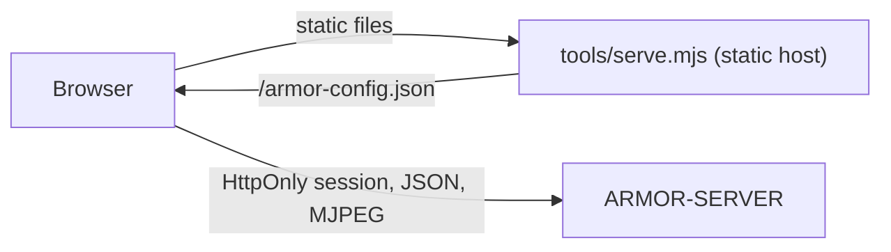

<p align="center">
  
</p>

# 🎛️ ARMOR-STUDIO

<p align="center">
  <a href="README.md">🇺🇸 English</a> |
  <a href="README_spa.md">🇪🇸 Español</a> |
  <a href="README_fra.md">🇫🇷 Français</a> |
  <a href="README_ita.md">🇮🇹 Italiano</a> |
  <a href="README_deu.md">🇩🇪 Deutsch</a> |
  🇨🇳 <b>简体中文</b> |
  <a href="README_jpn.md">🇯🇵 日本語</a> |
  <a href="README_por.md">🇵🇹 Português</a>
</p>

### 运营与设计控制台：摄像头、雷达、报警、能源、本地网络、证据、场地平面图和系统维护

<p align="center">
  
  
  
  
  
  
  
</p>

---

**诚实性检查 - 今天真正能运行的部分：** Studio 与 [ARMOR-SERVER](https://github.com/JuanenRac/ARMOR-SERVER) 通信，由 1004 个单元测试覆盖（设置解析、摄像头合并、太阳能图表的算术、设计器的几何与检查、报警播报器、助手的词典、八种语言的每个菜单、静态主机），并有浏览器测试。它在 CM5 测试台上日常运行，配有真实的服务器、真实的 IP 摄像头和板上的雷达节点；帮助中的图片使用示例数据制作。**尚未**证明的是：所有可能摄像头的实时视频和 PTZ、使用真实设备的太阳能、电气、报警主机和触摸屏菜单（目前只有雷达节点），以及正式的无障碍或可用性评审。当无法连接服务器时，Studio 会显示演示数据，并在顶部栏说明。

---

## 📋 速览

| | |
|---|---|
| 版本 | `0.8.1.0` |
| 成熟度 | 成熟 |
| 角色 | 家族的运维与设计控制台 |
| 技术栈 | React 19, TypeScript, Vite, Three.js, Leaflet |
| 测试 | 1004 项（`npm test`，Vitest）和浏览器测试（Playwright） |
| 契约 | 只与 ARMOR-SERVER 通信（带 HttpOnly 会话的 HTTP `/api/v1/*`、WebSocket `/api/v1/events`） |
| 监听地址 | `127.0.0.1:5178`（`tools/serve.mjs`） |
| 运行位置 | 浏览器；文件由 `tools/serve.mjs` 或容器中的 nginx 提供 |
| 真实硬件 | 每天在 CM5 测试台上使用（真实服务器、真实 IP 摄像头、真实雷达节点）；太阳能、电气、报警主机和触摸屏菜单在等待真实节点 |
| 许可证 | GPL-3.0-or-later |

**跳转到：** [概述](#-概述) · [架构](#-架构) · [安全](#-安全与防护) · [接口](#-接口) · [配置](#-配置) · [快速开始](#-快速开始) · [测试](#-测试) · [故障排除](#-故障排除) · [结构](#-仓库结构) · [相关项目](#-相关项目)

## 🚦 项目状态

每一行是本仓库的一个部分，灯号表示它今天做到了哪一步。内容依据仓库能够展示的证据（测试、构建、运行），而不是计划。

🟢 已完成并验证 · 🟡 可用，有已知限制 · 🟠 部分完成或尚未验证 · 🔴 未完成或不可用

| 领域 | 状态 | 在这里的含义 |
|---|---|---|
| 软件 | 🟢 | 控制台每天都对 CM5 测试台的真实服务器运行。 |
| 测试 | 🟢 | 1004 项单元测试通过（`npm test`）并运行浏览器测试：设置、摄像头合并、光伏图表、设计器的几何与检查、报警播报、助手词典以及八种语言的每个菜单。 |
| 界面 | 🟡 | 实时视频和云台并未对所有可能的摄像头验证过，也没有做过正式的无障碍或可用性评审，帮助中的图片使用的是示例数据。 |
| 硬件 | 🟡 | 每天与真实服务器、真实 IP 摄像头和真实雷达节点一起使用；光伏、电气、报警面板和触摸面板菜单在等待真实节点。 |
| 安全 | 🟡 | 会话、角色以及拒绝在地址中携带摄像头登录信息均有测试覆盖；没有经过独立审查。 |
| 集成 | 🟡 | 在服务器无法连接时，Studio 会显示演示数据，并在顶部栏中说明。 |
| 文档 | 🟢 | 八种语言、应用内帮助和引导导览、安全说明以及更新日志均为最新。 |

## 🎯 概述

**ARMOR-STUDIO** 是操作员的控制台。它从不持有摄像头密码、RTSP 地址或令牌：它用用户名和密码登录服务器，获得 7 天的 **HttpOnly** 会话，一切特权操作都经由该会话。

* **概览与系统：**周界状态、每个部分一块卡片（报警主机、雷达、摄像头、设备、能源、网络、服务器）、带有每个设备和报警的设计实时地图，以及需要关注的事项，全部在一个无需滚动的屏幕上；管理员还有系统页面和审计记录。
* **摄像头监视器：**1、2、4、6、8、9、12 或 16 个适应画框的画面（16:9，整个矩阵可见，不裁剪）、带有限定范围云台面板的放大视图、快照和 MP4 录像；**录像库**可筛选、预览、播放、保护和删除证据，并下载**保管证明**。
* **报警：**现在需要有人处理的事项，可确认并有已关闭记录；**布防前检查**和撤防 PIN；报警绘制在实时地图上；每种严重级别都有声音，朗读语音有自己的风格（中性、动作英雄、黑暗君主、戏剧化），并会说出有设备连接；弹窗、帮助旁的静音按钮，以及可选的跳转到相应菜单。
* **设备与自动化：**烟雾、燃气、漏水、门、窗、移动、气候、插座、灯、警笛、门锁、卷帘、大门、车库门和热水器设备，通过 Wi-Fi、Zigbee、蓝牙或有线（带 Zigbee2MQTT、Tasmota 和 Shelly 的预设）；来自任何报警源的规则（含阈值）可在发生事件时切换设备；一个大的布防 / 撤防按钮。
* **报警主机与报警设计器：**每个 ARMOR-NODE-ALARM 节点的状态、其防区和事件、绑定到防区的 Zigbee 传感器，以及可绘制住宅报警系统（主机、触点、移动、烟雾、燃气和漏水探测器、警笛、键盘、布线和无线链路）并把每个绘制的元素绑定到真实防区的设计器。
* **太阳能与电气能源：***逆变器*菜单把住宅画成动画能量流，带仪表、读数和历史图表；*电池*显示每个电池组的容量、每个模块和每个电芯；*电气*显示电网输入、每个通道和电表报警；两者都可以声明你的设备（Voltronic、MPP Solar、Pylontech、ANT-BMS……），并可先用*显示示例读数*按钮试用菜单。
* **电气设计器：**绘制住宅的电气图（电网、电表、保护、转换开关、配电、光伏、逆变器、电池和负载，交流和直流），把它与服务器读取的太阳能设备关联以查看实时值，并让检查来审阅它（一条线上有两个电源、断路器和电缆与电流的匹配……）。
* **雷达：**根据你的场地设计绘制的实时地图，显示每个雷达报告的目标、其近期轨迹以及**要忽略的画面区域**；节点实时状态，沉默的节点显示为*过期*；每个节点自己的面板只需点击一次。
* **场地设计器：**绘制地形、多层建筑（五种屋顶）、门、窗、灯、烟囱、太阳能板、桅杆、道路和小径，然后在任意位置放置摄像头和雷达；CAD 风格的 2D 平面图以及可环绕、逐层查看的 3D 视图；撤销和重做；设计版本。
* **本地网络：***网络*菜单显示 ARMOR-NETWORK 节点报告的内容（设备、中断、互联网状态以及带有运营商和地点的**公网地址**），可以命名、隐藏和监视设备，下达扫描、ping 或用你提供的登录信息进行检查的指令，*网络设计器*则把它画出来。
* **自动抓拍：**在*配置 > 自动抓拍*中，系统布防且摄像头看到东西时自动拍照和录像（拍几张、多久一次、片段多长），并在摄像头画面上绘制要忽略的区域。
* **节点固件与更新：***节点固件*逐个更新现场节点，整个任务和每个节点都有进度条，即使报警把你带到另一个菜单也会保留其状态；*更新*从 GitHub 安装 Studio 和服务器的新版本（显示新版本的更新内容）、操作系统更新以及可选的维护控制台。
* **分组的配置：**常规和偏好设置；用户、通知和自动抓拍；节点固件和更新；服务器、服务、MQTT 代理、配置文件、安装和控制台；侧边栏的每个菜单也分为可折叠的组（监控、安防、能源、住宅与网络、设计、管理）。
* **八种语言**（英语、西班牙语、德语、法语、意大利语、日语、中文和葡萄牙语）和十六种主题，默认主题名为 *Armor*；语言、主题和天气地点跟随账户，而不是浏览器。角色：管理员、操作员和只看不改的 **viewer**。
* **了解整个系统的帮助：**一本有四个详细程度的书，每个主要菜单都有一张示例数据图片，每个菜单都有逐项讲解的分步导览（每个按钮的作用、预期结果和常见错误，带专属吉祥物和语音），帮助中对现场节点有深入说明（设置 Wi-Fi、接入点与终端、蓝牙 PIN、带回滚的固件分区、签名更新、从外部访问面板），处处有提示，还有一个**助手**（可拖到任何位置、固定在想要的地方并可文字提问的吉祥物），带八种语言的词典，气泡会在有空位的一侧打开。你正在工作的菜单在你访问其他菜单时保持打开。
* **用选项而非文件设置外部访问：**在“安全”中，管理员可设置 WireGuard VPN、扫描二维码添加手机、保持一个跟随家的域名（DuckDNS、Cloudflare 或任意可调用的地址），并登记可通过服务器从外部打开其自身面板的节点（信任前先比对证书指纹）；每一步都有八种语言的说明，从外部操作时会再次要求密码。
* **从外部连接到家，逐步指引：** 在“配置 > 安全”中，六步向导会显示机器是否支持、VPN 是否存在、家是否有名称、路由器端口是否开放、手机是否已添加，以及如何用移动数据测试；安全页签整理为三个带标题的分区。
* **代理加密卡片:** 配置 > 代理 显示服务器与代理的连接是否加密,以及它所信任的本安装自有证书颁发机构的指纹;连接未加密时不会显示任何警告,因为这是默认状态。
* **节点健康与布防模式：** “系统”有一张卡片显示每个节点的健康报告（运行时间、重启原因、内存、连接与信号、代理连接、最后错误、历史与重启），“报警主机”有模式选择（离家、在家、夜间和自定义）及模式编辑器，全部提供八种语言，并带有帮助、引导步骤和助手回答。
* **适配密码管理器的登录与带标签的历史：** 登录是真正的表单，浏览器或系统的密码管理器可以保存并填充；可选的“记住我”只记住用户名（绝不保存密码），并附有说明。历史有“全部”“报警”“连接”“设备”“系统”“设置”标签，列出所有连接服务器的设备和应用（最后出现、已打开的会话、登录与被拒），以及节点、代理、服务、更新和布防的事件。地址只显示给管理员。
* **电池维护（配置，管理员）：** 四步向导——电池和操作、数值、输入电池序列号确认、结果——用于修改 Pylontech 电池保存的内容；限值以伏特和摄氏度输入并整组发送，固件文件在发送前先被读取，操作前后读取电池并显示差异和记录，输出可以恢复原状。
* **在节点健康卡片上控制节点：** 每个节点都有一个菜单（重启、暂停或恢复、待机——停止工作，保持连接——或开机、识别、诊断、开启或关闭维护），卡片上有群组操作：全部重启（同时进行，或逐个进行并把报警主机放在最后）、全部暂停、全部待机和全部恢复。需要再次输入节点名称（对所有节点则输入单词 RESTART、PAUSE 或 STANDBY），并要求新的身份验证；标签跟踪每个节点（已发送、已确认、离线、已恢复、已应用），并显示已暂停、自何时起由谁设为待机以及维护；警告会说明报警主机或雷达处于暂停或待机时，家中将失去保护。没有恢复出厂设置、擦除或深度睡眠。
* **实时状态：** Studio 监听服务器的实时通道（WebSocket），报警、布防或节点恢复会立即显示；通道打开时，状态仅每二十秒轮询一次作为保底，底栏显示“实时”。报警、电气和网络设计器除原有按键外，还支持 F（适应窗口）、加减号（缩放）和 Ctrl+D（复制）。

## 🧩 在 A.R.M.O.R. 中的角色

Studio 是操作员观察整个系统的窗口。它从不直接与节点通信：一切都经过 [ARMOR-SERVER](https://github.com/JuanenRac/ARMOR-SERVER)，只有它做决定（唯一的例外是指向每个节点自带面板的链接）。场地、报警、电气设施和网络也在这里设计，节点固件和系统自身的更新也从这里操作，帮助和助手也在这里。手机上的 [ARMOR-ANDROID-CONTROL](https://github.com/JuanenRac/ARMOR-ANDROID-CONTROL) 使用同一个服务器。

| 对话对象 | 方式 | 用途 |
|---|---|---|
| ARMOR-SERVER | 带 HttpOnly 会话的 HTTP、WebSocket 和 MJPEG | 一切：状态、指令、设计、摄像头 |
| 各节点自己的面板 | 经服务器代理的链接 | “从不直接与节点通信”的唯一例外 |
| 天气服务 | Open-Meteo, RainViewer, EUMETSAT, ArcGIS | 仅天气菜单，仅在保存了地点时 |
| ARMOR-DEVOPS | 在 CM5 测试台上安装整套软件 | 部署 |

## 🏛️ 架构

<p align="center">
  
</p>

<details>
<summary>图表的文本版本（Mermaid）</summary>



</details>

## 🖼️ 屏幕截图

在测试台上以 1920×1080 截取，使用示例数据，背后没有真实的安装。

<table>
<tr><td width="50%" valign="top"><br><sub>概览：周界状态、警报、雷达节点、能源和现场实时地图，一屏尽览。</sub></td><td width="50%" valign="top"><br><sub>雷达：每个雷达看到的目标，显示在现场平面图上，并标出每个传感器的覆盖范围。</sub></td></tr>
<tr><td width="50%" valign="top"><br><sub>逆变器：太阳能板、电网、住宅和电池之间的能量流向，只读。</sub></td><td width="50%" valign="top"><br><sub>现场设计器：在 Studio 其余部分共用的平面图上绘制地形、建筑、摄像头和雷达。</sub></td></tr>
<tr><td width="50%" valign="top"><br><sub>电气设计器：住宅的交流和直流图纸及其检查，来自现成的示例。</sub></td><td width="50%" valign="top"><br><sub>报警主机：每台是否在布防、其防区以及最近发生的事件。</sub></td></tr>
</table>

## 🔒 安全与防护

* **浏览器中没有机密。** 摄像头密码只输入一次，发送到服务器，之后只显示为被遮蔽的“已保存”状态。场地导出会去掉用户名和凭据标志。
* **保存的设置属于不可信输入。** 它们被逐值解析：无效的源、主题、语言或形状会被丢弃，位置被限制范围，列表被限制大小。

| 威胁 | 防御 |
|---|---|
| 浏览器中的机密 | 从不保存密码、令牌、会话或摄像头凭据；带登录信息的快照地址（`user:pass@` 或 `?pwd=`）会被拒绝；退出登录会清空控制台和固件任务状态 |
| 会话被盗 | 由服务器设置的 HttpOnly、SameSite=Strict Cookie（`armor_studio_sid`，HTTPS 下为 `__Host-armor_studio_sid`）；Studio 每分钟检查一次 |
| 被篡改的浏览器存储 | 从 `localStorage` 读取的内容逐项解析：无效的来源、主题、语言或结构会被丢弃，位置被限制范围，列表有上限；存储模式有版本号 |
| 恶意的服务器地址 | 只接受纯 `http(s)` 来源：没有凭据、路径、查询或片段 |
| 注入、点击劫持与泄露 | `Content-Security-Policy: default-src 'self'; script-src 'self'; object-src 'none'; base-uri 'none'; frame-ancestors 'none'`，`connect-src` 仅限所配置的服务器和天气服务，`nosniff`，`no-referrer`，`Cross-Origin-Opener-Policy: same-origin`，以及关闭摄像头、麦克风和定位的 `Permissions-Policy` |
| nginx 后丢失的安全头 | `security_headers.conf` 被包含在每个 `location` 中（nginx 只有在 location 自身没有时才继承 `add_header`） |
| 对节点的危险指令 | 仅限管理员；需再次输入节点名称（全部节点则输入 RESTART、PAUSE、STANDBY）并再次输入密码；没有擦除、恢复出厂或关机指令 |
| 角色 | 管理员、操作员、查看者（只看）和壁挂面板（其账户不能使用 Studio）；会话的 `capabilities` 决定显示内容，服务器会再次校验 |

**只有天气菜单会访问其他服务。** 字体来自本地，其余部分不向第三方请求任何内容。天气菜单仅在账户保存了地点时才会加载 Open-Meteo（预报、地理编码、空气质量）、RainViewer（雷达）、EUMETSAT（云图）和 ArcGIS（地图瓦片）。静态主机发送限于所配置服务器和这些服务的 `Content-Security-Policy: default-src 'self'`、`frame-ancestors 'none'`、`nosniff` 和 `no-referrer`。

**开关。** *配置 > 安全* 为 ARMOR-SERVER 允许管理员调整的 13 项保护各提供一个控件（撤防 PIN、语音静音、报警设计签名、区域推送、摄像头隧道、网络登录、壁挂面板实时事件、设备锁、节点存储加密和音频限制），默认值都很保守；调低任何一项服务器都会写入审计。详见 [docs/SECURITY_MODEL.md](docs/SECURITY_MODEL.md)。没有独立的安全审查。

## 🔌 接口

| 路由 | 认证 | 作用 |
|---|---|---|
| `/api/v1/*` | 会话 Cookie | 服务器客户端，按领域拆分在 `src/api/` 中；`src/api/routes.test.ts` 和 `src/api/contract/` 对照契约检查 |
| `WS /api/v1/events` | 会话 | 实时状态：报警、布防或节点恢复会立即显示；通道打开时仅每 20 秒查询一次状态作为保险（没有通道时每 3 秒）；底栏显示“实时” |
| MJPEG、快照、录像 | 流票据 | 实时视频只通过服务器发给操作员的地址显示；摄像头密码从不到达浏览器 |
| `GET /armor-config.json` | 无 | `{"serverOrigin": "<来源>" / "same-origin"}`，由 `tools/serve.mjs` 或 nginx 提供 |

## ⚙️ 配置

| 设置 | 默认值 | 作用 |
|---|---|---|
| `ARMOR_STUDIO_HOST` | 127.0.0.1 | 静态主机监听的地址 |
| `ARMOR_STUDIO_PORT` | 5178 | 端口；从 Studio 保存的 `connection.json` 中的 `studio_port` 优先 |
| `ARMOR_STUDIO_DIST` | ./dist | 要提供的构建文件夹 |
| `ARMOR_SERVER_ORIGIN` | 空 | Studio 启动时使用的一个或多个来源（逗号分隔），决定策略的 `connect-src`；为空则接受你登录的服务器 |
| `TLS_CERT_PATH`  `TLS_KEY_PATH` | 关闭 | 要么都设要么都不设：静态主机的原生 HTTPS |
| `ARMOR_PUBLIC_ORIGIN`  `ARMOR_SERVER_UPSTREAM` | same-origin | 容器内：`/armor-config.json` 的内容，以及 nginx 把 `/api/` 转发到的服务器 `host:port` |

未配置来源时，客户端使用 `http://127.0.0.1:8080`。语言、主题（十六种）和天气地点跟随账户而不是浏览器。`tools/serve.mjs` 读取上面的变量；要在 CM5 测试台上安装整套软件，请见 [ARMOR-DEVOPS](https://github.com/JuanenRac/ARMOR-DEVOPS)。

## 🚀 快速开始

**要求：** Node.js 22+ 和一个运行中的 ARMOR-SERVER（否则 Studio 显示演示数据，并在顶栏说明）。

```powershell
npm install                                                                    # 依赖
npm run dev                                                                    # http://127.0.0.1:5178 连接 127.0.0.1:8080 上的服务器
npm run typecheck                                                              # tsc -b --noEmit
npm run locales                                                                # 修改文案后写出每种语言的表
npm test                                                                       # 1004 项
npm run build                                                                  # dist/
$env:ARMOR_SERVER_ORIGIN = "http://192.168.0.180:18080"; node tools/serve.mjs  # 提供构建
```

## 🧪 测试

```powershell
npm run typecheck      # tsc -b --noEmit
npm test               # vitest run
npm run lint           # eslint src
npm run locales:check  # 八张表均已生成
python -I tools/armor_ci_validate.py
```

| 领域 | 覆盖内容 |
|---|---|
| 设置、摄像头与雷达地图 | 已存设置的解析、摄像头合并、雷达目标与忽略区 |
| 能源 | 光伏图表的计算以及电池和电气菜单 |
| 设计器 | 场地、电气、报警和网络设计器的几何、操作与检查 |
| 提醒与助手 | 报警与连接播报、助手词典和导览 |
| 八种语言的每个菜单 | 每个界面都以每种语言渲染，不留下原始键名 |
| API 客户端与静态主机 | `src/api/` 的路由与契约，以及 `tools/serve.test.mjs`（头、`/armor-config.json`、原生 TLS） |
| 浏览器测试 | 针对带真实服务器的整套环境、用 Playwright 运行的 `e2e/tests`（`e2e/README.md`） |

静态主机的原生 TLS 测试需要安装 `openssl`。如果某种语言的表不是由其文案生成的，`npm run locales:check` 会失败。GitHub Actions 在每次推送和拉取请求时运行 A.R.M.O.R. 基线：清单、版本、更新日志和 README 一致性的校验，然后是项目自身的构建和测试。

## 🏗️ 构建与发布

`npm run build` 把静态站点写入 `dist/`；`Dockerfile` 用 Node 22 构建并用 nginx（`nginx/`）提供。版本记录在 `package.json`、`armor.project.json` 和 README 徽章中（读取自清单）；每个版本在 [CHANGELOG.md](CHANGELOG.md) 中都有对应条目。发布版本发布在 GitHub 上。

## 🩺 故障排除

| 你看到 | 原因 | 处理 |
|---|---|---|
| 演示数据和顶栏提示 | 无法连接服务器 | 启动 ARMOR-SERVER 并检查登录所用的来源 |
| 浏览器拦截了所有发往服务器的请求 | 来源不在策略的 `connect-src` 中 | 加入 `ARMOR_SERVER_ORIGIN`（逗号分隔），或让 Studio 与服务器使用同一来源 |
| 指令被 `elevation_required`（403）拒绝 | 关键操作需要最近的身份验证 | Studio 会再次要求密码；输入后重试 |
| 密码管理器没有提示保存 | 登录是真正的表单；有的管理器要等第一次成功登录 | 登录一次；“记住我”只保存用户名，从不保存密码 |

## 📂 仓库结构

<p align="center">
  
</p>

<details>
<summary>目录树的文本版本</summary>

```text
ARMOR-STUDIO/
├── src/
│   ├── App.tsx                       外壳：菜单、分组、实时状态
│   ├── api/                          服务器客户端，每个领域一个文件
│   ├── views/                        概览、摄像头、雷达、报警、能源、网络、系统
│   ├── components/                   摄像头图块、顶栏、侧栏、帮助、地图
│   ├── designer/                     场地设计器，2D 平面图与 3D 视图
│   ├── electrical/ alarm/ network/   电气、报警和网络设计器
│   ├── alerts/ assistant/ tour/      声音、吉祥物、导览
│   ├── weather/ help/ preflight/     天气菜单、帮助手册、布防前检查
│   └── locales/                      每种语言的表（自动生成）
├── public/                           帮助图片（每种语言一套）
├── nginx/                            镜像的 Web 服务器及其头
├── e2e/                              浏览器测试（Playwright）
├── tools/                            serve.mjs（静态主机）、build_locales.mjs、共用的 CI 检查和启动器
├── docs/                             安全模型
├── images/                           横幅图、图标和 README 的图片
├── .github/                          CI 工作流、仪表板通知、议题和 pull request 模板
├── Dockerfile                        容器镜像：Node 构建、nginx 主机
├── armor.project.json                清单：版本、角色、成熟度
├── CHANGELOG.md                      每个版本的变化
├── package.json package-lock.json    依赖与脚本
├── index.html                        Vite 据以构建应用的页面
├── vite.config.ts eslint.config.js   打包器与 lint 设置
├── tsconfig.json tsconfig.app.json   TypeScript 设置
├── run.sh run.bat                    启动（共用流程）
├── build.sh build.bat                构建并测试（共用流程）
├── build-test.sh build-test.bat      构建、测试并打包
├── test.sh test.bat                  只运行测试，不改版本
└── SECURITY.md SUPPORT.md CONTRIBUTING.md CODE_OF_CONDUCT.md LICENSE
```

</details>

## 🗺️ 路线图与已知限制

**当前已知限制**

* 实时视频和 PTZ 尚未在所有可能的摄像头上验证。
* 太阳能、电气、报警面板和触摸面板的菜单在等待真实节点：目前只有雷达节点。
* 没有做过正式的无障碍或可用性评审，帮助中的图片使用示例数据。
* 没有独立的安全审查。

**下一步**

* 用其他节点的开发板试用它们的菜单。
* 评审无障碍与可用性。

## 🌍 语言

README 和文本提供英语、西班牙语、法语、意大利语、德语、汉语、日语和欧洲葡萄牙语版本。

## 🔗 相关项目

**A.R.M.O.R.**（Autonomous Radar & Multimodal Observation Range）是一个由相互独立的仓库组成的周界安全系统。每个仓库都有自己的版本、自己的测试和自己的 README；这是整个系列：

* **[ARMOR-COMMON](https://github.com/JuanenRac/ARMOR-COMMON)** - 消息契约、验证器、一致性向量和生成的类型
* **[ARMOR-NODE-RADAR](https://github.com/JuanenRac/ARMOR-NODE-RADAR)** - 面向 ESP32-S3 的现场节点固件，配三个雷达和自带的网页面板
* **[ARMOR-NODE-SOLAR](https://github.com/JuanenRac/ARMOR-NODE-SOLAR)** - 太阳能逆变器和电池的协议，以及网关节点的消息
* **[ARMOR-NODE-ELECTRICAL](https://github.com/JuanenRac/ARMOR-NODE-ELECTRICAL)** - 电气节点：电表、电网读数的消息和切换规则
* **[ARMOR-NODE-ALARM](https://github.com/JuanenRac/ARMOR-NODE-ALARM)** - 报警节点与面板：防区、布防、延时、警笛和 PIN，可配合服务器也可独立使用
* **[ARMOR-NODE-HMI](https://github.com/JuanenRac/ARMOR-NODE-HMI)** - 触摸面板：壁挂屏幕上的系统状态、布防与确认，以及语音助手的所在
* **[ARMOR-NETWORK](https://github.com/JuanenRac/ARMOR-NETWORK)** - 本地网络：其设备、互联网以及变化
* **[ARMOR-SERVER](https://github.com/JuanenRac/ARMOR-SERVER)** - 中央协调器：遥测、报警、设备、太阳能读数和摄像头
* **ARMOR-STUDIO**（本仓库） - 网页控制台：摄像头、雷达、报警、太阳能以及 2D/3D 场地设计器
* **[ARMOR-ANDROID-CONTROL](https://github.com/JuanenRac/ARMOR-ANDROID-CONTROL)** - 带实时 2D/3D 雷达的 Android 操作员客户端
* **[ARMOR-IOS-CONTROL](https://github.com/JuanenRac/ARMOR-IOS-CONTROL)** - iPhone 操作员客户端
* **[ARMOR-SERVER-AI](https://github.com/JuanenRac/ARMOR-SERVER-AI)** - 视觉推理策略，会解释其决策且从不驱动设备
* **[ARMOR-VISION](https://github.com/JuanenRac/ARMOR-VISION)** - 面向 Jetson Orin NX 的摄像头区域、遮罩和检测规则
* **[ARMOR-VOICE-AI](https://github.com/JuanenRac/ARMOR-VOICE-AI)** - 离线语音意图，附带无法伪造的确认
* **[ARMOR-HARDWARE](https://github.com/JuanenRac/ARMOR-HARDWARE)** - 外壳、电子器件和台架验收矩阵
* **[ARMOR-DEVOPS](https://github.com/JuanenRac/ARMOR-DEVOPS)** - 部署、CM5 测试台、备份和 TLS
* **[ARMOR-SIMULATOR](https://github.com/JuanenRac/ARMOR-SIMULATOR)** - 带可重复故障的离线遥测模拟器
* **[ARMOR-UPDATER](https://github.com/JuanenRac/ARMOR-UPDATER)** - 检测、安装和更新生态系统自身的仓库
* **[ARMOR-DOCS](https://github.com/JuanenRac/ARMOR-DOCS)** - 架构、安全基线和能力矩阵

## 📚 文档

* [安全模型](docs/SECURITY_MODEL.md)：浏览器保存什么、响应头以及对节点的指令
* [浏览器测试](e2e/README.md)：如何针对整套环境运行
* [能力矩阵：哪些已被证明，哪些没有](https://github.com/JuanenRac/ARMOR-DOCS/blob/main/docs/CAPABILITY_MATRIX.md)
* [项目目录：版本以及各仓库之间如何相互依赖](https://github.com/JuanenRac/ARMOR-DOCS/blob/main/docs/PROJECT_CATALOG.md)
* [本仓库的更新日志](CHANGELOG.md)

## 🤝 参与贡献与社区

* 提交 pull request 之前，请运行 `python -I tools/armor_ci_validate.py` 和测试：两者都必须通过。请参阅 [CONTRIBUTING.md](CONTRIBUTING.md) 和[行为准则](CODE_OF_CONDUCT.md)。
* README 提供八种语言，由 ARMOR-DOCS 中的源文件生成：文本的修改在那里进行。
* 组件之间消息的变更从 ARMOR-COMMON 开始。
* 不要把仅仅构建过的东西描述为已在板子上运行。
* 请私下报告漏洞：[SECURITY.md](SECURITY.md)。问题、想法和报告：electrohobby3d@gmail.com（[SUPPORT.md](SUPPORT.md)）。

## 👤 作者

**JuanenRac (Electro Hobby 3D)** · electrohobby3d@gmail.com

## 📜 许可证

GPL-3.0-or-later - 见 [LICENSE](LICENSE)。
