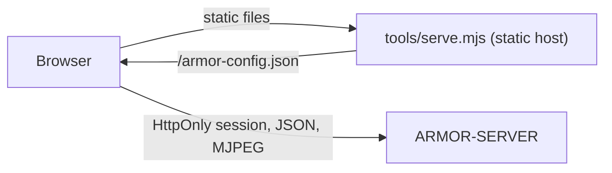

<p align="center">
  
</p>

# 🎛️ ARMOR-STUDIO

<p align="center">
  <a href="README.md">🇺🇸 English</a> |
  <a href="README_spa.md">🇪🇸 Español</a> |
  <a href="README_fra.md">🇫🇷 Français</a> |
  <a href="README_ita.md">🇮🇹 Italiano</a> |
  <a href="README_deu.md">🇩🇪 Deutsch</a> |
  🇨🇳 <b>简体中文</b> |
  <a href="README_jpn.md">🇯🇵 日本語</a> |
  <a href="README_por.md">🇵🇹 Português</a>
</p>

### 运营与设计控制台：摄像头、雷达、报警、能源、本地网络、证据、场地平面图和系统维护

<p align="center">
  
  
  
  
  
  
  
</p>

---

**诚实性检查 - 今天真正能运行的部分:** Studio 与 [ARMOR-SERVER](https://github.com/JuanenRac/ARMOR-SERVER) 通信，由 495 个单元测试覆盖（设置解析、摄像头合并、太阳能图表的算术、设计器的几何与检查、报警播报器、助手的词典、八种语言的每个菜单、静态主机），并有浏览器测试。它在 CM5 测试台上日常运行，配有真实的服务器、真实的 IP 摄像头和板上的雷达节点；帮助中的图片使用示例数据制作。**尚未**证明的是：所有可能摄像头的实时视频和 PTZ、使用真实设备的太阳能、电气、报警主机和触摸屏菜单（目前只有雷达节点），以及正式的无障碍或可用性评审。当无法连接服务器时，Studio 会显示演示数据，并在顶部栏说明。

---

## 📋 速览

| | |
|---|---|
| 版本 | `0.8.0.3` |
| 成熟度 | 成熟 |
| 测试 | 495 (`npm test`) |
| 技术栈 | React 19 / TypeScript / Vite |
| 真实硬件 | 每天在 CM5 测试台上使用（真实服务器、真实 IP 摄像头、真实雷达节点）；太阳能、电气、报警主机和触摸屏菜单在等待真实节点 |

## 🎯 概述

**ARMOR-STUDIO** 是操作员的控制台。它从不持有摄像头密码、RTSP 地址或令牌：它用用户名和密码登录服务器，获得 8 小时的 **HttpOnly** 会话，一切特权操作都经由该会话。

* **概览与系统：**周界状态、每个部分一块卡片（报警主机、雷达、摄像头、设备、能源、网络、服务器）、带有每个设备和报警的设计实时地图，以及需要关注的事项，全部在一个无需滚动的屏幕上；管理员还有系统页面和审计记录。
* **摄像头监视器：**1、2、4、6、8、9、12 或 16 个适应画框的画面（16:9，整个矩阵可见，不裁剪）、带有限定范围云台面板的放大视图、快照和 MP4 录像；**录像库**可筛选、预览、播放、保护和删除证据，并下载**保管证明**。
* **报警：**现在需要有人处理的事项，可确认并有已关闭记录；**布防前检查**和撤防 PIN；报警绘制在实时地图上；每种严重级别都有声音，朗读语音有自己的风格（中性、动作英雄、黑暗君主、戏剧化），并会说出有设备连接；弹窗、帮助旁的静音按钮，以及可选的跳转到相应菜单。
* **设备与自动化：**烟雾、燃气、漏水、门、窗、移动、气候、插座、灯、警笛、门锁、卷帘、大门、车库门和热水器设备，通过 Wi-Fi、Zigbee、蓝牙或有线（带 Zigbee2MQTT、Tasmota 和 Shelly 的预设）；来自任何报警源的规则（含阈值）可在发生事件时切换设备；一个大的布防 / 撤防按钮。
* **报警主机与报警设计器：**每个 ARMOR-ALARM 节点的状态、其防区和事件、绑定到防区的 Zigbee 传感器，以及可绘制住宅报警系统（主机、触点、移动、烟雾、燃气和漏水探测器、警笛、键盘、布线和无线链路）并把每个绘制的元素绑定到真实防区的设计器。
* **太阳能与电气能源：***逆变器*菜单把住宅画成动画能量流，带仪表、读数和历史图表；*电池*显示每个电池组的容量、每个模块和每个电芯；*电气*显示电网输入、每个通道和电表报警；两者都可以声明你的设备（Voltronic、MPP Solar、Pylontech、ANT-BMS……），并可先用*显示示例读数*按钮试用菜单。
* **电气设计器：**绘制住宅的电气图（电网、电表、保护、转换开关、配电、光伏、逆变器、电池和负载，交流和直流），把它与服务器读取的太阳能设备关联以查看实时值，并让检查来审阅它（一条线上有两个电源、断路器和电缆与电流的匹配……）。
* **雷达：**根据你的场地设计绘制的实时地图，显示每个雷达报告的目标、其近期轨迹以及**要忽略的画面区域**；节点实时状态，沉默的节点显示为*过期*；每个节点自己的面板只需点击一次。
* **场地设计器：**绘制地形、多层建筑（五种屋顶）、门、窗、灯、烟囱、太阳能板、桅杆、道路和小径，然后在任意位置放置摄像头和雷达；CAD 风格的 2D 平面图以及可环绕、逐层查看的 3D 视图；撤销和重做；设计版本。
* **本地网络：***网络*菜单显示 ARMOR-NETWORK 节点报告的内容（设备、中断、互联网状态以及带有运营商和地点的**公网地址**），可以命名、隐藏和监视设备，下达扫描、ping 或用你提供的登录信息进行检查的指令，*网络设计器*则把它画出来。
* **自动抓拍：**在*配置 > 自动抓拍*中，系统布防且摄像头看到东西时自动拍照和录像（拍几张、多久一次、片段多长），并在摄像头画面上绘制要忽略的区域。
* **节点固件与更新：***节点固件*逐个更新现场节点，整个任务和每个节点都有进度条，即使报警把你带到另一个菜单也会保留其状态；*更新*从 GitHub 安装 Studio 和服务器的新版本（显示新版本的更新内容）、操作系统更新以及可选的维护控制台。
* **分组的配置：**常规和偏好设置；用户、通知和自动抓拍；节点固件和更新；服务器、服务、MQTT 代理、配置文件、安装和控制台；侧边栏的每个菜单也分为可折叠的组（监控、安防、能源、住宅与网络、设计、管理）。
* **八种语言**（英语、西班牙语、德语、法语、意大利语、日语、中文和葡萄牙语）和十一种主题，默认主题名为 *Armor*；语言、主题和天气地点跟随账户，而不是浏览器。角色：管理员、操作员和只看不改的 **viewer**。
* **了解整个系统的帮助：**一本有四个详细程度的书，每个主要菜单都有一张示例数据图片，每个菜单都有逐项讲解的分步导览（每个按钮的作用、预期结果和常见错误，带专属吉祥物和语音），帮助中对现场节点有深入说明（设置 Wi-Fi、接入点与终端、蓝牙 PIN、带回滚的固件分区、签名更新、从外部访问面板），处处有提示，还有一个**助手**（可拖到任何位置、固定在想要的地方并可文字提问的吉祥物），带八种语言的词典，气泡会在有空位的一侧打开。你正在工作的菜单在你访问其他菜单时保持打开。
* **用选项而非文件设置外部访问：**在“安全”中，管理员可设置 WireGuard VPN、扫描二维码添加手机、保持一个跟随家的域名（DuckDNS、Cloudflare 或任意可调用的地址），并登记可通过服务器从外部打开其自身面板的节点（信任前先比对证书指纹）；每一步都有八种语言的说明，从外部操作时会再次要求密码。**从外部连接到家，逐步指引：** 在“配置 > 安全”中，六步向导会显示机器是否支持、VPN 是否存在、家是否有名称、路由器端口是否开放、手机是否已添加，以及如何用移动数据测试；安全页签整理为三个带标题的分区。

## 🖼️ 屏幕截图

在测试台上以 1920×1080 截取，使用示例数据，背后没有真实的安装。

<table>
<tr><td width="50%" valign="top"><br><sub>概览：周界状态、警报、雷达节点、能源和现场实时地图，一屏尽览。</sub></td><td width="50%" valign="top"><br><sub>雷达：每个雷达看到的目标，显示在现场平面图上，并标出每个传感器的覆盖范围。</sub></td></tr>
<tr><td width="50%" valign="top"><br><sub>逆变器：太阳能板、电网、住宅和电池之间的能量流向，只读。</sub></td><td width="50%" valign="top"><br><sub>现场设计器：在 Studio 其余部分共用的平面图上绘制地形、建筑、摄像头和雷达。</sub></td></tr>
<tr><td width="50%" valign="top"><br><sub>电气设计器：住宅的交流和直流图纸及其检查，来自现成的示例。</sub></td><td width="50%" valign="top"><br><sub>报警主机：每台是否在布防、其防区以及最近发生的事件。</sub></td></tr>
</table>

## 🧩 在 A.R.M.O.R. 中的角色

Studio 是操作员观察整个系统的窗口。它从不直接与节点通信：一切都经过 [ARMOR-SERVER](https://github.com/JuanenRac/ARMOR-SERVER)，只有它做决定（唯一的例外是指向每个节点自带面板的链接）。场地、报警、电气设施和网络也在这里设计，节点固件和系统自身的更新也从这里操作，帮助和助手也在这里。手机上的 [ARMOR-ANDROID-CONTROL](https://github.com/JuanenRac/ARMOR-ANDROID-CONTROL) 使用同一个服务器。

## 🔄 架构



## 🔒 安全模型

* **浏览器中没有机密。** 摄像头密码只输入一次，发送到服务器，之后只显示为被遮蔽的“已保存”状态。场地导出会去掉用户名和凭据标志。
* **保存的设置属于不可信输入。** 它们被逐值解析：无效的源、主题、语言或形状会被丢弃，位置被限制范围，列表被限制大小。
* **没有第三方请求。** 字体来自本地；静态主机发送限于所配置服务器的 `Content-Security-Policy: default-src 'self'`、`frame-ancestors 'none'`、`nosniff` 和 `no-referrer`。
* 实时视频只通过服务器发给操作员的视频流地址显示。

## 📂 仓库结构

```text
ARMOR-STUDIO/
├── src/
│   ├── App.tsx, domain.ts, settings.ts, prefs.ts, cameras.ts, hooks.ts, api.ts, config.ts, i18n.ts, viewSlots.tsx
│   ├── components/   camera, chrome (top bar, sidebar, Help), SiteMap
│   ├── views/        overview, monitoring, RadarView, AlarmsView, AlarmPanelsView, DevicesView, AutomationsView, InvertersView, BatteriesView, ElectricalView, NetworkView, WeatherView, SystemView, ServicesView
│   ├── designer/     the Site Designer: geometry, ops, model, Plan2D, Viewport3D, Toolbox, Inspector
│   ├── electrical/   the Electrical Designer: model, ops, analysis (the checks), presets, symbols, sync
│   ├── alarm/        the Alarm Designer and the alarm panels' Zigbee links
│   ├── network/      the Network Designer and the network model
│   ├── alerts/       sounds, voice and its styles, pop-ups, the announcer of alarms and of connections
│   ├── assistant/    the mascot, its dictionary in eight languages and where its bubble opens
│   ├── tour/         a guided tour for every menu
│   ├── weather/      the Weather menu: radar map, clouds, forecast
│   └── ...           ConfigurationPanel (tabs: General, Preferences, Users, Notifications, Automatic capture, Node firmware, Updates, Server, Services, Broker, Files, Installation, Console), MediaLibrary, HistoryView, StudioLogin, one *Text.ts per area (eight languages)
├── public/help/      the pictures of the Help, one set per language
├── e2e/              browser tests (Playwright)
├── tools/            serve.mjs (+ tests)
├── docs/             security model
└── images/           brand assets
```

## 🛠️ 开发环境

**环境要求:** Node.js 22+, a running ARMOR-SERVER (otherwise Studio shows demonstration data)

```powershell
npm install
npm run dev         # http://127.0.0.1:5178 against a server on 127.0.0.1:8080
npm run typecheck
npm test            # 495 tests: designers, settings, cameras, radar map, solar arithmetic, alerts and the assistant, every menu in eight languages, static host
npm run build       # dist/
$env:ARMOR_SERVER_ORIGIN="http://192.168.0.180:18080"; node tools/serve.mjs   # serve the build
```

`tools/serve.mjs` 读取 `ARMOR_STUDIO_HOST`（默认 `127.0.0.1`）、`ARMOR_STUDIO_PORT`（`5178`）、`ARMOR_STUDIO_DIST` 和 `ARMOR_SERVER_ORIGIN`。要把整套系统安装到 CM5 测试台，参见 [ARMOR-DEVOPS](https://github.com/JuanenRac/ARMOR-DEVOPS)。

## 🔗 相关项目

**A.R.M.O.R.**（Autonomous Radar & Multimodal Observation Range）是由若干独立仓库组成的周界安防系统。每个仓库都有自己的版本、测试和 README；家族成员如下：

* **[ARMOR-COMMON](https://github.com/JuanenRac/ARMOR-COMMON)** - 消息契约、验证器、一致性向量和生成的类型
* **[ARMOR-RADAR](https://github.com/JuanenRac/ARMOR-RADAR)** - 适用于 ESP32-S3 的现场节点固件，带三个雷达和自带网页面板
* **[ARMOR-SOLAR](https://github.com/JuanenRac/ARMOR-SOLAR)** - 太阳能逆变器与电池的协议，以及网关节点的消息
* **[ARMOR-ELECTRICAL](https://github.com/JuanenRac/ARMOR-ELECTRICAL)** - 电气节点：电表、电网读数消息和开关规则
* **[ARMOR-ALARM](https://github.com/JuanenRac/ARMOR-ALARM)** - 报警节点与报警主机：防区、布防、延时、警笛和 PIN，有无服务器均可
* **[ARMOR-HMI](https://github.com/JuanenRac/ARMOR-HMI)** - 触摸面板：墙面屏幕上的系统状态、布防与确认，以及语音助手的所在
* **[ARMOR-NETWORK](https://github.com/JuanenRac/ARMOR-NETWORK)** - 本地网络：其设备、互联网以及变化
* **[ARMOR-SERVER](https://github.com/JuanenRac/ARMOR-SERVER)** - 中央协调器：遥测、报警、设备、太阳能读数和摄像头
* **ARMOR-STUDIO** (本仓库) - 网页控制台：摄像头、雷达、报警、太阳能和 2D/3D 场地设计器
* **[ARMOR-ANDROID-CONTROL](https://github.com/JuanenRac/ARMOR-ANDROID-CONTROL)** - 带实时 2D/3D 雷达的 Android 操作员客户端
* **[ARMOR-SERVER-AI](https://github.com/JuanenRac/ARMOR-SERVER-AI)** - 会解释决策且从不执行动作的视觉推理策略
* **[ARMOR-VISION](https://github.com/JuanenRac/ARMOR-VISION)** - Jetson Orin NX 上的摄像头区域、遮罩与检测规则
* **[ARMOR-VOICE-AI](https://github.com/JuanenRac/ARMOR-VOICE-AI)** - 带无法伪造确认的离线语音意图
* **[ARMOR-HARDWARE](https://github.com/JuanenRac/ARMOR-HARDWARE)** - 外壳、电子器件和台架验收矩阵
* **[ARMOR-DEVOPS](https://github.com/JuanenRac/ARMOR-DEVOPS)** - 部署、CM5 测试台、备份与 TLS
* **[ARMOR-SIMULATOR](https://github.com/JuanenRac/ARMOR-SIMULATOR)** - 带可重复故障的离线遥测模拟器
* **[ARMOR-UPDATER](https://github.com/JuanenRac/ARMOR-UPDATER)** - 发现、安装并更新生态系统自身的仓库
* **[ARMOR-DOCS](https://github.com/JuanenRac/ARMOR-DOCS)** - 架构、安全基线和能力矩阵

## 📚 文档与社区

更多阅读：

* [能力矩阵：哪些已被证实，哪些没有](https://github.com/JuanenRac/ARMOR-DOCS/blob/main/docs/CAPABILITY_MATRIX.md)
* [项目目录：版本以及各仓库之间的依赖](https://github.com/JuanenRac/ARMOR-DOCS/blob/main/docs/PROJECT_CATALOG.md)
* [本仓库的变更记录](CHANGELOG.md)
* [许可证（GPL-3.0-or-later）](LICENSE)
* 问题、想法与反馈：electrohobby3d@gmail.com

## 👤 作者

**JuanenRac (Electro Hobby 3D)** · electrohobby3d@gmail.com

## 📜 许可证

GPL-3.0-or-later - 见 [LICENSE](LICENSE)。
